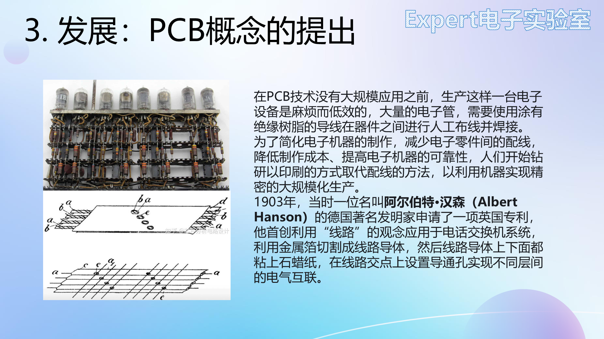
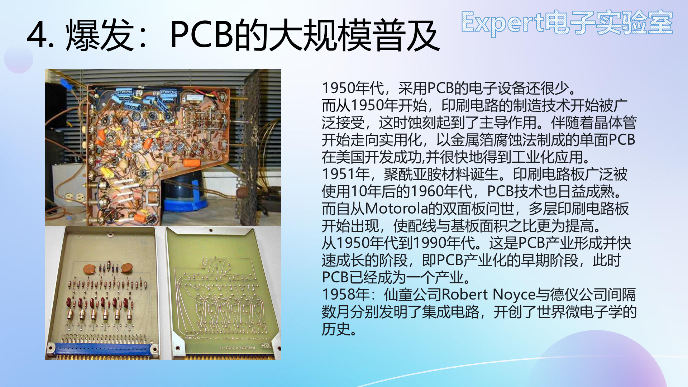
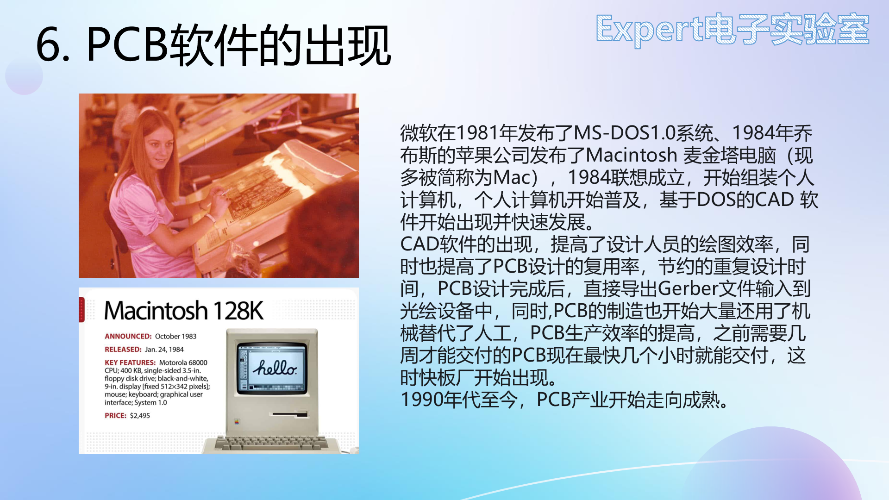
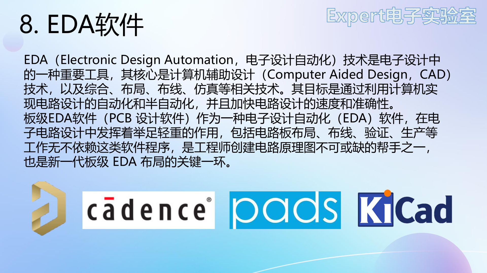

# 01 课程导论与PCB技术发展史

> 前置要求：无。本章对应课程第 1、2 课：为什么学 PCB、为什么选立创EDA专业版，以及印刷电路板这项技术从何而来、向何处去。

## 1. 课程定位与学习方法

本课程（入门篇 → 强化篇 → 大师篇）面向四类需求：**学科竞赛**（电赛、蓝桥杯、嵌入式、智能车都需要自制电路板）、**毕业设计与课程设计**、**电子 DIY 爱好者**，以及**未来想从事硬件工程师岗位**的人——后者最终要掌握 Altium Designer、Cadence Allegro、Mentor PADS 等中大型软件，而立创EDA专业版是进入这些软件前非常好的垫脚石：学完它，你对 PCB 设计已经有系统认识。

三篇的分工：

| 篇 | 内容 | 产出 |
| --- | --- | --- |
| 入门篇（本笔记 01~04 章） | PCB 发展史、电路分析基础、PCB 设计基础知识 | 看懂原理图与 PCB |
| 强化篇（本笔记 05~13 章） | 软件操作 + 两个完整项目（51 核心板、USB 拓展坞） | 两块自己画的板子 |
| 大师篇 | 复杂工程（STM32 电赛开发板）、蓝桥杯赛题、高速电路初步 | 进阶设计能力 |

学习方法两条：**跟着操作**——画板是熟能生巧的手艺，不要纸上谈兵；**盯住键位**——实战章节大量使用快捷键，看不清操作时按功能名称而非鼠标路径找菜单。

## 2. 为什么选立创EDA专业版

1. **在线元件库极丰富**：AD 等离线软件画板前要先画元件库，对新手繁琐；立创EDA 的在线库（符号 + 封装 + 3D 模型）可直接调用，能快速完成整板绘制；
2. **免费**：软件免费，且用立创EDA画板每月可在嘉立创免费打样两次，对学生极友好；
3. **中文界面**：国产软件，没有语言门槛；
4. **专业版引擎升级**：安装包仅几百 MB，但换用了新引擎，两万个元件规模的板子也不卡顿——标准版画大板会卡，所以**直接学专业版**。

## 3. PCB 技术发展史：从电子管到 EDA

### 3.1 催生 PCB 的土壤

电磁学是现代电子技术的根基：麦克斯韦方程组奠定了理论基础；此后贝尔发明电话（1876）、爱迪生发明白炽灯（1879）、特斯拉发明电动机（1888）；1887 年赫兹用实验证实电磁波存在（频率单位 Hz 即纪念他）；1897 年布朗制造出第一只真空管，电子学进入**电子管时期**。

电子管让设备里的元器件越来越多、越来越复杂，元器件之间怎么连，成了大问题。

### 3.2 从搭棚到印刷电路

PCB 普及之前，电子产品内部靠**搭棚**（手工导线互连）生产：结构复杂、效率低、可靠性差——震动或搬运就可能让触点虚焊、短路。

1903 年，德国发明家提出在铜箔上刻出线路并焊接元件、以导电孔实现层间互联的专利；1907 年树脂工业化技术为覆铜板创造了条件；1925 年，美国工程师在绝缘基板上印出线路图案、再以电镀建立导线——"Printed Circuit（印刷电路）"由此得名；1936 年奥地利工程师发展出铜箔蚀刻技术，但因电子管发热大、体积笨重，仅小规模使用。

### 3.3 化学蚀刻普及与产业成熟

1950 年起，随着晶体管实用化，以**化学蚀刻**为主导工艺的单面板在美国开发成功并迅速工业化——蚀刻出的 PCB 工整美观，稳定性远高于搭棚。此后 PCB 沿高精度、高密度、细线小孔、高可靠、低成本、自动化方向追赶摩尔定律。

一个有趣的插曲：电赛"四天三夜"来不及等打样，比赛现场常用**热转印 + 腐蚀**自制电路板，从设计到成品约 2 小时——这是化学蚀刻工艺至今仍在使用的活例子。

### 3.4 从人工布线到 CAD

20 世纪 70 年代多层板发展迅速，但 PCB 设计全靠人工（在胶片上贴胶带布线），复杂板子人工设计低效且易错。1984 年前后计算机普及，基于计算机的 **CAD 软件出现并高速发展**，逐步取代人工设计；1990 年代至今，PCB 产业走向成熟。

### 3.5 高密度化：过孔的进化与 EDA 工具

手机是最直观的观察窗口：iPhone 4S（2011）的 PCB 面积约为电池的一半，到 iPhone X（2017）已只有电池的三分之一，而性能却在提升——靠的就是**高密度、高精度、高集成度**。其中关键技术之一是**过孔的进化**：早期只有贯穿全部层的通孔（占空间、限制密度），后来发展出盲孔、埋孔，在任意层间互连，显著提高集成度。

现代 PCB 设计离不开 EDA 软件。除 PCB 三巨头（Altium Designer、Cadence Allegro、Mentor PADS）外，还有完全免费开源的 KiCad，以及本课程使用的国产免费软件立创EDA——它在标准版之上推出的**专业版**（新引擎、不卡顿）是本课程全程使用的工具。

## 4. 检查点

- 说出 PCB 诞生前"搭棚"工艺的两个缺点；
- 解释"印刷电路"名称的由来（1925 年印刷线路 + 电镀建导线）；
- 说出过孔从通孔到盲埋孔的演进对 PCB 密度的意义；
- 能复述立创EDA专业版的四个选择理由。

下一章：[02 基本元件 RLC与二极管三极管场效应管](02%20基本元件%20RLC与二极管三极管场效应管.md)——看懂原理图的第一步是认识元件。
