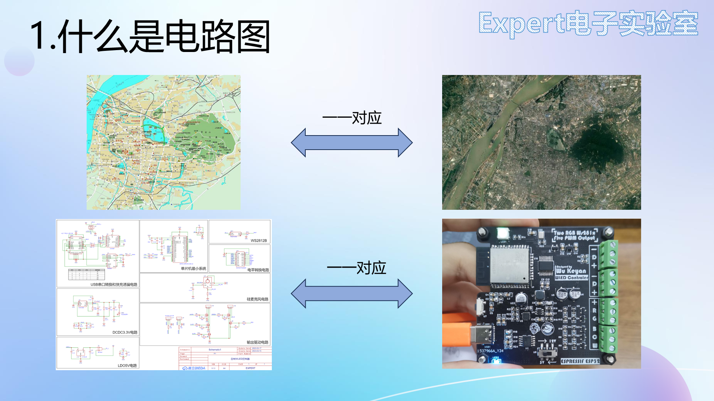
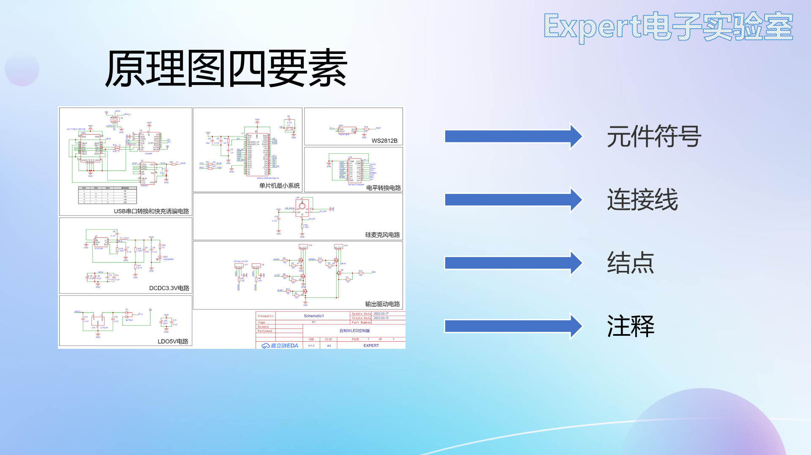
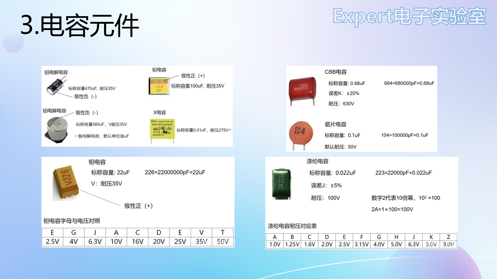
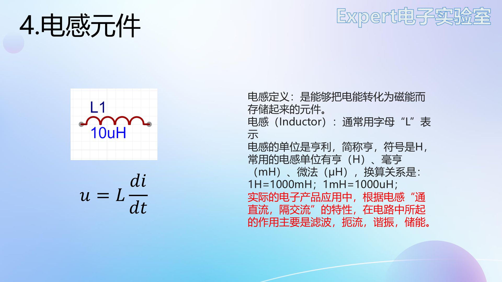
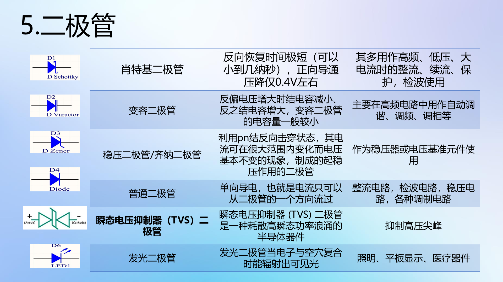
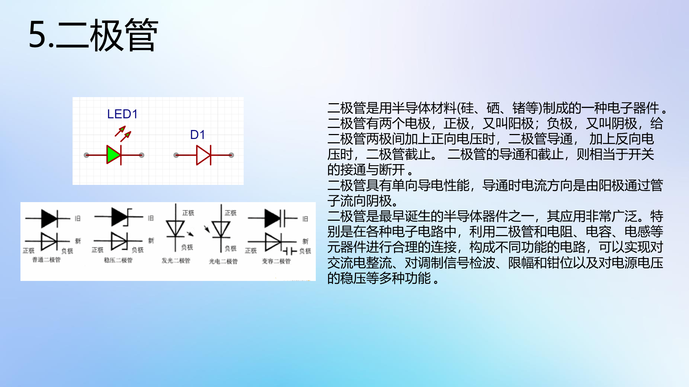
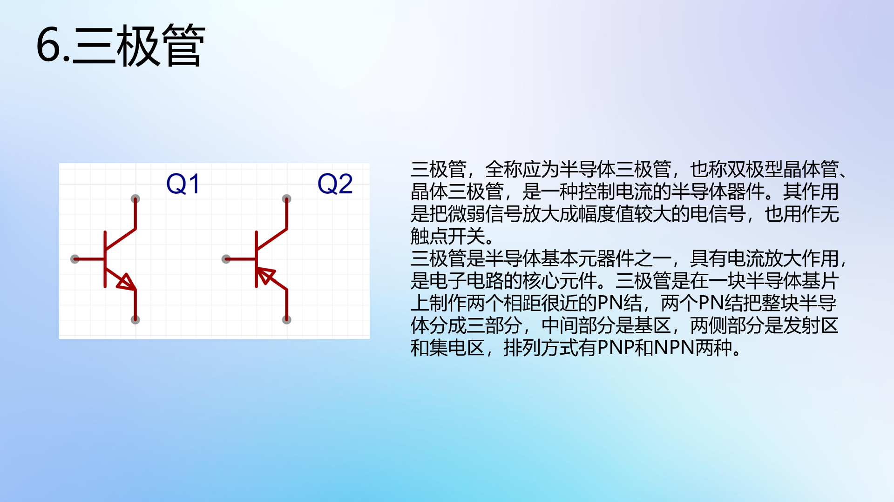
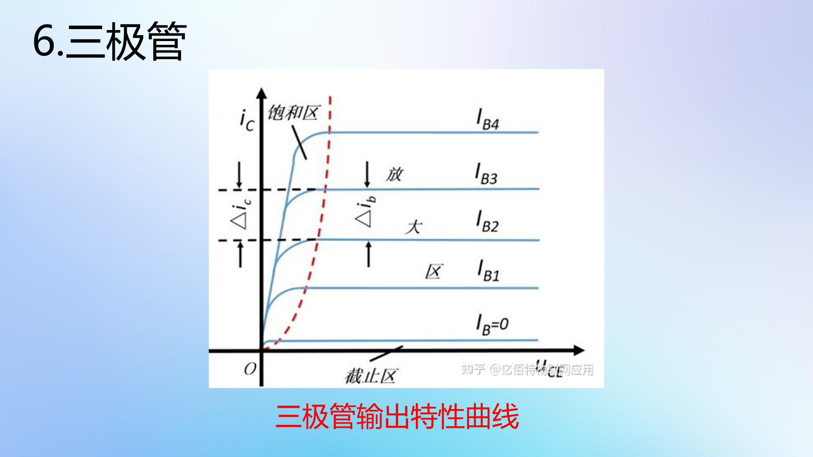
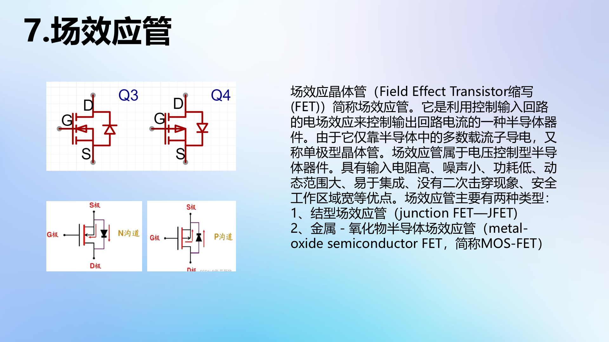
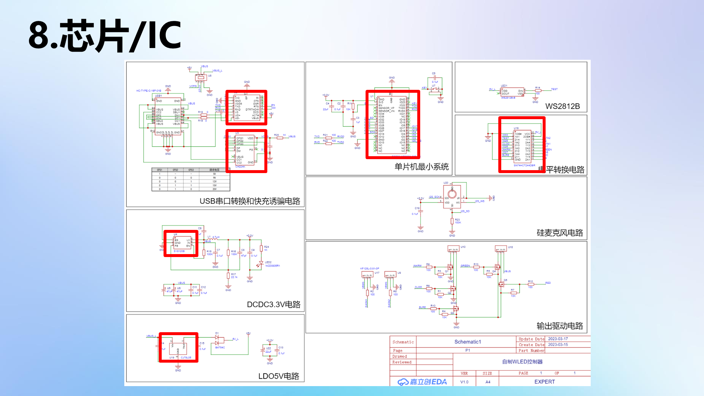

# 02 基本元件 RLC与二极管三极管场效应管

> 前置要求：无。本章对应课程第 3、4 课，是全课程的地基：原理图四要素中的"元件符号"，以及每个元件的特性、读值方法与封装极性识别。

## 1. 原理图：电路的"地图"

看实物 PCB 很难一眼看出有哪些器件、怎么连的；而原理图能让人一眼看清用了哪些模块、每个模块什么功能——就像城市地图对实景照片的抽象与简化。

PCB 设计领域不说"电路图"，而叫**原理图**。任何原理图都由四要素组成：**元件符号、连接线、节点、注释**。本章解决第一个要素，连接线与节点见 [03 章](03%20数据手册阅读与电路定理.md)，注释见 [04 章](04%20原理图读写与PCB基础知识.md)。

读元件符号先认识两个标注：**位号**（如 R1 = 首字母 R + 序号 1，板上唯一）与 **value 值**（如 10k，元件大小）。常用位号前缀：R 电阻、C 电容、L 电感、D 二极管、LED 发光二极管、Q 三极管/场效应管、U 芯片。

## 2. 电阻：最常用的"限流降压"元件

符号与欧姆定律 $U = IR$。使用前提（考试与实战都常踩坑）：

1. R 是**线性定值电阻**（不随电流、温度变化）；
2. 电压电流取**关联参考方向**时写 $U = IR$；非关联方向要加负号。

**封装与额定功率**：直插电阻体积大；贴片电阻按尺寸分 0805、0603、0402 等——封装不仅决定大小，还对应**额定功率**，选型时必须核对。特殊电阻：排阻（插针排组）、功率电阻（测电源）、滑动变阻器、光敏电阻（阻值随光照变化）。

### 2.1 色环电阻读法（直插）

- **四环**：前两环 = 有效数字，第三环 = 乘数（10 的幂），第四环 = 误差。例：红(2)橙(3)黑(×1)金(±5%) → 23Ω；
- **五环**（精度更高）：前三环 = 有效数字，第四环 = 乘数，第五环 = 误差。例：黄(4)紫(7)黑(470)金(×0.1)棕(±1%) → 47Ω。

### 2.2 贴片电阻读法

- **三位数字**：前两位有效数字 + 第三位 10 的幂，精度 5%。例：104 = 10×10⁴ = 100kΩ；
- **四位数字**：前三位有效数字 + 第四位 10 的幂，精度 1%。例：5112 = 511×10² = 51.1kΩ；
- **R 表示小数点**：2R0 = 2.0Ω；毫欧级采样电阻常写成 R010 = 0.010Ω。

## 3. 电容：储能与滤波

电容是**储能元件**，不消耗电能，伏安关系为积分形式 $u = \dfrac{1}{C}\int i\,dt$（同样要求关联参考方向）。核心特性：**通交流、隔直流**，电路中起储能、滤波作用。

| 类型 | 特点 | 适用 |
| --- | --- | --- |
| MLCC 陶瓷电容 | 中高频滤波好，容值小 | 去耦、高频滤波 |
| 铝电解 / 钽电容 | 容值大，高频特性不如 MLCC | 中低频滤波、储能 |
| CBB / X / Y 电容 | 耐压高 | 市电输入等高压场合 |

实际滤波电路常将**大容量电容与小容量陶瓷电容并联**，各管一段频段，1+1>2。

**极性警告**：MLCC、CBB 无极性；**铝电解与钽电容有极性，接反可能爆炸**——新手"点亮 LED 却点亮了电容"的笑话就来自这里。

### 3.1 电容的读值与极性识别

| 电容 | 容值标注 | 极性标注 |
| --- | --- | --- |
| 直插铝电解 | 直接印（470µF、耐压 35V） | 白色竖线一侧 = **负极** |
| 贴片铝电解 | 直接印（560µF、35V，无单位默认 µF） | 黑色小半圆一侧 = **负极** |
| 钽电容 | 三位数字（226 = 22×10⁶ pF = 22µF），前缀字母表耐压（V1 = 35V） | 横杠一侧 = **正极**（与铝电解相反！）；大封装标 S（正）/D（负） |
| 瓷片/CBB 电容 | 三位数字（104 = 0.1µF；2A223G：2A = 100V 耐压、223 = 0.022µF、G = ±5%） | 无极性，未标耐压默认 50V |

## 4. 电感：通直隔交

电感同样是储能元件（动态元件），伏安关系为微分形式 $u = L\dfrac{di}{dt}$。特性与电容相反：**通直流、隔交流**，用于滤波、扼流、谐振、储能（DC-DC 的功率电感即此，见 [大师篇 03 章](../PCB设计大师篇/03%20电源设计基础%20LDO与DC-DC.md)）。

- 贴片：片式功率电感（常带屏蔽）、叠层电感；
- 插件：工字电感、磁棒电感、环形电感、**共模电感（4 脚，其余电感均 2 脚）**。

读值：色环电感读法同色环电阻（黄紫红银 = 47×10² = 4700µH = 4.7mH，银 = ±10%）；功率电感丝印同贴片电阻（331 = 33×10¹ = 330µH）；R 表小数点且**单位是 µH**（1R5 = 1.5µH）。

## 5. 二极管：单向导电

二极管电流只能由**阳极流向阴极**，反接截止。符号家族（功能差异极大，务必分清）：

| 类型 | 识别 | 典型应用 |
| --- | --- | --- |
| 普通二极管 | 三角+横杠 | 整流桥、防反接 |
| 稳压二极管 | 横杠两端出脚 | 反向击穿区稳压 |
| 发光二极管 LED | 外向箭头（发光） | 指示灯 |
| 光电二极管 | 内向箭头（吸光） | 光检测 |
| 变容二极管 | 与电容符号组合 | 谐振调谐 |
| 肖特基二极管 | — | **导通压降低**，防反接/续流首选 |
| TVS 瞬态抑制 | — | 浪涌防护 |

应用举例：整流桥（单向导电）、检波电路（二极管+电容对 AM 调制波包络检波）、电源输入防反接、稳压管稳压。

### 5.1 伏安特性曲线（必须看懂的一张图）

从正半轴往负半轴读：

1. **导通区**（约 0.5V 以上）：二极管导通，但有**导通压降**——硅管 0.6~0.8V、锗管 0.2~0.3V。压降越小越好，所以防反接常用**肖特基二极管**；
2. **死区**（0 ~ 0.5V，硅管 0.5V、锗管 0.1V）：正向电压不足，二极管截止；
3. **反向截止区**：反向电压增大时只有很小的静态反向电流；
4. **反向击穿区**：反向电压超过击穿电压后反向电流猛增，且**电流增大几乎不再使电压升高**——稳压特性。稳压二极管正是工作在此区。

### 5.2 封装极性识别（焊接防呆）

- 直插 LED：内部**大片 = 负极、小片 = 正极**；引脚**长正短负**；
- 贴片 LED：背面绿色三角由正指向负；正面**绿色小点/竖线 = 负极**；
- 贴片/插件普通二极管：**浅色/黑色竖线一端 = 负极**；
- PCB 焊盘丝印上的竖线/缺口同样标负极——焊接时与元件负极对应。

## 6. 三极管：放大与开关

三极管三个脚：集电极 C、基极 B、发射极 E。位号 Q。**NPN 与 PNP 的判别看箭头**：箭头由 P 指向 N——箭头朝外（内→外）即 NPN，朝内即 PNP。

记忆法：三极管 = **两个背靠背的 PN 结**。NPN 是两个 N 夹一个 P（B 从 P 引出）；PNP 相反。

### 6.1 输出特性曲线：水阀模型

把三极管想象成一个水阀：水管水流 = 集电极电流 $I_C$，阀门开度由基极电流 $I_B$ 控制——$I_B$ 大阀门开大、$I_C$ 增大；$I_B = 0$ 阀门关死。

| 区域 | 条件 | 特征 | 用途 |
| --- | --- | --- | --- |
| 截止区 | $I_B = 0$，发射结反偏、集电结反偏 | $I_C \approx 0$ | 开关"断开" |
| 放大区 | 发射结正偏、集电结反偏 | $I_C = \beta \, I_B$（β 查手册） | 信号放大 |
| 饱和区 | 发射结正偏、集电结正偏 | $V_{CE}$ 极小，C-E 近似短路 | 开关"导通" |

### 6.2 两个典型应用

- **放大**：麦克风音频信号微弱 → 让三极管工作在放大区，把微弱信号放大后驱动扬声器；
- **开关**：单片机 IO 输出电流小带不动负载 → IO 经限流电阻接基极，输出高电平使三极管饱和导通，负载回路接通。设计要点：IO 控制的是**基极**，大电流走 C-E 通路。

## 7. 场效应管：电压控制的开关

场效应管同样三个脚：**S 源极、G 栅极、D 漏极**，学习时与三极管类比：G ↔ B、D ↔ C、S ↔ E。

- N 沟道 / P 沟道：同样看箭头（P 指向 N）；
- 按材料分耗尽型与增强型；
- **关键区别：三极管是电流控制（$I_B$），场效应管是电压控制（$U_{GS}$）**——栅极几乎不取电流。

封装与能力：SOT-23 等小封装用于几安/60V 以内（单片机 IO 控制常见）；TO-252 可达 70A/100V；更大功率用 TO-220 / TO-263——TO-263 背面的大焊盘是**散热焊盘**，必须与 PCB 散热焊盘焊接。

## 8. 芯片：元件符号看不出功能的"黑盒子"

原理图上芯片只是一个标着引脚号的小方块，看不出功能——要看懂它，必须查**元件数据手册**（下一章的主题）。芯片时代的基本功：看到不认识的芯片 → 先找数据手册。

## 9. 检查点

- 写出电阻、电容、电感的伏安关系及各自的使用前提（参考方向）；
- 读出 473、5112、2R2、4R7 分别是多大阻值/容值/感值；
- 说出铝电解与钽电容的极性标注差别，以及接反的后果；
- 在伏安特性曲线上指出死区、导通压降、反向击穿区，并解释为什么防反接选肖特基、稳压管工作在击穿区；
- 用水阀模型复述三极管三个工作区的偏置条件与用途；
- 说出三极管与场效应管控制量的区别。

下一章：[03 数据手册阅读与电路定理](03%20数据手册阅读与电路定理.md)——芯片的"身份证"怎么读，电路怎么算。
