# 02 基本元件、数据手册与电路定理

> 前置要求：已读 [01 课程导论与PCB技术发展史](01%20课程导论与PCB技术发展史.md)。本章对应课程第 3~6 课，是全课程的地基：原理图四要素中的"元件符号"与每个元件的特性、读值方法；芯片的"身份证"——数据手册怎么读（以 TPS5450 为例精读一份英文手册）；以及电路分析的两把尺子，基尔霍夫电流定律与电压定律。

## 1. 原理图：电路的"地图"

看实物 PCB 很难一眼看出有哪些器件、怎么连的；而原理图能让人一眼看清用了哪些模块、每个模块什么功能——就像城市地图对实景照片的抽象与简化。

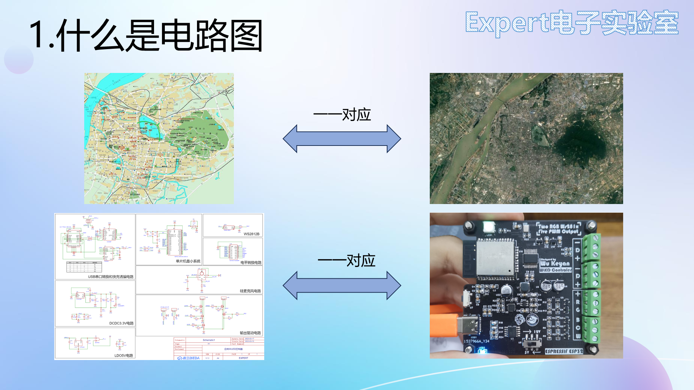

PCB 设计领域不说"电路图"，而叫**原理图**。任何原理图都由四要素组成：**元件符号、连接线、节点、注释**。本章依次解决元件符号（第 2~8 节）与连接线、节点（第 10 节），注释见 [03 原理图读写与PCB基础知识](03%20原理图读写与PCB基础知识.md)。

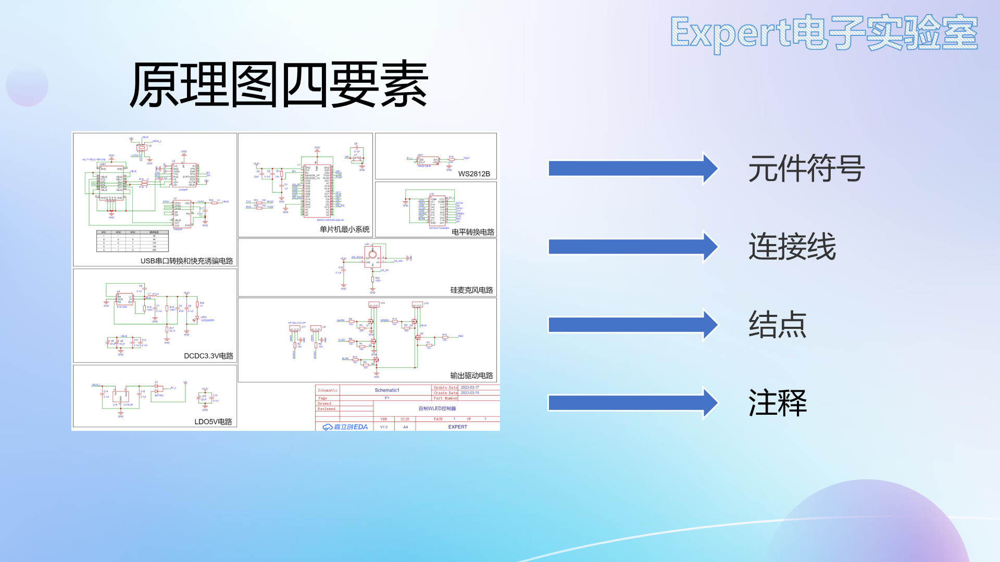

读元件符号先认识两个标注：**位号**（如 R1 = 首字母 R + 序号 1，板上唯一）与 **value 值**（如 10k，元件大小）。常用位号前缀：R 电阻、C 电容、L 电感、D 二极管、LED 发光二极管、Q 三极管/场效应管、U 芯片。

## 2. 电阻：最常用的"限流降压"元件

符号与欧姆定律 $U = IR$。使用前提（考试与实战都常踩坑）：

1. R 是**线性定值电阻**（不随电流、温度变化）；
2. 电压电流取**关联参考方向**时写 $U = IR$；非关联方向要加负号。

**封装与额定功率**：直插电阻体积大；贴片电阻按尺寸分 0805、0603、0402 等——封装不仅决定大小，还对应**额定功率**，选型时必须核对。特殊电阻：排阻（插针排组）、功率电阻（测电源）、滑动变阻器、光敏电阻（阻值随光照变化）。

### 2.1 色环电阻读法（直插）

- **四环**：前两环 = 有效数字，第三环 = 乘数（10 的幂），第四环 = 误差。例：红(2)橙(3)黑(×1)金(±5%) → 23Ω；
- **五环**（精度更高）：前三环 = 有效数字，第四环 = 乘数，第五环 = 误差。例：黄(4)紫(7)黑(470)金(×0.1)棕(±1%) → 47Ω。

### 2.2 贴片电阻读法

- **三位数字**：前两位有效数字 + 第三位 10 的幂，精度 5%。例：104 = 10×10⁴ = 100kΩ；
- **四位数字**：前三位有效数字 + 第四位 10 的幂，精度 1%。例：5112 = 511×10² = 51.1kΩ；
- **R 表示小数点**：2R0 = 2.0Ω；毫欧级采样电阻常写成 R010 = 0.010Ω。

## 3. 电容：储能与滤波

电容是**储能元件**，不消耗电能，伏安关系为积分形式 $u = \dfrac{1}{C}\int i\,dt$（同样要求关联参考方向）。核心特性：**通交流、隔直流**，电路中起储能、滤波作用。

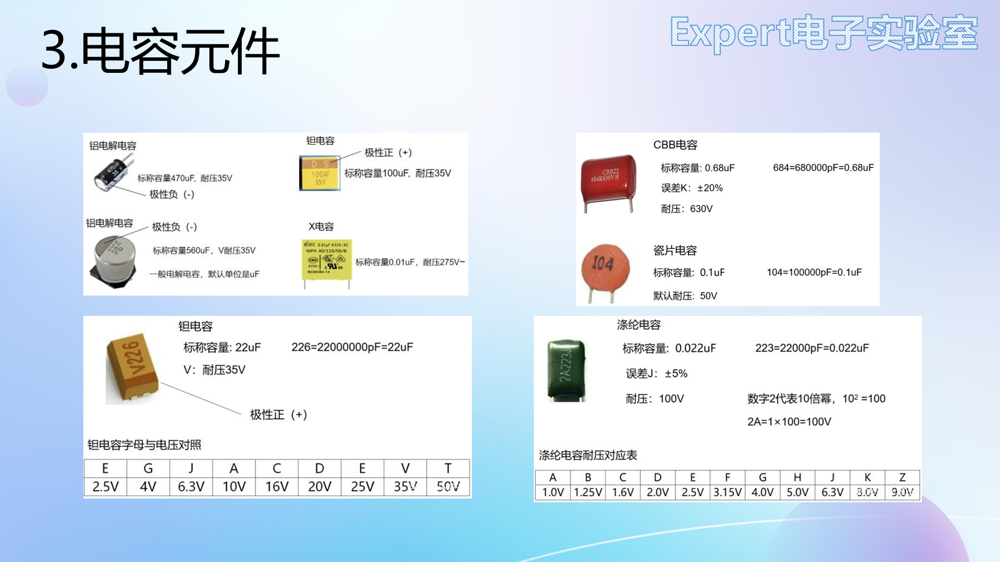

| 类型 | 特点 | 适用 |
| --- | --- | --- |
| MLCC 陶瓷电容 | 中高频滤波好，容值小 | 去耦、高频滤波 |
| 铝电解 / 钽电容 | 容值大，高频特性不如 MLCC | 中低频滤波、储能 |
| CBB / X / Y 电容 | 耐压高 | 市电输入等高压场合 |

实际滤波电路常将**大容量电容与小容量陶瓷电容并联**，各管一段频段，1+1>2。

**极性警告**：MLCC、CBB 无极性；**铝电解与钽电容有极性，接反可能爆炸**——新手"点亮 LED 却点亮了电容"的笑话就来自这里。

### 3.1 电容的读值与极性识别

| 电容 | 容值标注 | 极性标注 |
| --- | --- | --- |
| 直插铝电解 | 直接印（470µF、耐压 35V） | 白色竖线一侧 = **负极** |
| 贴片铝电解 | 直接印（560µF、35V，无单位默认 µF） | 黑色小半圆一侧 = **负极** |
| 钽电容 | 三位数字（226 = 22×10⁶ pF = 22µF），前缀字母表耐压（V1 = 35V） | 横杠一侧 = **正极**（与铝电解相反！）；大封装标 S（正）/D（负） |
| 瓷片/CBB 电容 | 三位数字（104 = 0.1µF；2A223G：2A = 100V 耐压、223 = 0.022µF、G = ±5%） | 无极性，未标耐压默认 50V |

## 4. 电感：通直隔交

电感同样是储能元件（动态元件），伏安关系为微分形式 $u = L\dfrac{di}{dt}$。特性与电容相反：**通直流、隔交流**，用于滤波、扼流、谐振、储能（DC-DC 的功率电感即此，见 [大师篇 02 章](../PCB设计大师篇/02%20电源设计基础%20LDO、DC-DC、基准与滤波电容.md)）。

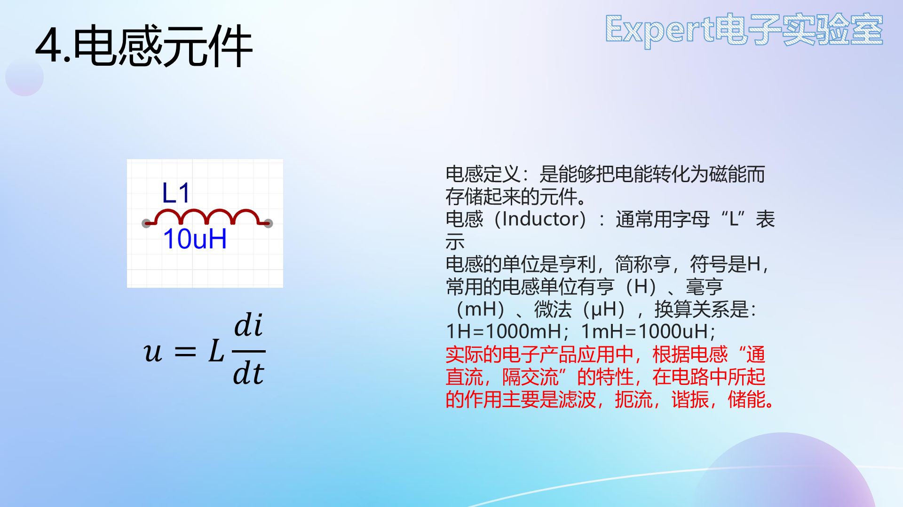

- 贴片：片式功率电感（常带屏蔽）、叠层电感；
- 插件：工字电感、磁棒电感、环形电感、**共模电感（4 脚，其余电感均 2 脚）**。

读值：色环电感读法同色环电阻（黄紫红银 = 47×10² = 4700µH = 4.7mH，银 = ±10%）；功率电感丝印同贴片电阻（331 = 33×10¹ = 330µH）；R 表小数点且**单位是 µH**（1R5 = 1.5µH）。

## 5. 二极管：单向导电

二极管电流只能由**阳极流向阴极**，反接截止。符号家族（功能差异极大，务必分清）：

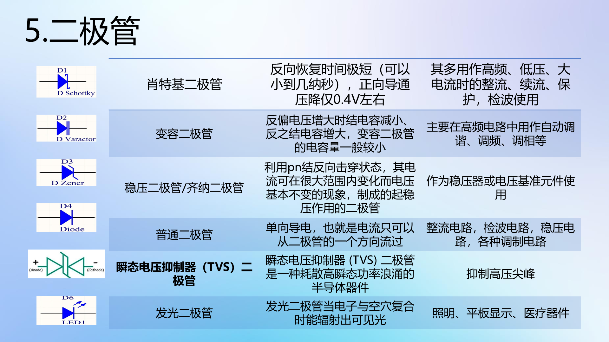

| 类型 | 识别 | 典型应用 |
| --- | --- | --- |
| 普通二极管 | 三角+横杠 | 整流桥、防反接 |
| 稳压二极管 | 横杠两端出脚 | 反向击穿区稳压 |
| 发光二极管 LED | 外向箭头（发光） | 指示灯 |
| 光电二极管 | 内向箭头（吸光） | 光检测 |
| 变容二极管 | 与电容符号组合 | 谐振调谐 |
| 肖特基二极管 | — | **导通压降低**，防反接/续流首选 |
| TVS 瞬态抑制 | — | 浪涌防护 |

应用举例：整流桥（单向导电）、检波电路（二极管+电容对 AM 调制波包络检波）、电源输入防反接、稳压管稳压。

### 5.1 伏安特性曲线（必须看懂的一张图）

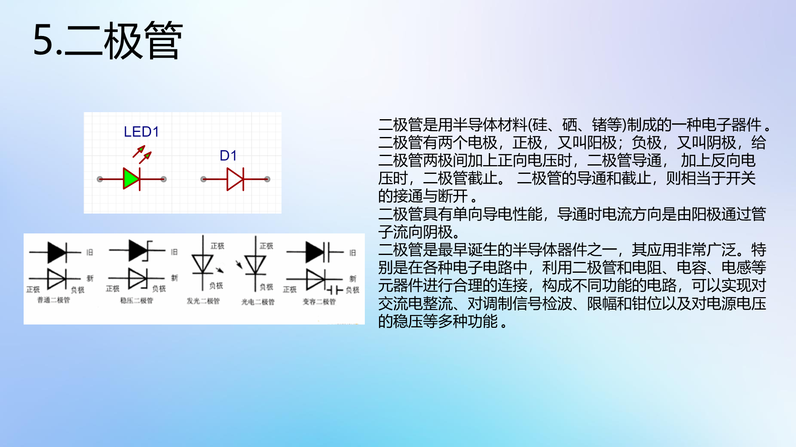

从正半轴往负半轴读：

1. **导通区**（约 0.5V 以上）：二极管导通，但有**导通压降**——硅管 0.6~0.8V、锗管 0.2~0.3V。压降越小越好，所以防反接常用**肖特基二极管**；
2. **死区**（0 ~ 0.5V，硅管 0.5V、锗管 0.1V）：正向电压不足，二极管截止；
3. **反向截止区**：反向电压增大时只有很小的静态反向电流；
4. **反向击穿区**：反向电压超过击穿电压后反向电流猛增，且**电流增大几乎不再使电压升高**——稳压特性。稳压二极管正是工作在此区。

### 5.2 封装极性识别（焊接防呆）

- 直插 LED：内部**大片 = 负极、小片 = 正极**；引脚**长正短负**；
- 贴片 LED：背面绿色三角由正指向负；正面**绿色小点/竖线 = 负极**；
- 贴片/插件普通二极管：**浅色/黑色竖线一端 = 负极**；
- PCB 焊盘丝印上的竖线/缺口同样标负极——焊接时与元件负极对应。

## 6. 三极管：放大与开关

三极管三个脚：集电极 C、基极 B、发射极 E。位号 Q。**NPN 与 PNP 的判别看箭头**：箭头由 P 指向 N——箭头朝外（内→外）即 NPN，朝内即 PNP。

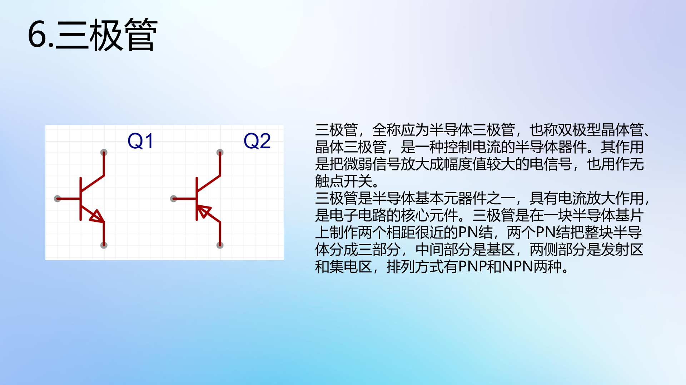

记忆法：三极管 = **两个背靠背的 PN 结**。NPN 是两个 N 夹一个 P（B 从 P 引出）；PNP 相反。

### 6.1 输出特性曲线：水阀模型

把三极管想象成一个水阀：水管水流 = 集电极电流 $I_C$，阀门开度由基极电流 $I_B$ 控制——$I_B$ 大阀门开大、$I_C$ 增大；$I_B = 0$ 阀门关死。

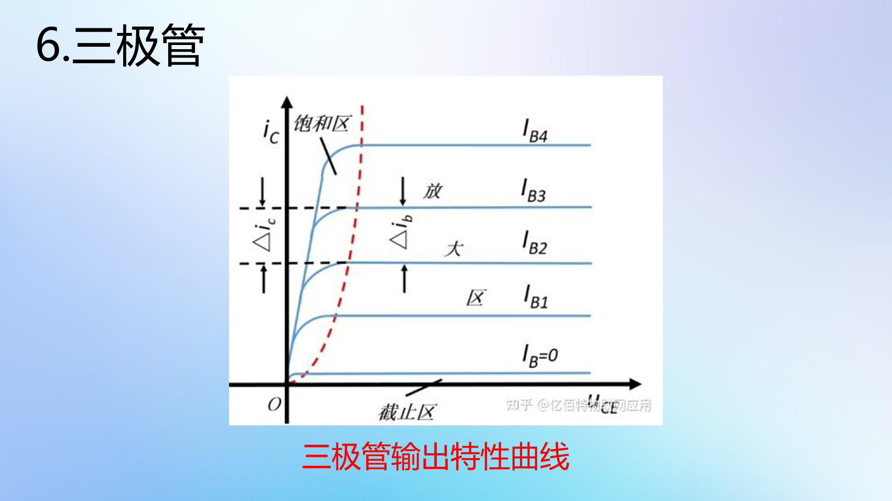

| 区域 | 条件 | 特征 | 用途 |
| --- | --- | --- | --- |
| 截止区 | $I_B = 0$，发射结反偏、集电结反偏 | $I_C \approx 0$ | 开关"断开" |
| 放大区 | 发射结正偏、集电结反偏 | $I_C = \beta \, I_B$（β 查手册） | 信号放大 |
| 饱和区 | 发射结正偏、集电结正偏 | $V_{CE}$ 极小，C-E 近似短路 | 开关"导通" |

### 6.2 两个典型应用

- **放大**：麦克风音频信号微弱 → 让三极管工作在放大区，把微弱信号放大后驱动扬声器；
- **开关**：单片机 IO 输出电流小带不动负载 → IO 经限流电阻接基极，输出高电平使三极管饱和导通，负载回路接通。设计要点：IO 控制的是**基极**，大电流走 C-E 通路。

## 7. 场效应管：电压控制的开关

场效应管同样三个脚：**S 源极、G 栅极、D 漏极**，学习时与三极管类比：G ↔ B、D ↔ C、S ↔ E。

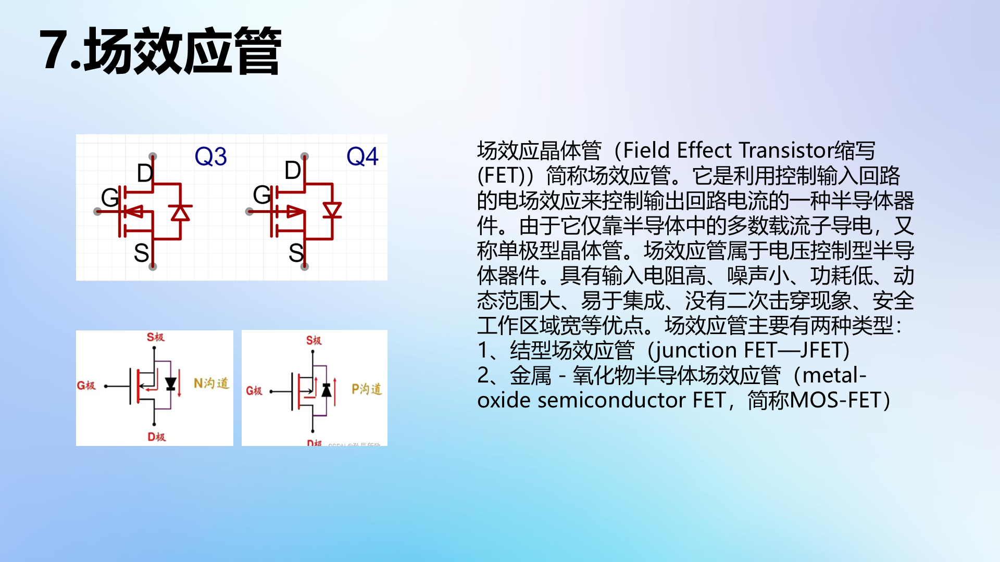

- N 沟道 / P 沟道：同样看箭头（P 指向 N）；
- 按材料分耗尽型与增强型；
- **关键区别：三极管是电流控制（$I_B$），场效应管是电压控制（$U_{GS}$）**——栅极几乎不取电流。

封装与能力：SOT-23 等小封装用于几安/60V 以内（单片机 IO 控制常见）；TO-252 可达 70A/100V；更大功率用 TO-220 / TO-263——TO-263 背面的大焊盘是**散热焊盘**，必须与 PCB 散热焊盘焊接。

## 8. 芯片与数据手册：芯片的"身份证"

原理图上的芯片只是一个标着引脚号的小方块：看不出功能，也不知道引脚名称。要弄懂它，必须读厂家提供的**元件数据手册（Datasheet）**——芯片的身份证，里面有功能、引脚定义、电气特性、示例应用等全部信息。芯片时代的基本功：看到不认识的芯片，先找数据手册。

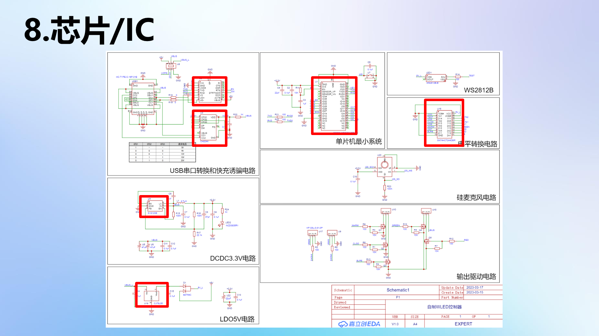

数据手册少则十几页、多则上百页且多为英文，**新手不需要逐页读完**，关键是分清哪些部分要精读、哪些扫一眼即可。

**查找途径**：

1. **立创商城**（推荐）：搜元件型号 → 详情页"数据手册"直接下载；凡立创元件库里有的器件，商城里都有对应手册；
2. **半导小芯**等专门查询网站：无广告，可按型号检索。

## 9. 精读示范：TPS5450 数据手册

以电源芯片 TPS5450（本课程后续电源电路的主角）为例，按手册目录走一遍。不同厂家结构略有差异，但骨架相通。

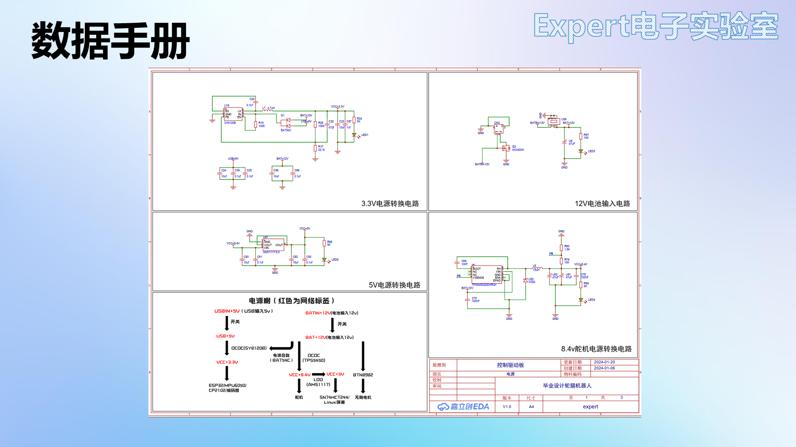

### 9.1 特性（Features）与描述（Description）——快速选型区

- **标题**：`TPS5450 5A 宽输入范围降压转换器`——一行就知道它是降压电源芯片、输出电流 5A；
- **特性**：厂家把最突出的优点放在最前面，如宽输入 5.5~36V、5A 输出、效率 90%、内部集成补偿（外围器件少）、低关断电流（关断时仍有静态电流耗电，越小越好）、过流/过压/过热保护、工作结温 -40~125℃、底部散热焊盘封装；
- **应用与描述**：适用场景（高密度负载点稳压器、LCD 显示屏、电池充电器、12V/24V 分布式电源）；描述部分是对特性的展开。

这两部分的作用：**快速判断"这颗芯片是不是我要的"**，完成初步选型。

### 9.2 引脚配置与功能——画原理图的依据（重点）

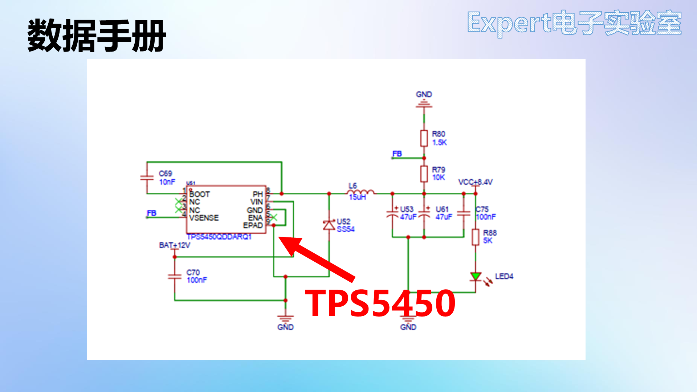

引脚图 + 引脚功能表是画原理图时最重要的部分。每个引脚给出：名称、编号、输入/输出属性（I/O）、功能说明。逐个"翻译成人话"：

| 引脚 | 名称 | 手册说明 | 设计动作 |
| --- | --- | --- | --- |
| 1 | BOOT | 高侧 FET 驱动器升压电容，接 0.01µF 陶瓷电容到 PH | BOOT–PH 之间放 10nF 自举电容 |
| 2、3 | NC | No Connect，内部不连接 | 悬空不接 |
| 4 | VSENSE | 稳压器反馈电压，接输出分压器 | 输出经分压电阻接此脚（反馈） |
| 5 | ENA | 使能：低于 0.5V 停止切换，悬空即启用 | 不需要控制时悬空 |
| 6 | GND | 接地，连到 PowerPad | 必须与散热焊盘相连 |
| 7 | VIN | 电源输入，需高质量陶瓷电容旁路至 GND | VIN 引脚附近放陶瓷电容 |
| 8 | PH | 高侧功率 MOS 源极=转换输出，接电感与续流二极管 | PH→电感→输出 |
| 9 | PowerPAD | 底部散热焊盘 | 接地散热 |

读引脚表的通用技巧：看到 ENA/EN 大概率是使能；NC 直接悬空；带"capacitor to XX"字样就是在两个引脚间接电容。

### 9.3 规格（Specifications）——核对你的应用不越界

- **绝对最大额定值**：超过即可能损坏（如 VIN -0.3~45V、工作结温 -40~150℃）。注意它**宽于**建议工作条件——到最大额定值不代表能正常工作；
- **建议工作条件**：如输入 5.5~36V——设计要落在这个区间；
- **电气特性表**：每个参数给出最小/典型/最大三个值（如开关频率、电流限制、热关断温度）。设计中要逐项核对自己的应用是否越界，越界就换芯片或改设计；
- **典型特性曲线**：参数随温度/电压/电流变化的曲线——静态电流、效率等"典型值"其实是变量；
- ESD 等级（人体模型 ±2000V 等）了解即可。

### 9.4 详细说明、功能方框图与特性说明——理解内部逻辑

- **详细说明**：把开头的特性按功能模块重新展开；
- **功能方框图**：芯片内部电路的框图（振荡器、基准、误差放大器、保护逻辑……）。初学看不懂没关系——应用层面只需知道引脚功能；
- **特性说明**：对方框图中各模块（如 UVLO 欠压锁定、BOOT 自举）逐个解释。两者对照着看，才能理解芯片"为什么这么接"。

### 9.5 应用与实现（Application & Implementation）——设计的模板（重点）

厂家给出**示例应用电路**与完整设计流程：先确定设计参数（输入/输出电压、纹波、输出电流、开关频率），再把这些值代入手册给的公式，逐一算出分压电阻、输入电容、电感、输出电容的取值，最后核对应用曲线确认性能。

**重要结论：电路设计不是从零发明。** 正确姿势是"厂家示例电路 + 自己的应用参数"：示例电路经过验证、成功率高；不同芯片的应用章节结构不同，要具体分析。

### 9.6 布局指南与机械封装

- 部分芯片（尤其电源类）手册附 **PCB Layout 建议**——有就**必须遵守**，它直接决定芯片能否正常工作（本课程实战篇会照做）；
- **机械封装图**：标注了外形与焊盘的全部尺寸——当元件库里找不到封装时，照着这张图自绘封装（见 [04 软件入门与自建元件库](04%20软件入门与自建元件库.md)）。

### 9.7 两点建议

1. **多读多练**：养成"见到元件就查手册"的习惯，硬件工程师的水平就是经验积累；
2. **学好英语**：主流芯片手册都是英文，四六级能过就赶紧过。

## 10. 电路定理：基尔霍夫定律

### 10.1 预备概念：连接线、节点与网络标签

- **连接线**：原理图上的绿色导线；实际 PCB 上对应的是铜箔条，不是理想的"线"；
- **节点**：多条导线交汇处的红色小圆点。**有节点 = 有实际电气连接**；两条导线交叉而无节点（像立交桥，立体交叉不相通）就没有电气连接；
- **网络标签**：相同名称的网络标签在电气上互连（如 DTR1↔DTR1、所有 GND 相连）。原理图大量使用网络标签：一来避免导线绕成"盘丝洞"，二来标签按功能命名（如 SCL、SDA）便于理解；
- **电源类标签**要能一眼认出：VCC（正电源）、+5V、GND（地）、保护地、模拟地。

### 10.2 支路、回路、网孔

| 概念 | 定义 | 记忆 |
| --- | --- | --- |
| 支路 | 两节点间由一个或多个串联元件构成的分支 | 从 A 到 B 有几条"路径"就有几条支路；支路内电流相同 |
| 回路 | 闭合路径；电流必须存在闭合回路 | 独立回路：至少含一条新支路，否则方程多余 |
| 网孔 | 平面电路内部不含支路的回路（不可再分） | 数"渔网的孔"；**平面电路网孔数 = 独立回路数**，用网孔列方程最简 |

### 10.3 集总参数电路（定律的适用边界）

实际元件在高频下会显出电感/电容特性（电阻高频等效为 R+L 串联再并 C）。当**电路尺寸远小于工作电磁波波长**时，可把元件理想化为只有端部特性的**集总参数元件**，忽略元件间电磁相互影响——基尔霍夫定律只对集总参数电路成立。本课程几乎全部电路满足该条件；高频/微波电路则要改用传输线模型。

### 10.4 KCL：节点电流代数和为零

**基尔霍夫电流定律**：任一时刻，流入某节点的电流之和 = 流出该节点的电流之和（$\sum I_{入} = \sum I_{出}$）。

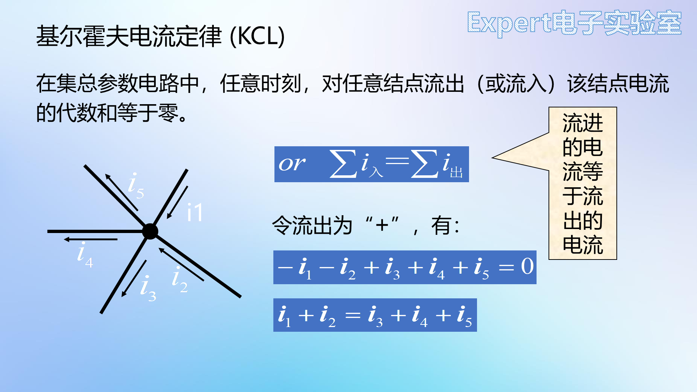

- 本质是**电荷守恒**（节点像不漏水的水管：流入 = 流出）；
- 推广：KCL 也适用于**包围多个节点的任意闭合面**——把闭合面看成一个"大节点"；
- 与支路上接什么元件、交流直流**无关**；
- 按参考方向列方程：解出正值 = 实际方向与参考方向相同，负值 = 相反。

### 10.5 KVL：回路电压代数和为零

**基尔霍夫电压定律**：任一时刻，沿任意回路绕行一周，各段电压的代数和恒为零（$\sum U_{降} = \sum U_{升}$）。

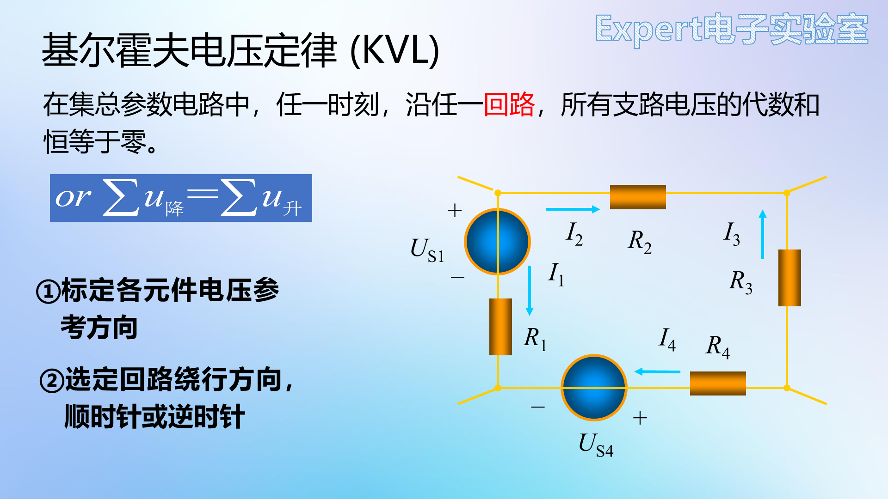

列方程两步：①标定各元件电压参考方向（关联方向下由电流方向决定）；②选定回路绕行方向（顺/逆时针），电压降取正。

- 本质是**能量守恒**：绕行一周回到原点，电位差为零（爬山一圈，净爬升为零）；
- 与元件性质无关；按参考方向列写，负值表示实际方向相反。

### 10.6 小结与延伸

| 要点 | 内容 |
| --- | --- |
| KCL | 约束**节点电流**，与元件性质无关 |
| KVL | 约束**回路电压**，与元件性质无关 |
| 适用边界 | 仅集总参数电路 |
| 使用 | 两者联立才能解出全部支路电压电流 |

基尔霍夫定律之上还有支路电流法、回路电流法、节点电压法、叠加定理、戴维南定理等分析工具，本课程用不到，需要时参考邱关源《电路》第一、二章。

## 11. 检查点

**元件与读值**

- 写出电阻、电容、电感的伏安关系及各自的使用前提（参考方向）；
- 读出 473、5112、2R2、4R7 分别是多大阻值/容值/感值；
- 说出铝电解与钽电容的极性标注差别，以及接反的后果；
- 在伏安特性曲线上指出死区、导通压降、反向击穿区，并解释为什么防反接选肖特基、稳压管工作在击穿区；
- 用水阀模型复述三极管三个工作区的偏置条件与用途；
- 说出三极管与场效应管控制量的区别。

**数据手册与电路定理**

- 说出数据手册各部分的阅读优先级（精读：引脚功能、建议工作条件、电气特性、应用电路、布局指南；略读：特性、描述、方框图；跳过：修订历史）；
- 把 TPS5450 的 BOOT、VSENSE、ENA、PowerPAD 四个引脚的"设计动作"各说一遍；
- 两条导线交叉但无节点，有没有电气连接？为什么？
- 数一个电路的网孔数，并说明为什么网孔方程组是独立方程组；
- 写出 KCL、KVL 的数学表达、物理本质（电荷守恒/能量守恒）与适用边界。

下一章：[03 原理图读写与PCB基础知识](03%20原理图读写与PCB基础知识.md)——读懂一张真实原理图，并认识 PCB 上的每一种元素。
