# 03 原理图读写与PCB基础知识

> 前置要求：已读 [02 基本元件、数据手册与电路定理](02%20基本元件、数据手册与电路定理.md)。本章对应课程第 7~11 课，是入门篇的收官：读懂并画好一张真实原理图，然后认识 PCB 的结构组成、叠层、符号与封装、设计全流程。

## 1. 原理图第四要素：注释

注释是原理图的"代码注释"，提升可读性。团队协作时，你的原理图必须**别人也看得懂**：

- **模块功能与关键参数**：如"线性稳压器，最大输出 1A"；
- **元件功能说明**：`NC` = No Connect（默认不连接）、`NF` = No Fix（默认不安装）、`0Ω` 电阻（可短路的跳线选择）；
- **配置表格**：如快充诱骗芯片的"CFG 引脚电平 → 请求电压"对照表贴在电路旁；
- **注意事项**：如 ESP32 的 strapping 引脚对启动电平有要求，标在芯片旁防止别人改图踩坑；
- **标题栏、公司/个人 logo、版本号**。

## 2. 读图实战：RGB 灯带控制器

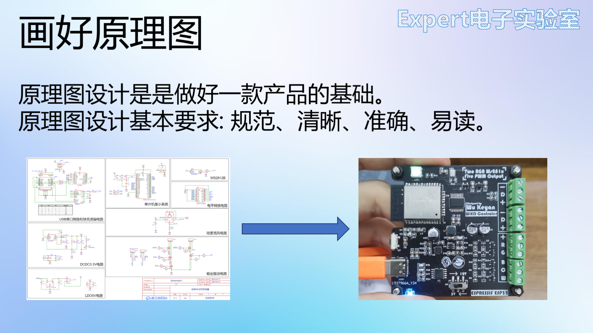

读图流程三步：

### 2.1 先看标题栏

右下角标题栏给出绘图软件、作者、**标题**（自制 WLED 控制器——一眼知道板子用途）、创建/更新日期、图页号。

### 2.2 再分模块

布局合理的原理图按功能分区，本图分为：USB 串口转换和快充诱骗、DCDC 3.3V、LDO 5V、单片机最小系统、WS2812B 灯珠、电平转换、硅麦克风、输出驱动。看模块注释即可了解板子整体功能。

### 2.3 逐模块对照数据手册

对陌生模块，**找到模块用的芯片 → 查数据手册 → 对照引脚功能与示例电路**：

- **CH224K**（快充诱骗）：USB PD 协议芯片，通过配置 CFG1/2/3 引脚电平请求不同电压（000=9V、001=12V……）；
- **CH343P**（USB 转串口）：把电脑 USB 协议转为单片机异步串口；UD+/UD- 接 Type-C 的 DP/DN——Type-C 引脚正反面对称排列，这正是它能正反插的原因；
- **SY8120B**（DCDC）：开关降压到 3.3V；
- **CG78L05**（LDO）：线性稳压 5V，最大输出仅 0.1A——**大功率用 DC-DC（效率高）、小功率与高纹波要求用 LDO**；
- **ESP32-WROOM 模组**：为什么"最小系统"只有几颗电容？因为模组**内部自带**最小系统（晶振、复位、4M SPI Flash）——查手册的内部电路原理图即可确认；
- **SN74HCT244**（电平转换/驱动）：八路缓冲器。WS2812B 控制电平要求 >4V，单片机 3.3V 带不动——用它把 3.3V 转成 5V 并提高驱动能力；
- **输出驱动**：3P 座子输出；NMOS 栅极接单片机 IO、漏极接灯带、源极接地——典型 **PWM 驱动电路**，场效应管做开关，靠占空比混色调光。

**读图心法**：不要死板地用电路定理逐个网孔硬算，而是**以芯片数据手册为钥匙**——引脚功能 + 示例电路，效率天差地别。

## 3. 画好原理图的六条规范

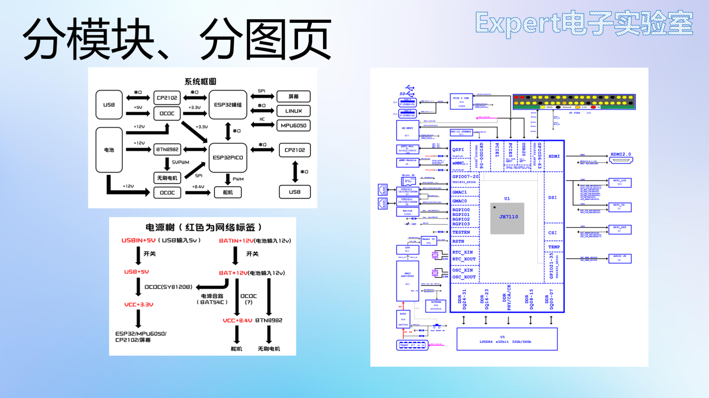

1. **分模块**：电源左上、主控居中、按键左下……同类电路放一起，一眼定位；
2. **分图页**：复杂原理图一页画不下就分多页，每页一个功能域。大公司的板子甚至几十个图页，前几页放**系统框图**（模块与通信关系）、**电源树**（各路电源如何产生与分配，含上电时序）、**GPIO 引脚分配表**；
3. **标注重要参数**：符号上读不出来的信息（最大输出电流、NC、配置表、启动电平注意事项）；
4. **合理的网络标签命名**：便于理解 + 避免重复，推荐"元件_功能"格式（如 `MPU6050_SCL`）；
5. **logo 与版本号**：便于迭代对照；
6. **电路正确高于一切**：原理图本质是电路，反复对照数据手册检查设计正确性。

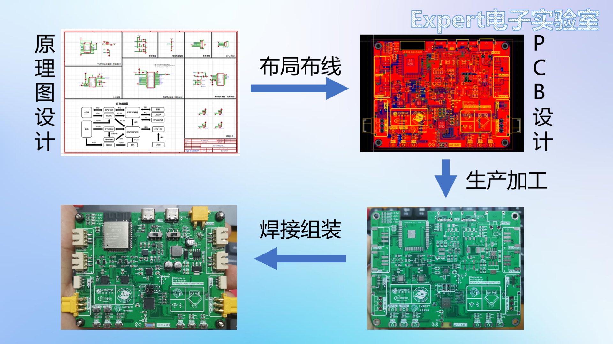

## 4. PCB 的结构与组成

PCB（印刷电路板）是电子元器件电气连接的提供者。按基材分高频板、金属基板（铝/铁/铜）等；按层数分单面板、**双面板（本课程主线）**与多层板。空板上的组成元素：

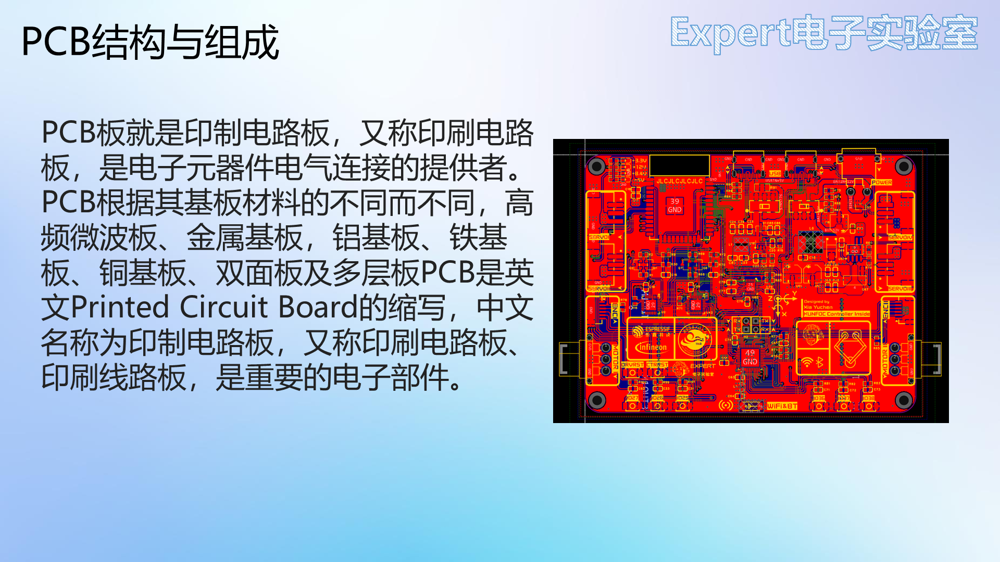

### 4.1 导线（Track）

一段细铜箔，连接两个元件引脚——它反映的正是**原理图的网络连接关系**。不同网络的导线绝不允许相交短路；导线可设不同粗细（信号线常用细线，电源线加粗）。

### 4.2 铺铜（Copper Pour）

一整块铜皮连接网络。**地平面**对一块板子至关重要，所以布完信号线后统一对 GND 铺铜；大面积铜皮也利于大电流与散热。铜皮与焊盘的连接方式：

- **十字连接（发散）**：几根细铜箔连接焊盘——焊接时散热慢、好焊；
- **直连（填充）**：整块相连——大电流路径用，或用于不需要焊接的固定焊盘。

### 4.3 过孔（Via）

不同层之间的电气连接，可以理解为"竖起来的导线"；也用于器件固定定位（如 M3 安装孔）。导电过孔三类：

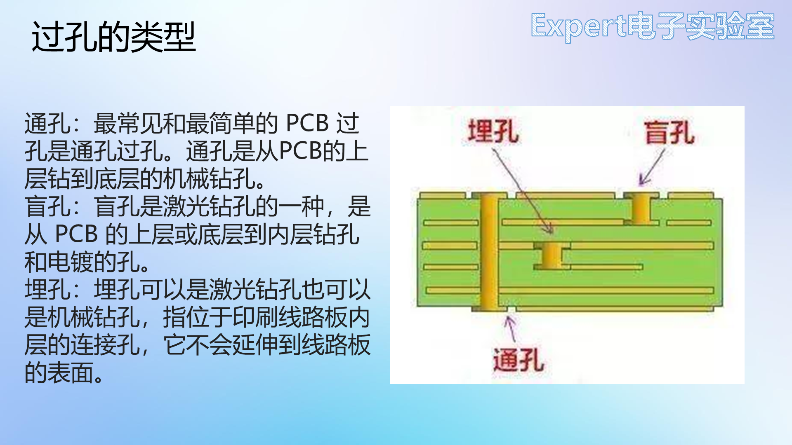

| 类型 | 打孔范围 | 特点 |
| --- | --- | --- |
| 通孔 | 顶层贯穿到底层 | 最常用、最便宜 |
| 盲孔 | 顶层到中间某层 | 不占底层布线空间 |
| 埋孔 | 只在内部层间 | 表面看不见，布线效率最高但最贵 |

### 4.4 焊盘（Pad）

元件焊接位置，本质是一块**裸露的铜皮**：通孔式焊盘（直插元件，中间有孔）、表贴式焊盘（贴片元件，无孔的方形铜皮）。

### 4.5 丝印（Silkscreen）

PCB 表面的"注释"：白色文字与 logo，帮助识别元件位置、数量、型号。

### 4.6 阻焊（Solder Mask）

覆盖铜层的油墨（常为绿色），保护铜层防氧化、防止焊接短路；焊盘位置**开窗**露出铜皮供焊接。注意阻焊层比焊盘**略大一圈**，方便焊接。自制腐蚀板没有阻焊层，所以焊起来容易短路——工厂板的绿油就是干这个的。

## 5. PCB 叠层结构

把 PCB 想象成三明治：起绝缘支撑作用的是**基板**（PP 半固化片 + 芯板），两侧压合铜箔构成覆铜板。

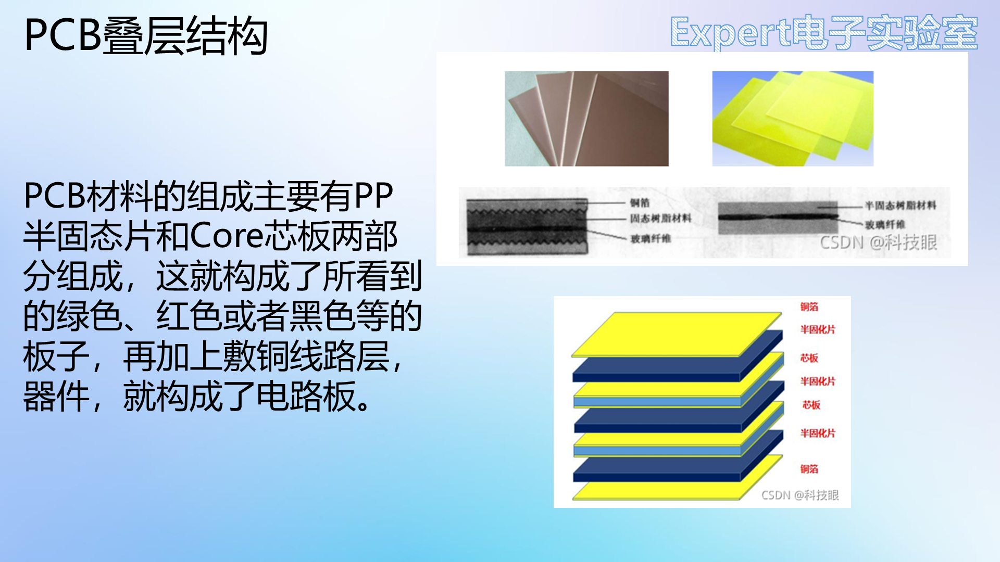

多层板每一层是走信号还是电源/地，需要自行设计，称为**叠层设计**：

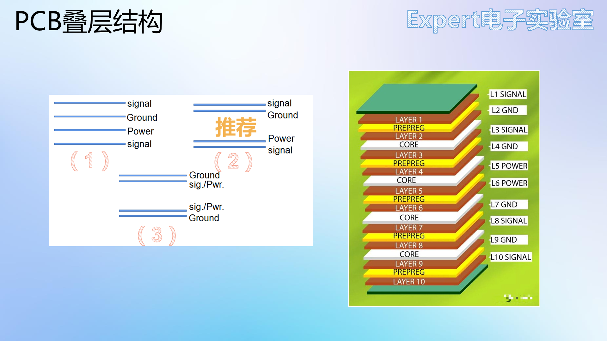

- 四层板：顶层信号 / 内层 GND / 内层电源 / 底层信号；
- 六层板：信号 / GND / 信号 / 电源 / GND / 信号——完整的地平面带来更好的信号完整性。

**两层板无需叠层设计**：顶层底层都要走信号、电源并铺地，靠过孔换层。本课程全程两层板。

## 6. 元件符号与封装：一一对应

PCB 设计的过程，就是把原理图**转化为实际电路板**的过程，其中关键一环是把电路符号映射为 PCB 封装。

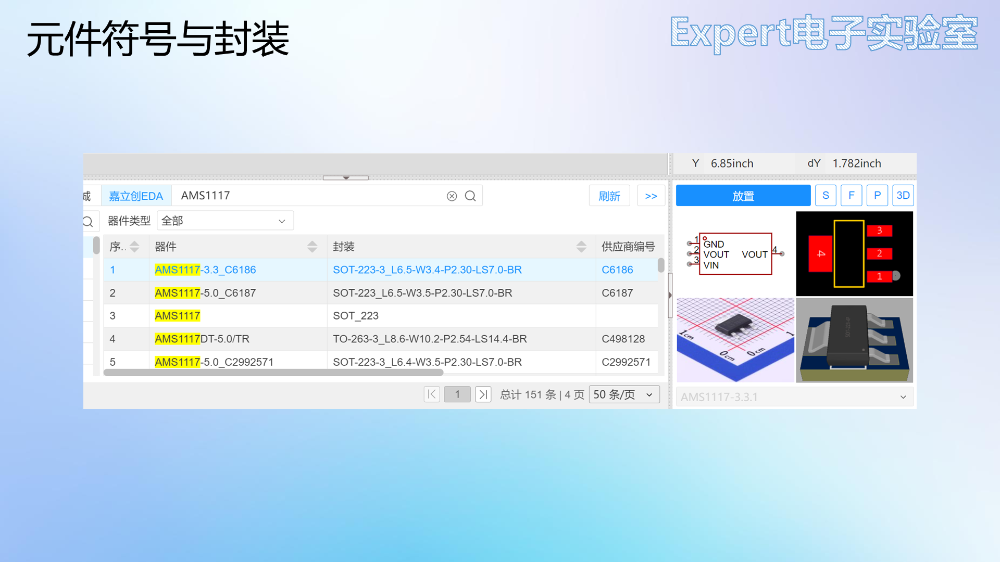

每个元件由三要素组成：**元件符号**（原理图阶段用）、**元件封装**（PCB 阶段用）、3D 模型（预览用）。两者的纽带是**引脚编号**：

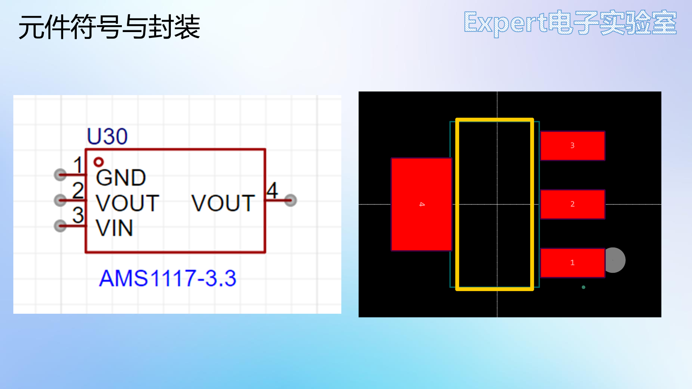

- 符号上引脚外侧的灰色小圆点表示可电气连接的引脚；
- 引脚编号（1、2、3…）与封装焊盘编号**一一对应**——对应错了，板子焊出来就是错的；
- 封装上 1 号焊盘用**小圆点/丝印缺口**标识，与芯片实物顶部的凹点对应；
- 封装的丝印框标注元件实物的外形大小。

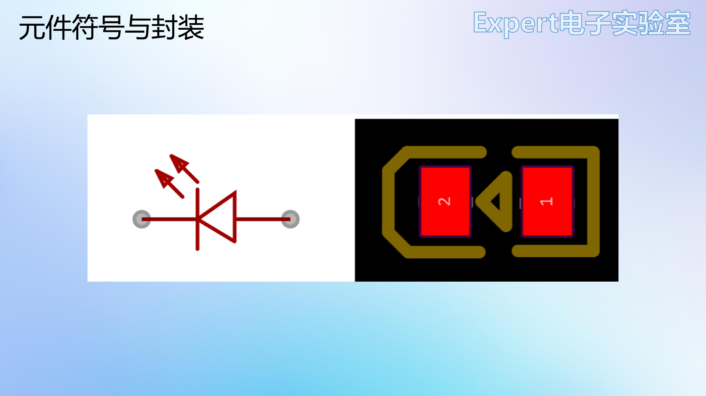

典型例子：TPS5450 的 9 脚是底部散热焊盘；LED 封装 1 脚=正极 2 脚=负极；Type-C 的固定插针焊盘带过孔；拨动开关不分正负方向；LQFP 芯片的小圆点对应 1 脚。立创EDA的在线库虽丰富，但**总有用不到的元件——自绘符号与封装是基本功**（见 [04 软件入门与自建元件库](04%20软件入门与自建元件库.md)）。

## 7. PCB 设计全流程

一块电路板的诞生：**原理图设计 → PCB 设计 → 生产加工 → 焊接组装**。

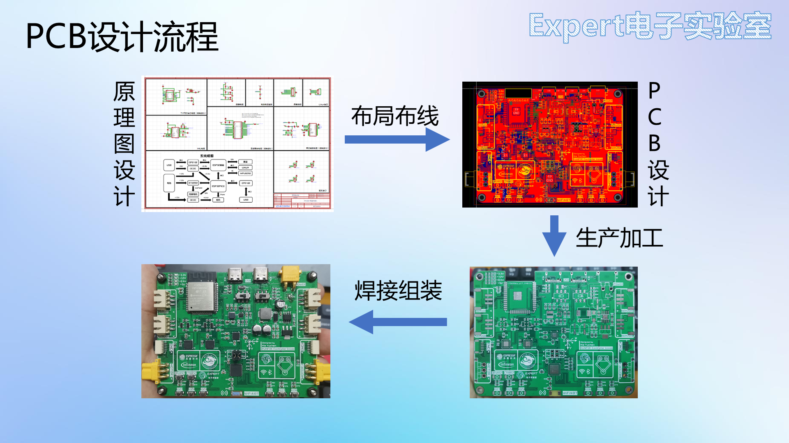

1. **新建工程**：工程内建一块板子，板子下含原理图与 PCB 两部分；
2. **原理图设计**：元件选型与电路设计 → 放置器件（库中没有的新建元件）→ 布线 → **DRC 检查**；
   - **DRC（Design Rule Check，设计规则检查）**：确保设计满足制造工艺要求的质量保证措施——短路、悬空等电气错误都会被报出；
3. **转 PCB + 导出 BOM**：BOM（物料清单）即采购清单；
4. **PCB 设计**：放置**板框**（板子尺寸；嘉立创免费打样不能超过 100×100mm，且越小越省钱）→ **布局**（分功能分模块）→ **布线** → **检查 DRC**。**布局与布线是 PCB 设计最关键的两步，布局又是布线的前提**；
5. **导出 Gerber**：生产文件，发给板厂；
6. **嘉立创下单打板**：每月两次免费打样机会。

## 8. 检查点

- 说出 NC、NF、0Ω 电阻三种注释的含义；
- 用"查数据手册"的方法分析一个陌生模块：需要哪两样信息？
- 复述画好原理图的六条规范，并说出"电源树、系统框图"该放在原理图什么位置；
- 解释十字连接与直连各自适合什么场景；
- 比较通孔、盲孔、埋孔；说明阻焊层为什么比焊盘略大；
- 说出符号与封装对应的纽带是什么，1 号脚如何识别；
- 默画 PCB 设计全流程，并指出哪一步最关键、DRC 出现在哪几步。

入门篇到此完成。下一章进入强化篇软件实战：[04 软件入门与自建元件库](04%20软件入门与自建元件库.md)。
