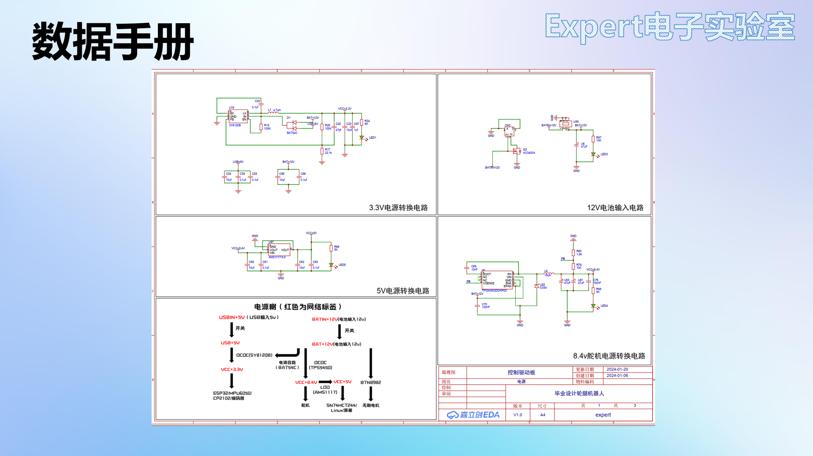
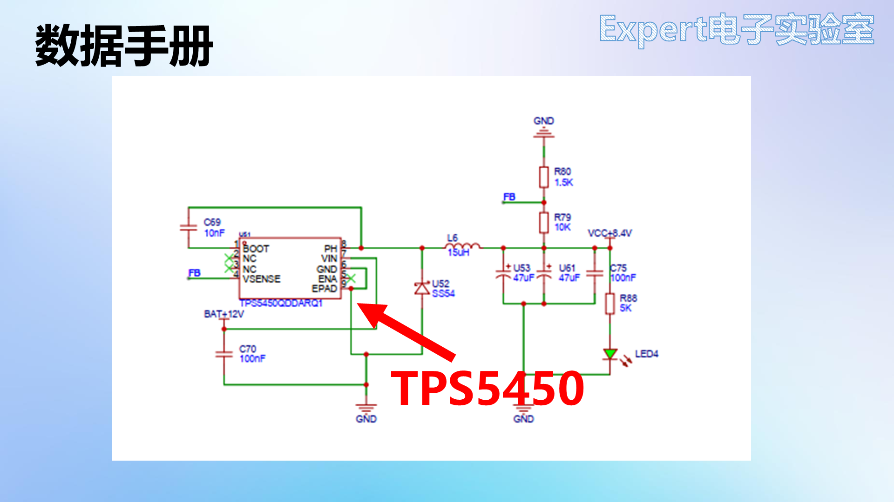
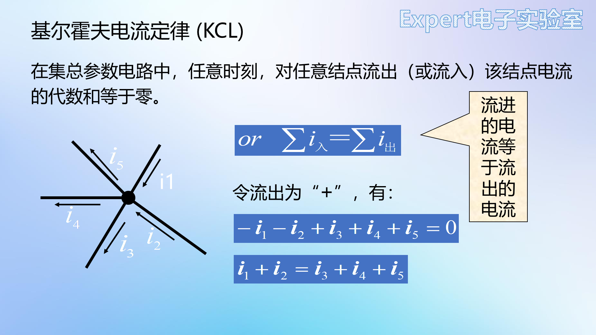
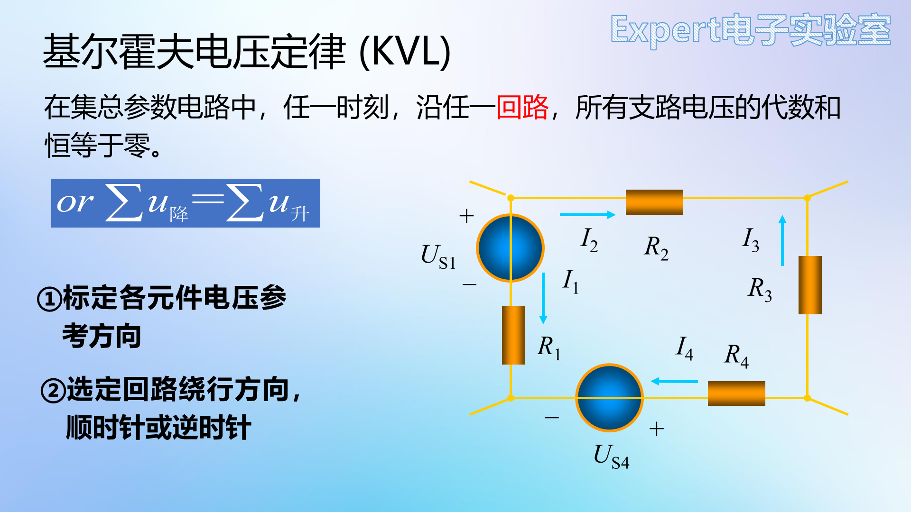

# 03 数据手册阅读与电路定理

> 前置要求：已读 [02 章](02%20基本元件%20RLC与二极管三极管场效应管.md)。本章对应课程第 5、6 课：上半场解决"芯片的身份证怎么读"（以 TPS5450 为例精读一份英文数据手册），下半场补上电路分析的两把尺子——基尔霍夫电流定律与电压定律。

## 1. 为什么要读数据手册，怎么找

原理图上的芯片只是一个标着引脚号的小方块：不知道引脚名称，也不知道它在干什么。要弄懂原理图，必须读厂家提供的**元件数据手册（Datasheet）**——芯片的身份证，里面有功能、引脚定义、电气特性、示例应用等全部信息。

数据手册少则十几页、多则上百页且多为英文，**新手不需要逐页读完**，关键是分清哪些部分要精读、哪些扫一眼即可。

**查找途径**：

1. **立创商城**（推荐）：搜元件型号 → 详情页"数据手册"直接下载；凡立创元件库里有的器件，商城里都有对应手册；
2. **半导小芯**等专门查询网站：无广告，可按型号检索。

## 2. 精读示范：TPS5450 数据手册

以电源芯片 TPS5450（本课程后续电源电路的主角）为例，按手册目录走一遍。不同厂家结构略有差异，但骨架相通。

### 2.1 特性（Features）与描述（Description）——快速选型区

- **标题**：`TPS5450 5A 宽输入范围降压转换器`——一行就知道它是降压电源芯片、输出电流 5A；
- **特性**：厂家把最突出的优点放在最前面，如宽输入 5.5~36V、5A 输出、效率 90%、内部集成补偿（外围器件少）、低关断电流（关断时仍有静态电流耗电，越小越好）、过流/过压/过热保护、工作结温 -40~125℃、底部散热焊盘封装；
- **应用与描述**：适用场景（高密度负载点稳压器、LCD 显示屏、电池充电器、12V/24V 分布式电源）；描述部分是对特性的展开。

这两部分的作用：**快速判断"这颗芯片是不是我要的"**，完成初步选型。

### 2.2 引脚配置与功能——画原理图的依据（重点）

引脚图 + 引脚功能表是画原理图时最重要的部分。每个引脚给出：名称、编号、输入/输出属性（I/O）、功能说明。逐个"翻译成人话"：

| 引脚 | 名称 | 手册说明 | 设计动作 |
| --- | --- | --- | --- |
| 1 | BOOT | 高侧 FET 驱动器升压电容，接 0.01µF 陶瓷电容到 PH | BOOT–PH 之间放 10nF 自举电容 |
| 2、3 | NC | No Connect，内部不连接 | 悬空不接 |
| 4 | VSENSE | 稳压器反馈电压，接输出分压器 | 输出经分压电阻接此脚（反馈） |
| 5 | ENA | 使能：低于 0.5V 停止切换，悬空即启用 | 不需要控制时悬空 |
| 6 | GND | 接地，连到 PowerPad | 必须与散热焊盘相连 |
| 7 | VIN | 电源输入，需高质量陶瓷电容旁路至 GND | VIN 引脚附近放陶瓷电容 |
| 8 | PH | 高侧功率 MOS 源极=转换输出，接电感与续流二极管 | PH→电感→输出 |
| 9 | PowerPAD | 底部散热焊盘 | 接地散热 |

读引脚表的通用技巧：看到 ENA/EN 大概率是使能；NC 直接悬空；带"capacitor to XX"字样就是在两个引脚间接电容。

### 2.3 规格（Specifications）——核对你的应用不越界

- **绝对最大额定值**：超过即可能损坏（如 VIN -0.3~45V、工作结温 -40~150℃）。注意它**宽于**建议工作条件——到最大额定值不代表能正常工作；
- **建议工作条件**：如输入 5.5~36V——设计要落在这个区间；
- **电气特性表**：每个参数给出最小/典型/最大三个值（如开关频率、电流限制、热关断温度）。设计中要逐项核对自己的应用是否越界，越界就换芯片或改设计；
- **典型特性曲线**：参数随温度/电压/电流变化的曲线——静态电流、效率等"典型值"其实是变量；
- ESD 等级（人体模型 ±2000V 等）了解即可。

### 2.4 详细说明、功能方框图与特性说明——理解内部逻辑

- **详细说明**：把开头的特性按功能模块重新展开；
- **功能方框图**：芯片内部电路的框图（振荡器、基准、误差放大器、保护逻辑……）。初学看不懂没关系——应用层面只需知道引脚功能；
- **特性说明**：对方框图中各模块（如 UVLO 欠压锁定、BOOT 自举）逐个解释。两者对照着看，才能理解芯片"为什么这么接"。

### 2.5 应用与实现（Application & Implementation）——设计的模板（重点）

厂家给出**示例应用电路**与完整设计流程：先确定设计参数（输入/输出电压、纹波、输出电流、开关频率），再把这些值代入手册给的公式，逐一算出分压电阻、输入电容、电感、输出电容的取值，最后核对应用曲线确认性能。

**重要结论：电路设计不是从零发明。** 正确姿势是"厂家示例电路 + 自己的应用参数"：示例电路经过验证、成功率高；不同芯片的应用章节结构不同，要具体分析。

### 2.6 布局指南与机械封装

- 部分芯片（尤其电源类）手册附 **PCB Layout 建议**——有就**必须遵守**，它直接决定芯片能否正常工作（本课程实战篇会照做）；
- **机械封装图**：标注了外形与焊盘的全部尺寸——当元件库里找不到封装时，照着这张图自绘封装（见 [06 章](06%20自建元件库%20绘制符号与封装.md)）。

### 2.7 两点建议

1. **多读多练**：养成"见到元件就查手册"的习惯，硬件工程师的水平就是经验积累；
2. **学好英语**：主流芯片手册都是英文，四六级能过就赶紧过。

## 3. 电路定理：基尔霍夫定律

### 3.1 预备概念：连接线、节点与网络标签

- **连接线**：原理图上的绿色导线；实际 PCB 上对应的是铜箔条，不是理想的"线"；
- **节点**：多条导线交汇处的红色小圆点。**有节点 = 有实际电气连接**；两条导线交叉而无节点（像立交桥，立体交叉不相通）就没有电气连接；
- **网络标签**：相同名称的网络标签在电气上互连（如 DTR1↔DTR1、所有 GND 相连）。原理图大量使用网络标签：一来避免导线绕成"盘丝洞"，二来标签按功能命名（如 SCL、SDA）便于理解；
- **电源类标签**要能一眼认出：VCC（正电源）、+5V、GND（地）、保护地、模拟地。

### 3.2 支路、回路、网孔

| 概念 | 定义 | 记忆 |
| --- | --- | --- |
| 支路 | 两节点间由一个或多个串联元件构成的分支 | 从 A 到 B 有几条"路径"就有几条支路；支路内电流相同 |
| 回路 | 闭合路径；电流必须存在闭合回路 | 独立回路：至少含一条新支路，否则方程多余 |
| 网孔 | 平面电路内部不含支路的回路（不可再分） | 数"渔网的孔"；**平面电路网孔数 = 独立回路数**，用网孔列方程最简 |

### 3.3 集总参数电路（定律的适用边界）

实际元件在高频下会显出电感/电容特性（电阻高频等效为 R+L 串联再并 C）。当**电路尺寸远小于工作电磁波波长**时，可把元件理想化为只有端部特性的**集总参数元件**，忽略元件间电磁相互影响——基尔霍夫定律只对集总参数电路成立。本课程几乎全部电路满足该条件；高频/微波电路则要改用传输线模型。

### 3.4 KCL：节点电流代数和为零

**基尔霍夫电流定律**：任一时刻，流入某节点的电流之和 = 流出该节点的电流之和（$\sum I_{入} = \sum I_{出}$）。

- 本质是**电荷守恒**（节点像不漏水的水管：流入 = 流出）；
- 推广：KCL 也适用于**包围多个节点的任意闭合面**——把闭合面看成一个"大节点"；
- 与支路上接什么元件、交流直流**无关**；
- 按参考方向列方程：解出正值 = 实际方向与参考方向相同，负值 = 相反。

### 3.5 KVL：回路电压代数和为零

**基尔霍夫电压定律**：任一时刻，沿任意回路绕行一周，各段电压的代数和恒为零（$\sum U_{降} = \sum U_{升}$）。

列方程两步：①标定各元件电压参考方向（关联方向下由电流方向决定）；②选定回路绕行方向（顺/逆时针），电压降取正。

- 本质是**能量守恒**：绕行一周回到原点，电位差为零（爬山一圈，净爬升为零）；
- 与元件性质无关；按参考方向列写，负值表示实际方向相反。

### 3.6 小结与延伸

| 要点 | 内容 |
| --- | --- |
| KCL | 约束**节点电流**，与元件性质无关 |
| KVL | 约束**回路电压**，与元件性质无关 |
| 适用边界 | 仅集总参数电路 |
| 使用 | 两者联立才能解出全部支路电压电流 |

基尔霍夫定律之上还有支路电流法、回路电流法、节点电压法、叠加定理、戴维南定理等分析工具，本课程用不到，需要时参考邱关源《电路》第一、二章。

## 4. 检查点

- 说出数据手册各部分的阅读优先级（精读：引脚功能、建议工作条件、电气特性、应用电路、布局指南；略读：特性、描述、方框图；跳过：修订历史）；
- 把 TPS5450 的 BOOT、VSENSE、ENA、PowerPAD 四个引脚的"设计动作"各说一遍；
- 两条导线交叉但无节点，有没有电气连接？为什么？
- 数一个电路的网孔数，并说明为什么网孔方程组是独立方程组；
- 写出 KCL、KVL 的数学表达、物理本质（电荷守恒/能量守恒）与适用边界。

下一章：[04 原理图读写与PCB基础知识](04%20原理图读写与PCB基础知识.md)——读懂一张真实原理图，并认识 PCB 上的每一种元素。
