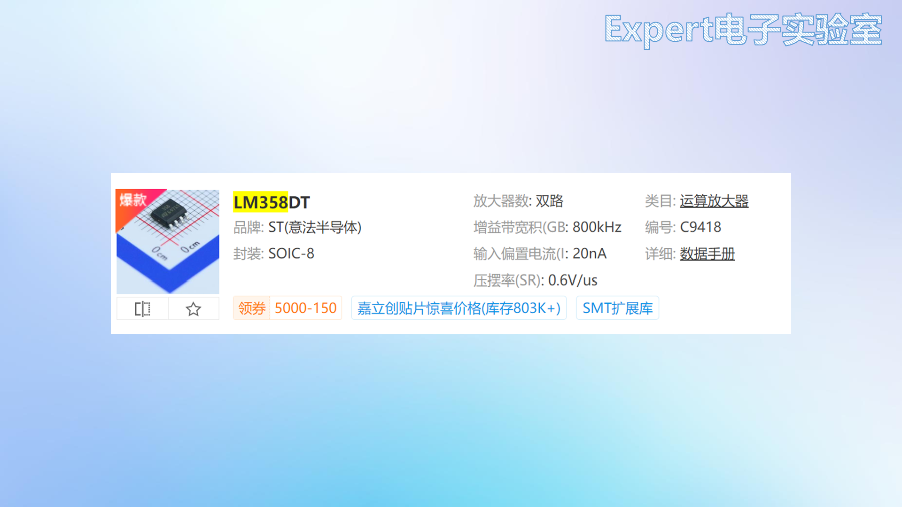

# 04 软件入门与自建元件库

## 学习目标

- 装好立创EDA专业版桌面端，选对运行模式与备份策略。
- 认全原理图、PCB 两个界面的功能区与高频菜单。
- 按推荐值配好设计环境与 DRC 规则，说清每个值的来历。
- 从数据手册出发，独立完成"符号 → 封装 → 绑定 → 上板验证"。

## 目录

1. 安装：选桌面客户端，不要在线版
2. 界面导览
3. 设计环境设置：一次调好，全程受益
4. 快捷键速查
5. 为什么库这么全还要自己画
6. 绘制元件符号（Part）
7. 绘制封装（Footprint）
8. 绑定封装并上板验证

## 1. 安装：选桌面客户端，不要在线版

官网下载时有两个选项：**在线编辑器**在浏览器里运行，工程和库都在服务器上，网络一抖就卡；**桌面客户端**把界面跑在本地，响应快、支持离线，工程也能落到本地磁盘。务必选桌面客户端。

安装流程很直接：下载对应系统的专业版安装包（几百 MB，安装很快）→ 以管理员身份运行 → 选择安装位置 → 启动后登录账号。首次使用按官网提示下载**激活文件**完成激活，激活与账号绑定，换机后重新登录即可。

**三种运行模式**在右上角齿轮 → 系统中切换：

- **全在线**：工程与个人库保存在服务器，换任何一台电脑登录都能继续画；
- **半离线**：工程存本地，仍可使用在线系统库；
- **全离线**：全部本地，不能使用在线库，适合涉密或断网环境。

推荐**全在线模式**：省心、不占本地空间，元件库随时可用；需要归档时手动导出工程，得到一个压缩包，拷到哪里都能打开。选择模式后顺手记下**自动备份路径**，软件崩溃或误删时，从该文件夹能找回未保存的版本。这条路径平时用不上，出一次事故就值回票价。

运行模式决定工程与库放在哪里，也决定协作方式。全在线适合多机切换与团队共享，半离线适合网络不稳但需要在线库，全离线只适合涉密环境；模式可以在设置里切换，但切换前要确认工程已同步，否则本地与云端版本会分叉。

自动备份与自动保存是两条独立的保险：自动保存把当前工程写回存储，自动备份保留历史副本；只开其中一个，遇到误删或崩溃仍可能丢稿。备份目录要定期清理，但不要清空最近几天的副本。

## 2. 界面导览

### 2.1 首页面板

首页提供五个入口：新建工程（一切设计的第一步）、打开工程、新建符号或封装（自建元件库用，见第 5~8 节）、迁移标准版工程到专业版、导入 AD 工程（原理图与 PCB 打包成 zip 上传）。新手最常用的是前两个，等到需要自绘器件时再回来看第三个。

### 2.2 原理图界面

- **左侧导航栏**：所有工程、工程设计（当前工程的板子 → 原理图 + PCB）、**常用库**（电阻电容等标准件，画图常从这里拿）、器件标准化（批量分配位号）；
- **右侧属性栏**：点画布显示图页属性，点元件显示元件属性；
- **底部面板**：库（全局搜元件）、日志（操作记录）、DRC（检查结果）、查找（全局搜索）；
- **菜单栏**：文件（新建、保存、导入导出）、编辑（撤销、复制）、视图（适应全部、`Q` 切换单位、网格与网点）、放置（导线、图形注释、**原理图转 PCB**）、设计（设计规则、检查 DRC、**交叉选择**、**布局传递**）、布局（对齐工具）、工具（封装管理器、器件管理器）、导出（网表、PDF）、下单（嘉立创下单助手）。

### 2.3 PCB 界面

PCB 界面比原理图多出**图层栏**（右侧，点击切换当前层），菜单也新增了一批 PCB 专属命令：视图（2D/3D 预览）、放置（过孔、焊盘、板框、铺铜、文本与图片）、设计（从原理图导入变更、PCB 设计规则如安全间距、网络类与差分类管理器）、布线（单路、差分、等长调节、布线角度与模式）、工具（测量、泪滴）。

板子的结构再强调一遍：**工程 → 板子 → 原理图（可多图页）+ PCB**。位号、网络、封装都挂在这棵树上，删除工程会连板子一起删掉。

界面导览的目标不是背菜单，而是知道"这类操作在哪一栏"。原理图阶段高频的是放置、设计（DRC/交叉选择/布局传递）、工具（封装管理器）；PCB 阶段高频的是图层栏、布线、铺铜、设计规则。找不到命令时先想它属于哪一类，再在对应菜单里找，比逐个菜单翻快。

底部面板的库、日志、DRC、查找各有分工：库用来搜器件，日志用来回退误操作，DRC 用来定位错误，查找用来跨图页搜网络与位号。养成用日志回退的习惯，比反复 Ctrl+Z 更可靠。

## 3. 设计环境设置：一次调好，全程受益

设置 → 系统 → 通用。以下是推荐配置；有旧软件习惯的按自己偏好改，没有的照抄。

### 3.1 通用选项

| 分类 | 推荐设置 |
| --- | --- |
| 系统 | 国库管理简易模式；双击工程新窗口打开；画布缩放用滚轮 |
| 原理图 | 单位 mil；网格类型"使用网格"；十字光标大；默认网格 0.05、**Alt 吸附 0.01**（按住 Alt 临时细化网格）；移动符号导线默认跟随 |
| PCB | 网格显无；**新建 PCB 默认单位 mil，新建封装默认 mm**（画封装对照数据手册，手册是毫米）；每次旋转 90° |
| 布线 | **不勾选"优先放置盲埋孔"**（工艺贵，普通板用通孔即可）；保存前检查 DRC |
| 显示 | 主题选嘉立创EDA；未激活层透明度 60%（当前层更突出） |
| 快捷键 | 配置选**嘉立创EDA标准版**（好记顺手） |
| 顶部工具栏 | 按需勾选；**对齐相关全部勾上**（对齐操作高频，点按钮比背快捷键快） |
| 保存 | **开启自动保存（10 分钟）+ 自动备份**——防崩溃丢稿的生命线 |

新建 PCB 用 mil、新建封装用 mm，是因为两类工作的参照系不同。PCB 的布线规则、安全间距、线宽习惯以 mil 表述（6mil、10mil、40mil 都是常用值）；封装的尺寸直接来自数据手册的工程图，手册标的是毫米（1.27mm、3.9mm）。单位跟着参照系走，可以少做一次心算换算，也少一次换算错误。

网格与吸附决定画图精度。默认 0.05 英寸（50mil）网格适合摆放，Alt 吸附 0.01 英寸用于微调；封装绘制用 0.05mm 或 0.1mm 网格，保证焊盘中心落在整数坐标上。网格太粗，元件对不齐；网格太细，拖动时容易落到非整数位置，丝印与焊盘反而错位。

### 3.2 设计规则（DRC 判据）

**原理图设计规则**的检查项全部勾选即可。本课程会关掉"元件属性与供应商编号匹配"这一项：它面向 SMT 贴片下单，自行焊接时没有意义，留着只会一直报警告。规则的作用是让 DRC 结果可信，警告太多就等于没有警告。

**PCB 设计规则**比原理图复杂，画板前先设好。

| 规则项 | 推荐值 | 说明 |
| --- | --- | --- |
| 安全间距 | 默认矩阵（导线-导线 6mil 量级） | 矩阵的读法：**行与列的交叉格**就是两类对象间的最小间距，如"焊盘行 × 导线列"格 = 焊盘到导线的间距 |
| 线宽 | 最小 5 / 最大 100 / **默认 10 mil** | 默认 10mil 就是信号线宽 |
| 差分对 | 线宽同信号线、间距 6、误差 10mil | 要求高的项目把误差改 5mil（见 [06 项目二：USB拓展坞](06%20项目二：USB拓展坞.md)） |
| 过孔 | 外径 24 / 孔径 12 mil | 通孔默认值 |
| 铺铜 | 连接方式**发散**，发散线宽与间距 10、角度 90° | 直连焊接散热太快，需要大功率烙铁；发散即十字连接 |
| 阻焊拓展 | 2mil | 阻焊开窗比焊盘略大，抵消对位公差 |
| 网络规则 | 可按网络单独设置 | 电源网络可单独放宽线宽（见 [05 项目一：51单片机核心板](05%20项目一：51单片机核心板.md)） |

规则里的最小值指向的是设计下限，不是工艺上限。嘉立创常规双面板工艺大致是 6/6mil（线宽/间距），板厂能做到更细，但往往要加价或换工艺档。把默认线宽定在 10mil、安全间距定在 6mil，既有余量，也在免费打样的工艺范围内；等做高速板需要 4/4mil 时，先确认板厂的工艺能力再改规则，否则设计做出来没人能生产。

安全间距要按电压与工艺分档。低压信号 6mil 足够；市电或高压区要按爬电距离加宽，必要时开槽；BGA、QFN 的焊盘间距小于 0.5mm 时，阻焊桥与蚀刻补偿比间距本身更难控制。网络类管理器可以把电源、差分、时钟分组，避免一条全局规则管死所有网络。

线宽与电流的关系可用 IPC-2221 的经验式估算：

$$
I=k\,\Delta T^{0.44}\,A^{0.725},
$$

其中 $A$ 为铜箔截面积（$\mathrm{mil}^2$），外层 $k\approx0.048$，内层 $k\approx0.024$。1oz 铜厚 1.37mil，10mil 线宽的截面积约 13.7mil²，代入可得 10℃ 温升下约 0.9A；内层散热差，同样线宽只能按约一半到七折使用。

## 4. 快捷键速查

| 快捷键 | 功能 | 快捷键 | 功能 |
| --- | --- | --- | --- |
| `Q` | mil / mm 单位切换 | `Shift + X` | 交叉选择（原理图 ↔ PCB 定位元件） |
| `Ctrl + S` | 保存 | `Ctrl + Shift + X` | 布局传递（按原理图布局映射到 PCB） |
| `Alt`（按住） | 临时细化网格吸附 | `R` | 快速放置矩形框 |
| `W` | 布线 | `V` | 放置过孔 |
| `B` | 切换到底层 | `Alt + D` | 差分对布线 |
| `T` | 放置文本 | `Ctrl + Z` | 撤销 |

快捷键的价值在于把注意力留给判断。布线时想的是"这条线该走哪层"，而不是"移动命令在哪个菜单"；两小时的板子有一半时间耗在找菜单上，熟练之后这部分时间可以省下来。

快捷键要形成肌肉记忆，但不要一开始全背。先掌握移动、旋转、布线、过孔、单位切换、交叉选择这几个高频操作，其余用到再查；软件允许自定义快捷键，把最常用的命令放到左手可及的位置。

## 5. 为什么库这么全还要自己画

两个理由。**在线库不可能覆盖所有元件**：冷门芯片、厂家定制件、老器件，总有一天搜不到；**自绘符号与封装是基本功**，想在硬件方向深入，就必须能照着数据手册把一颗器件准确地画出来。整个流程完全由手册决定，不需要任何"发明"：手册给引脚表，你画符号；手册给封装工程图，你画焊盘。

流程是单向的：数据手册 → 符号（引脚名、编号、电气类型）→ 封装（焊盘尺寸、间距、丝印）→ 绑定 → 放进原理图 → 转 PCB 验证。任何一步偷懒，后面都会以"焊不上""接反了""装不进去"的形式暴露。

自绘元件攒多了需要管理。个人库支持建分类，把电源芯片、接口、MCU 分开存放，找起来比在几百个条目里翻要快得多；工程告一段落时用导出功能把个人库打包成一个文件，换电脑或重装系统后导入即可恢复，比逐个重画省事。几个人协作时还可以放进团队库共用一套符号与封装，避免同一颗器件被画出三个版本。

分类维度可以是"电源/接口/MCU/阻容"，也可以是项目；命名与立创商城型号保持一致，方便搜索与复用。库文件要定期导出备份，别等重装系统才想起。

符号的引脚电气类型决定 ERC 能查出什么：电源脚短路、输出对输出、输入悬空，都靠类型识别。类型全填"无源"等于关掉 ERC；填错类型则会制造假报错。画完符号先跑一遍 ERC，再放进正式工程。

## 6. 绘制元件符号（Part）

目标：按厂家手册给出的符号，复刻 LM358DT（双运放，SOP-8）的符号。

1. **新建元件**：文件 → 新建 → 新建元件，命名 `LM358DT`，分类与描述可留空；
2. **找参照**：立创商城搜 LM358DT → 打开数据手册 → Features 页通常有厂家提供的符号图，照着画，不要自己重新安排引脚位置；
3. **画外框**：用工具栏的矩形，在画布原点附近画一个矩形框，大小以容纳 8 个引脚为宜；
4. **放置引脚**：SOP-8 共 8 脚，左右各 4。引脚符号两端不同：**带电气点（灰色圆点或十字端）的一端朝外**，用于连线；平端贴住芯片边框。先放一侧 4 个并等间距排列，再放另一侧；
5. **填引脚属性**（选中引脚，在右侧属性栏）：
   - **引脚名称**填功能名（OUT1、IN1-、IN1+、VCC-、IN2+、IN2-、OUT2、VCC+），照手册抄；
   - **引脚编号**是横杠上方的数字，**沿封装逆时针 1→8**：SOP 左侧从上到下 1~4，右侧从下到上 5~8；4 脚 VCC- 在单电源电路里接地，8 脚 VCC+ 接正电源，两者不要写反；
   - **引脚长度**默认偏长，改短（如 0.2→0.1）让符号紧凑，画完再整体外移对齐；
6. **1 脚标识**：放置 → 线条 → 圆形，在 1 脚旁画一个小圆点；按住 `Alt` 可细化网格，便于对准；
7. 保存。在库面板 → 个人 → 全部里就能找到自绘符号，此时"封装"一栏还是空的，下一步补上。

每个引脚还有一个容易漏填的属性：**电气类型**，可选输入、输出、双向、电源、无源等。它不进入制造文件，却决定原理图 DRC 能查出哪些逻辑错误——两个输出脚接在一起、电源脚被短路到地，都靠这个属性识别。LM358 的 OUT1/OUT2 设为输出、IN 系列设为输入、VCC+ 设为电源，检查才有依据；类型全填"无源"，DRC 就等于没开。

画符号前先确定引脚布局。厂家手册的符号图通常已经按功能分区，照抄最省事；自己重排时把电源放上、地放下、输入放左、输出放右，读图的人能顺着信号走。引脚名称用功能名，编号用封装编号，两者不要混。

引脚长度影响连线美观。太长符号松散，太短不便连线；一般 100~200mil，画完统一对齐。1 脚标识、极性标识、多单元符号的单元编号都要在符号阶段确定，不能留到 PCB 再补。

多单元符号（如双运放、四与非门）要把 A/B/C/D 单元与电源单元分开画，电源脚只画一次，避免同一颗芯片在图上出现两套电源。层次图里的子图符号只保留输入输出端口，内部电路放在子图页。

## 7. 绘制封装（Footprint）

### 7.1 先复习封装的构成

SOP-8 封装 = 8 个长圆形焊盘（编号与符号一一对应）+ 丝印框（标注实物大小）+ 方向标识（半圆或小圆）+ 1 脚标识（小圆点）。四样东西缺一不可：没有编号无法对应引脚，没有丝印框无法判断干涉，没有方向标识容易贴反，没有 1 脚标识无法定位。

焊盘看着是一块铜，在制造文件里其实分成三层：**铜箔**是真正导电的部分；**阻焊开窗**是比铜箔大一圈的缺口，保证油墨不压到焊盘上；**助焊层（钢网层）**只在贴片时给钢网开孔用，手工焊接可以忽略。画封装时只需要画铜箔尺寸，开窗由软件按阻焊拓展规则自动外扩——这就是 3.2 节要把阻焊拓展设成 2mil 的原因。

封装还应有**丝印框**与**占位/ courtyard**。丝印框标元件本体，方便装配检查；占位框比本体大一圈，用于布局时检查相邻元件是否干涉。两者都不导电，但决定了板子装不装得下。

### 7.2 从数据手册取尺寸

打开手册的 **Package Information** 章节，SOP 封装工程图给出三视图与尺寸表，需要四个关键尺寸。

| 尺寸 | 含义 | LM358DT 取值 |
| --- | --- | --- |
| B | 引脚宽度（剖面图） | 最大 0.48mm → 焊盘宽取 **0.6mm** |
| L1 | 引脚长度（剖面图） | 典型 1.04mm → 焊盘长取 **1.9mm** |
| e | 相邻引脚中心距（顶视图） | **1.27mm** |
| E1 | 两排引脚中心距（顶视图） | 3.9mm → 两排焊盘**中心距 = 3.9 + 1.9 = 5.8mm** |

焊盘比引脚略大，是为了容纳贴片机的对位误差和焊锡的润湿范围。宽度从 0.48mm 放大到 0.6mm，多出 0.12mm；长度从 1.04mm 放大到 1.9mm，是因为焊盘还要向引脚外侧延伸出一段"脚跟"，让焊锡形成可靠的 fillet。放大过头会相邻短路，所以宽度只放 0.12mm，不能再多。

两排焊盘中心距的算法容易错。E1 是两排**引脚**的中心距，焊盘中心要落在引脚中心上，所以焊盘中心距等于 E1 加上焊盘长——焊盘向引脚外侧伸出的那一段，在两侧各占一半。代入得 $3.9+1.9=5.8\,\mathrm{mm}$，若直接填 3.9mm，两排焊盘会向内缩，芯片根本放不进去。

焊盘尺寸可以从手册的三个参数推：宽度取引脚宽度 b 的最大值再加 0.1~0.2mm，长度取引脚长度 L 的典型值再向外延伸 0.5~0.8mm。延伸段不是越大越好：太长会让相邻焊盘靠得太近，回流焊时连锡；太短则焊锡形不成可靠的 fillet。

### 7.3 绘制步骤

1. **新建封装**：文件 → 新建 → 新建封装，命名 `LM358DT`；
2. **放第一个焊盘在原点**：放置 → 焊盘 → 单焊盘。默认是通孔焊盘，表贴封装要改**层为顶层**、形状选**长圆形**，宽 0.6、高 1.9（单位 mm，来自第 3 节的默认单位设置）；
3. **复制出同侧另外 3 个焊盘**，有三种方法，从笨到巧：
   - 逐个复制后手填坐标：X = 0、1.27、2.54、3.81，Y 全为 0；
   - **智能尺寸**：用工具栏的智能尺寸依次点两个焊盘中心标注距离，改成 1.27，逻辑同 SolidWorks；
   - **条形多焊盘（线性阵列）**：放置 → 焊盘 → 条形多焊盘，从原点向右拉，`Tab` 设数量 4、间距 1.27——自动排列并**自动编号**，最快；
4. **放另一排**：复制 4 个，把 1 号焊盘中心的 Y 改为 5.8（= E1 + 焊盘长），其余**顶对齐**跟随；
5. **改编号**：SOP 逆时针排列——左排 1~4（上→下），右排 5~8（下→上）；
6. **画丝印**：切到**顶层丝印层**，用折线画丝印框（约芯片实物大小，不压焊盘），用半圆或小圆标方向，1 脚旁放实心小圆（半径 0.15mm、线宽 0.3mm）作标识；
7. 保存。

丝印框画在元件本体外侧，不能压焊盘；1 脚用实心圆点或缺口标识；极性器件加正负极标记。3D 模型不是必需，但有了可以在布局阶段检查高度干涉，建议从厂商或立创库导入。

## 8. 绑定封装并上板验证

1. **绑定**：库面板 → 器件 → 个人 → 右键 LM358DT → 绑定封装 → 选个人库中刚画好的封装；
2. **验证**：打开测试工程，把自绘元件放到原理图 → 点"更新原理图到 PCB" → 应用修改 → PCB 上出现封装 → 用 3D 视图确认。没有导入 3D 模型不影响绘制与生产，只影响预览观感。

焊盘编号与符号引脚编号对不上，是自建库最常见也最致命的错误：符号上 1 脚是 OUT1，封装上 1 脚却落在 IN1+ 的位置，板子焊出来运放全反，调试时怎么量都不对。绑定后务必在 PCB 里点开封装核对一次编号与 1 脚位置，这一步只花一分钟。

绑定后要做三步验证：原理图里放一个实例，转 PCB 看封装是否带出；用交叉选择确认引脚对应；用 3D 预览确认方向与高度。绑定错误在原理图阶段只表现为网表不对，到了 PCB 才变成焊盘错位，越早发现越便宜。

自建库的坑基本落在四处：**编号错位**，符号与封装的 1 脚不是同一个位置；**尺寸取错**，焊盘按手册典型值而不是最大值画，贴片时引脚盖不满焊盘；**镜像**，把顶层封装直接放到背面，焊盘顺序左右颠倒；**漏标识**，没有 1 脚圆点，装配只能靠猜。四条都能在转 PCB 后用封装管理器加 3D 预览核对出来，核对成本一分钟，返工成本一次打样。

同一颗器件在多个工程里被改过时，要在库里升版本并记下差异；直接覆盖旧封装，已经画好的板子会悄悄变样。库文件与工程一起归档，才能复现当年的板子。

下一章：[05 项目一：51单片机核心板](05%20项目一：51单片机核心板.md)——用刚调好的环境和自建库能力，做第一块完整的板子。
