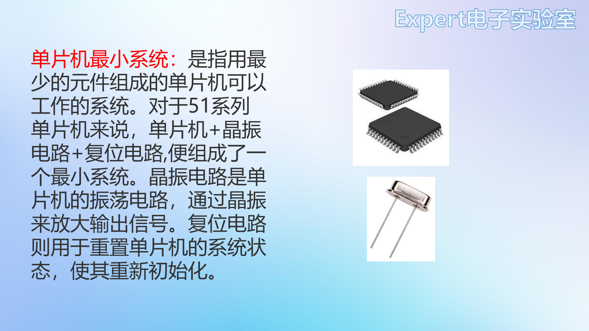
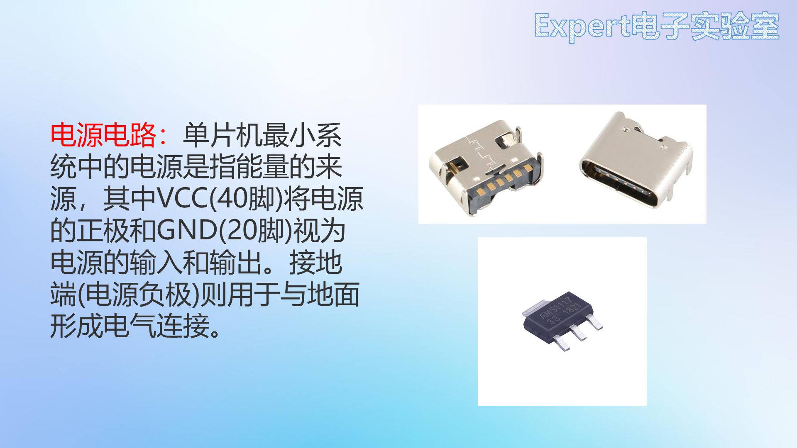
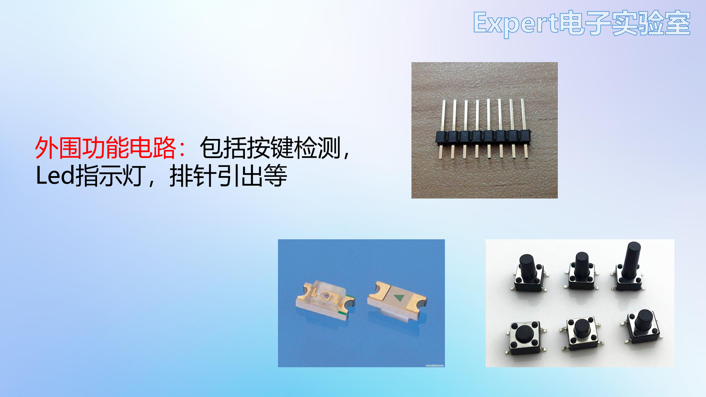
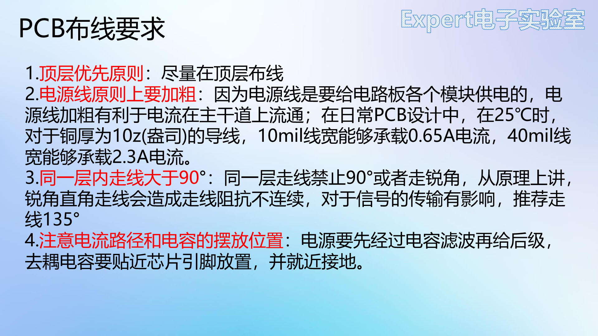
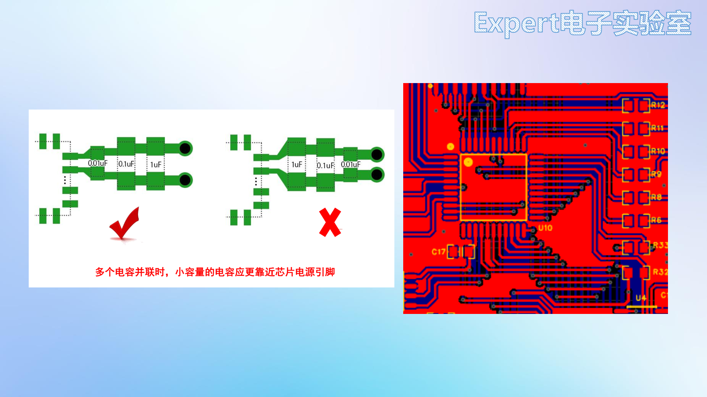
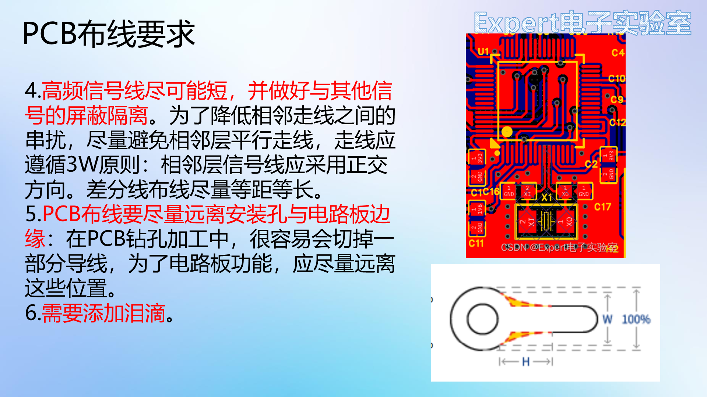

# 05 项目一：51单片机核心板

## 学习目标

- 从数据手册推出最小系统的元件取值，并说清每个取值的作用。
- 按电源、最小系统、外设的顺序画完一张可用的原理图。
- 用交叉选择与布局传递完成布局，判断元件该放在板的哪个位置。
- 按信号、电源、地的顺序布线，处理晶振这类高速信号。
- 独立完成丝印、DRC 与 Gerber 导出，走通一次免费打样。

## 目录

1. 为什么第一个项目选 51 核心板
2. 元件选型：全部来自数据手册
3. 原理图实操
4. PCB 布局
5. PCB 布线
6. 纠错与丝印
7. DRC 检查
8. 导出 Gerber 与嘉立创打板

## 1. 为什么第一个项目选 51 核心板

51 单片机是微机原理课与大多数人入门单片机的第一款芯片。自己做一块核心板，既练 PCB 又辅助学编程：板子上的每个引脚、每个外设都由你亲手接出来，写代码时对硬件的理解会比买现成开发板深一层。封装选 **LQFP**（贴片、引脚细密、可手工焊接），不用 DIP 大块头，画出来的板子更接近真实产品。

市售 51 核心板的核心都是**最小系统**：单片机 + 晶振电路 + 复位电路，通电即可工作。核心板把单片机的全部 IO、电源、串口引到排针上，外接模块就能做实验。这个"最小 + 全引出"的结构，正好覆盖 PCB 设计的主要动作：电源、去耦、晶振、复位、上拉、接口、丝印。

核心板与开发板的差别在于"最小"与"全引出"。开发板把 USB 转串口、按键、显示、扩展接口都做在板上，拿来就能用；核心板只保留单片机工作必需的最小系统，把 IO 全部引到排针，体积小、成本低，适合嵌进自己的项目。画核心板的过程，就是把"芯片能工作"所需的每一颗外围都交代清楚。

## 2. 元件选型：全部来自数据手册

### 2.1 主控：STC89C52RC（LQFP-44）

到宏晶 STC 官网下载 STC89C52 系列数据手册，第 11 页直接给出**厂家最小系统应用电路**，这就是原理图的底稿：

- 复位电路接 RST 引脚；
- 晶振电路用 **12MHz 晶振 + 两颗 47pF 谐振电容**（负载电阻可省）；
- 电源经开关与滤波电容进入系统。

数据手册示例用的是 DIP 封装的引脚布局（VCC 在 40 脚、GND 在 20 脚），LQFP-44 的引脚位置不同但功能一致，照抄参数没有问题，连线时按 LQFP 的引脚号重新对应即可。

LQFP-44 的引脚间距是 0.8mm，手工焊接难度中等：先在焊盘上薄薄上一层锡，芯片对准 1 脚后固定对角两脚，再用尖头烙铁逐边拖焊，最后用吸锡带清掉连锡。选它而不是 DIP，是因为 DIP-40 的封装占掉半块 70×40 的板子，排针和外围就没地方放了。

### 2.2 其余选型

| 电路 | 选型 | 依据 |
| --- | --- | --- |
| 供电接口 | **6pin Type-C** | Type-C 分 6pin（仅供电）、16pin（USB2.0）、24pin（USB3.0），只取电选 6pin |
| 稳压 | **AMS1117-3.3** | USB 输出 5V；单片机系统电流小，LDO 经济实惠（手册：输入输出各 10µF 滤波） |
| 调试 | 微动贴片按键 ×2 | 按键检测 |
| 指示 | 0805 贴片 LED | 状态指示 |
| 扩展 | 排针全部引出 | 外接模块 |

6pin Type-C 只保留 VBUS、GND、CC1、CC2 六个触点，不带 USB2.0 数据对；本项目只取电，6pin 足够，焊接也比 16pin 容易。要传数据就换 16pin，DP/DM 两对都要接，否则反插时不通。

选型的共同依据是"够用 + 好焊 + 便宜"。AMS1117 的压差约 1.1V，5V 输入降到 3.3V 有 1.7V 余量，200mA 以内的负载都能稳住；系统电流只有几十毫安，LDO 的效率损失可以接受，换来的是外围只需两颗电容。

选型不是挑最便宜，而是让每个参数都有余量。主控看供电、IO 数量、封装与下载方式；稳压看输入范围、输出电流、压差与热阻；接口看机械强度与插拔寿命；阻容看精度、功率与封装。把选型依据写进原理图注释，改板时才知道为什么选它。STC89C52RC 的 8 位内核、512B RAM、8KB Flash 对核心板足够，LQFP-44 的 0.8mm 间距手工可焊，换成 DIP-40 则会占掉大半板面。

## 3. 原理图实操

新建工程 `51单片机核心板`，把板子、原理图、PCB 分别重命名。画图顺序按电流流向：先电源，再最小系统，最后外设。

### 3.1 电源电路

1. **6pin Type-C**：VBUS 加 `+5V` 标签；GND 与 EP 固定脚接地；**CC1/CC2 各经 5.1kΩ 电阻下拉接地**。USB Type-C 规范规定受电端（sink）在 CC 上接 5.1kΩ 下拉电阻 Rd，源端检测到 Rd 才打开 VBUS 并输出 5V。不接这两颗电阻，用 C-to-C 线连电脑时板子可能完全不上电；
2. **拨动开关**：6 脚开关只用一侧 3 脚（公共端加一侧），另一侧 3 脚全部接地，防止焊盘悬空。开关串在 Type-C 与稳压器之间，用来切断整板电源；
3. **AMS1117-3.3**：VIN 接开关输出，VOUT 输出 3.3V 标签，GND 接地；
4. **电源指示灯**：3.3V → LED（0805 绿）→ 1kΩ 限流 → 地，3.3V 正常即亮。绿色 LED 压降约 2.0V，电流 $(3.3-2.0)/1000=1.3\mathrm{mA}$，亮度偏弱但足够指示；
5. **滤波电容**：查 AMS1117 手册，输入输出各 10µF；每侧用 **10µF + 0.1µF 并联**。10µF 管低频储能，0.1µF 管高频旁路，两者频段互补。

整板电流不大，但要算一遍才能确认 LDO 不会过热。单片机约 20mA，两颗 LED 共约 3mA，指示灯与杂散按 5mA 计，合计不到 30mA。AMS1117 的压差为 $5-3.3=1.7\mathrm{V}$，耗散功率 $P=1.7\times0.03=0.051\mathrm{W}$；SOT-223 封装的热阻约 50℃/W，结温比环境高约 2.6℃，室温下毫无压力。若换成 5V 输入、500mA 负载，耗散就到 0.85W，结温升 40℃ 以上，必须改 DC-DC——这就是 03 章"大功率用 DC-DC、小功率用 LDO"的定量依据。

CC 下拉电阻的作用是让源端识别"这是一个受电设备"。Type-C 规范里 Rd=5.1kΩ，源端检测到 CC 电压落在约定区间才打开 VBUS；两颗电阻分别接 CC1/CC2，缺一颗，反插时就不上电。电阻精度用 5% 即可，但阻值不能随意改，改大了源端可能识别成别的电流档位。

去耦电容不是"越多越好"，而是"越近越好"。芯片开关瞬间的电流由最近的电容提供，电容到引脚之间的走线电感会形成电压尖峰；0.1µF 负责高频，10µF 负责低频，二者并联覆盖更宽的频段。布局时 0.1µF 贴引脚，10µF 放在稍远处。

AMS1117 的稳定性依赖输出电容的 ESR，手册要求输出电容落在一定范围内；用低 ESR 的陶瓷电容替换钽电容时，要确认手册允许，否则可能振荡。输入输出各 10µF 是课程的保守配置，实际布线时 0.1µF 贴引脚、10µF 放在入口，兼顾高频与储能。

开关的额定电流要覆盖整板峰值电流；拨动开关接触电阻小，适合电源通断，轻触按键只能做信号，不能直接串在电源里。开关拨到"关"只切断稳压器输入，Type-C 一侧仍带电，检修时先拔线。

### 3.2 最小系统

1. 放置 STC89C52RC（LQFP-44）。供电范围 3.3~5.5V，**本板接 5V**：VCC 接 VCC5，GND 接地，芯片旁放一颗 **100nF 去耦电容**。去耦电容的作用是给芯片瞬间的大电流提供本地来源，避免电流从远处电源绕过来时在走线电感上产生压降；
2. **每个引脚加网络标签**（按引脚默认名 P0.0~P4.7 等），后续电路全靠标签连接。标签比拉长导线清晰，也方便布局时分模块；
3. **晶振电路**：12MHz 贴片晶振接 XTAL1/XTAL2，两颗 **47pF** 谐振电容接地。晶振的负载电容 $C_L$ 由两颗电容串联再并上杂散电容得到：

$$
C_L=\frac{C_1C_2}{C_1+C_2}+C_{stray}.
$$

$C_1=C_2=47\mathrm{pF}$ 时串联值为 23.5pF，加 PCB 与引脚杂散约 5pF，合计约 28.5pF，正好落在常见 12MHz 晶振 27~30pF 的负载电容范围内。换成 20pF 的晶振，起振频率会偏高，长期跑串口会累积误差，所以晶振电容要跟着晶振手册走；
4. **复位电路**：RST 经 10kΩ 电阻接地，电容接在 VCC 与 RST 之间，按键并在电容两端。原理分两种情形：
   - **上电复位**：上电瞬间电容未充电，RST 被拉到 VCC，保持高电平；随后电容经 10kΩ 充电，RST 电压按 $e^{-t/RC}$ 下降，时间常数 $\tau=10\mathrm{k}\Omega\times10\mu\mathrm{F}=0.1\mathrm{s}$。51 单片机是**高电平复位**（与 STM32 低电平复位相反），RST 只要保持两个机器周期以上的高电平就能完成复位，0.1s 远远足够；充电结束后 RST 被电阻拉回低电平，进入运行；
   - **手动复位**：按下按键，电容被短路，RST 直接接 VCC 拉高；松开后电容重新充电，再走一次上电过程。

12MHz 晶振的选取也与指令周期有关。51 的一个机器周期是 12 个时钟，12MHz 对应 1µs，定时器与延时计算都按整数微秒走，代码里的 `for` 循环延时也容易估。换成 11.0592MHz 则是为了串口波特率整除（11.0592MHz 能被 9600 等标准波特率整除），本项目不追求串口精度，选 12MHz 更直观。

晶振布局有三条：电容选 NP0/C0G，温漂小；晶振到芯片的走线尽量短、等长、包地；晶振下方不要走其他信号，避免耦合。晶振频率偏差会累积成串口波特率误差，12MHz 与 11.0592MHz 的选择就是精度与整数便利的取舍。

RC 太大，上电后复位脚长时间为高，程序启动延迟；RC 太小，电源上升慢时可能复位不彻底。按键复位与上电复位共用一条 RC，按键按下时电容放电，松开后重新充电。

如果改 3.3V 供电，晶振与复位参数要重新核对，P0 上拉也要改到 3.3V；电源域混用时，电平转换与上拉位置都要跟着改，不能只换稳压器。

### 3.3 外设电路

1. **按键检测 ×2**（P2.0、P2.1）：按键一端接 IO 一端接地，按下读低电平；并联电容做硬件消抖。软件消抖要等 10~20ms，硬件电容把抖动期间的电压平滑掉，两者可以只用一种；
2. **LED ×2**（P1.0、P1.1）：**IO 接 LED 阴极**，阳极经 1kΩ 限流接 3.3V。51 的 IO 灌电流能力（约 10~20mA）远大于拉电流（不足 1mA），低电平点亮才能获得足够亮度；
3. **P0 口上拉 ×8**：查手册的 IO 结构章节，51 的 IO 有准双向口、仅为输入、开漏输出三种模式，**P0 口上电后是开漏输出，输出不了高电平**。作普通 GPIO 用时必须外接 10kΩ 上拉到 5V；作地址/数据总线时才不需要，因为那时由外部锁存器驱动；
4. **电源引出**：7pin 排针引出 2 路 5V、2 路 3.3V、3 路 GND，给外接传感器供电；
5. **串口引出**：P3.0（RXD）、P3.1（TXD）加 5V、GND 接 4pin 排针，外接 USB 转串口模块下载程序。

整板排针按工程文件分配：两个 16pin 中，一个引出 P0.0~P0.7 与 P2.7~P2.0，另一个引出 P1.0~P1.7 与 P3.0~P3.7；此外一个 7pin 引出 P4.0~P4.6，一个 7pin 做电源，一个 4pin 做串口。排针数量与引脚顺序由封装固定，画原理图时先看封装是 16P 还是 7P，再按手册的引脚号一一对应，不能凭记忆排。

按键的硬件消抖要算时间常数。按键并在 IO 与地之间，P2 口是准双向口、内部有弱上拉，外接 0.1µF 电容时，按下瞬间电容经按键放电，松开后经上拉充电，时间常数约 $10\mathrm{k}\Omega\times0.1\mu\mathrm{F}=1\mathrm{ms}$。机械按键的抖动持续 5~20ms，1ms 只能削掉一部分毛刺，软件里仍要延时 10~20ms 再读第二次；硬件电容让抖动期间不产生完整的高频脉冲，软件延时才是决定性的。

LED 的限流电阻按灌电流算：3.3V 经 1kΩ 到 LED 阳极，阴极接 IO，IO 输出低电平时电流 $(3.3-2.0)/1000=1.3\mathrm{mA}$，51 的灌电流能力足够；若希望更亮，把电阻降到 470Ω，电流约 2.8mA，仍在 IO 与 LED 的允许范围内。P0 的上拉取 10kΩ 是折中：太小会增加输出低电平时的灌电流，太大则上升沿变慢、驱动能力弱；10kΩ 在 5V 下提供约 0.5mA 上拉电流，足够驱动 CMOS 输入。

上拉电阻在 IO 输出低电平时承受 5V，10kΩ 的功耗只有 $5^2/10\mathrm{k}=2.5\mathrm{mW}$，可以忽略；如果改成 1kΩ，功耗升到 25mW，八路同时拉低就是 0.2W，还会让 IO 灌电流接近上限。上拉不是越小越好，够用即可。

51 的 P1/P2/P3 准双向口内部有弱上拉，作输入时先写 1；P0 没有，所以必须外拉。按键接在 P2 上不需要外部上拉，靠内部弱上拉即可，这也是本板按键只加电容、不加电阻的原因。

LED 限流电阻的功率按 $I^2R$ 算：1.3mA 在 1kΩ 上只有 1.7mW，0805 绰绰有余；若驱动大功率 LED，电流到几百毫安，电阻功率与散热都要重新选。

### 3.4 整理与 DRC

- 模块化摆放：电源左上、最小系统居中、晶振复位在侧、排针右侧、按键 LED 左下；用**放置 → 矩形框**（快捷键 `R`）逐框包住并写中文名称；右下角标题栏填学校与姓名；
- **检查 DRC**：若报"元件属性与供应商编号不匹配"警告，它属于 SMT 检查项，在设计规则里关掉该条 → 清空重检 → **0 错误 0 警告**。

整理阶段还要检查网络标签有没有同义异名、NC/NF 有没有标、标题栏与版本号有没有填。这些不影响连通性，却决定别人能不能接手你的图。

## 4. PCB 布局

### 4.1 布局的通用要求

蓝桥杯 EDA 组考题对布局的要求同样适用于一切板子：

1. **元器件相互平行或垂直排列**，整齐美观，不要东横西竖；
2. **排列紧凑、分布均匀、疏密一致**，不留大片空白，也别局部堆死；
3. "所有元件放顶层"是给回流焊大批量生产定的规矩，自己手焊放哪层都行。

再补三条实战原则：

4. **按电气与使用特点布局**：接口、按键、排针放**板边**（Type-C 放板中间根本没法插线）；屏幕与主控放**中央**；电源电路放**电源输入旁**，并注意电流路径与滤波电容位置；**晶振贴着单片机放**；
5. **元件是三维的**：注意高度，屏幕插座下方不能放高元件，否则装不上外壳；
6. **模块化布局**：同一功能的电路放同一区域，方便布线与调试。

布局的第一目标是让电流与信号走最短的路，第二才是整齐。电源从接口进来，经过开关、保险丝、滤波，再到负载，这条链上的元件按顺序摆；晶振、复位、去耦这些"怕干扰"的电路靠近主控；接口、按键、排针靠板边，方便操作。

板框与定位孔先定，再摆元件。板框尺寸受外壳、打样价格与机械强度约束；板框与孔锁定后再布局，避免拖动时误改。

### 4.2 转 PCB、板框与定位孔

1. 原理图界面先跑一遍 DRC，确认干净 → 工具栏**原理图转 PCB** → 应用修改，全部元件带飞线进入 PCB；
2. **板框**：切到板框层 → 放置 → 线条 → 矩形（起点对准原点）→ 属性里精确输入 **宽 70mm × 高 40mm**（免费打样上限 100×100mm）→ 右键 → 添加 → **圆角 3mm**，防划手也更好看；
3. **定位孔 ×4**：放置过孔，`Tab` 设**外径 4mm / 内径 3mm**（M3 螺丝孔），坐标参数化输入：

| 孔 | X (mm) | Y (mm) |
| --- | --- | --- |
| 左上 | 2.6 | -2.6 |
| 左下 | 2.6 | -37.4（= 40 - 2.6） |
| 右上 | 67.4（= 70 - 2.6） | -2.6 |
| 右下 | 67.4 | -37.4 |

4. 板框与定位孔全部选中 → 右键**锁定**，防止后续误拖。

板框尺寸不是随便定的。免费打样上限 100×100mm，70×40mm 的板子还有余量；板子越小越便宜，但接口、定位孔与排针间距不能省。板边到铜皮要留安全距离，钻孔与 V-cut 会吃掉一部分边缘，线走得太靠边容易被切到。

排针的间距固定为 2.54mm（100mil），画板时不必逐个核对，但放置时要注意方向：双排排针的两排中心距也是 2.54mm，若与丝印框错位，装配时会插不进去。定位孔到板边的 2.6mm 也不是随意取的：M3 螺丝头直径约 5.5mm，留出 2.6mm 才不至于让螺丝头压到板边或元件。

### 4.3 预布局：两个关键快捷键

| 快捷键 | 名称 | 作用 |
| --- | --- | --- |
| `Shift + X` | **交叉选择** | 原理图选中元件 ↔ PCB 高亮同一元件，双向定位 |
| `Ctrl + Shift + X` | **布局传递** | 原理图框选一个模块 → PCB 中元件按原理图相对位置自动摆放 |

先关掉 GND 的飞线（最后统一铺铜，飞线只会碍事），再按原理图的模块逐块布局传递：电源、按键、引脚引出、单片机、晶振、复位、按键检测、LED、排针。先在板外摆成"拼装好的零件"，再整体上板，比一个一个拖快得多。

预布局用布局传递把原理图的模块关系搬到 PCB，再手工微调。先摆大件（主控、接口、晶振），再摆小件（阻容）；先摆固定位置的（板边接口），再摆可移动的。布局不是一次成型，布线发现不顺时要回布局调整。

### 4.4 上板布局要点

1. **电源模块**：Type-C 与开关放板边，方便插线与拨动；**CC 下拉电阻贴着 Type-C**；按电流流向排布：Type-C → 开关 → LDO → 输出；**滤波电容先大后小**——10µF 远离芯片、0.1µF 贴近芯片引脚，输出侧同理，3.3V 出来先过小电容再过大电容；
2. **主控**：单片机放板子中央（本板放在中轴线 Y = -20 上），两排排针贴板边对称放置，中间留丝印空间；串口排针放左侧空位；
3. **晶振**：贴近晶振引脚，并**与两引脚轴对称**——这样两根晶振线天然等长，为布线埋好伏笔（见 5.5 节）；
4. **P0 上拉电阻**：放 P0 口附近，本板挪到**底层**（属性 → 图层 → 底层，`B` 切换视角），贴近引脚并与排针对齐；
5. **按键**：与晶振轴对称放置（P2.0、P2.1 引脚在上方，按键放右上方便走线）；
6. **LED**：放中间，3.3V 出线就近；位号先删，之后统一加功能丝印（POWER）；
7. 全程用**对齐工具**（顶对齐、水平与垂直等距分布、中心对称）并调整丝印位号位置；发现左下角过密，就把按键挪到右上角平衡疏密。

布局完成的判断标准是：**方向一致、疏密一致、电流路径顺畅、每个功能模块成块**。用 3D 预览整体看一遍，比在 2D 里盯半天更容易发现高度冲突和比例失调。

3D 预览能发现 2D 看不出的问题：元件高度冲突、接口方向反了、丝印被外壳挡住。布局完成后至少看一遍正反面，再开始布线。

## 5. PCB 布线

### 5.1 不要用自动布线

无论何时都不要使用自动布线。目前没有任何软件的自动布线能达到合格硬件工程师的手工水平，它只会把线连通，不会考虑回流路径、载流、串扰和后期改板。把"自动布线"当成不存在的功能。

自动布线的结果看起来整齐，实际上常常把电源与信号混在一起、过孔乱打、长度不受控；改一处，整片重排。手工布线虽然慢，但每一步都知道为什么，后期改板也只需动局部。

### 5.2 六条布线要求

1. **顶层优先**：尽量在顶层布线，走不通再切底层，避免底层乱成一团；
2. **电源线加粗**：电源线要给全板供电，主干道必须宽。25℃、1oz 铜厚下，**10mil 线宽约载 0.65A，40mil 约载 2.3A**（按 IPC-2221 曲线估算，温升越大载流越高）。信号线默认 10mil，电源线至少 40mil 起步；
3. **同层走线夹角大于 90°，推荐 135°**。直角与锐角有三个问题：工艺上腐蚀锐角会产生三角效应，使线宽变窄（现代工艺已少见）；阻抗不连续，影响信号；锐角像天线，高频时向外辐射。圆弧走线更美但效率低，135° 是效率与美观的平衡；
4. **注意电流路径与电容位置**：电源**先经过滤波电容再给后级**，不允许先拉线给后级、再远程接电容；**去耦电容贴近芯片供电引脚、就近打孔接地**，小容量电容最靠近引脚：

5. **高频信号线尽可能短**，并与其他信号隔离；相邻层避免平行走线，遵循 **3W 原则**（线间距不小于 3 倍线宽），相邻层正交布线降低串扰；**差分线等距等长**；
6. **远离安装孔与板边**（钻孔容易切到线），完成后**添加泪滴**：

泪滴补强过孔与导线的连接面积，保护焊盘在受热或受力时不至于从铜皮上撕开。设计完成后统一添加，或在设置里开启自动添加。

线宽可以用 IPC-2221 的经验曲线核对。1oz 铜厚、允许 10℃ 温升时，外层 10mil 约载 0.9A、20mil 约 1.5A、40mil 约 2.4A、60mil 约 3.2A；内层散热差，同宽度只能按七折估算。课程给出的 0.65A 与 2.3A 是偏保守的工程值，实际布线时把 10mil 当 1A 以内、40mil 当 2A 左右使用，余量用来吸收温升与铜厚偏差。

### 5.3 布线顺序

原则是**关键元件优先、关键信号线优先、密度优先**：从连线最密集的区域开始；DDR、射频、时钟等关键部分先布（此时板子最空、最好走）；次要信号顾全整体，不与关键信号抵触。本板的执行顺序：**信号线（单片机）→ 电源 → 铺地**。

布线顺序不是固定的，但有一条原则：先难后易。晶振、差分、高速、电源这些约束多的线先走，普通 IO 后走；先走的线占用最好的通道，后走的线绕路代价小。

回流路径与信号路径同样重要。信号从顶层走到哪，回流就从最近的地平面或地线走回源端；地平面被分割、过孔太远，回流被迫绕行，环路面积变大，辐射与串扰上升。铺地前先想回流，而不是铺完再说。

### 5.4 信号线实操

先隐藏电源与 GND 飞线，屏幕上只剩信号。按 `W` 布线，`Q` 切 mil，`Tab` 设线宽 **10mil**：

- **从焊盘短边引出**：长圆形焊盘若从长边出线会形成直角，从短边出线天然平直；
- **横平竖直**，拐弯 135°，同束线**间距相等**，上下**对称**；大量斜线既难看，也给后续布线添乱；
- **能走顶层不打过孔**；个别不好出的引脚（如 P1.0）按 `B` 自动打过孔切底层绕出；
- **布局为布线让路**：发现按键左右顺序不顺走线，就回布局把它对调（以晶振为轴对称），布局不是一次定死的；
- **不要从元件内部穿线**（如从两颗 LED 之间穿过），需要时在焊盘上打过孔走底层；
- P0 口上拉电阻在底层，直接就近连接；P4 口走底层到排针，过孔位置灵活调整避让交叉；
- 串口 P3.0/P3.1、复位线走底层绕行；**CC 线从 Type-C 反方向走**，不干扰正面电源线，也省过孔；
- 开启自动泪滴：设置 → PCB → 通用 → 布线 → 勾选"自动添加泪滴"。

走线的"好看"不是审美问题。同束线等距、拐角一致、过孔成列，意味着任意两条线的长度与耦合关系可预期；随手拉出的斜线会让某两条线意外平行很长一段，串扰就在那里产生。检查时可以隐藏丝印，只看铜箔，整齐与凌乱一眼可辨。

### 5.5 晶振：等长 + 包地 + 禁铺区

晶振是板上频率最高的信号，按高频原则处理：

1. 建立差分对：设计 → 网络 → 差分对 → 添加（XTAL1 为正网络，XTAL2 为负网络）；
2. **差分对布线**（快捷键 `Alt + D`）：软件实时显示两线长度差。轴对称布局加对称走线天然等长，把误差压进 **10mil** 内，提示条变绿即合格；
3. **包地**：按 `V` 放过孔（外径 24、内径 12，**网络 GND**）绕晶振一周，外侧对齐排列（顶对齐加垂直等距）；用 **20mil** 地线把过孔串成一圈（40mil 太粗，占空间）；晶振接地焊盘并入包地环。一圈接地过孔加地线的屏蔽原理与**法拉第笼**相同：外部电磁场在环上感应出电流，环内区域被屏蔽；
4. **禁止区域**：放置 → 禁止区域 → 多边形，框住整个晶振电路（含过孔环），层选**多层**、内容选**禁止铺铜**，防止最后铺铜挤进晶振区引入干扰。

晶振处理按高频信号做：包地、禁铺、短走线、等长。包地过孔要围成一圈并接到地；禁铺区防止铜皮靠近晶振；两根晶振线对称等长，减少共模转化。

### 5.6 电源布线

解封电源飞线。原则是**电源线尽量粗，且不超过焊盘宽度**：线比焊盘宽，焊接时焊锡会沿着线爬到阻焊层上，既不美观也容易连锡；线比需要细，载流不够。

- Type-C 焊盘宽约 27.6mil → 电源线取 **27mil**，与焊盘同宽最粗合法；
- 单片机供电引脚焊盘仅 16.5mil → 该段线宽取 **16mil**；
- IO 供电等粗电源走 **40mil**；
- 3.3V 的负载一律**从滤波电容之后取电**，从未滤波的 LDO 输出直接引线，会把纹波原样送给芯片；
- 十字连接处自动补泪滴。

电源布线先经过滤波电容再给负载，去耦电容就近打孔接地；大电流换层多打过孔，过孔数量按电流并联。电源路径上的每个连接点都要能承受峰值电流，不能只看平均电流。

### 5.7 铺地收尾

1. **缝合孔**：按 `V` 放过孔（网络 **GND**），6 孔一组（顶部对齐加水平等距）复制到板上各空白区域；**滤波电容附近多放**，为回流提供最短路径。过孔多不会显著增加成本，机器打孔很快；
2. GND 焊盘旁边无法放过孔的，用导线手动引出到空旷处再打过孔；
3. **铺铜**：工具 → 铺铜 → 矩形，框选整板，顶层、底层各铺一次，网络 **GND**；
4. 检查飞线归零（工程设计 → 网络/飞线）；若有过孔没连上，核对它的网络属性是否为 GND；
5. 顶层信号线周围若仍有铜皮空洞，在空洞处补过孔 → 右键铺铜区域 → **重建全部**；
6. 3D 预览验收。

铺地收尾要检查三件事：所有 GND 焊盘是否真的连到铜皮、有没有孤立铜岛、缝合孔是否覆盖了回流路径。铺铜重建后飞线应归零；如果还有飞线，多半是某个焊盘的网络属性不对，或者过孔没设成 GND。

过孔的载流按孔径与镀铜厚度估算，12mil/6mil 的孔约 1A；电源换层时按电流并联，不要一个孔走到底。缝合孔除了连地，还能缩短回流路径，低频板上按 5~10mm 间距铺开即可。

## 6. 纠错与丝印

### 6.1 先纠一个典型错误：电容放反了

隐藏铺铜（右侧过滤 → 隐藏铺铜区域），用 `Shift + X` 对照原理图逐模块检查，发现 **C5（去耦电容）与 C8（复位电容）位置放反了**——去耦电容必须贴芯片供电引脚，复位电容属于复位电路。修复流程：

1. 删掉两颗电容周围的导线 → 交换两颗电容位置（C5 挪到芯片引脚旁）；
2. 重新补信号线与电源线（单片机焊盘高 16.5mil，电源线宽取 16mil，不超焊盘）；
3. 重新显示铺铜 → 右键铺铜区域 → **重建全部**。

这个错误正是 5.2 节"去耦电容贴近引脚"的复盘：布线时手一快就会犯，检查时用交叉选择逐模块对照原理图就能揪出来。

纠错时不要只挪元件。元件换位后，原网络的走线要删干净，再按新位置重新走；铺铜必须重建，否则旧铜皮还连在原来的焊盘上，DRC 可能查不出。改完再跑一遍交叉选择，确认每个模块的元件与原理图一一对应。

### 6.2 排针引脚标注

1. 放置 → 文本（`T` 图标），写第一个引脚名（如 `P00`）；字号压到可读最小（高度约 45~50mil、线宽 5），选一个顺眼的字体；
2. 复制一整排 → 全选 → **顶对齐加水平等间距** → 逐个改成 P01、P02……P27；底排同样操作（P10~P17、P30~P37）；
3. 侧排竖排丝印（P40~P46、5V、3V3、GND）**先摆好首尾两个，全选后右对齐加垂直等间距**，中间自动排好；
4. 用折线（线宽 10mil）把每组排针的丝印框起来，注意别压到焊盘。

### 6.3 功能丝印

| 位置 | 标注 |
| --- | --- |
| 串口排针 | `RX`、`TX`、`+5V`、`GND`（对照原理图确认 P3.0 = RX、P3.1 = TX） |
| 电源开关 | 小圆点标"开启"方向（拨向圆点即开） |
| 电源 LED | 位号删掉，写 `POWER` |
| 复位按键 | `RESET` |
| 用户按键 | `P20`、`P21`（标引脚号，方便编程） |
| 板面 | 放置 → **图片**导入个人 logo（容差 0.3，越小线条越精细），文本写 `STC89C52RC` 与厂家 logo |

丝印是给装配和调试看的，不是给设计者看的。位号可以删，功能标识必须留：接口名、按键功能、引脚号、电源方向。丝印字体高度按板子大小选，太小看不清，太大压焊盘；丝印不能压在焊盘上，否则焊接时会被锡覆盖。

### 6.4 焊接与装配建议

黑色阻焊最有科技感，确认 3D 预览正反面观感后保存。焊接顺序建议先贴低矮的阻容与芯片，再焊 Type-C、开关、排针这类高的；芯片对准 1 脚标记，先固定对角两脚，再逐脚补焊。

手工焊 SOP 与 LQFP 时，最常见的缺陷是连锡与虚焊。连锡用吸锡带加助焊剂清理，别用烙铁硬刮；虚焊表现为焊点发暗、不润湿，补一点助焊剂重新加热即可。焊完先用万用表二极管档量一遍电源与地是否短路，再上电，能避免第一次通电就烧芯片。

LQFP 的拖焊要点是"锡少、助焊剂多、方向一致"：先用锡固定对角两脚，再把烙铁贴着引脚根部沿一边拖过去，锡会自然聚到焊盘上；连锡处涂助焊剂后用吸锡带吸走，不要反复高温刮擦，以免翘脚或伤焊盘。

## 7. DRC 检查

建议画板全程开启**实时 DRC**（设计 → 实时 DRC），出错当场报，避免改到最后才发现一堆间距问题。手动收尾：DRC 面板 → 清除错误 → 检查 DRC → 0 错误 0 警告。

报错时按四步定位，以人为制造的错误"GND 过孔压在焊盘上"为例：

1. 看错误**类型**（间距错误）；
2. 点**对象**，画布自动高亮定位；
3. 看**规则名称**，点开了解这项规则；
4. 看**解释**里的实际距离与要求（实际 0mm，要求 ≥ 0.152mm 即 6mil），按解释把过孔移开。

0.152mm 就是 6mil 安全间距，来自第 3 章的 PCB 设计规则。清除后重新检查，直到清零。

新手最常见的 DRC 报错有三类：**间距错误**，元件或走线离得太近，按解释挪开即可；**未连接**，飞线没有全部连完，检查是否漏了某条网络；**短路**，两个不同网络的铜皮碰在一起，多半是铺铜或填充越界。三类错误的定位方法相同，都是先看类型缩小范围，再点对象定位。

实时 DRC 让错误当场暴露，比最后一次性检查便宜。规则要按板厂能力设，不能为了消错把规则改松；改规则前先确认设计真的需要，而不是掩盖问题。

## 8. 导出 Gerber 与嘉立创打板

1. 文件 → 导出 → **PCB 制版文件（Gerber）** → 选择导出位置，得到 Gerber 压缩包，这是发给板厂的**生产文件**。压缩包里按层分开：顶层与底层铜箔、顶层与底层阻焊、顶层与底层丝印、钻孔文件、板框（外形）层。板厂按层名识别，缺一层就会做出少丝印或缺开窗的板子；
2. 下载**嘉立创下单助手**（官网，小熊图标）。先**领券**：优惠券中心 → 免费打样券（1~4 层板），每月可领 2 次。再**下单**：PCB 订单 → 计价下单 → 上传 Gerber → 数量 5 片 → 板材 FR4、板厚 0.8~1.6mm 均免费、**阻焊颜色选黑色**、无需生产稿、不需要 SMT 与钢网 → 使用 1~4 层立创EDA 专用券 → **0 元提交订单**；
3. 约 4~5 天后收到打样完成的 PCB。

导出后用 Gerber 查看器逐层核对：顶层/底层铜箔有没有断线、阻焊开窗是否对准焊盘、丝印是否压焊盘、板框是否闭合、钻孔是否对位。板厂只按文件生产，不会替设计者判断对错。

到货先目检：板框与孔径对不对、阻焊有没有压焊盘、丝印有没有糊、焊盘有没有氧化。再按电源→最小系统→外设的顺序装配，每装完一级先量电源与地，确认没有短路再装下一级；一次全焊完再上电，出问题时很难定位是哪一级。

以上规则以 2026 年嘉立创免费打样政策为准：每月 2 张券、板子不超过 100×100mm、1~4 层、每次 5 片，具体以下单页面与[官方说明](https://wiki.lceda.cn/zh-hans/design-production/free-pcb.html)为准。

BOM 与坐标文件是装配文件。BOM 给采购，坐标给贴片机；手工焊也要导出，方便以后转 SMT。BOM 的位号、型号、封装、数量要一致，替代料写清楚，否则采购会买错。

打样前核对板厂工艺：最小线宽/间距、最小孔径、板厚、铜厚、阻焊颜色、表面处理。免费打样有尺寸与层数限制，拼板要算工艺边；这些约束在设计规则里就要体现，不能等下单才发现做不了。

一次做多块小板，或者板子太窄、过不了贴片机的夹持轨道时，需要**拼板**：把几块板排在一起，用 V-cut（V 形刻槽）或邮票孔连接，四周留 5mm 左右的**工艺边**供设备夹持。拼板会占掉尺寸额度，100×100mm 的上限要连工艺边一起算；纯手工焊接的单块板不必拼，直接下单更省事，掰板时也不会因为槽口没刻透而撕坏铜箔。

至此第一个 PCB 工程项目完整闭环：选型 → 原理图 → 布局 → 布线 → 丝印 → DRC → 打样。板子到货焊上元件，就能配合单片机编程学习使用。

下一个项目：[06 项目二：USB拓展坞](06%20项目二：USB拓展坞.md)——这次要和差分信号打交道了。
