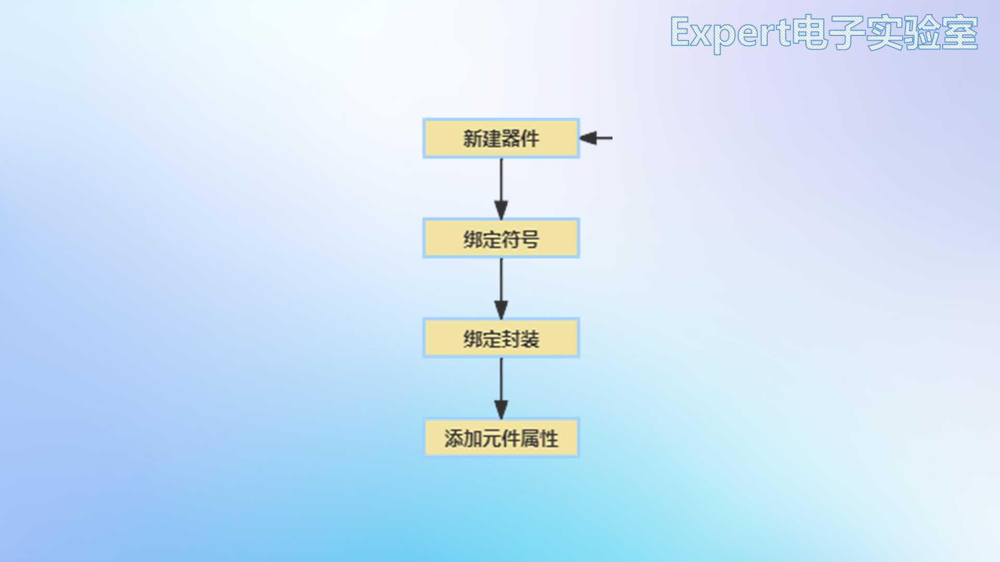
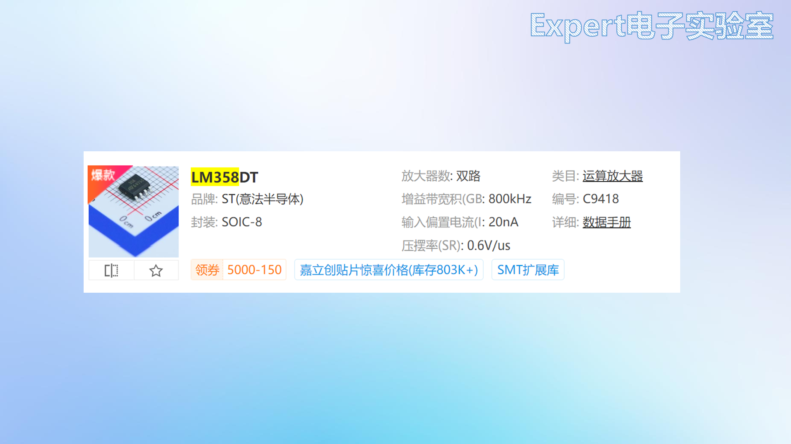
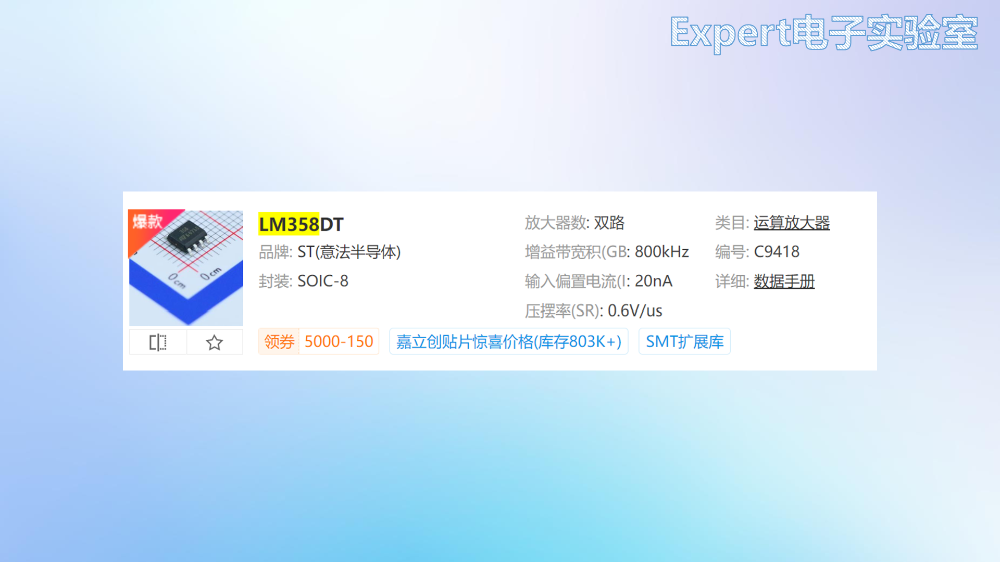

# 06 自建元件库 绘制符号与封装

> 前置要求：已读 [04 章](04%20原理图读写与PCB基础知识.md) 的"符号与封装一一对应"、[05 章](05%20软件入门%20安装界面与环境设置.md)。本章对应课程第 15、16 课，以 LM358DT（双运放，SOP-8）为例完成一次完整的"新建符号 → 自绘封装 → 绑定 → 上板验证"。

## 1. 为什么库这么全还要自己画

两个理由：**在线库不可能覆盖所有元件**——总有一天你用的芯片库里搜不到；自绘符号与封装是 PCB 设计的**基本功**，想在硬件方向深入就必须打牢。整个流程完全照数据手册执行，不需要任何"发明"。

## 2. 绘制元件符号（Part）

目标：按厂家手册给出的符号复刻 LM358DT 的符号。

1. **新建元件**：文件 → 新建 → 新建元件，命名 `LM358DT`（分类/描述可空）；
2. **找参照**：立创商城搜 LM358DT → 打开数据手册 → Features 页有厂家提供的元件符号图，照着画；
3. **画外框**：工具栏矩形，在画布原点附近画矩形框；
4. **放置引脚**：SOP-8 共 8 脚，左右各 4。注意引脚符号两端：**带电气点（灰色圆点/十字端）的一端朝外**（用于连线），平端贴芯片边框；先放一侧 4 个并等间距排列，再放另一侧；
5. **填引脚属性**（选中引脚，右侧属性栏）：
   - **引脚名称**：填功能名（OUT1、IN1-、IN1+、VCC-、VCC+、IN2-、IN2+、OUT2），照手册；
   - **引脚编号**：横杠上方的数字，**沿封装逆时针 1→8**（SOP 封装左侧从上到下 1~4，右侧从下到上 5~8）；
   - **引脚长度**：默认偏长，改短（如 0.2→0.1）让符号紧凑，画完整体外移对齐；
6. **1 脚标识**：放置 → 线条 → 圆形，在 1 脚旁画小圆点（按住 `Alt` 细分网格便于对准）；
7. 保存。在库面板 → 个人 → 全部 里即可找到自绘符号——此时"封装"一栏还是空的，下一步补上。

## 3. 绘制封装（Footprint）

### 3.1 先复习封装的构成

SOP-8 封装 = 8 个长圆形焊盘（编号与符号一一对应）+ 丝印框（标注实物大小）+ 方向标识（半圆/小圆）+ 1 脚标识（小圆点）。

### 3.2 从数据手册取尺寸

打开手册的 **Package Information** 章节，SOP 封装工程图给出三视图与尺寸表，需要四个关键尺寸：

| 尺寸 | 含义 | LM358DT 取值 |
| --- | --- | --- |
| B | 引脚宽度（剖面图） | 最大 0.48mm → 焊盘宽取 **0.6mm**（焊盘要包住引脚，略大） |
| L1 | 引脚长度（剖面图） | 典型 1.04mm → 焊盘长取 **1.9mm**（同样放大留余量） |
| e | 相邻引脚中心距（顶视图） | **1.27mm** |
| E1 | 两排引脚中心距（顶视图） | 3.9mm → 两排焊盘**中心距 = E1 + 焊盘长 = 3.9 + 1.9 = 5.8mm** |

### 3.3 绘制步骤

1. **新建封装**：文件 → 新建 → 新建封装，命名 `LM358DT`；
2. **放第一个焊盘在画布原点**：放置 → 焊盘 → 单焊盘。默认是通孔焊盘，表贴封装要把**层改为顶层**、形状选**长圆形**，宽 0.6 / 高 1.9（单位 mm，见 [05 章](05%20软件入门%20安装界面与环境设置.md) 的默认单位设置）；
3. **复制出同侧另外 3 个焊盘**——三种方法（从笨到巧）：
   - 逐个复制后手填坐标：X = 0、1.27、2.54、3.81（Y 全为 0）；
   - **智能尺寸**：工具栏智能尺寸，依次点两个焊盘中心标注距离，改成 1.27（逻辑同 SolidWorks）；
   - **条形多焊盘（线性阵列）**：放置 → 焊盘 → 条形多焊盘，从原点向右拉，`Tab` 设数量 4、间距 1.27——自动排列并**自动编号**，最快；
4. **放另一排**：复制 4 个，1 号焊盘中心 Y 改 5.8（= E1 + 焊盘长），其余**顶对齐**跟随；
5. **改编号**：SOP 逆时针排列——左排 1~4（上→下），右排 5~8（下→上）；
6. **画丝印**：切到**顶层丝印层**：折线画丝印框（约芯片实物大小，不压焊盘）；半圆或小圆标方向；1 脚旁放实心小圆（半径 0.15mm、线宽 0.3mm）作 1 脚标识；
7. 保存。

## 4. 绑定封装并上板验证

1. **绑定**：库面板 → 器件 → 个人 → 右键 LM358DT → 绑定封装 → 选个人库中刚画的封装；
2. **验证**：打开测试工程，把自绘元件放到原理图 → 点"更新原理图到 PCB" → 应用修改 → PCB 上出现封装 → 3D 视图确认（未导入 3D 模型不影响绘制）。

焊盘编号与符号引脚编号对不上是自建库最常见的致命错误——**绑定后务必在 PCB 里核对一次引脚对应关系**。

## 5. 检查点

- 说出封装的四个构成要素（焊盘+编号、丝印框、方向标识、1 脚标识）；
- 焊盘宽度为什么要比手册引脚宽度 B 略大？两排焊盘中心距怎么算？
- 演示三种放焊盘的方法，说出最快的一种；
- 完整走一遍"新建元件 → 画符号 → 画封装 → 绑定 → 转 PCB 验证"。

下一章进入第一个实战项目：[07 项目一51核心板 选型与原理图](07%20项目一51核心板%20选型与原理图.md)。
