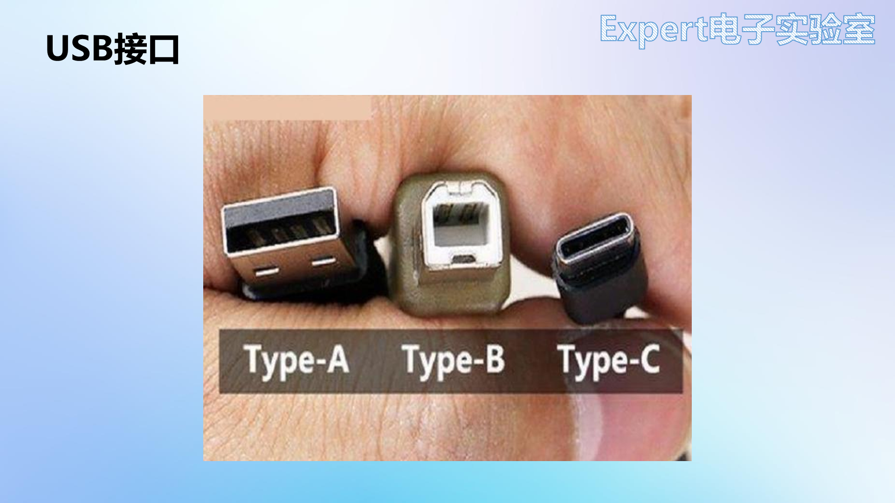
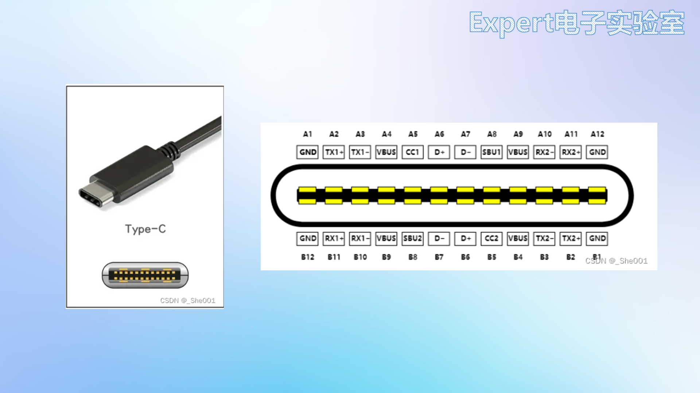
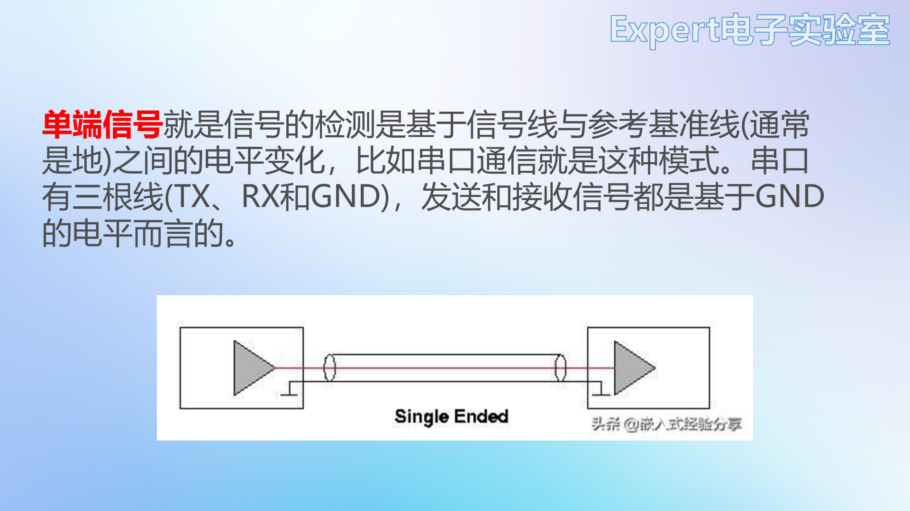
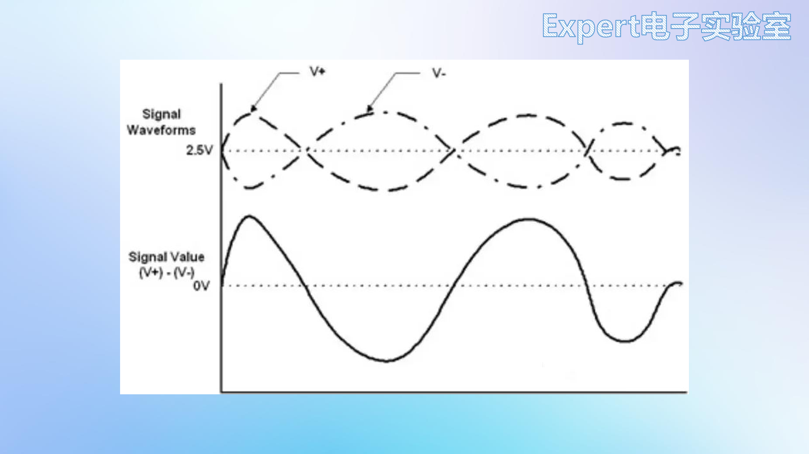
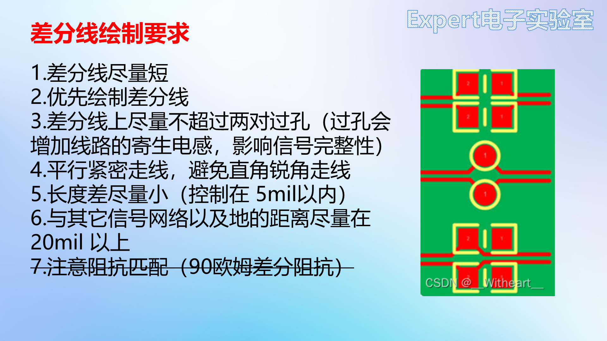

# 06 项目二：USB拓展坞

## 学习目标

- 说出 USB Hub 的"一上行、四下行"拓扑与 SL2.1A 的选型依据。
- 解释 Type-C 的引脚分工，以及"12 脚符号为何叫 16pin"。
- 用差分信号的原理解释差分线七原则，并把误差压进 5mil。
- 在细长板框上完成布局、差分布线、电源填充与铺地。
- 独立完成丝印、DRC 与生产文件导出，闭环第二个项目。

## 目录

1. USB Hub 工作原理
2. USB 接口
3. 差分信号与差分线布线
4. 原理图实操
5. PCB 布局
6. PCB 布线
7. 丝印与 DRC 检查
8. 导出生产文件
9. 结课回顾

## 1. USB Hub 工作原理

USB 拓展坞又叫 **USB 集线器（Hub）**：上行为 **Host 端**（电脑），Hub 起桥接作用，把 1 个上行口扩展成 4 个下行口，电脑用一个 USB 口就能同时与 4 个设备通信。笔记本的接口越来越少，一个拓展坞把稀缺的接口变成四个，这也是它成为最常见的入门项目之一的原因。

本项目主控选 **SL2.1A**（USB2.0 Hub 控制芯片），选型依据照例来自数据手册。

| 手册信息 | 设计动作 |
| --- | --- |
| 引脚定义：9/10 脚 DM/DP 接**上行口**；1~8 脚接 4 个**下行口**的 DM/DP | 一转四拓扑 |
| 15 脚 XOUT、16 脚 XIN 接外部晶振，要求 **12MHz** | 选 12MHz 晶振 |
| 功能描述：USB2.0 集线器，供电 5V | 电源 5V 直供 |
| 电气特性：供电最大 5.5V；USB 信号脚输入 ≤3.6V；工作温度 0~70℃；静态电流 ≤2.5mA | 核对应用边界 |
| 应用电路参考图 | 原理图底稿 |

读这张表的顺序与 02 章读 TPS5450 一致：先看功能与拓扑，确定它能做"一转四"；再看晶振与电源，确定外围；最后看电气极限，确认本项目的 5V 供电、室温环境都在范围内。

SL2.1A 采用 STT（Single Transaction Translator）架构：4 个下行口共用一套事务转换器，把高速设备与全速/低速设备的数据流按事务排队转发。STT 的成本低、外围简单，代价是多个低速设备同时工作时共享带宽——键盘、鼠标、U 盘这类间歇性设备完全够用，这也是它成为廉价拓展坞主控的原因。USB2.0 本身有三档速率：低速 1.5Mbps、全速 12Mbps、高速 480Mbps，差分线设计主要服务高速模式；12MHz 晶振是芯片内部 PLL 的参考时钟，不是总线速率。

Hub 的工作可以拆成三层：物理层负责差分信号与端口；协议层负责枚举、地址分配与事务转发；电源层负责给下行口供电与限流。SL2.1A 把前两层集成在一颗芯片里，外围只需要晶振、电容与少量电阻，这也是廉价 Hub 能做得这么小的原因。

MTT（Multiple Transaction Translator）则每口一套事务转换器，性能好但成本高；同时接多个高速设备时更稳，而键盘、鼠标这类间歇性设备用 STT 就够。

低速与全速对差分线不敏感，只有高速 480Mbps 才需要严格的 90Ω 阻抗与长度匹配。晶振频率偏了，PLL 输出也会偏，高速通信首先出问题。

电源预算要按最坏情况算。四个口各 500mA 就是 2A，加上主控与指示灯，输入至少 2.2A；保险丝 1.5A 保护的是电脑，不是保证四口满载。实际使用按典型负载估，设计按最坏情况留余量，两者不能混。

## 2. USB 接口

USB（通用串行总线）是串口总线标准与输入输出接口技术规范，Type-C 的特点之一是**支持正反插**。USB 用**差分信号**传输数据：一对极性互补的信号（D+/D-）。本项目与电脑连接用 **Type-C**，扩展出的 4 个口用 **USB Type-A**。

**Type-A 母座**只有 4 个信号脚：VCC、D+、D-、GND，外壳固定脚另算，简单直接，适合做下行口。USB-A 的 1 脚是 VBUS、4 脚是 GND，2/3 脚是 D-/D+；D+/D- 接反不会烧器件，但设备不枚举。

Type-C 的 CC 脚承担三重角色：检测插入方向、协商供电能力、识别电缆类型。受电端用 5.1kΩ 下拉表示"我需要 5V"，源端用上拉表示"我能供电"；CC 电压落在不同区间，对应 500mA、1.5A、3A 等档位。不做快充时，5.1kΩ 下拉是最小实现。

**Type-C 16pin** 的 16 指连接器的 16 个物理脚：12 个电气触点加 4 个外壳固定脚（EP）。12 个触点里 GND 与 VBUS 各有两路；封装又把 GND 与 VBUS 的每一路都拆成两个焊盘以增加载流，所以工程里的符号能看到 A1/B1/A12/B12 四个 GND 脚、A4/A9/B4/B9 四个 VBUS 脚，再加 4 个 EP，一共 20 个焊盘。

多个电源触点并联的目的是降低接触电阻与载流密度；16pin 连接器把 USB3 的高速对去掉，只保留 USB2.0 与供电，所以便宜、体积小。引脚分工如下。

| 引脚 | 功能 | 本项目处理 |
| --- | --- | --- |
| A6/A7、B6/B7 | USB2.0 差分信号（DP/DM） | 使用，注意**正反插两侧对称**，两对都要接 |
| A1/B1/A12/B12 | GND | 接地；另有 4 个 EP 固定脚同样接地 |
| A4/B9/A9/B4 | VBUS 电源 | 接 5V |
| A5/B5 | CC（快充识别） | **5.1kΩ 下拉接地**（不做快充） |
| A8/B8 | SBU 备用 | 不接，放非连接标识 |

正反插的实现机制就在这张表里：插头正插时，A6/A7 与 B6/B7 中的一对接触；反插时换成另一对。板子把两对都接到同一组 DP/DM 上，无论怎么插，信号都能通。

Type-C 的引脚全部裸露在外，人手上的静电插拔一次就可能打进芯片，所以成熟的拓展坞会在 VBUS 与 DP/DM 上并**ESD 保护器件**（如 USBLC6-2SC6 这类专用阵列，或简单的 TVS 二极管）。TVS 的寄生电容会削弱高速差分信号，USB2.0 选几 pF 的阵列即可。本项目按手册的最小系统不装，先把拓扑与差分线做对；要拿去实用了，这几个器件应该补在靠接口的一侧，越靠近插座越好，地也要就近接到接口地。

## 3. 差分信号与差分线布线

### 3.1 单端与差分

**单端信号**以参考地电平为基准读取，比如串口 TX 相对 GND 的电压。外界噪声会直接叠加在有效信号上，抗干扰差，所以串口线拉不长。

**差分信号**在发送端发出两路**极性相反**的信号，两线绞合并行走线，接收端取**两线电平之差**。设两条线上各自叠加了噪声 $n$，接收端做减法：

$$
V_{diff}=(V_++n)-(V_-+n)=V_+-V_-.
$$

噪声在相减时被抵消，这就是**抑制共模噪声**的数学原因。前提是两条线靠得足够近，噪声以相同幅度耦合到两线上；一旦两线分开走，$n$ 不再相等，抵消效果就打折。差分信号因此抗干扰强，适合远距离与高速传输。

图中两条波形各自叠加了同相噪声，相减后得到干净的有效信号；若噪声不同相，差值里就会残留。

### 3.2 差分线布线七原则

1. 差分线**尽量短**，减少干扰与衰减；
2. **优先布线**——差分线往往承载最重要的信号；
3. **过孔不超过 2 对**：每个过孔都带来寄生电感与阻抗不连续，过孔越多，信号完整性问题越大；
4. **平行紧密走线**，禁止直角锐角，保证噪声同量耦合到两线，相减才能抵消；
5. **长度差尽量小**，控制在 **5mil** 以内。FR4 中信号速度约 6mil/ps，5mil 对应约 0.8ps 的时差；USB2.0 高速模式一个位宽是 2.08ns，0.8ps 只占万分之四，看似微不足道，但规则留的是裕量：长度差越大，两线到达时间差越大，接收端的共模抑制越差；
6. 与其他信号网络及地的距离不小于 **20mil**，避免外部干扰破坏两线的对称性；
7. **阻抗匹配**：USB 差分阻抗为 90Ω，由线宽、线距、介质厚度共同决定。USB2.0 规范允许 ±15% 的偏差，落在 76.5~103.5Ω 之间都算合格。入门阶段暂不展开——USB2.0 速率不高，实测不做阻抗匹配也能正常工作；进阶后可用嘉立创阻抗计算工具，按板厚与铜厚反推线宽和间距。

两层板做到 90Ω 并不轻松：1.6mm 板厚的介质太厚，得靠"差分对两侧加地铜"的共面波导结构把阻抗压下来，算出来的线宽与间距会细到 6/6mil 量级。这也解释了为什么真正的高速板要用四层以上、把 GND 放在紧邻信号层的位置——介质薄了，阻抗才好控制。入门阶段先不管阻抗，把等长、包地、少过孔做对，收益比抠阻抗更大。

眼图把许多个比特叠加在一起，张开度越大，采样余量越大。阻抗不连续、长度失配、过孔 stub 都会让眼图闭合；入门阶段没有示波器，可以先用规则与目检把这些因素控制住，等有设备时再看眼图验证。

长度匹配的目的是让两线同时到达。长度差换算成时差：FR4 中信号约 6mil/ps，5mil 差约 0.8ps；USB2.0 高速位宽 2.08ns，0.8ps 只占万分之四。规则留的是裕量，实际布线不必为 1mil 纠结，但也不能让两线差出几十 mil。

过孔是差分线最大的不连续源。每个过孔带来寄生电容与电感，还会产生 stub；差分对换层时两线要同时换、对称换，过孔数量尽量少，换层后立即恢复等距。

蛇形走线用于补长，但不能乱补。补偿段放在长度差产生的位置附近，拐弯用 45° 或圆弧，相邻两段间距不小于 3 倍线宽；补长量按软件差值设置，多补会增加损耗与耦合。

## 4. 原理图实操

新建工程 `USB拓展坞`。**原理图完全照 SL2.1A 数据手册的应用电路绘制**。

1. **放置器件**：SL2.1A、16pin Type-C、4 个 USB A 型母座（选 180° 短体直边款，板子可以做小）；
2. **SL2.1A**：DP1~DP4/DM1~DM4 接下行口，DP/DM 接上行 Type-C，VDD5 接电源，GND 接地；**VDD18、VDD33 各接 10µF 电容到地**，照手册；
3. **晶振**：XIN/XOUT 接 12MHz 贴片晶振，小尺寸型号便于紧凑布局；
4. **Type-C**：两对 DP 接芯片 DP，两对 DN 接芯片 DM，实现正反插；SBU 放**非连接标识符**；VBUS 接 5V；GND 与 4 个 EP 固定脚接地；
5. **电源滤波**：电源入口 **10µF + 0.1µF 并联**。手册只要求 10µF，并联小电容是为了高频旁路更好；芯片供电引脚旁放 0.1µF 去耦；
6. **USB A ×4**：D+ 接芯片 DPn、D- 接芯片 DMn，注意正负对应；VCC 接 5V，GND 与 SHIELD 固定插针接地；**每个 USB A 的供电旁各放 10µF + 0.1µF 滤波**。手册标的 100µF/16V 是保守值，实测 10µF + 0.1µF 足够（待实测，视负载而定）；
7. **CC1/CC2**：各接 5.1kΩ 下拉电阻到地；
8. **保险丝**：外接 USB 设备短路会烧坏电脑的 USB 口，输入 5V 串一颗 **1.5A 自恢复保险丝（1206）**，超流自动断开保护电脑。Type-C 侧的网络标签改 `VCC5V`，保险丝输出为 `+5V`，这样标签本身就体现了"保险丝之后才是板内电源"；
9. **电源指示灯**：+5V → LED（0805 绿）→ 2kΩ → 地。电流约 $(5-2.0)/2000=1.5\mathrm{mA}$，足够指示；
10. **整理**：Type-C 左上、保险丝与指示灯右上、SL2.1A 中部、4 个 USB A 左下均匀排开；矩形框加中文注释（Type-C 电路 / 电源指示与保险丝电路 / SL2.1A USB Hub 主控 / USB Type-A 电路）；DRC → **0 错误 0 警告**。

保险丝放在 Type-C 入口之后、所有下行口之前，是因为它要保护的对象是电脑：无论哪个 USB 口短路，电流都要先经过保险丝。放在某个下行口之后，就只能保护那一路。

原理图按手册的应用电路画，但要注意网络标签的命名。上行口叫 DP/DM，下行口叫 DP1~DP4/DM1~DM4，晶振叫 XIN/XOUT；命名一致，布局与调试时才能对得上。电源标签区分保险丝前 VCC5V 与保险丝后 +5V，避免把未保护的电引到下行口。

晶振不需要外接负载电容时，芯片内部已经集成；如果手册要求外接，按负载电容公式选，并靠近芯片放置。晶振下方不要走差分线，避免时钟噪声耦合到 USB 信号。

1.5A 是保持电流（hold current），不是瞬间跳闸值：电流超过 1.5A 后，保险丝温度上升、阻值变大，经过数秒才切断；电流越大，动作越快。四个下行口各接一个设备，正常工作总电流通常不到 1A，选 1.5A 留出裕量，又能在真正短路时及时动作。自恢复保险丝冷却后自动恢复，不需要更换，适合学生实验。

这里藏着一个必须交代的取舍：USB2.0 每口规范上限 500mA，四个口同时满载就是 2A，已经超过保险丝的保持电流。实际使用中很少四口全满——键鼠几十毫安，U 盘读写峰值几百毫安，移动硬盘启动瞬间可能冲到 1A。可选的路有两条：换 2A 保险丝并把电源走线按 2A 重新核算，或者维持 1.5A、在丝印上注明"不要同时接多个大功率设备"。本项目选后者，1.5A 配合 22~30mil 的电源线是自洽的一组参数；若要支持四个移动硬盘，电源部分就得整体重做。

## 5. PCB 布局

### 5.1 板框与定位孔

转 PCB 前**再跑一遍原理图 DRC**。板框层画矩形：**宽 30mm × 高 100mm**（拓展坞专用的细长形），圆角 3mm；4 个 M3 定位孔（过孔外径 4、内径 3mm），坐标 (2.6, -2.6)、(2.6, -97.4)、(27.4, -97.4)、(27.4, -2.6)；与板框一起**锁定**。细长板框的尺寸来自外壳与插头间距：USB A 母座需要并排四个，宽度由插座本体决定，长度则要容纳 Type-C、主控与四个接口。

细长板还有一个容易被忽略的机械问题：板子越长，插拔 USB 时的力矩越大，30mm 宽、100mm 长的板子单端受力时会有明显弯曲。两个定位孔放在两端而不是中间，正是为了让螺丝承担这份力矩；如果做外壳，最好在 USB 座附近再加一个支撑点。

板框 30×100mm 的长宽比接近 3.3:1，翘曲风险比方形板高。打样时板厚选 1.6mm 比 0.8mm 更稳；如果有外壳，让外壳承担一部分插拔力，别让 USB 座独自受力。

### 5.2 布局要点

1. **Type-C 居中、略超出板框**：装外壳时插座不与外壳干涉；中心 X = 15mm 精确定位；CC 下拉电阻放板边，给差分线让路；
2. **电源链**：Type-C → 10µF（先大）→ 0.1µF（后小）→ 保险丝 → 电源指示灯 → 主控；滤波电容靠近各自供电对象；
3. **SL2.1A 放左侧**（USB 口在右侧），旋转到引脚朝向 Type-C 与 USB A 都顺的方向；**晶振不要贴板边**（贴边易电磁外泄），电容同理留边距；
4. **4 个 USB A 沿引脚顺序排列**在右侧板边：**接地焊盘贴板边**，留出空隙防外壳干涉；右对齐加垂直等间距，注意软件报错提示（离板边太近、互相干涉）及时移开；插上设备后不能互相打架；
5. **USB 滤波电容**：先大后小、贴近 USB 引脚；正面放不下的（第二个接口处）**放背面**，打过孔接 5V 引脚——不重要的元件为重要信号让位；
6. 精细化：顶对齐、左对齐、垂直等距，丝印位号统一方向，GND 飞线先关掉。

四个 USB-A 的中心距按插座本体加插头外壳留，插上设备后不能互相干涉；板边到插座的距离按外壳厚度留，太靠里插头够不着。

细长板的布局要先定接口。Type-C 在上端、四个 USB-A 在下端，主控放中间，晶振靠近主控；接口方向决定板子的正反面与外壳开口，不能等布线时再改。USB-A 的接地焊盘贴板边，插拔力由外壳与焊盘共同承担。

电源链按电流顺序摆：Type-C → 输入滤波 → 保险丝 → 指示灯 → 主控 → 下行口滤波。滤波电容先大后小，0.1µF 贴引脚；正面放不下的电容放背面，打过孔连接，不要为了整齐把电容拉到远处。

晶振与差分线的关系要提前想。晶振放主控旁边，差分线从主控到接口的通道要留出来；如果电容挡路，把电容挪到背面，而不是让差分线绕远。

## 6. PCB 布线

### 6.1 改规则：差分误差 5mil

设置 → 设计规则 → 差分对 → 单位 mil → **对内误差 5mil**，比项目一的 10mil 更严，依据是 3.2 节的七原则。

规则收紧后，等长调节会更频繁；如果发现某对线怎么补都超差，先回布局检查是不是两线路径本身不对称，而不是一味加蛇形。规则是判据，不是目的。

### 6.2 第一优先：六对差分线

设计 → 网络 → 差分对 → 添加 **6 对**：DP/DM（上行）、DP1~DP4/DM1~DM4（下行 4 对）、XTAL1/XTAL2（晶振）。晶振也按差分对处理，软件会自动检查等长。

布线快捷键 **`Alt + D`（差分对布线）**，两线同时拉出并实时显示长度差：

- 自动出线若不是从焊盘**短边**引出，手动调整出线方向；
- 挡路的元件（滤波电容）挪到底层，为差分线让出通道——不重要的线给重要的线让路；
- 四对下行差分线尽量互相平行、上下对称；
- 长度差超标的（上行 DP/DM）用**等长调节**：布线 → 等长调节，框选区域自动生成**蛇形走线**给短线补长，直到误差小于 5mil、提示变绿。

蛇形走线不是随便画几个弯。补偿段要放在信号路径上、尽量靠近长度差产生的位置，拐弯用 45° 或圆弧，相邻两段的间距不小于 3 倍线宽，避免蛇形本身产生新的耦合。补长量按软件给出的差值设置，多补会引入额外损耗，少补则误差仍超标。

以下行四对为例，芯片的 DP1~DP4 与 DM1~DM4 成对出线，四个 USB A 座沿板边等距排列，只要每对线从芯片走到对应插座时保持平行、等距，长度差自然就小；真正需要蛇形补偿的通常只有上行那对，因为它要从 Type-C 绕到芯片的 9/10 脚。

长度差超标时用等长调节，优先在上行对补长，因为上行从 Type-C 绕到主控，长度差最大；下行四对如果布局对称，通常不需要补。补长后重新检查 5mil 误差与 20mil 间距。

六对差分线的优先级相同，但通道资源不同。先布上行与晶振，这两对最靠近主控、最难绕；再布四对下行，利用板边通道平行拉开。差分线从焊盘短边引出，避免长边出线形成直角。换层后要重新拉回等距，不能换层前等距、换层后放开。

### 6.3 次要信号线

电源指示灯、CC1/CC2（快充识别信号）用 10mil 普通信号线直接连接，没有特殊要求。

### 6.4 电源线：实心填充

电源网络用**实心填充**（铺铜/填充区域-多边形）连接，整块铜皮的载流能力远强于细导线。

1. 把 +5V 网络的所有焊盘整片框住（含滤波电容）；
2. Type-C 右侧焊盘外扩一块填充，**打 3 个过孔**（外 24、内 12mil）连接左右两侧。单个过孔载流弱，三个并联载流强，也降低了单孔失效的风险；切到底层用填充把 6 个过孔连成一片，实现顶层与底层的电源互连；
3. 线宽照旧遵循**不超过焊盘宽度**：SL2.1A 焊盘宽 22mil → 到芯片的电源线取 22mil；到保险丝一段取 30mil；
4. 电流路径铁律不变：**输入滤波 → 保险丝 → USB 口旁滤波 → USB 口**。USB 口的滤波电容在背面，电源打过孔到背面先过电容再进接口；
5. 十字连接自动补泪滴。

电源填充要避开差分线，保持 20mil 以上间距；填充边界不要压到阻焊开窗，否则焊接时锡会顺着铜皮流开。大电流路径上的过孔要成组放置，单个过孔载流不足时并联，不能只靠一条细线。填充与板边留 0.5mm 以上间距，避免铣边露铜。

### 6.5 GND：缝合孔 + 晶振包地 + 整板铺铜

1. **地过孔阵列**：按 `V` 放过孔（网络 GND），成组对齐（水平等距）铺满空白区；**电源附近、USB 引脚附近多加**，为回流提供路径；
2. **晶振包地**：与项目一相同（见 [05 项目一：51单片机核心板](05%20项目一：51单片机核心板.md) 第 5.5 节），一圈 GND 过孔包围晶振电路，粗地线（约 20mil）串联，再用**禁止区域（多层，禁止铺铜）**罩住整个晶振区；
3. 工具 → 铺铜 → 矩形，顶层、底层各铺整板 GND；
4. 检查飞线归零 → 3D 预览验收。

铺铜不是最后一步的装饰，而是回流设计的一部分。地过孔阵列要覆盖电源与接口附近的回流路径，晶振区用禁铺隔开，整板重建后确认没有孤立铜岛。

## 7. 丝印与 DRC 检查

1. **功能丝印替换位号**：删除电源 LED 的位号，加文本 `POWER`（顶层丝印，高度约 60mil），灯亮即通电；
2. **logo 与标题**：放置 → **图片**导入频道 logo（调整尺寸，层设为顶层丝印），再导入文字图片横排放在旁边；放文本 `USB HUB` 标明功能，可勾选**反向**让文字底部填充更醒目；位置选在靠近板边的空白区；
3. **背面丝印**：复制这三个元素，属性改为**底层丝印**，按 `B` 切到底层摆放在空白处，背面也不空着；
4. 3D 预览检查正反面观感（浅色背景下黑色阻焊效果最佳），保存。

与项目一相同的丝印方法论：**位号可以删，功能标识必须留**。POWER、接口名、按键功能、引脚号，都是"不查原理图就能用板子"的关键。

四个下行口还要标清编号：丝印写 `USB1`~`USB4`，与原理图的 DP1~DP4 一一对应。少这一行字，某个口不认设备时就无法判断是哪一路通道的问题；Type-C 旁标 `PC` 或 `UP`，提示这是接电脑的上行口，插错方向会让人误以为板子坏了。

丝印还要标电源方向与保险丝位置。POWER 灯亮只说明 5V 到了，不说明四个口都通；保险丝旁标电流值，检修时能快速判断是不是过流断开。

DRC 检查：打开过滤显示铺铜区域 → DRC 面板 → 清除错误 → **检查 DRC** → 0 报错。定位方法与项目一一致：看错误类型 → 点对象定位 → 看规则名称 → 读解释里的实际距离与要求。画板全程开着实时 DRC，此时通常一把过。

高速板的 DRC 还要看两类问题：差分对间距是否被电源填充破坏、过孔是否落在焊盘上造成虚焊。前者靠规则与目检，后者靠 DRC 的孔盘间距检查；两类都不会在连通性检查里报错，却会直接影响成品率。

## 8. 导出生产文件

文件 → 导出 → **PCB 制版文件（Gerber）** → 选择保存位置 → 得到 Gerber 压缩包。

发出去之前值得花五分钟核对一遍。用免费的在线 Gerber 查看器逐层打开：顶层铜箔有没有断线或残留的孤立铜皮、阻焊开窗是否对准焊盘、丝印有没有压到焊盘上、板框层是否首尾闭合。板厂只按文件生产，不会替设计者判断对错，一个没闭合的板框就可能让整批板子报废。

导出前确认层名与文件结构。顶层/底层铜箔、阻焊、丝印、钻孔、板框缺一不可；文件名不要用中文或特殊符号，避免板厂系统识别失败。Gerber 只描述图形，BOM 与坐标文件才说明每个位置装什么。

导出菜单里还有 **BOM（物料清单）**和**坐标文件（Pick and Place）**。前者用来采购，位号、型号、数量、封装齐全；后者给贴片机定位每个元件。手工焊接用不上坐标文件，但养成随工程一起导出的习惯，将来交给 SMT 或转给队友时不必回头补。

BOM 要核对位号、型号、封装与数量，替代料写清参数；坐标文件的原点与方向要和贴片厂约定，否则贴片机会把元件放反。

后续流程与项目一相同：嘉立创下单助手 → 领每月 2 次的 1~4 层免费打样券 → 上传 Gerber → 5 片、FR4、黑油、无 SMT → 用券 0 元下单 → 约 4~5 天收货。到货焊上 SL2.1A、Type-C、4 个 USB 母座与阻容，插上电脑，插拔 U 盘验证。

验证可以按三步走。先量电源：不插电脑，用万用表二极管档测 VCC5V 与 GND、+5V 与 GND 是否短路；插上电脑后量 Type-C 的 VBUS 应为 5V，保险丝两端压降接近 0。再验枚举：接一个 U 盘，电脑设备管理器里应出现新的 USB 大容量存储设备，说明上行与某个下行口都通了。最后逐个口插拔，四个下行口都要能识别，且同时插多个设备时不掉线——这一步同时检验了电源载流与差分线的对称性。

测试顺序从电源到通信，不能反过来。电源没量就插电脑，短路会把电脑的 USB 口一起带走；枚举通过但某个口不稳，优先查该口的差分对与滤波电容，而不是怀疑主控。

## 9. 结课回顾

入门篇加强化篇约 6 小时课程，跟着做下来已经完成三件事。

**掌握 PCB 设计的完整流程**：需求 → 选型（数据手册）→ 原理图（模块化加 DRC）→ PCB（板框、布局、布线、包地、铺铜）→ 丝印 → DRC → Gerber 打样。

**独立完成两个实战项目**：51 单片机核心板覆盖最小系统、按键、LED、上拉、排针；USB 拓展坞覆盖差分信号、电源保护、多口布局。两块板子的差别，正好对应从"连通"到"信号质量"的台阶：前者只要连通、载流与丝印正确，后者还要处理差分对称、阻抗与电源保护，难度差一个量级。两块板都做完，再回头看原理图、布局与布线的规则，会发现它们不是孤立的条文，而是一条条被实际问题逼出来的经验。

**熟悉立创EDA专业版的核心操作**：布局传递、交叉选择、差分布线、等长调节、禁止区域、铺铜重建、DRC 定位。换到别的软件，缺的是按钮位置，不是这些判断。

后续进阶路线见[大师篇](../PCB设计大师篇/README.md)：STM32 电赛开发板等复杂工程、蓝桥杯省赛与国赛真题、高速电路初步。把已经建立的方法用在更复杂的板子上，就是从"会画"走向"能设计"。
