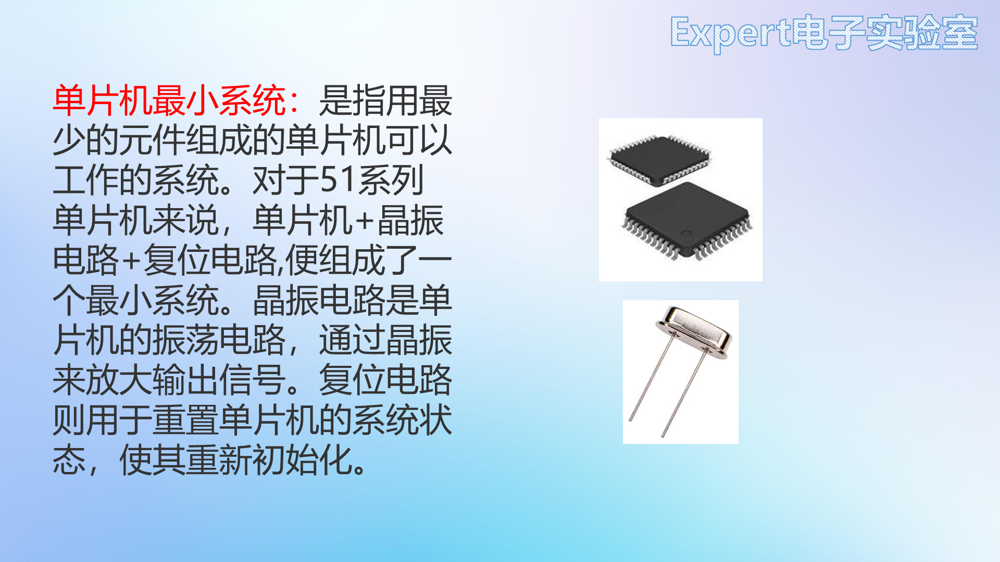
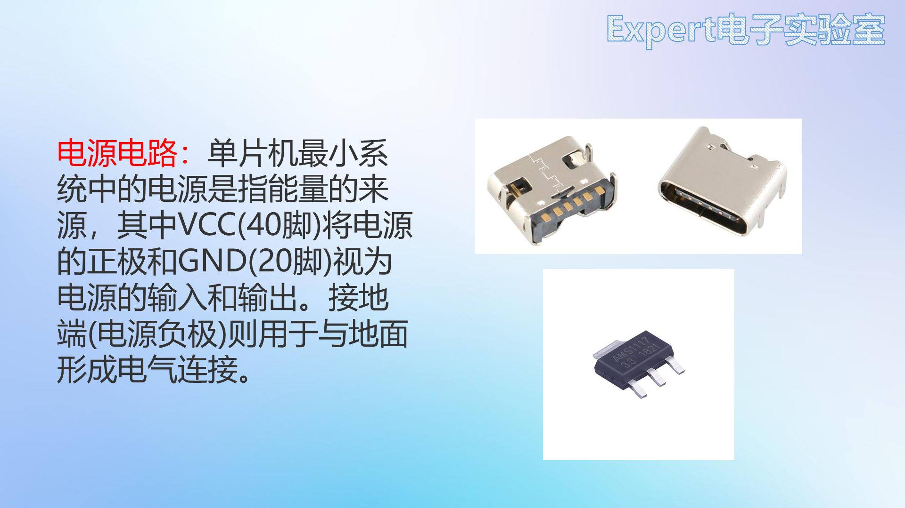
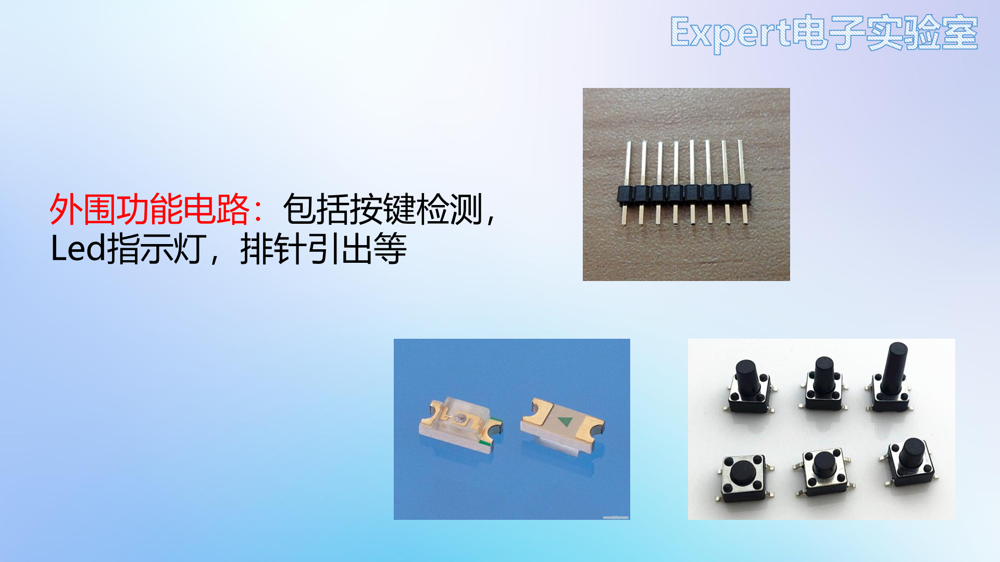

# 07 项目一51核心板 选型与原理图

> 前置要求：完成 [05](05%20软件入门%20安装界面与环境设置.md)、[06](06%20自建元件库%20绘制符号与封装.md)。本章对应课程第 17~19 课：第一个完整项目——51 单片机核心板，从选型到原理图 DRC 清零。

## 1. 为什么第一个项目选 51 核心板

51 单片机是微机原理课与大多数人入门单片机的第一款芯片——自己做一块核心板，既练 PCB 又辅助学编程，一举两得。封装选 **LQFP**（贴片、优雅、可手焊），不用 DIP 大块头。成品参考：市售 51 核心板的核心就是**最小系统**（单片机 + 晶振电路 + 复位电路），通电即可工作。

## 2. 元件选型：全部来自数据手册

### 2.1 主控：STC89C52RC（LQFP-44）

到宏晶 STC 官网下载 STC89C52 系列数据手册，第 11 页直接给出**厂家最小系统应用电路**——这就是原理图的底稿：

- 复位电路接 RST 引脚；
- 晶振电路：**12MHz 晶振 + 两颗 47pF 谐振电容**（负载电阻可省）；
- 电源经开关 + 滤波电容进入系统。

注意：数据手册示例用的是 DIP 封装引脚布局，LQFP-44 引脚位置不同但功能一致，不影响照抄参数。

### 2.2 其余选型

| 电路 | 选型 | 依据 |
| --- | --- | --- |
| 供电接口 | **6pin Type-C** | Type-C 分 6pin（仅供电）/16pin（USB2.0）/24pin（USB3.0），只取电选 6pin |
| 稳压 | **AMS1117-3.3** | USB 输出 5V；单片机系统电流小，LDO 经济实惠（手册：输入输出各 10µF 滤波） |
| 调试 | 微动贴片按键 ×2 | 按键检测 |
| 指示 | 0805 贴片 LED | 状态指示 |
| 扩展 | 排针全部引出 | 外接模块 |

## 3. 原理图实操（电源 → 最小系统 → 外设）

新建工程 `51单片机核心板`，把板子/原理图/PCB 分别重命名。画图顺序：

### 3.1 电源电路

1. **6pin Type-C**：VBUS 加 `+5V` 标签；GND、EP 固定脚接地；**CC1/CC2 各串 5.1kΩ 下拉接地**——不做快充，下拉保证充电器/电脑输出标准 5V；
2. **拨动开关**：6 脚开关只用一侧 3 脚（公共端 + 一侧），另一侧 3 脚全部接地（防止焊盘悬空）；输出标签 `VCC5`；
3. **AMS1117-3.3**：VIN 接开关输出，VOUT 输出 3.3V 标签，GND 接地；
4. **电源指示灯**：3.3V → LED（0805 绿）→ 1kΩ 限流 → 地，3.3V 正常即亮；
5. **滤波电容**：查 AMS1117 手册——输入输出各 10µF；每侧用 **10µF + 0.1µF 并联**，不同容值并联滤波频段互补，效果优于单一容值。

### 3.2 最小系统

1. 放置 STC89C52RC（LQFP-44），供电 5.5~3.3V 宽压——**本板接 5V**：VCC 接 VCC5，GND 接地，芯片旁放一颗 **100nF 去耦电容**；
2. **每个引脚加网络标签**（按引脚默认名 P0.0~P4.7 等），后续电路全靠标签连接；
3. **晶振电路**：12MHz 贴片晶振接 XTAL1/XTAL2，两颗 **47pF** 谐振电容接地（参数即数据手册值）；
4. **复位电路**：RST 经 10kΩ 电阻接地、对地并联 10µF 电容、电容上并联按键。原理：
   - **上电复位**：上电瞬间电容充电产生大电流，RST 被拉**高**——51 单片机是**高电平复位**（与 STM32 低电平复位相反！）；充电完成后电流消失，RST 被电阻拉回低电平，进入运行；
   - **手动复位**：按下按键，电容被短接，RST 直接拉高复位。

### 3.3 外设电路

1. **按键检测 ×2**（P2.0、P2.1）：按键一端接 IO 一端接地，按下读低电平；**并联电容做硬件消抖**；
2. **LED ×2**（P1.0、P1.1）：**IO 接 LED 阴极**——51 的 IO 灌电流能力远大于拉电流，低电平点亮；LED 阳极经 1kΩ 限流接 3.3V；
3. **P0 口上拉 ×8**：查手册 IO 结构章节——51 的 IO 有准双向口/仅为输入/开漏输出三种模式，**P0 口上电后是开漏输出，输出不了高电平**；作普通 GPIO 用必须外接 10kΩ 上拉到 5V（作地址数据总线时才不需要）；
4. **电源引出**：8pin 排针引出 5V、3.3V、GND，给外接传感器供电；
5. **串口引出**：P3.0（RXD）/P3.1（TXD）+ 5V + GND 接 4pin 排针——外接 USB 转串口模块下载程序。

### 3.4 整理与 DRC

- 模块化摆放：电源左上、最小系统居中、晶振复位在侧、排针右侧、按键 LED 左下；**放置 → 矩形框**（快捷键 `R`）逐框包住并写中文名称；右下角标题栏填学校/姓名；
- **检查 DRC**：若报"元件属性与供应商编号不匹配"警告，属 SMT 检查项，在设计规则里关掉该条即可 → 清空重检 → **0 错误 0 警告**。

## 4. 检查点

- 说出最小系统三要素，并指出本板三者各自的元件取值（12MHz + 47pF ×2；10kΩ + 10µF + 按键）；
- 51 与 STM32 的复位有效电平有什么不同？上电复位过程如何发生？
- 为什么 LED 要接在 IO 阴极侧？P0 口为什么必须加上拉？
- CC 引脚 5.1kΩ 下拉的作用是什么？

下一章：[08 项目一51核心板 PCB布局](08%20项目一51核心板%20PCB布局.md)——原理图转 PCB。
