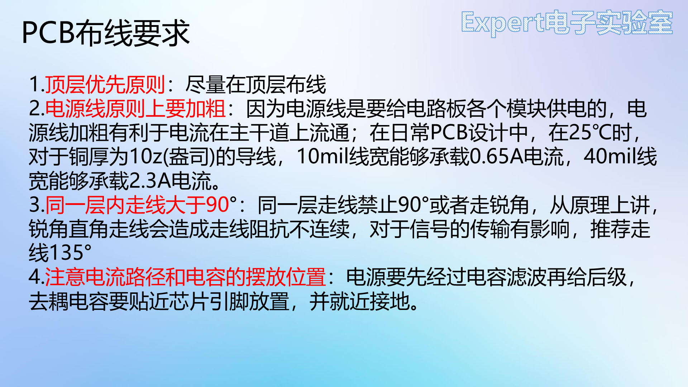
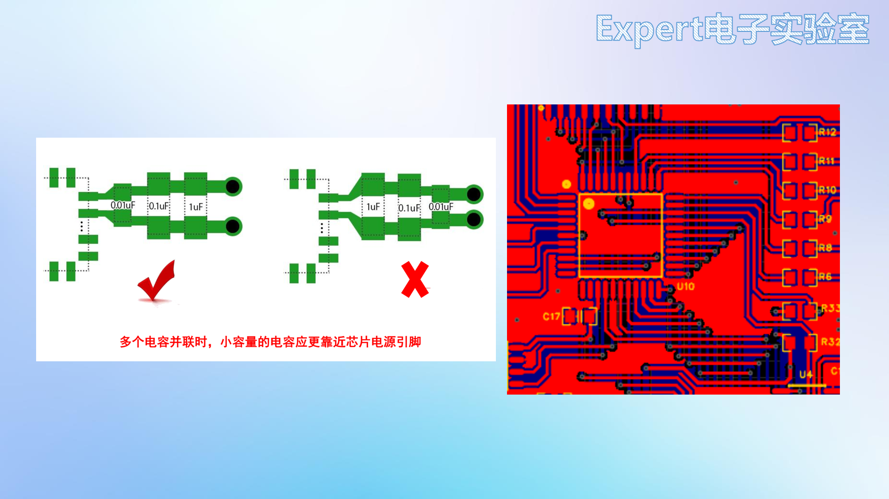
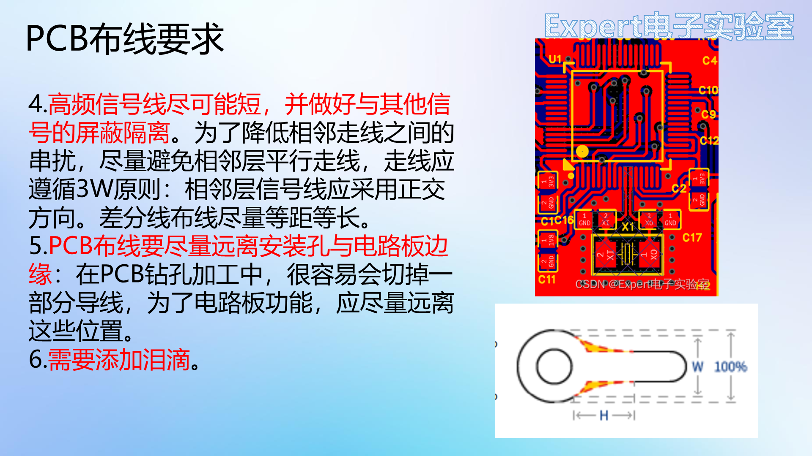

# 09 项目一51核心板 PCB布线

> 前置要求：布局完成（[08 章](08%20项目一51核心板%20PCB布局.md)）。本章对应课程第 21、22 课：六条布线要求 + 51 核心板完整布线实操（信号线 → 晶振包地 → 电源 → 铺地）。

## 1. 第一戒律：不要用自动布线

无论何时何地**都不要使用自动布线**——目前没有任何软件的自动布线能达到合格硬件工程师的手工水平。把"自动布线"当成不存在的功能。

## 2. 六条布线要求

1. **顶层优先**：尽量在顶层布线，走不通再切底层，避免底层乱成一团；
2. **电源线加粗**：电源线要给全板供电，主干道要宽。25℃、1oz 铜厚下 **10mil 线宽约载 0.65A，40mil 约载 2.3A**——信号线默认 10mil，电源线至少 40mil 起步；
3. **同层走线夹角 > 90°，推荐 135°**：直角/锐角三宗罪——工艺上腐蚀锐角会产生三角效应使线宽变窄（现代工艺已少见）；阻抗不连续影响信号；锐角像天线，高频线对外辐射。圆弧走线更美但效率低，135° 是效率与美观的平衡；
4. **注意电流路径与电容位置**：电源**先经过滤波电容再给后级**，不允许先拉线给后级再远程接电容；**去耦电容贴近芯片供电引脚、就近打孔接地**，小容量电容最靠近引脚：

5. **高频信号线尽可能短**并与其它信号屏蔽隔离；相邻层避免平行走线、遵循 **3W 原则**（线间距 ≥ 3 倍线宽），相邻层正交布线降低串扰；**差分线等距等长**；
6. **远离安装孔与板边**（钻孔易切线）；完成后**添加泪滴**：

泪滴补强过孔与导线的连接面积，保护焊盘——设计完成后统一添加（或开启自动添加）。

## 3. 布线顺序

**关键元件优先、关键信号线优先、密度优先**：从连线最密集的区域开始；DDR、射频、时钟等关键部分先布（此时板子最空、最好走）；次要信号顾全整体、不与关键信号抵触。本板的执行顺序：**信号线（单片机）→ 电源 → 铺地**。

## 4. 信号线实操

先隐藏电源与 GND 飞线，屏幕上只剩信号。按 `W` 布线，`Q` 切 mil，`Tab` 设线宽 **10mil**：

- **从焊盘短边引出**：长圆形焊盘若从长边出线会形成直角，从短边出线天然平直；
- **横平竖直**、拐弯 135°、同束线**间距相等**、上下**对称**——大量斜线既难看又给后续布线添乱；
- **能走顶层不打过孔**；个别不好出的引脚（如 P1.0）按 `B` 自动打过孔切底层绕出；
- **布局为布线让路**：发现按键左右顺序不顺走线，就回到布局把它对调（以晶振为轴对称）——布局不是一次定死的；
- **不要从元件内部穿线**（如从两个 LED 之间穿过），需要时在焊盘上打过孔走底层；
- P0 口上拉电阻在底层，直接就近连接；P4 口走底层到排针，过孔位置灵活调整避让交叉；
- 串口 P3.0/P3.1、复位线：底层绕行；**CC 线从 Type-C 反方向走**——不干扰正面电源线，省过孔；
- 开启自动泪滴：设置 → PCB → 通用 → 布线 → 勾选"自动添加泪滴"。

### 4.1 晶振：等长 + 包地 + 禁铺区（小板上的高速信号标准处理）

晶振是板上频率最高的信号，按高频原则处理：

1. 建立差分对：设计 → 网络 → 差分对 → 添加（XTAL1 正网络、XTAL2 负网络）；
2. **差分对布线**（快捷键 `Alt + D`）：软件实时显示两线长度差，**轴对称布局 + 对称走线 = 天然等长**，把误差压进 **10mil** 内（提示条变绿即合格）；
3. **包地**：`V` 放过孔（外径 24 / 内径 12，**网络 GND**）绕晶振一周，外侧对齐排列（顶对齐 + 垂直等距）；用 **20mil** 地线把过孔串成一圈（过粗如 40mil 占空间）；晶振接地焊盘并入包地环。一圈接地过孔 + 地线的屏蔽原理与**法拉第笼**相同；
4. **禁止区域**：放置 → 禁止区域 → 多边形，框住整个晶振电路（含过孔环），层选**多层**、内容选**禁止铺铜**——防止最后铺铜挤进晶振区引入干扰。

## 5. 电源布线

解封电源飞线。原则：**电源线尽量粗，且不超过焊盘宽度**。

- Type-C 焊盘宽约 27.6mil → 电源线取 **27mil**，与焊盘同宽最粗合法；
- 单片机供电引脚焊盘仅 16.5mil → 该段线宽取 **16mil**（不超过焊盘）；
- IO 供电等粗电源走 **40mil**；
- 3.3V 的负载一律**从滤波电容之后取电**——从未滤波的 LDO 输出直接引线会把纹波直接送给芯片；
- 十字连接处自动补泪滴。

## 6. 铺地收尾

1. **缝合孔**：`V` 放过孔（网络 **GND**），6 孔一组（顶部对齐 + 水平等距）复制到板上各空白区域；**滤波电容附近多放**——为回流提供路径；不要怕过孔多，机器打孔很快；
2. GND 焊盘旁边无法放过孔的，用导线手动引出到空旷处再打过孔；
3. **铺铜**：工具 → 铺铜 → 矩形，框选整板，顶层、底层各铺一次，网络 **GND**；
4. 检查飞线归零（工程设计 → 网络/飞线）；若有过孔没连上，核对过孔的网络属性是否为 GND；
5. 顶层信号线周围若仍有铜皮空洞，在空洞处补过孔 → 右键铺铜区域 → **重建全部**；
6. 3D 预览验收。

## 7. 检查点

- 说出 10mil/40mil 线宽的载流量，以及"电源线宽不超过焊盘宽度"的原因；
- 复述锐角走线的三宗罪与 135° 走线；
- 背出去耦电容摆放规则，并判断"1µF 在最里、0.01µF 在最外"对不对；
- 演示晶振"差分对等长 + 包地 + 禁铺区"三板斧；
- 解释缝合孔与回流路径的关系。

下一章：[10 项目一51核心板 丝印DRC与打板](10%20项目一51核心板%20丝印DRC与打板.md)。
