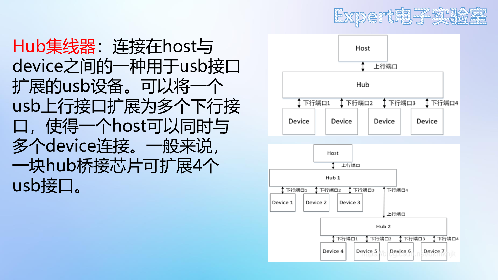
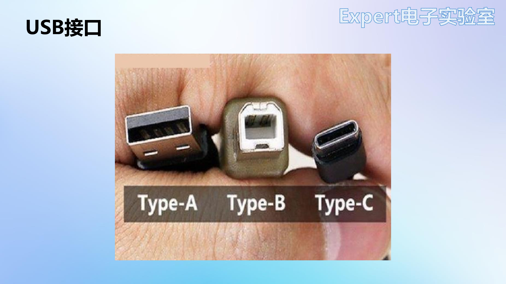
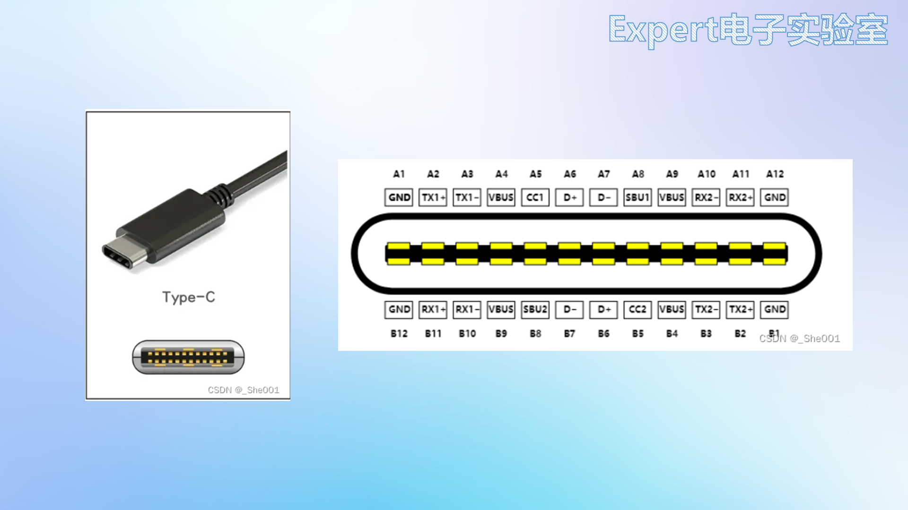
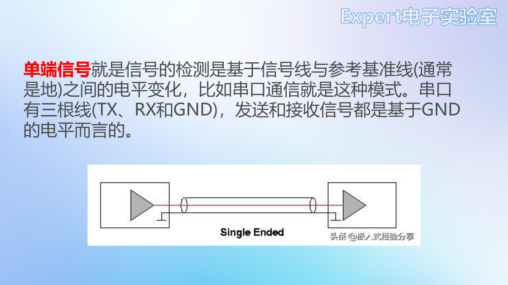
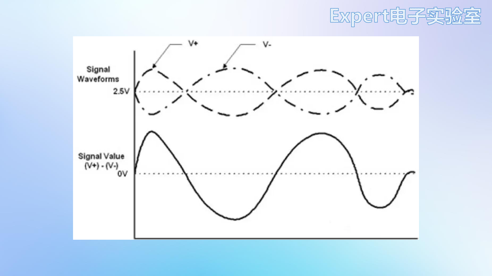
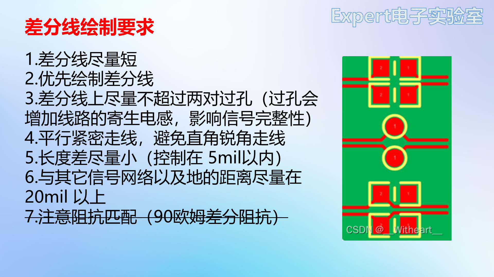

# 11 项目二USB拓展坞 选型与原理图

> 前置要求：完成项目一（[07~10 章](07%20项目一51核心板%20选型与原理图.md)）。本章对应课程第 24、25 课：第二个项目 USB 拓展坞。先补两块理论（USB Hub 原理、差分信号），再做选型与原理图。笔记本接口越来越少，一个 USB 拓展坞（集线器）能把电脑的一个口变成四个——作者入门的第一块板就是它，用两年多没出问题。

## 1. USB Hub 工作原理

USB 拓展坞又叫 **USB 集线器（Hub）**：上行为 **Host 端**（电脑），Hub 起桥接作用，把 1 个上行口扩展为 4 个下行口，电脑用一个 USB 口就能同时与 4 个 USB 设备通信。

本项目主控选 **SL2.1A**（USB2.0 Hub 控制芯片），选型依据照例来自数据手册：

| 手册信息 | 设计动作 |
| --- | --- |
| 引脚定义：9/10 脚 DM/DP 接**上行口**信号；1~8 脚接 4 个**下行口**的 DM/DP | 一转四拓扑 |
| 15/16 脚 XIN/XOUT 接外部晶振，要求 **12MHz** | 选 12MHz 晶振 |
| 功能描述：USB2.0 集线器，供电 5V | 电源 5V 直供 |
| 电气特性：供电最大 5.5V；USB 信号脚输入 ≤3.6V；工作温度 0~70℃；静态电流 ≤2.5mA | 核对应用边界 |
| 应用电路参考图 | 原理图底稿 |

## 2. 理论补充一：USB 接口

USB（通用串行总线）是串口总线标准与输入输出接口技术规范；**Type-C 支持正反插**。USB 用**差分信号**传输数据：一对极性互补的信号（D+/D-）。本项目：与电脑连接用 **Type-C**，扩展出的 4 个口用 **USB Type-A**。

- **Type-A 母座**只有 4 脚：VCC、D+、D-、GND——简单直接；
- **Type-C 16pin**：符号上只有 12 个引脚，为什么叫 16pin？看封装：1/12 脚（GND）与 2/11 脚（VBUS）四个**电源焊盘各由两个小焊盘拼成**（电源电流大），12 + 4 = 16。引脚分工：

| 引脚 | 功能 | 本项目处理 |
| --- | --- | --- |
| A6/A7、B6/B7 | USB2.0 差分信号（DP/DM） | 使用，注意**正反插两侧对称**，两对都要接 |
| A2/A3、B10/B11 等 8 脚 | USB3.0 信号 | 不用 |
| A4/B9/A9/B4 | VBUS 电源 | 接 5V |
| A5/B5 | CC（快充识别） | **5.1kΩ 下拉接地**（不做快充） |
| A8/B8 | SBU 备用 | 不接，放非连接标识 |

## 3. 理论补充二：差分信号与差分线布线

### 3.1 单端 vs 差分

- **单端信号**：以参考地电平为基准读取信号（如串口 TX 相对 GND 的电压）。噪声会直接叠加在有效信号上——**抗干扰差**，串口线拉不长；
- **差分信号**：发送端发出两路**极性相反**的信号，两线绞合并行，接收端取**两线电平之差**。外界噪声**同时耦合到两条线**上，相减后噪声被抵消——**抑制共模噪声**，抗干扰能力强，适合远距离与高速传输。

### 3.2 差分线布线七原则（本项目的布线铁律）

1. 差分线**尽量短**，减少干扰与衰减；
2. **优先布线**——差分线往往是重要信号；
3. **过孔不超过 2 对**：过孔增加寄生电感，损害信号完整性；
4. **平行紧密走线**，禁止直角锐角——保证噪声同量耦合到两线，相减才能抵消；
5. **长度差尽量小**，控制在 **5mil** 以内（等距等长保证两路信号同步；误差值可在立创EDA差分规则中设置）；
6. 与其他信号网络及地的距离 ≥ **20mil**；
7. **阻抗匹配**：USB 差分阻抗 90Ω。入门阶段暂不展开——USB2.0 速率不高，实测不做阻抗匹配也能正常工作；进阶后可用嘉立创阻抗计算神器设计。

## 4. 原理图实操

新建工程 `USB拓展坞`。**原理图完全照 SL2.1A 数据手册的应用电路绘制**：

1. **放置器件**：SL2.1A、16pin Type-C、4 个 USB A 型母座（选 180° 短体直边款，板子可以做小）；
2. **SL2.1A**：DP1~DP4/DM1~DM4（下行）、DP/DM（上行接 Type-C）、VDD5V 接电源、GND 接地；**VD18、VD33 各接 10µF 电容下拉**（照手册）；
3. **晶振**：XIN/XOUT 接 12MHz 贴片晶振（小尺寸可放得紧凑）；
4. **Type-C**：两对 DP 接芯片 DP、两对 DN 接芯片 DM（正反插）；SBU 放**非连接标识符**；VBUS 接 5V；GND 与 4 个 EP 固定脚接地；
5. **电源滤波**：电源入口 **10µF + 0.1µF 并联**（手册只要求 10µF，并联小电容高频滤波更好）；芯片供电引脚旁 0.1µF 去耦；
6. **USB A ×4**：D+ → 芯片 DPn、D- → 芯片 DMn（注意正负对应）；VCC 接 5V、GND、SHIELD 固定插针接地；**每个 USB A 的供电旁各放 10µF + 0.1µF 滤波**（手册标 100µF/16V 是保守值，实测 10µF+0.1µF 足够）；
7. **CC1/CC2**：各串 5.1kΩ 下拉接地；
8. **保险丝**：外接 USB 设备短路会烧坏电脑 USB 口——输入 5V 串一颗 **1.5A 自恢复保险丝（1206）**，超流自动断开保护电脑；Type-C 网络标签改 `VCC5V`，保险丝输出为 `+5V`；
9. **电源指示灯**：+5V → LED（0805 绿）→ 2kΩ → 地；
10. **整理**：Type-C 左上、保险丝与指示灯右上、SL2.1A 中部、4 个 USB A 左下均匀排开；矩形框 + 中文注释（Type-C 电路 / 电源指示与保险丝电路 / SL2.1A USB Hub 主控 / USB Type-A 电路）；DRC → **0 错误 0 警告**。

## 5. 检查点

- 画出 Hub 的"1 上行 → 4 下行"拓扑，并指出 SL2.1A 哪些脚是上行、哪些是下行；
- 解释 Type-C"12 脚符号却叫 16pin"的原因；
- 用波形图解释差分信号为什么抗共模噪声；
- 背出差分线七原则中的四条硬指标（≤2 对过孔、等长 5mil、间距 20mil、90Ω）；
- 说出保险丝为什么放在 Type-C 入口之后。

下一章：[12 项目二USB拓展坞 PCB布局与布线](12%20项目二USB拓展坞%20PCB布局与布线.md)。
