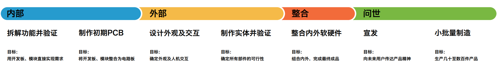
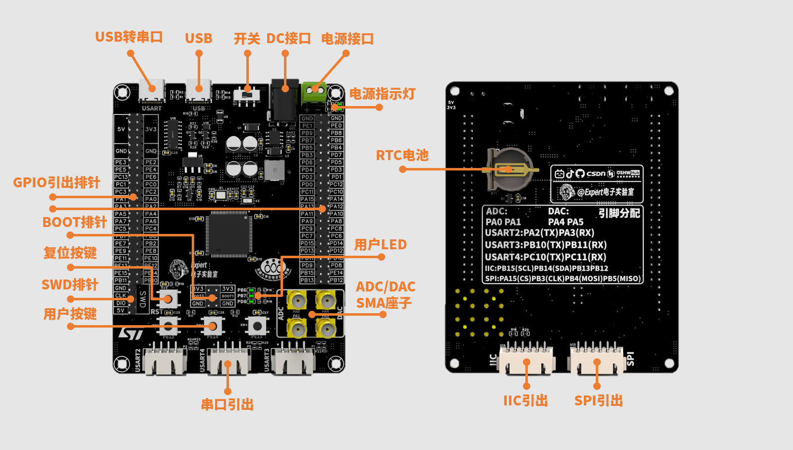
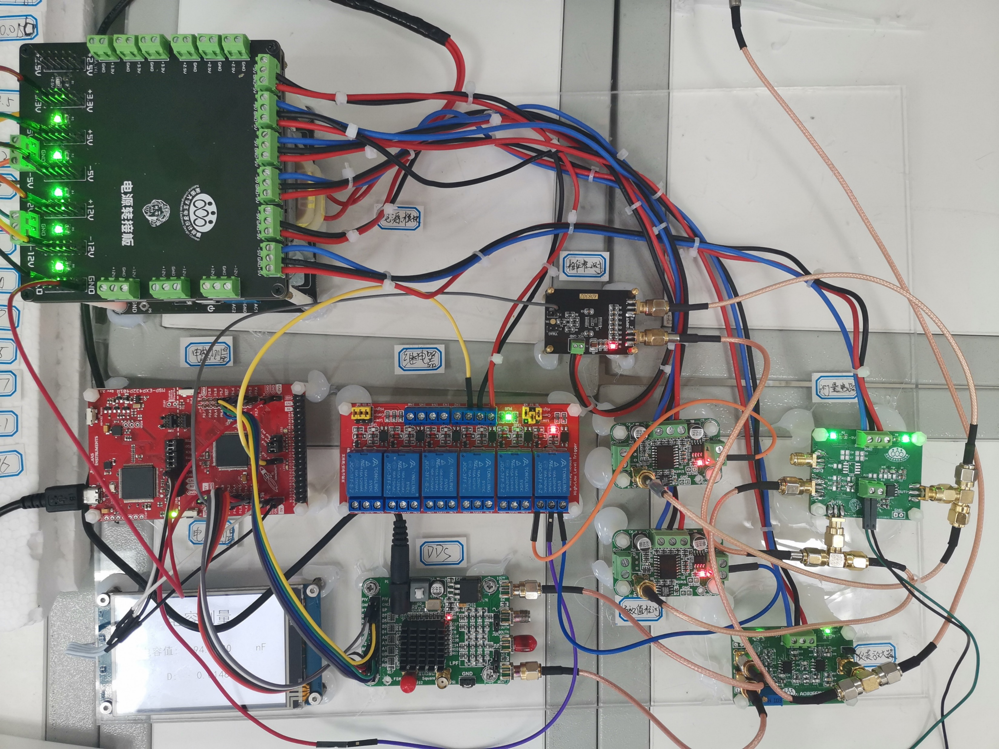
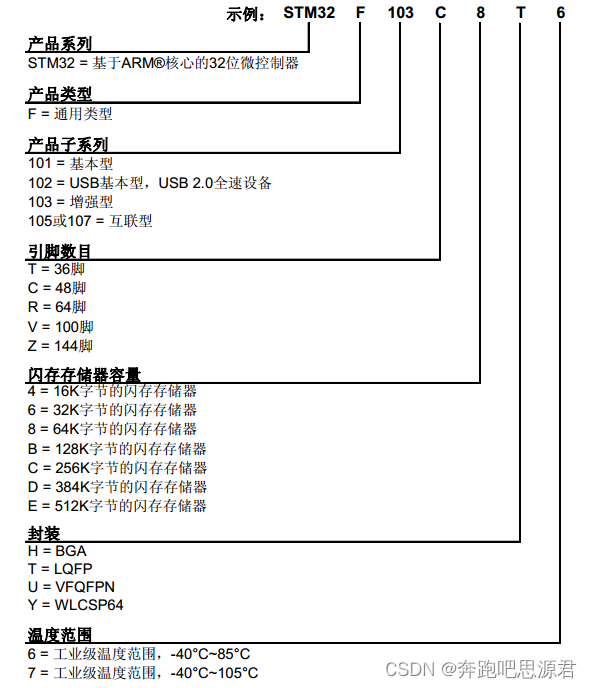
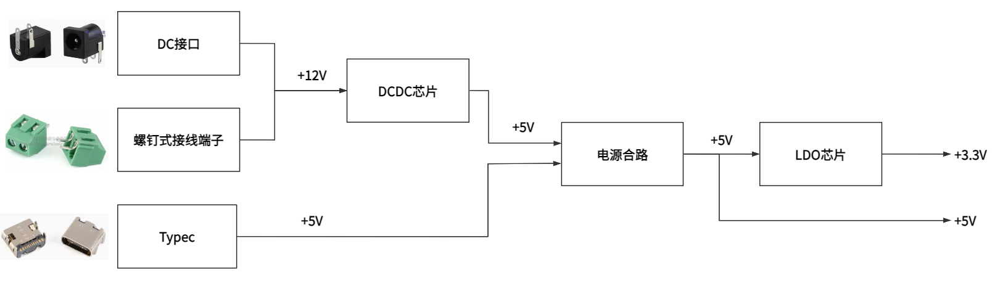

# 01 产品设计流程与元器件选型

## 学习目标

- 说出 PCB 设计闭环在电子产品全流程中的位置，以及每一段的交付物。
- 从电赛现场的四类痛点反推出开发板的需求与方案表。
- 按 STM32 命名规则逐位读出引脚数、容量、封装与温度等级。
- 解释信号接口选 SMA、模块接口选防反插连接座的理由。
- 画出本板的电源树，并指出哪一级用 DC-DC、哪一级用 LDO。

## 目录

1. 两条流程线
2. 项目背景：为什么电赛需要一块专用开发板
3. 从痛点提炼需求与方案
4. 主控选型：STM32F103VET6 是怎么读出来的
5. 信号接口选型：为什么是 SMA
6. 模块接口选型
7. 电源架构：先画电源树，再谈电路
8. 其他设计

## 1. 两条流程线

### 1.1 PCB 设计流程

单次 PCB 设计的闭环是：

```
原理图设计 → 布局布线（PCB设计） → 导出 Gerber → 板厂加工 → 焊接组装调试 → 成品
```

原理图描述"电气上怎么连"，PCB 描述"物理上怎么摆怎么走"，两者由软件保证网络一一对应。加工回来的裸板必须经过焊接、调试才能验证设计是否成功——**没焊过、没测过的板子不能算设计完成**。

这条链上每往右走一步，纠错成本就上一个台阶。原理图画错，改一个符号只要几秒；PCB 布完才发现引脚接反，要重新布局布线；板子做回来才暴露，代价是重新打样、等一周、再拆焊一遍。所以流程的价值不在"按顺序做"，而在**把错误尽量压在左边**：原理图阶段用 DRC 拦住连接错误，布局阶段用 3D 预览拦住干涉，打样前用 Gerber 查看器拦住制造问题。

### 1.2 电子产品设计流程

PCB 流程只是电子产品设计全流程中的一段。完整的流程按时间线展开：



读这张图的方式：横向是时间轴，分为内部、外部、整合、问世四个阶段。每个阶段的"目标"一栏回答了"现在该做什么、做到什么程度算过关"：

| 阶段 | 关键动作 | 目标 |
| --- | --- | --- |
| 内部 | 拆解功能并验证 | 用开发板 + 模块直接实现需求 |
| 内部 | 制作初期 PCB | 把开发板和模块整合成一块电路板 |
| 外部 | 设计外观及交互 | 确定外观与人机交互 |
| 外部 | 制作实体并验证 | 确定所有部件的可行性 |
| 整合 | 整合内外软硬件 | 组合内外，完成最终成品 |
| 问世 | 宣发 / 小批量制造 | 传达产品精神 / 生产几十至几百件 |

前两个阶段允许"丑但能用"：开发板加杜邦线能把功能跑通，就说明方案成立；到了外部阶段才开始收敛尺寸、接口位置与外观。很多作品卡在中间，是因为在功能还没验证时就去雕外观，改一次结构就要重做一次板子。

概括成一句话：**确定需求 → 提出方案 → 软硬件设计 → 样品验证 → 制作实物**。大师篇的项目（一块 STM32 电赛开发板）就是沿着"需求 → 方案 → 原理图 → PCB → 打板 → 焊接测试"这条链完整走一遍。

## 2. 项目背景：为什么电赛需要一块专用开发板

大师篇要设计的是一块面向电子设计竞赛（电赛）的 STM32 开发板。先看两个"反例"和两个"参照物"，需求就从里面长出来了。



上图是课程最终成品：正面集中了两个 Type-C（串口/USB）、DC 电源座、开关、GPIO 排针、按键、LED 与四个 SMA 座；背面是 RTC 纽扣电池和整板引脚分配丝印。后面每一章做的事，都是为了把这块板从需求变成实物。

### 2.1 通用核心板的局限

最小系统核心板（如 STM32C8T6 最小板）只把引脚用排针引出，所有外部连接都靠杜邦线。在电赛现场这会暴露四个问题：

1. **连接不可靠**：杜邦线与排针的连接在搬运、震动中容易松脱；
2. **模拟信号干扰大**：ADC 采样的高频小信号走杜邦线，耦合干扰明显，采样质量差；
3. **接口不匹配**：如串口屏的专用接口与杜邦线不通用，还得自制转接线；
4. **供电不便**：板子没有预留电源接口，只能靠充电宝从 USB 口供电。

四个问题指向同一件事：核心板只解决了"芯片能跑起来"，没解决"系统能稳定工作"。电赛四天三夜里，接触不良导致的重测、干扰导致的读数漂移，消耗的时间往往比写代码还多。

### 2.2 通用开发板的局限

正点原子精英版这类开发板外设资源丰富（屏幕、SD 卡、USB 转串口、RTC、蜂鸣器等），但它是"学习板"而非"参赛板"：板载资源与比赛题目需求不对应，信号接口依旧是排针，上述四个问题一个都没解决。

学习板的设计目标是"把外设都演示一遍"，所以它把资源铺开、留足跳线帽；参赛板的目标是"接上题目给定的外围就能测"，需要的是专用接口与稳定的供电。两者不是好坏之分，而是用途不同——拿学习板去比赛，等于用演示工具做量产测试。

### 2.3 电赛作品实录

2023 年电赛 C 题作品中，主控用 TI MSP432 开发板，与外部的全部连接都靠排针引出——比赛时发现连接不稳定、ADC 干扰大、串口屏需要自制转接线、220V 电源模块转换出的直流电没有合适接口，只能用充电宝供电。2022 年 F 题作品同样如此，甚至专门做了一块"SMA 转杜邦线"的转接板，蓝牙、WIFI 模块也用杜邦线连接，测试中频繁松动。



"转接板"这个细节很能说明问题：信号本来该从 SMA 直接进板，中间却多了一级杜邦线转接。每多一个转接点就多一份接触电阻与天线效应，仪表类题目对微伏级信号的测量，最怕的正是这种不受控的中间环节。

与之对比，一些开源的电赛 K 题作品已经是自制的专用开发板：主控与屏幕板之外，引出了专用排线接口、板载 DC-DC 电源模块，并预留了 ADC、DAC、SPI、I2C、CAN 等专用接口，与外围模块稳定连接。

## 3. 从痛点提炼需求与方案

把上面的痛点正向翻译，就得到本次设计的需求与方案表。这张表是全课程的"总纲"，后续每一章都在填表中的一格：

| 需求 | 方案 |
| --- | --- |
| 设计一款基于 STM32 的开发板，满足电赛仪表组的需求 | 主控：STM32F103VET6 |
| | 信号接口：ADC、DAC（SMA 座） |
| | 模块接口：屏幕、I2C、SPI、USART、USB |
| | 电源设计 |
| | 其他设计（排针、按键、LED、SWD、安装孔） |

这样定，是因为模拟信号用 SMA 同轴座（螺纹锁紧、外导体接地，稳定且抗干扰，直接解决痛点 1、2）；模块用 4pin 防反插连接座与 Type-C（解决痛点 1、3）；电源支持 12V DC 座 + USB 5V 双输入（解决痛点 4）；主控与外围选型在下文第 4~8 节展开。

读这张表要连着"由谁实现"一起看：第 4 节定主控，第 5、6 节定接口，第 7 节定电源，第 8 节补齐排针、按键、调试口与安装孔。方案表不是文档摆设，它决定了后面每一章要不要多画一个电路——凡是表里没有的功能，一律不加，避免"顺手多留一个接口"把板子撑大。

## 4. 主控选型：STM32F103VET6 是怎么读出来的

### 4.1 产品线定位

ST 的 MCU/MPU 产品线非常丰富，电赛常用的是主流 MCU（F1、F4）与高性能 MCU（H7）两条线，备赛时通常三种都准备。对入门者与多数电赛基本任务而言，**STM32F103**（Cortex-M3 内核）就够用且资料最多，本设计从 F103 系列中选型。

F103 系列内部的差别集中在三处：闪存与 SRAM 容量、引脚数、外设数量。C8T6 是 64K 闪存 + 20K SRAM 的入门款，跑裸机小程序够用，一旦加上屏幕驱动、滤波算法与缓存就容易吃紧；VET6 给到 512K 闪存 + 64K SRAM，做 FFT、存波形、跑多任务都留有余量。H7 主频高、带浮点与更大内存，适合图像与高速采样，但价格与焊接难度也上一个台阶，不是本设计的必要项。

F103 系列在 CubeMX 中有 49 个型号，逐个试不现实——正确做法是读命名规则，让每一位字母/数字替你做选择。

### 4.2 命名规则逐位拆解



以示例 `STM32F103C8T6` 从左到右读：

| 位 | 含义 | 可选值 | 本设计的选择与理由 |
| --- | --- | --- | --- |
| STM32 | 基于 ARM 核心的 32 位微控制器 | — | 固定 |
| F | 产品类型（通用型） | F 通用 / L 低功耗 / H 高性能 | F |
| 103 | 子系列（增强型） | 101 基本型 / 102 USB 基本型 / 103 增强型 / 105 互联型 | 103 |
| 引脚数 | 封装引脚数目 | T=36、C=48、R=64、V=100、Z=144 | **V（100 脚）**：电赛要外接大量模块，GPIO 越多越好 |
| 闪存容量 | 程序存储空间 | 4=16K、6=32K、8=64K、B=128K、C=256K、D=384K、E=512K | **E（512K）**：比赛代码与中间结果多，闪存尽量大 |
| 封装 | 焊接形式 | BGA、T=LQFP、VFQFPN(QFN)、WLCSP(CSP) | **T（LQFP）**：引脚分布在四周，手工焊接最友好 |
| 温度范围 | 工作温度 | 6=-40~85℃、7=-40~105℃ | 6，比赛场景无特殊温度要求 |

封装位需要展开说明，因为它直接决定"自己能不能焊出来"：

- **BGA**：球栅阵列，焊球藏在芯片底下，多用于 CPU 类高引脚数芯片，手工基本无法焊接，排除；
- **LQFP**：引脚外露在四周，烙铁 + 热风枪都能焊，**首选**；
- **QFN**：引脚藏在背面，省空间但焊接难度比 LQFP 略高，可行但非首选；
- **CSP**：与 BGA 类似，少见且难焊，排除。

四位拼起来：**STM32F103VET6**。这就是整块板子的心脏。

读型号有个固定顺序：**先看封装能不能焊，再看引脚够不够用，最后看容量装不装得下**。反过来先挑大容量再发现是 BGA，等于给自己挖坑。100 脚的 LQFP 在 0.5mm 间距下仍可手工拖焊，再往上到 144 脚，焊盘更密、对位更难，第一次做板容易连锡。选型时还要查一眼库存与价格：同系列里 VET6 属于供货稳定、单价适中的档位，比 144 脚的 ZET6 便宜，引出的 IO 又足够覆盖电赛常见外设。

### 4.3 最小系统从哪来

选定 MCU 后，它的外围电路不用自己发明——**查数据手册**。数据手册给出了最小系统的三个参考电路：

1. **时钟电路**（晶振 + 起振电容）；
2. **电源电路**（去耦电容、模拟电源、基准）；
3. **复位电路**（复位阻容 + 按键）。

数据手册之外，ST 还有一份硬件设计应用笔记（AN2586），把供电、复位、时钟、BOOT 引脚的推荐接法集中画在一起，画原理图时对照它比逐页翻手册更快。具体参数的确定在 [03 原理图设计](03%20原理图设计%20电源、最小系统与接口电路.md) 中逐个展开。

## 5. 信号接口选型：为什么是 SMA

电赛仪表类题目（如 2023 C 题）的典型系统框图里，主控开发板与三类电路连接：DDS 信号产生电路（GPIO）、相位检测电路（输出模拟信号，用 ADC 读）、继电器（GPIO）。模拟信号的接入质量直接决定仪表类题目的测量精度。

**SMA 座**是射频/信号领域最常见的同轴连接器：

- 内芯传信号，外层导体接地，形成同轴屏蔽结构；
- 接口带螺纹，与线缆对接后机械锁定——不会像杜邦线那样松脱；
- 屏蔽层全程包裹信号，抗干扰能力远高于杜邦线。

同轴结构的另一个好处是阻抗可控。SMA 系统按 **50Ω** 设计，信号从座子到板内走线只要保持同一参考面，反射就小；杜邦线没有固定阻抗，长度一变，信号质量跟着变。这也是示波器、信号源、频谱仪清一色用 SMA 或 BNC 的原因——测量链路里不能出现"不知道阻抗是多少"的一段。

因此本设计预留 4 个 SMA 座：2 路 ADC 输入（PA0、PA1）+ 2 路 DAC 输出（PA4、PA5），所有信号类连接统一走 SMA。座子选板边直插或弯插款，拧线缆时受力落在座上而不是焊盘上；四个座子排在板边同一侧，接线不会互相压住。

## 6. 模块接口选型

| 外接对象 | 通信协议 | 板上接口 |
| --- | --- | --- |
| WIFI 模块、串口屏 | USART 串口 | 4pin 防反插连接座 ×3 |
| OLED 屏 | SPI / I2C | 6pin 连接座 ×2 |
| 与电脑通信 / 供电 | USB | Type-C |
| 通用调试 | SWD | 4pin 排针 |
| 任意扩展 | GPIO | 双排 2×23pin 排针 ×2 |

选 4pin/6pin 连接座的理由与 SMA 一脉相承：**有方向的防反插设计 + 稳定的机械连接**，比杜邦线可靠得多。Type-C 支持正反插且外观整洁。电源座、开关、SMA 都会被引到板边，方便插拔。

连接座的间距要跟外设对上：常见的 2.54mm 排线座好压线、成本低，1.25mm 的座子更小但需要配套的端子与压线钳。本板统一用 2.54mm，好处是随便一根杜邦线母头都能临时插上去调试，同时外壳上留出防反插的凸起，插错方向插不进去。丝印上把每个座的 1 脚与信号名标清楚，接反了能立刻发现。

## 7. 电源架构：先画电源树，再谈电路

电源需求从两端说起：

- **输入**：220V 适配器 → 12V 直流（DC 座 / 螺钉端子）；或 USB → 5V；
- **输出**：5V（给模块、串口屏等）与 3.3V（给单片机）。

把"输入怎么变成输出"画成一张框图，就是**电源树**。画复杂原理图前先画电源树，别人看图时能一眼看清电源架构：



读图要点（这也是后面 [03 原理图设计](03%20原理图设计%20电源、最小系统与接口电路.md) 的绘制顺序）：

1. 12V 与 5V 压差大（7V），若用线性稳压，多余能量全部变成热——**12V→5V 用 DC-DC 开关芯片**，效率高；
2. DC-DC 输出的 5V 与 USB 输入的 5V 可能同时存在，需要**电源合路**（二选一开关 + 保险丝）；
3. 合路后的 5V → 3.3V 压差小，且 MCU 对电源纹波敏感——**5V→3.3V 用 LDO**，输出干净。

顺着树再算一遍电流，才知道每一级要留多少余量。12V 输入经 DC-DC 降到 5V，这一级要同时供串口屏、WIFI 模块与外接传感器，按峰值 1A 估算，选 3A 的芯片留三倍余量，发热与压降都不吃紧。5V 转 3.3V 只给 MCU 与数字电路，约 100mA；LDO 上的耗散是 $(5-3.3)\times0.1=0.17\mathrm{W}$，SOT-223 封装靠焊盘散热即可，不必加散热片。如果哪一天把 3.3V 负载加到 500mA，耗散就升到 0.85W，那时必须改 DC-DC——这条分界线在下一章会用效率公式讲清楚。

"为什么大压差用 DC-DC、小压差用 LDO"的原理与定量对比，见下一章 [02 电源设计基础](02%20电源设计基础%20LDO、DC-DC、基准与滤波电容.md)。

## 8. 其他设计

- **GPIO 全部引出** + 电源引脚引出：接外接模块时不用飞线；
- **按键**：用户按键 ×3 + 复位按键，方便调试；
- **SWD 调试下载接口**：必备；
- **LED 指示灯**：电源指示 + 用户 LED；
- **M3 铜柱孔**：安装固定，避免板子悬空导致焊接点受力。

四个 M3 孔分布在板的四角，孔心到板边留 3mm 以上，给螺丝头留出空间，也避免钻孔时把板边铜皮崩掉。板厚按常规 1.6mm 下单：太薄插拔 SMA 时会弯，太厚则铜柱与外壳的配合尺寸要跟着改。

到这里，需求、主控、接口、电源四件事都有了结论，整块板的骨架也就定了。下一章先把电源树里两个框的内部原理讲透，再补上基准与滤波电容两块拼图：[02 电源设计基础](02%20电源设计基础%20LDO、DC-DC、基准与滤波电容.md)。
