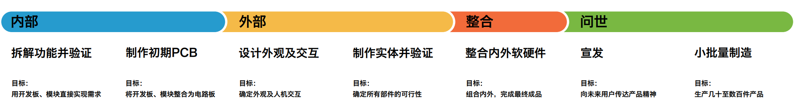
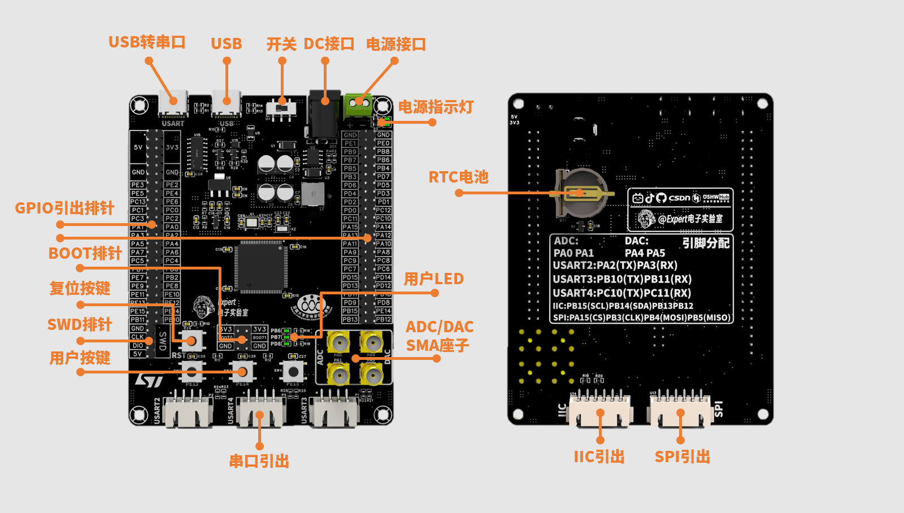
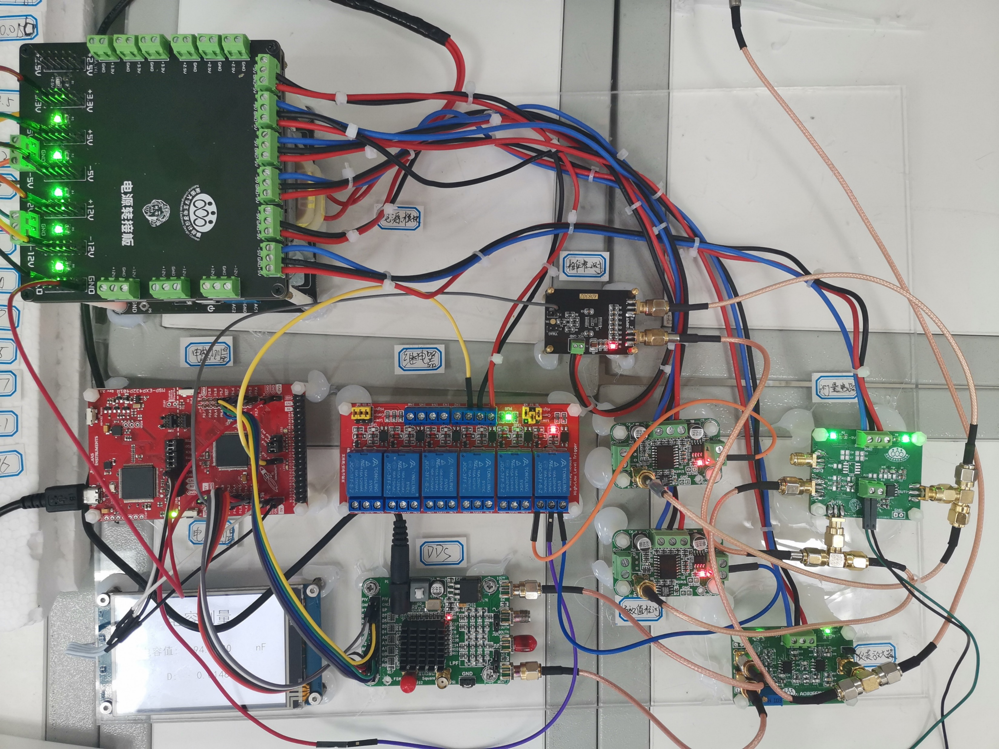

# 01 产品设计流程与需求分析

> 前置要求：无。本章建立整门课程的工程观：一块开发板不是从画原理图开始的，而是从"需求"开始的。

## 1. 两条流程线

### 1.1 PCB 设计流程

单次 PCB 设计的闭环是：

```
原理图设计 → 布局布线（PCB设计） → 导出 Gerber → 板厂加工 → 焊接组装调试 → 成品
```

原理图描述"电气上怎么连"，PCB 描述"物理上怎么摆怎么走"，两者由软件保证网络一一对应。加工回来的裸板必须经过焊接、调试才能验证设计是否成功——**没焊过、没测过的板子不能算设计完成**。

### 1.2 电子产品设计流程

PCB 流程只是电子产品设计全流程中的一段。完整的流程按时间线展开：



读这张图的方式：横向是时间轴，分为内部、外部、整合、问世四个阶段。每个阶段的"目标"一栏回答了"现在该做什么、做到什么程度算过关"：

| 阶段 | 关键动作 | 目标 |
| --- | --- | --- |
| 内部 | 拆解功能并验证 | 用开发板 + 模块直接实现需求 |
| 内部 | 制作初期 PCB | 把开发板和模块整合成一块电路板 |
| 外部 | 设计外观及交互 | 确定外观与人机交互 |
| 外部 | 制作实体并验证 | 确定所有部件的可行性 |
| 整合 | 整合内外软硬件 | 组合内外，完成最终成品 |
| 问世 | 宣发 / 小批量制造 | 传达产品精神 / 生产几十至几百件 |

概括成一句话：**确定需求 → 提出方案 → 软硬件设计 → 样品验证 → 制作实物**。大师篇的项目（一块 STM32 电赛开发板）就是沿着"需求 → 方案 → 原理图 → PCB → 打板 → 焊接测试"这条链完整走一遍。

## 2. 项目背景：为什么电赛需要一块专用开发板

大师篇要设计的是一块面向电子设计竞赛（电赛）的 STM32 开发板。先看两个"反例"和两个"参照物"，需求就从里面长出来了。



上图是课程最终成品：正面集中了两个 Type-C（串口/USB）、DC 电源座、开关、GPIO 排针、按键、LED 与四个 SMA 座；背面是 RTC 纽扣电池和整板引脚分配丝印。后面每一章做的事，都是为了把这块板从需求变成实物。

### 2.1 通用核心板的局限

最小系统核心板（如 STM32C8T6 最小板）只把引脚用排针引出，所有外部连接都靠杜邦线。在电赛现场这会暴露四个问题：

1. **连接不可靠**：杜邦线与排针的连接在搬运、震动中容易松脱；
2. **模拟信号干扰大**：ADC 采样的高频小信号走杜邦线，耦合干扰明显，采样质量差；
3. **接口不匹配**：如串口屏的专用接口与杜邦线不通用，还得自制转接线；
4. **供电不便**：板子没有预留电源接口，只能靠充电宝从 USB 口供电。

### 2.2 通用开发板的局限

正点原子精英版这类开发板外设资源丰富（屏幕、SD 卡、USB 转串口、RTC、蜂鸣器等），但它是"学习板"而非"参赛板"：板载资源与比赛题目需求不对应，信号接口依旧是排针，上述四个问题一个都没解决。

### 2.3 电赛作品实录

2023 年电赛 C 题作品中，主控用 TI MSP432 开发板，与外部的全部连接都靠排针引出——比赛时发现连接不稳定、ADC 干扰大、串口屏需要自制转接线、220V 电源模块转换出的直流电没有合适接口，只能用充电宝供电。2022 年 F 题作品同样如此，甚至专门做了一块"SMA 转杜邦线"的转接板，蓝牙、WIFI 模块也用杜邦线连接，测试中频繁松动。



与之对比，一些开源的电赛 K 题作品已经是自制的专用开发板：主控与屏幕板之外，引出了专用排线接口、板载 DC-DC 电源模块，并预留了 ADC、DAC、SPI、I2C、CAN 等专用接口，与外围模块稳定连接。

## 3. 从痛点提炼需求与方案

把上面的痛点正向翻译，就得到本次设计的需求与方案表。这张表是全课程的"总纲"，后续每一章都在填表中的一格：

| 需求 | 方案 |
| --- | --- |
| 设计一款基于 STM32 的开发板，满足电赛仪表组的需求 | 主控：STM32F103VET6 |
| | 信号接口：ADC、DAC（SMA 座） |
| | 模块接口：屏幕、I2C、SPI、USART、USB |
| | 电源设计 |
| | 其他设计（排针、按键、LED、SWD、安装孔） |

**为什么这样定**：模拟信号用 SMA 同轴座（螺纹锁紧、外导体接地，稳定且抗干扰，直接解决痛点 1、2）；模块用 4pin 防反插连接座与 Type-C（解决痛点 1、3）；电源支持 12V DC 座 + USB 5V 双输入（解决痛点 4）；主控与外围选型在下一章展开。

## 4. 检查点

- 能默画两条流程线，并说出 PCB 流程在产品流程中的位置；
- 能对一块"排针 + 杜邦线"的核心板列出至少三条电赛现场的风险；
- 看到需求方案表时，能说出每一行对应第几章完成。

下一章：[02 元器件选型](02%20元器件选型.md)——把方案表里的每一项落成具体型号。
