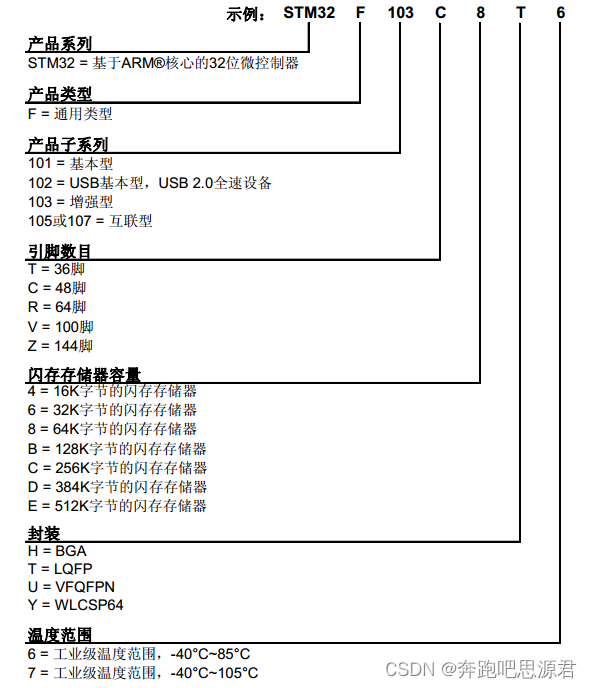
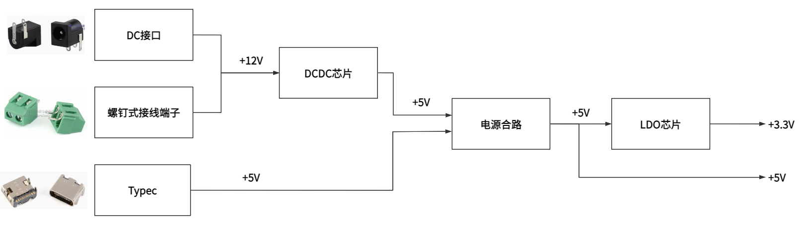

# 02 元器件选型

> 前置要求：已读 [01 产品设计流程与需求分析](01%20产品设计流程与需求分析.md)。本章把需求方案表落成具体型号：主控、信号接口、模块接口、电源架构。

## 1. 主控选型：STM32F103VET6 是怎么读出来的

### 1.1 产品线定位

ST 的 MCU/MPU 产品线非常丰富，电赛常用的是主流 MCU（F1、F4）与高性能 MCU（H7）两条线，备赛时通常三种都准备。对入门者与多数电赛基本任务而言，**STM32F103**（Cortex-M3 内核）就够用且资料最多，本设计从 F103 系列中选型。

F103 系列在 CubeMX 中有 49 个型号，逐个试不现实——正确做法是读命名规则，让每一位字母/数字替你做选择。

### 1.2 命名规则逐位拆解

以示例 `STM32F103C8T6` 从左到右读：

| 位 | 含义 | 可选值 | 本设计的选择与理由 |
| --- | --- | --- | --- |
| STM32 | 基于 ARM 核心的 32 位微控制器 | — | 固定 |
| F | 产品类型（通用型） | F 通用 / L 低功耗 / H 高性能 | F |
| 103 | 子系列（增强型） | 101 基本型 / 102 USB 基本型 / 103 增强型 / 105 互联型 | 103 |
| 引脚数 | 封装引脚数目 | T=36、C=48、R=64、V=100、Z=144 | **V（100 脚）**：电赛要外接大量模块，GPIO 越多越好 |
| 闪存容量 | 程序存储空间 | 4=16K、6=32K、8=64K、B=128K、C=256K、D=384K、E=512K | **E（512K）**：比赛代码与中间结果多，闪存尽量大 |
| 封装 | 焊接形式 | BGA、T=LQFP、VFQFPN(QFN)、WLCSP(CSP) | **T（LQFP）**：引脚分布在四周，手工焊接最友好 |
| 温度范围 | 工作温度 | 6=-40~85℃、7=-40~105℃ | 6，比赛场景无特殊温度要求 |

封装位需要展开说明，因为它直接决定"自己能不能焊出来"：

- **BGA**：球栅阵列，焊球藏在芯片底下，多用于 CPU 类高引脚数芯片，手工基本无法焊接，排除；
- **LQFP**：引脚外露在四周，烙铁 + 热风枪都能焊，**首选**；
- **QFN**：引脚藏在背面，省空间但焊接难度比 LQFP 略高，可行但非首选；
- **CSP**：与 BGA 类似，少见且难焊，排除。

四位拼起来：**STM32F103VET6**。这就是整块板子的心脏。

### 1.3 最小系统从哪来

选定 MCU 后，它的外围电路不用自己发明——**查数据手册**。数据手册给出了最小系统的三个参考电路：

1. **时钟电路**（晶振 + 起振电容）；
2. **电源电路**（去耦电容、模拟电源、基准）；
3. **复位电路**（复位阻容 + 按键）。

具体参数的确定在 [06 原理图设计二](06%20原理图设计二%20单片机最小系统.md) 中逐个展开。

## 2. 信号接口选型：为什么是 SMA

电赛仪表类题目（如 2023 C 题）的典型系统框图里，主控开发板与三类电路连接：DDS 信号产生电路（GPIO）、相位检测电路（输出模拟信号，用 ADC 读）、继电器（GPIO）。模拟信号的接入质量直接决定仪表类题目的测量精度。

**SMA 座**是射频/信号领域最常见的同轴连接器：

- 内芯传信号，外层导体接地，形成同轴屏蔽结构；
- 接口带螺纹，与线缆对接后机械锁定——不会像杜邦线那样松脱；
- 屏蔽层全程包裹信号，抗干扰能力远高于杜邦线。

因此本设计预留 4 个 SMA 座：2 路 ADC 输入（PA0、PA1）+ 2 路 DAC 输出（PA4、PA5），所有信号类连接统一走 SMA。

## 3. 模块接口选型

| 外接对象 | 通信协议 | 板上接口 |
| --- | --- | --- |
| WIFI 模块、串口屏 | USART 串口 | 4pin 防反插连接座 ×3 |
| OLED 屏 | SPI / I2C | 6pin 连接座 ×2 |
| 与电脑通信 / 供电 | USB | Type-C |
| 通用调试 | SWD | 4pin 排针 |
| 任意扩展 | GPIO | 双排 2×23pin 排针 ×2 |

选 4pin/6pin 连接座的理由与 SMA 一脉相承：**有方向的防反插设计 + 稳定的机械连接**，比杜邦线可靠得多。Type-C 支持正反插且外观整洁。电源座、开关、SMA 都会被引到板边，方便插拔。

## 4. 电源架构：先画电源树，再谈电路

电源需求从两端说起：

- **输入**：220V 适配器 → 12V 直流（DC 座 / 螺钉端子）；或 USB → 5V；
- **输出**：5V（给模块、串口屏等）与 3.3V（给单片机）。

把"输入怎么变成输出"画成一张框图，就是**电源树**。画复杂原理图前先画电源树，别人看图时能一眼看清电源架构：

读图要点（这也是后面 [05 原理图设计一](05%20原理图设计一%20电源电路与模数地分离.md) 的绘制顺序）：

1. 12V 与 5V 压差大（7V），若用线性稳压，多余能量全部变成热——**12V→5V 用 DC-DC 开关芯片**，效率高；
2. DC-DC 输出的 5V 与 USB 输入的 5V 可能同时存在，需要**电源合路**（二选一开关 + 保险丝）；
3. 合路后的 5V → 3.3V 压差小，且 MCU 对电源纹波敏感——**5V→3.3V 用 LDO**，输出干净。

"为什么大压差用 DC-DC、小压差用 LDO"的原理与定量对比，见 [03 电源设计基础](03%20电源设计基础%20LDO与DC-DC.md)。

## 5. 其他设计

- **GPIO 全部引出** + 电源引脚引出：接外接模块时不用飞线；
- **按键**：用户按键 ×3 + 复位按键，方便调试；
- **SWD 调试下载接口**：必备；
- **LED 指示灯**：电源指示 + 用户 LED；
- **M3 铜柱孔**：安装固定，避免板子悬空导致焊接点受力。

## 6. 检查点

- 给定任意 STM32 型号（如 STM32F103ZET6），能按命名规则说出引脚数、闪存、封装、温度范围；
- 能说出选 LQFP 而非 BGA/QFN 的原因；
- 能默画本板的电源树，并指出哪一级用 DC-DC、哪一级用 LDO、为什么。

下一章：[03 电源设计基础 LDO与DC-DC](03%20电源设计基础%20LDO与DC-DC.md)——把电源树里两个框的内部原理讲透。
