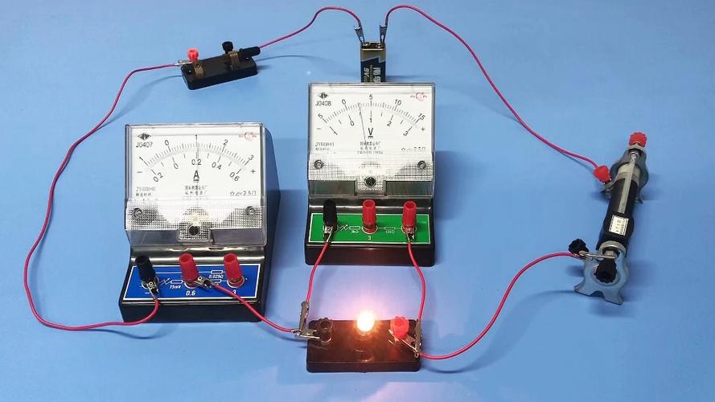
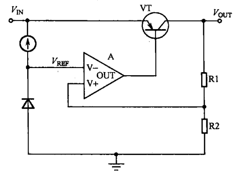
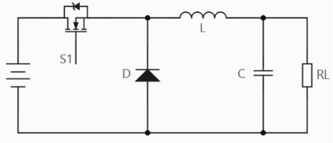
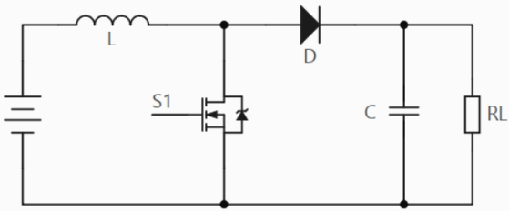
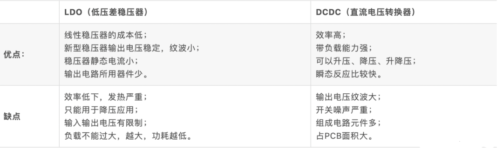
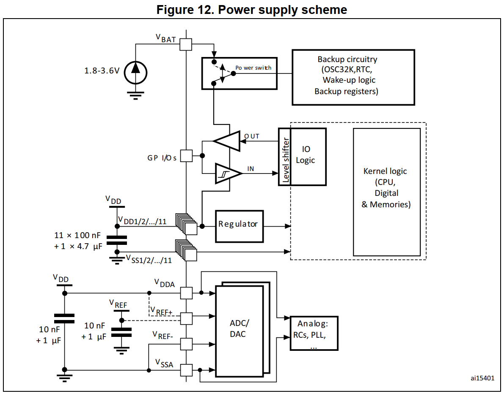
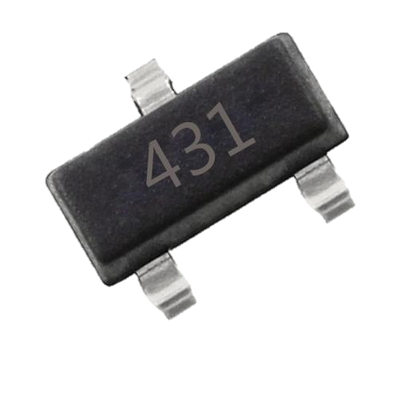
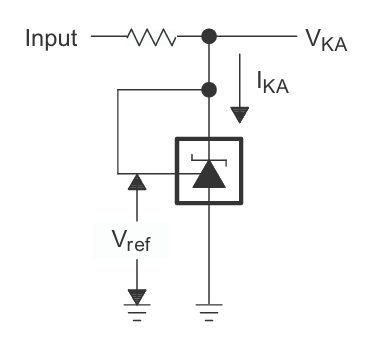
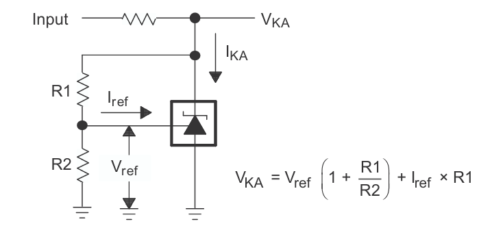

# 02 电源设计基础 LDO、DC-DC、基准与滤波电容

## 学习目标

- 用"观察—比较—调节"的闭环解释 LDO 的内部结构与稳压过程。
- 从储能元件的行为推出 Buck、Boost 的工作原理与输出电压关系。
- 按效率、压差、纹波、成本四条维度选择 LDO 或 DC-DC。
- 用示波器正确测出 DC-DC 的输出纹波，并说清每个设置的理由。
- 解释 VREF 与 VDD 的分工，说清 100nF 滤波与去耦的区别，并用 TL431 搭出基准。

## 目录

1. LDO：一个会自动调节的"滑动变阻器"
2. DC-DC 开关稳压器：先把电"斩"碎，再"滤"平
3. 实验：用示波器测 DC-DC 输出纹波
4. MCU 里为什么有两种"电源"：VDD 与 VREF
5. TL431：最经典的基准电压源
6. 100nF 电容：原理图上最常见的小元件

**电源稳压器（Power Regulator）**：在输入电压或负载电流发生变化时，仍能提供稳定输出电压的元件。AMS1117 这类芯片我们都用过，但它内部到底怎么"稳"，值得展开。

## 1. LDO：一个会自动调节的"滑动变阻器"

### 1.1 从初中实验说起

电池 + 小灯泡 + 滑动变阻器串联。电池电压会变，想让灯泡亮度稳定，人可以这样做：眼睛观察亮度 → 太亮就把变阻器调大（灯泡分压变小、变暗）→ 太暗就调小。这是一个完整的闭环：**观察 → 比较 → 调节**。

LDO 的发明思路就一步：**用电路把"人"换掉**——眼睛换成电压采样，大脑比较换成误差放大器，手换成调整管。

### 1.2 内部四大电路与闭环过程

四个部分对应图中的四个位置：

| 电路 | 图中元件 | 作用 |
| --- | --- | --- |
| 电压基准 | 电流源 + 稳压二极管 | 产生不随输入/温度变化的参考电压 $V_{REF}$ |
| 误差放大器 | 三角形运放 A | 输出 = $\beta \times (V_+ - V_-)$，理想 $\beta \to \infty$；同相端接采样电压，反相端接 $V_{REF}$ |
| 调整管 | PNP 三极管 VT | 等效为一个受基极电压控制的**可变电阻**（基极电压升高 → 管压降电阻变大），串在输入与输出之间 |
| 采样电路 | R1、R2 分压 | 采样点电压 = $V_{OUT} \times \dfrac{R2}{R1+R2}$，正比于输出 |

**闭环调节过程**（对照"人调变阻器"的每一步）：

- 输出偏高：采样电压 > $V_{REF}$ → 运放同相端电位高 → 输出高电平 → 调整管等效电阻变大 → 串联分压中管子吃掉更多电压 → $V_{OUT}$ 回落；
- 输出偏低：采样电压 < $V_{REF}$ → 运放输出低电平 → 调整管等效电阻变小 → $V_{OUT}$ 回升。

输出就这样被"摁"在设定值附近。这里的运放知识如果没学过模电，只需记住：运放比较两个输入端的电压差并放大输出，同相端 > 反相端时输出高电平，反之输出低电平——足够理解 LDO 了。

闭环之所以能稳，靠的是**负反馈的极性没有接反**：输出升高会让调整管"多分压"，而这恰好又把输出压回去。反馈极性接反的电路会一路顶到电源轨或地，表现为输出直接等于输入或为零，这也是调试电源时首先要排除的故障。

### 1.3 电气特性与适用场合

特性全部可以从"串联分压"这个本质推出：

| 优点 | 缺点 |
| --- | --- |
| 外围器件少（一两个旁路电容），电路简单、成本低 | **效率低**：压差全部落在调整管上发热 |
| 负载响应快 | 压差不能太大（一般几伏以内） |
| 输出纹波小、噪声小（无开关动作） | 只能降压 |
| | 输出电流有限（大电流时调整管发热严重，一般一两安以内） |

效率可以算得很直白：忽略静态电流时，LDO 的输入功率全部由输出电流决定，$\eta \approx V_{OUT}/V_{IN}$。5V 转 3.3V 是 66%，12V 转 5V 只有 42%，其余都变成调整管上的热。耗散功率用压差乘电流估算：$(V_{IN}-V_{OUT})\times I_{OUT}$，再加上静态电流那一小份 $V_{IN}\times I_q$。AMS1117 在 1A 时的压差约 1.1V，输入只剩 4.4V 时就开始掉出稳压区，这也是"压差不能太大"的另一层含义——**输入不能低到贴住输出**。

**适用场合**：低压差 + 低纹波/低噪声 + 小电流。典型例子：51 单片机核心板工作电流只有几十 mA，5V→3.3V 用 AMS1117 恰到好处。反过来，用 LDO 把 12V 降到 5V 给 1A 负载供电，管子上要烧掉 7W，任何小封装都撑不住。

## 2. DC-DC 开关稳压器：先把电"斩"碎，再"滤"平

### 2.1 从 PWM 说起

还是小灯泡实验，这次没有滑动变阻器，只有一个开关：快速通断开关，速度足够快时灯泡呈现平稳的常亮，亮度比常通时低。定义：

- 周期 $T$，导通时间 $t$，**占空比** $D = \dfrac{t}{T}$；
- 该方波即 **PWM 波**，灯泡亮度（等效电压）取决于占空比。

调亮 = 调大占空比，调暗 = 调小。这个"手"在电源芯片里由 MOS 管担任——但 PWM 波波动太大，不能直接当电源用，需要储能元件把方波"滤"成直流。这就是 DC-DC 开关稳压器的核心：**MOS 管高频开关把直流斩成 PWM，LC 储能网络把 PWM 整形为稳定直流**。

> 术语澄清：DC-DC（直流转直流）是宽泛概念，含隔离型（正激、反激，用于强电场合）。本课程所指均为**非隔离型开关稳压器**：降压型叫 **Buck**，升压型叫 **Boost**。

### 2.2 Buck 降压电路

把电路拆成两个模块看：左边"电源 + MOS 管 S1"把直流斩成 PWM；右边"二极管 D + 电感 L + 电容 C + 负载 RL"负责整形。

必须有电感，是因为电容的电流满足 $i = C\dfrac{du}{dt}$。现实电流不能无穷大，所以电容两端电压不能突变；而开关切换瞬间 A 点电压跳变相当于 $\dfrac{du}{dt}\to\infty$，会让电容充电电流剧增，威胁后级稳定与开关管安全。电感恰好相反——**电感电流不能突变**。LC 网络配合，让后级电压、电流都平稳。

续流二极管也不能省；分两种状态分析完整回路——

- **S1 导通**：电源 → S1 → 节点 A → 电感 → 电容/负载，二极管反偏截止；LC 储能，B 点电压被充高但充不满电源电压；
- **S1 关断**：A 点失去电源、近似 0V；但电感电流不能突变，必须有泄放路径——电流经 **D（续流二极管）→ 电感 → 负载** 继续给负载供电。导通期储能、关断期释能，输出因此连续。

两个思考题：二极管能不能换成导线？不能——S1 导通时电源经导线直接对地短路。能不能换成别的元件？同步整流芯片把 D 换成第二颗 MOS 管降低压降，但原理角色不变。

压降平衡能直接给出占空比。稳态下电感两端电压在一个周期内的平均值为零：导通期电感承受 $V_{IN}-V_{OUT}$，持续 $D\cdot T$；关断期承受 $-V_{OUT}$，持续 $(1-D)\cdot T$。两者抵消，得到

$$
V_{OUT}=D\cdot V_{IN}.
$$

这个式子在连续导通模式（CCM）下成立，也是所有 Buck 芯片调压的依据：反馈环路只需要调 $D$，就能把输出定在任何低于输入的值。电感电流的脉动幅度为

$$
\Delta I_L=\frac{(V_{IN}-V_{OUT})\,D}{L\,f},
$$

其中 $f$ 是开关频率。它说明三件事：想减小纹波，就把电感取大、频率取高；芯片开关频率定死之后，电感量就成了主要选择项；负载轻到电感电流降到零以下时进入断续模式（DCM），上面的公式不再适用。频率也不是越高越好——开关损耗随频率上升，所以常见芯片把频率放在几百 kHz 到 2MHz 之间，在体积与效率之间折中。

**输出与调节**：

- B 点电压是带小纹波的直流，纹波大小由输出 LC 的选型决定；
- 芯片通过 **FB（反馈）引脚**采样输出：输出经分压接 FB，芯片据偏差调节 PWM 占空比。分压电阻的取值公式在数据手册的反馈分压一节（本板 TPS5450 的计算见 [03 原理图设计](03%20原理图设计%20电源、最小系统与接口电路.md)）；
- **效率高的原因**：对比 A、B 两点波形，开关导通期间高出 B 点的那部分能量没有变成热，而是存进了 LC，关断期再释放给负载——像水电站蓄水放水，效率可达 90% 以上。LDO 则像火电站，多余能量全程烧掉。

### 2.3 Boost 升压电路

元件与 Buck 相同，连接不同：电感在 MOS 管**前面**。

- **S1 导通**：电源直接给电感充电储能；此时 MOS 管近似短路，前后级隔离，负载由电容供电，输出缓慢下降；
- **S1 关断**：电感电流不能突变，只能经二极管向后级电容与负载泄放；泄放电流逐渐减小，电感感应出"右正左负"的电压阻碍电流减小。

用节点电压法看输出：$U_A = U_{L(感应)} + U_{IN} > U_{IN}$，故实现升压。占空比关系：

$$V_{OUT} = \frac{1}{1-D}\,U_{IN}$$

$0 < D < 1$，故 $V_{OUT} > U_{IN}$。类比：MOS 导通期相当于给电磁弹射器（电感）充电储能，关断瞬间把储存的能量瞬间释放——小电源也能顶出高电压。

升压比不能无限取。$D$ 越接近 1，分母越小，理论上输出越高；实际受限于器件耐压、电感直流电阻与开关损耗，常见 Boost 在升压比超过四五倍后效率明显下滑，输出能力也变差。所以"5V 升 12V"轻松，"5V 升 48V"就要认真选器件了。另外 Boost 有一个 Buck 没有的毛病：输入与输出之间始终存在一条经电感的直流通路，开关管击穿时高压会直接灌到输入端，做高压输出时要额外考虑保护。

### 2.4 LDO 与 DC-DC 全面对比

| 维度 | LDO（低压差线性稳压器） | DC-DC（开关稳压器） |
| --- | --- | --- |
| 效率 | 低（压差发热） | 高（约 90%，能量蓄放） |
| 压差 | 只能降压，且压差受限 | 输入范围宽，可升可降 |
| 纹波/噪声 | 小（无开关动作） | 大（PWM 开关噪声） |
| 外围与成本 | 器件少、简单、便宜 | 器件多（电感/电容/二极管/芯片）、复杂、贵 |
| 输出电流 | 受限（一两安内） | 大，功率可做得很大 |

**选型口诀**：大压差、大功率 → DC-DC；低压差、低纹波、小电流 → LDO。本板 12V→5V 用 DC-DC（TPS5450），5V→3.3V 用 LDO（AMS1117），正是这条口诀的应用。

两级串联时顺序不能反。先 DC-DC 后 LDO，是因为开关电源擅长处理大压差、LDO 擅长收尾降噪；反过来先 LDO 把 12V 降到 5V，效率只有 42%，剩下的 7V 全变成热，再让 DC-DC 升压或降压都没有意义。混合架构在仪器里很常见：DC-DC 负责粗调与隔离，LDO 负责给 ADC、基准、运放这类怕噪声的电路做最后一段净化。

## 3. 实验：用示波器测 DC-DC 输出纹波

原理讲完，用成品板实测一次。目标：量化 TPS5450 的输出纹波（峰峰值）。

**探头改装**：取下接地夹与探针帽，装上探头附赠的**接地弹簧**。作用：把测量时的接地回路长度缩到最短，减少环路耦合进来的噪声——否则测出来的"纹波"里混着自己的地环路噪声。

**示波器设置**（以通用示波器为例）：

| 设置项 | 取值 | 原因 |
| --- | --- | --- |
| 耦合方式 | 交流（AC） | 纹波是交流分量，隔掉 5V 直流才能放大看细节 |
| 带宽限制 | 20 MHz | 滤除不需要的高频系统噪声 |
| 探头 | 1:1 | 小信号直接测量 |
| 垂直分辨率 | 约 50 mV/格 | 与 30mV 级纹波匹配 |

**测量**：开发板接 12V DC 供电，探头探针与接地弹簧一起点在 **DC-DC 输出端的电容**上（输出电容处纹波最真实）。读数：纹波峰峰值约 **30 mV**。切到直流耦合档按 Auto，可见完整输出波形：顶端约 5V，峰峰值仍约 30mV。

测点选在输出电容的焊盘上而不是板子边缘，因为纹波沿着铜箔传输会衰减，也会被周围走线耦合进额外噪声；同一个电源，量在电容上和在负载引脚上，读数可能差一倍。接地弹簧与探针要尽量靠近，两者形成的环路面积越小，拾取的磁场干扰越少。若手上只有带长地线的探头，可以先量一次作对照，就能直观看到地环路贡献了多少"假纹波"。

做出自己的板子后，用同样方法测自己的纹波，与 30mV 这个量级对照。纹波超标时先查输出电容的容值与位置，再查电感选型与布局回路，最后才怀疑芯片——大多数纹波问题出在布局，而不是芯片本身。

## 4. MCU 里为什么有两种"电源"：VDD 与 VREF

稳压方案确定后，还有两个专题直接决定单片机模拟部分的质量：ADC/DAC 需要的基准 VREF，与遍布原理图的 100nF 电容。

回到 STM32 数据手册的最小系统电源电路与 ADC/DAC 框图，会发现两类电源引脚：**VDD**（数字电源）和 **VREF**（基准电压）。数据手册给出的完整电源方案如下：

读图要点：

- 左上 **VDD/VSS**：数字电源，供 CPU、存储器、IO 逻辑，数据手册推荐 11×100nF + 1×4.7µF；
- 左下 **VDDA/VSSA + VREF+**：模拟电源与模拟基准，专供 ADC/DAC，推荐各自 10nF + 1µF 去耦；
- **VBAT**：接 1.8~3.6V 电池，断电后维持 RTC 与备份寄存器（见 [03 原理图设计](03%20原理图设计%20电源、最小系统与接口电路.md)）。

VDD 与 LDO 输出的普通电源没有本质区别；而 **VREF 是 ADC/DAC 的"量尺"**——ADC 的转换结果 = 输入电压 / VREF × 满量程。尺子不准，一切采样都是错的。算一下误差就有体感：12 位 ADC 的满量程是 4095，VREF 偏 1%，读数就整体偏 1%，相当于 41 个码值；温度每变化几十度，基准漂移几个 ppm，又会叠加进来。普通 LDO 的初始精度常见 ±1%~±2%，温漂也大，拿它当 VREF，等于用一把会热胀冷缩的尺子量长度。

所以 VREF 需要比普通电源芯片高得多的精度与温漂指标，这就是**基准电压源**存在的意义。

> 基准电压源：能提供稳定、精确、不随温度、负载、电源电压波动而变化的电压源，广泛用于 ADC、DAC、稳压电路、传感器电路等高精度场合。

## 5. TL431：最经典的基准电压源

### 5.1 认识引脚

TL431 三个引脚：**K（Cathode，阴极）**、**A（Anode，阳极）**、**REF（Reference，参考）**。它的电路符号与稳压二极管非常相似，只是多出左侧一个参考引脚；电流方向从阳极流向阴极（三角形指向）。

### 5.2 内部逻辑：一只"聪明"的电子开关

内部结构可以简化为三件套：**2.5V 内部基准 + 运放（比较器）+ 三极管**。行为规则只有一条：

> 芯片总是设法把自己的 **REF 引脚维持在 2.5V**。

具体动作：

| REF 引脚电压 | 运放输出 | 三极管状态 | 等效效果 |
| --- | --- | --- | --- |
| > 2.5V | 高电平 | 导通 | 阴极 K 与阳极 A 近似短接（K 电位被拉向 A） |
| < 2.5V | 低电平 | 关断 | K 与 A 断开 |
| = 2.5V | 平衡 | 微调 | 稳定工作点 |

单独一颗芯片看不出用处——**基准源必须配合外部电路才能工作**。

它还有一个硬性工作条件：阴极电流不能太小。手册给出的最小值通常是 1mA，低于这个值内部基准建立不起来，输出会漂；上限一般在 100mA 量级，超过就烧。所以 TL431 前面必须串限流电阻，既要保证最坏情况下仍有 1mA，又不能在大电流时超过耗散。

### 5.3 应用电路一：固定 2.5V 输出

接法：REF 直接接 K，K 经限流电阻接电源，A 接地。以 5V 输入为例推演平衡过程：

1. 上电瞬间 K 点 = 5V，REF = K = 5V > 2.5V → 三极管导通 → K 被拉向地，电位下降；
2. K 降到 2.5V 以下时，REF < 2.5V → 三极管关断 → K 又被电阻拉回 5V 方向；
3. 由于是纯模拟电路，动态平衡速度极快，最终 **K 点稳定在 2.5V**。

这个接法输出固定等于内部基准 2.5V。限流电阻可以顺手算出来：5V 输入、目标阴极电流 5mA，则 $R=(5-2.5)/5\mathrm{mA}=500\,\Omega$，取标准值 510Ω，实际电流约 4.9mA。若后级还要从 K 点取电流，这部分要一起算进电阻的预算里。

### 5.4 应用电路二：任意电压输出

在 REF 与 K 之间接入分压：R1 从 VKA 到 REF，R2 从 REF 到地。利用"REF 恒为 2.5V"与虚断（REF 端输入电流 $I_{ref}$ 极小可忽略）做支路电流分析，得到输出：

$$V_{KA} = V_{ref}\left(1 + \frac{R1}{R2}\right) + I_{ref} \times R1 \approx V_{ref}\left(1 + \frac{R1}{R2}\right)$$

使用边界（每条都很重要）：

- 因为系数 $(1+R1/R2) > 1$，输出**一定大于 2.5V**；
- 输出上限受芯片耐压限制，**不得超过 36V**（数据手册绝对最大值）；
- 即 TL431 的可调范围是 $2.5\text{V} \sim 36\text{V}$。

举个具体取值：要 3.3V，取 R2 = 10kΩ，则 $R1=10\,\mathrm{k}\Omega\times(3.3/2.5-1)=3.2\,\mathrm{k}\Omega$，标准值取 3.3kΩ 时输出约 3.325V，误差 0.8%。分压电阻的精度直接变成输出精度，所以这里用 1% 电阻；若对温漂敏感，还要按手册核对基准本身的温度系数。

**本板的选择**：STM32 数据手册规定 VREF+ 的允许范围是 2.4V ~ VDDA（本板 VDDA=3.3V，即 2.4~3.3V）。取固定 2.5V 接法（应用电路一）刚好落在范围内，元件也最少——所以板上的 VREF 电路就是"应用一"再加输出电容。

### 5.5 输出电容：不看手册会震荡的坑

TL431 数据手册专门给出**稳定工作区曲线**：横轴为负载电容 $C_L$，纵轴为工作电流（阴极电流），曲线下方的区域电路会**震荡**。对本板 $V_{KA} = V_{ref} = 2.5\text{V}$ 的情况按曲线 A 查：把输出电容取到稳定区（如 **10µF**）即可保证不振荡。

稳定区曲线的读法是"电容—电流"的二维图：同一个电容量，电流太小会振荡、电流适中才稳定；同一股电流，电容落在某些区间也会振荡。所以"随便并一颗电容"并不安全，按曲线选值才是正解。

工程备注：实测中此电路不加输出电容也能稳定工作，焊接时省略它通常不会出问题；但按手册设计仍建议焊上。

## 6. 100nF 电容：原理图上最常见的小元件

几乎每个电源引脚旁都挂着一颗 100nF 电容，它做两件事：

### 6.1 滤波：把电源"洗"干净

实际电源不是一条理想直线：稳压器输出本身带纹波，PCB 走线弯弯绕绕还会耦合系统噪声。任何实际电源都可分解为：

$$V_{实际} = V_{稳定直流} + V_{交流噪声}$$

负载只需要前者。电容**隔直通交**——交流噪声经电容旁路到地，直流继续供给负载，引脚上得到干净的电源。

### 6.2 去耦：把芯片自己的噪声也关在门口

芯片工作时（尤其是数字电路翻转）会向电源轨道注入噪声。靠近引脚的 100nF 电容为这些噪声提供就近的泄放回路，防止它顺着电源线传播、干扰板上其他器件——这正是"去耦（decoupling）"一词的含义。

**放置原则**（画原理图与 PCB 都适用）：100nF 电容必须**靠近被去耦的电源引脚**；大容量电容（储能用）可以放远一些。经验上焊盘到电容的距离控制在几毫米以内，超过一厘米，走线的寄生电感就会让高频旁路基本失效。这一原则在 [04 PCB布局](04%20PCB布局%20设计规则与模块化整体布局.md) 的布局规则中会反复出现。

容值搭配的工程惯例：小电容滤高频、大电容补能量，两者并联各司其职（如数据手册的 11×100nF + 1×4.7µF）。

为什么小电容只能管高频？因为真实电容除了容量还带等效串联电感（ESL），二者构成一个谐振点。低于谐振频率时它表现为电容，高于谐振频率时反而变成电感，阻抗随频率上升，滤波能力消失。0805 封装的 100nF 谐振点通常在十几 MHz 量级，正好覆盖数字电路翻转产生的高频段；再高的频段要靠更小容值、更小封装的电容。这就是"多个容值并联"的物理原因——不是简单相加，而是各自负责一段频段。

下一章：[03 原理图设计 电源、最小系统与接口电路](03%20原理图设计%20电源、最小系统与接口电路.md)——打开嘉立创 EDA，把本章的理论画成图纸。
