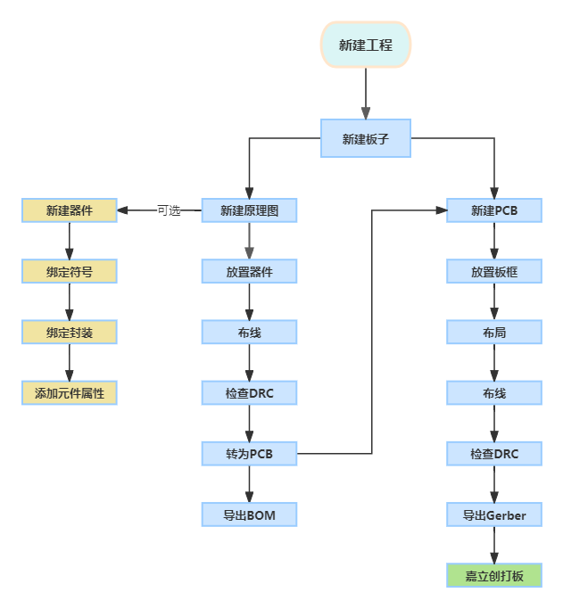
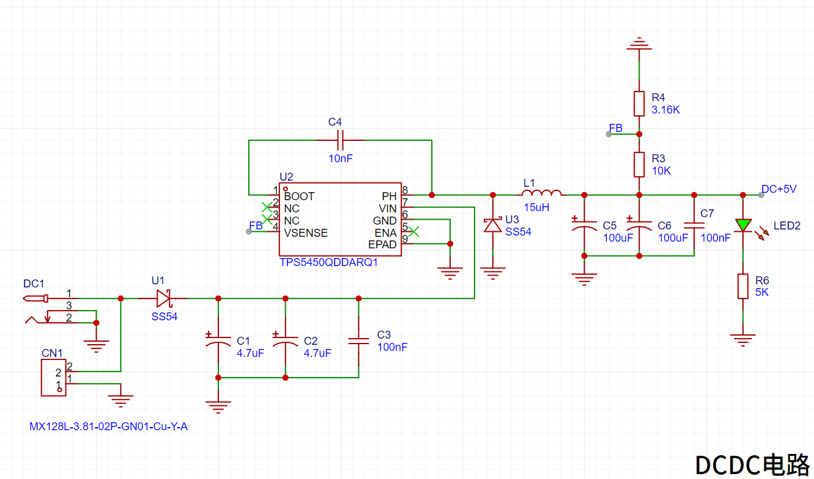
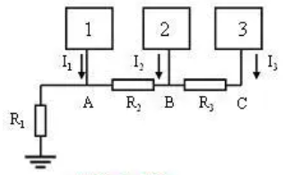
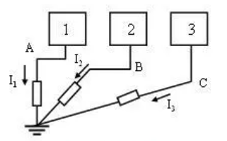
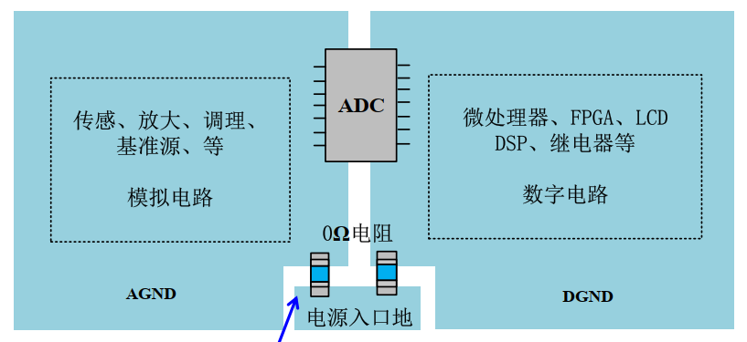
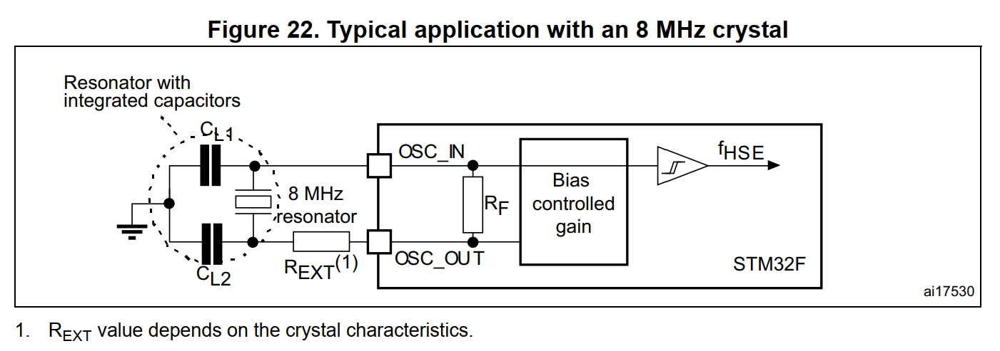
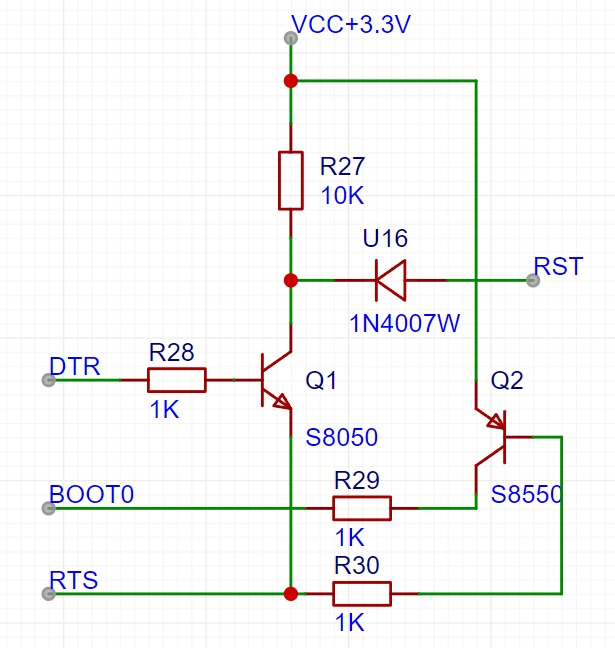

# 03 原理图设计 电源、最小系统与接口电路

## 学习目标

- 按"电源 → 主控 → 接口"的顺序规划三页原理图与网络命名。
- 照数据手册搭出 TPS5450 的 12V→5V 外围，并核对每个元件的取值依据。
- 用短接标识符与拨动开关完成两路 5V 合路，用 0Ω 电阻实现模数地单点连接。
- 画出 STM32 最小系统：数字/模拟电源、双晶振、复位、BOOT 与 GPIO 引出。
- 补齐 USB、SMA、串口与 CH340C 自动下载电路，并把整图 DRC 清零。

## 目录

1. 建立工程与软件准备
2. 电源图页：逐电路绘制
3. 模数地分离：为什么地要"分家"
4. 主控图页：单片机最小系统
5. 接口图页：接口电路
6. CH340C 与串口自动下载
7. 整理与 DRC 清零

## 1. 建立工程与软件准备

### 1.1 新建工程与图页规划

嘉立创 EDA 中一块板子的标准设计流程：

操作步骤：

1. **新建工程**：文件 → 新建 → 新建工程，命名 `STM32电赛单片机开发板`。工程自动包含一块板子，板内含原理图（Schematic）与 PCB 两部分；
2. **分图页**：本原理图较复杂，右键原理图 → 新建图页，建三页并重命名——**电源**（第 2~3 节）、**主控**（第 4 节）、**接口**（第 5~6 节）。复杂工程按模块分图页是让原理图清晰的基本手段；
3. **调整 DRC 规则**：设计 → 设计规则，取消"元件属性需与供应商编号匹配"（序号 22）检查项——该检查面向 SMT 贴片下单，自行焊接时无意义，留着只会持续报错；
4. 图纸尺寸设为 A3；**放置 → 图片**把电源树贴进图页，对照画图。

图页命名要带顺序号，比如 `1-电源`、`2-主控`、`3-接口`，导出的 PDF 会按名字排序，别人翻图时顺序就是阅读顺序。工程名里也别写"最终版""改改改"这类词，版本用日期或字母后缀区分，否则半年后分不清哪份是投板的。

全程**勤保存**：EDA 偶有崩溃或网络异常，丢失两小时进度的教训值得吸取。软件版本迭代较快，菜单以**功能名称**查找为准。

### 1.2 常用快捷键（全章通用）

| 快捷键 | 功能 |
| --- | --- |
| `W` | 放置导线（布线） |
| `Q` | mil / mm 单位切换 |
| `R` | 放置矩形框（整理模块用） |
| `Ctrl + S` | 保存 |

若与教程键位不一致：设置 → 快捷键，把配置切换为嘉立创 EDA 标准配置。

## 2. 电源图页：逐电路绘制

本板全部电阻电容统一用 **0603 封装**。绘制顺序即电流流向：输入 → DC-DC → 合路 → LDO → 指示灯。

### 2.1 三路输入接口

- **Type-C 母座（16pin）**：库内搜索放置。引脚处理：
  - VBUS → 网络标签 `USB+5V`（USB 输入的 5V）；
  - **CC1/CC2 → 各串 5.1kΩ 电阻下拉到地**：CC 是快充识别引脚，下拉后充电器确认输出标准 5V 而非高压快充协议；
  - DP1/DN1 与 DP2/DN2 分别短接合并为 `DP`/`DN`：利用 USB 特性实现正反插都能识别 D+/D-；
  - SBU1/SBU2 为保留引脚，放**未连接标识符**；
  - EP（4 个固定焊盘脚）接地。
- **DC-005-2.5 电源座**与**螺钉式接线端子**：常用库直接放置，两者都是 12V 输入，正极并联，外壳/负极接地。

16pin 的 Type-C 里，VBUS 与 GND 各由两个焊盘并联承载，正是因为 USB 供电电流可以到 3A，单个小焊盘的通流与散热都不够。原理图上把两组 VBUS 接在一起、两组 GND 接在一起，PCB 上还要用铜皮把它们连成一片，这一点 04 章布局时会用到。

接口暴露在板边，插拔时的静电会顺着 VBUS 与 D+/D- 打进芯片。工业设计会在靠接口处并 ESD 保护器件；本板作为教学板按最小系统处理，先不加，知道这回事即可。

### 2.2 防反接二极管

螺钉端子接线经常被接反，反接会烧毁后级全部电路。在 12V 输入后串一颗 **SS54 肖特基二极管**（正向压降低、额定 5A，满足整板供电）：正极接 12V 输入，负极接后级。DC 座与 Type-C 有固定极性无需防反，只有螺钉端子这条路必须加。

肖特基的正向压降约 0.5V，1A 电流下要耗散 0.5W，所以它要放在通风位置，别贴着电解电容。反过来看，这颗管的代价换来的是"接反了只是不工作，不会冒烟"，对需要现场接线的比赛作品很值。若嫌压降大，可以改用 P 沟道 MOS 做理想二极管，代价是电路复杂一倍。

### 2.3 DC-DC：TPS5450 12V→5V

TPS5450 的外围电路**完全照抄数据手册的应用电路**——电源芯片设计的第一原则。成品原理图如下，先看图再对步骤：

1. **输入滤波**：VIN 前两颗大容量电解电容 + 一颗 100nF 陶瓷电容。12V 输入电压高，电容**耐压要选高**（100nF 需 16V 以上否则易击穿）；习惯上**大电容靠电源输入端、小电容贴芯片**；
2. **GND（6 脚）直接接地；PowerPad（9 脚，散热焊盘）必须接地**——它是芯片的主要散热路径；
3. **ENA（5 脚）悬空**：数据手册规定 ENA < 0.5V 时芯片停止开关，悬空则内部上拉默认使能——本板永远开机，不接；
4. **BOOT 自举电容**：BOOT 与 PH 之间接 0.01µF（10nF），为内部开关管提供栅极驱动电压，贴芯片放；
5. **功率级**：PH（8 脚）→ 15µH 功率电感 → 输出；PH 与地之间接 SS54 做**续流二极管**（角色见 [02 章](02%20电源设计基础%20LDO、DC-DC、基准与滤波电容.md) Buck 电路）；
6. **输出滤波**：两颗电解电容并联 + 100nF。电容并联容值相加（公式同电阻串联），不必严格照抄手册值，按手头库存取值即可；
7. **反馈分压**：输出经 R1（10kΩ，上）、R2（3.16kΩ，下）分压后接入 FB/VSENSE 脚。阻值由数据手册公式算出：

$$V_{OUT} = 1.221 \times \left(1 + \frac{R1}{R2}\right) = 1.221 \times \left(1 + \frac{10\text{k}}{3.16\text{k}}\right) \approx 5.08\text{V} \approx 5\text{V}$$

   通用流程：先定 R1 = 10kΩ（手册推荐起点），再按目标输出解出 R2；
8. 输出加网络标签 `DC+5V`；VSENSE/输出相关的 NC 引脚放未连接标识符。

每个取值都能倒推一遍，画图才不是抄图。

**输入电容耐压**取 12V 的 1.5 倍以上，即 25V 档；电解电容容值按每安培输出配几十微法估算，本板取两颗并联兼顾容量与 ESR。

**电感**除了 15µH，还要看饱和电流与直流电阻。开关频率 500kHz、占空比 $D=5/12\approx0.42$ 时，电感电流的脉动为 $\Delta I_L=(12-5)\times0.42/(15\mu\mathrm{H}\times500\mathrm{kHz})\approx0.39\mathrm{A}$，峰值是输出电流加半个脉动。选型时饱和电流要大于这个峰值，否则电感饱和、电流失控；直流电阻越小，铜损越低。15µH 是手册推荐值，换值要重新核纹波。

**续流二极管**的反向耐压要高于输入电压（12V），平均电流约 $I_{OUT}(1-D)\approx1.75\mathrm{A}$（按 3A 输出），SS54 的 40V/5A 留有余量。它和电感一样是功率路径，布局时回路面积要小。

**反馈电阻的精度**直接决定输出精度。3.16kΩ 是 1% 系列的标准值，配上 10kΩ 得到 5.08V，偏差 1.6%，对数字负载足够；若用 5% 电阻，输出可能落到 4.7~5.4V。这也是为什么电源板上常见"1% 电阻"的标注。

原理图画对只是第一步，这几处布局约束要在 04 章兑现：输入电容与续流二极管的回路要贴着芯片，FB 走线从输出电容之后取、远离 PH 节点，PowerPAD 下方打散热过孔。画图时先把这些网络的标签起得清楚（`DC+5V_FB` 之类），布局时才不会把反馈线误当成普通电源线乱拉。

### 2.4 电源合路：DC+5V 与 USB+5V 二选一

DC-DC 出来的 5V 要与 USB 输入的 5V 合并成一路 VCC+5V：

1. **不能直接用导线连**：两个不同网络短接，DRC 直接报错；
2. 正确做法：放**短接标识符**（浮动工具箱中的菱形符号），它表示"这两个网络通过一段导线连通"；
3. **拨动开关**（6 脚）：上下各三个引脚为一组，中间是公共端，拨向一侧接通、另一侧断开。只用一组（如 4-5-6）：4 接合路输出、5-6 短接。**悬空不用的引脚也要接地**——防止焊接时引脚铜皮脱落；
4. **保险丝**串在合路输出上：额定电流按后级功率选，大功率器件选大保险丝，小功率就选小一些；输出网络标签 `VCC+5V`。

二选一开关的好处是两路电源不会同时对板子供电。若把 DC 5V 与 USB 5V 直接并联，两边电压稍有差异就会互相灌电流，轻则发热，重则把电脑的 USB 口拖垮。开关的额定电流要覆盖整板峰值，常见的 6 脚小拨动开关约 0.5~1A，超过就要换更大规格或改用 MOS 做理想二极管合路。

保险丝的选值看后级：本板 5V 侧带屏幕与模块，正常不到 1A，取 1.5A 留余量；选太大起不到保护作用，选太小则开机瞬间的电容充电电流就可能把它熔断。

### 2.5 LDO：AMS1117-3.3

5V→3.3V 用经典 **AMS1117-3.3**：VIN 接 VCC+5V，VOUT 输出 `VCC+3.3V`，输入、输出各配 **10µF + 100nF** 滤波电容（陶瓷电容即可），GND 接地。电路一分钟画完——这正是 LDO"外围器件少"特性的体现。

耗散顺手算一下：3.3V 侧只供 MCU 与数字电路，按 100mA 计，$(5-3.3)\times0.1=0.17\mathrm{W}$，SOT-223 封装靠焊盘散热足够。若后级要 500mA，耗散升到 0.85W，就该考虑改 DC-DC。AMS1117 对输出电容的 ESR 有要求，手册推荐钽电容；用陶瓷电容时稳定性要在实物上确认，这也是"照手册画"比"凭经验画"稳的原因。

### 2.6 电源指示灯

3.3V 与 5V 各配一颗 LED + 限流电阻：3.3V 回路用 2kΩ，5V 回路电压高、限流电阻取 5kΩ。

按绿色 LED 压降 2.0V 估算，两条回路的电流都在 0.6~0.7mA，作为"通电了"的指示够用，暗处也看得清。嫌暗就把电阻减半，代价是多耗一点电；电池供电的设备则相反，宁可再暗一些。

## 3. 模数地分离：为什么地要"分家"

### 3.1 问题：一根地线上的"跷跷板"

STM32 内部既有数字部分（CPU、存储、IO 逻辑，吃 VDD）也有模拟部分（ADC/DAC、PLL，吃 VDDA/VREF）。原理图上"地"是一根零阻抗导线，但 PCB 上地是**铜箔**，电阻虽小却不为零：

三个电路（1、2、3）就近共用接地线，数字电路工作电流 $I$ 流过地线电阻 R 产生压降 $U = I \times R$，把模拟电路的"地电位"抬高且随数字工作状态波动。ADC/DAC 需要高精度采样，波动的参考地直接拉低采样精度——**数字电路的噪声经公共地耦合进了模拟电路**。反过来模拟电路也会影响数字部分，但数字信号只有高低电平、抗扰能力强得多，所以常说：**数字是攻击方，模拟是受害方**。

量化一下：一段 10mm 长、20mil 宽的地线，电阻约几毫欧；数字部分瞬间电流跳变 50mA，压降只有百微伏级。对 12 位 ADC、3.3V 满量程（1LSB ≈ 0.8mV）来说，百微伏还会占总量的十分之一；若地线更细更长、电流更大，误差就不可忽略了。

### 3.2 对策：单点接地

让数字地与模拟地**各自独立走线，最后汇聚到同一点**。这样 $I \times R$ 压降只影响各自的电位，互不串扰。

PCB 上的两种实现（本节原理图阶段先定电路，物理分割在 [05 章](05%20PCB布线%20信号线与电源线.md)、[06 章](06%20铺地与丝印DRC.md) 落地）：

1. 数字地与模拟地分割，**在电源入口处用 0Ω 电阻连接**；
2. 电源入口放在数字地上，模拟地用一小块铜皮连接。

**连接元件的选择**：0Ω 电阻并非真零，毫欧级；磁珠可理解为"带阻滤波器"（特定频段高阻），0Ω 电阻则对所有频段小幅衰减。单片机电路用 0Ω 电阻即可。

地分割不是万能药。它的前提是"模拟部分确实怕数字回流"，而且分割后模拟信号的回流路径必须明确——如果模拟地是一块孤岛，信号的回流绕远路，反而更容易出问题。高速数字板（DDR、USB3.0）通常不分割地，靠完整的平面让回流自动选择最短路径；本板是低速 MCU 加精密 ADC，分割加单点连接更合适。

### 3.3 电路实现

在电源图页画出隔离电路：

1. `VCC+3.3V` → 0Ω 电阻 → 新网络 `DVCC+3.3`（数字电源）；
2. `VCC+3.3V` → 0Ω 电阻 → 新网络 `VCCA+3.3`（模拟电源），并挂一颗 **100nF 滤波电容，靠近模拟供电引脚**；
3. 模拟地使用**倒三角符号**（模拟地标识），与数字地 GND 区分；两个网络最终在电源入口经 0Ω 电阻单点相连。

模拟电源侧多加的那颗 100nF，就是"数字电源与模拟电源隔离"之外的二次滤波。两个 0Ω 电阻要放在一起、靠近电源入口，PCB 上它们就是地平面与电源平面唯一的连接点，位置分散等于没做单点。

## 4. 主控图页：单片机最小系统

### 4.1 放置主控与批量网络标签

- 图纸设 A3；库内搜索 `STM32F103VET6` 放置，**单片机放图页中心**——它是主控图页的主角，所有外围电路围绕它展开；
- 通用 GPIO（PA/PB/PC/PD/PE）用**批量添加网络标签**：按住 Ctrl 多选引脚 → 右键 → 按引脚名称填入网络名，几十个引脚一次完成。VDD、VBAT、晶振等特殊引脚先跳过，后面单独处理；
- 引出的标签线统一拖短，电气点对齐，图面紧凑美观。

网络标签的命名要能自解释。GPIO 直接沿用引脚名（`PA0`、`PB6`），功能固定的网络用"功能_方向"（`USART2_TX`、`I2C1_SCL`），电源用带电压值的名字（`VCC+5V`）。同一张图里不要出现 `PA0` 和 `PA0_1` 这种"看起来是同一个、电气上不是"的名字，DRC 的单网络报错多半就是这么来的。

### 4.2 VDD / VSS：数字电源

对照数据手册的电源方案（见 [02 章](02%20电源设计基础%20LDO、DC-DC、基准与滤波电容.md) 的框图）逐组连接。

VDD 接 `DVCC+3.3`（数字电源），VSS 接数字地。共 5 组引脚，**每个 VDD 引脚旁放一颗 100nF 滤波电容**（共 5 颗），电容另一端接地；排列用"顶部对齐 + 水平等距分布"整理。

五颗电容不是"多画几颗更保险"，而是每个电源引脚各管一片内部电路：引脚离得远，芯片内部到该引脚的引线电感就长，去耦电容必须就近补上。数据手册推荐 11 颗 100nF，是给 144 脚封装所有 VDD 准备的；本板 100 脚只有 5 组，按实际引脚数配即可。

### 4.3 VBAT：断电后 RTC 的救命电池

VBAT 在内部接 RTC 时钟与唤醒逻辑，接 1.8~3.6V 电池，**系统断电后由它维持 RTC 计时**——与电脑主板上的纽扣电池同理。

- 电池座：**CR1220 纽扣电池座**，符号长条为正极，1 脚对准 VBAT；
- **自动切换**用 **BAT54C**（双二极管共阴组合）实现电源选择：一颗二极管接纽扣电池、另一颗接 VCC+3.3V，公共端接 VBAT：
  - 系统上电时：3.3V 高于电池电压，上管压差更大**优先导通**，电池侧二极管无正向偏置不导通——不消耗电池；
  - 系统断电时：3.3V 消失，电池侧二极管导通，由电池维持 RTC。
- 判断二极管谁先导通的方法：先假设两管都不导通，分别计算两端压差，压差大者优先导通。这个双二极管电源选择电路用途极广（电池供电设备标配），值得记住；
- VBAT 引脚旁再放一颗 100nF 滤波电容。

BAT54C 的正向压降约 0.3V，3.3V 经它之后到 VBAT 约 3.0V，仍在 1.8~3.6V 范围内；电池 3V 经另一只管子后约 2.7V，也够 RTC 工作。两只二极管的压差不同，正是"谁高谁供电"的物理基础。

纽扣电池的寿命可以粗算：CR1220 容量约几十毫安时，STM32 的 RTC 备份电流在微安级，理论能撑数年。真正耗电的往往不是 RTC 本身，而是漏在电池座附近的助焊剂或潮气形成的微短路，所以焊完电池座要清洗并吹干。

### 4.4 VDDA / VSSA / VREF+：模拟电源与基准

19~22 号引脚对应数据手册的 VDDA、VREF+、VREF-、VSSA：

- VDDA → `VCCA+3.3`（模拟电源），VSSA → 模拟地（倒三角）；
- **VREF+ 接 TL431 产生的 2.5V 基准**（允许范围 2.4V~VDDA，见 [02 章](02%20电源设计基础%20LDO、DC-DC、基准与滤波电容.md)）：
  - `VCCA+3.3` 经 1kΩ 限流电阻进 TL431 阴极；REF 接阴极（固定 2.5V 接法）；阳极接**模拟地**（基准属于 ADC 电路，归模拟域）；
  - 输出端接 **10µF** 稳定电容——按 TL431 手册稳定区曲线取值防震荡（实测不焊也稳定，但按手册建议保留）。

1kΩ 限流电阻的取值可以复核：3.3V 供电、TL431 输出 2.5V，电阻上压降 0.8V，电流 0.8mA——略低于手册 1mA 的最小阴极电流。实际 TL431 在 0.8mA 下多数也能建立基准，但严格按手册应把电阻降到 680Ω（约 1.2mA）。这类"边界擦着走"的取值，最好在实物上量一次 VREF 再定。

### 4.5 时钟电路：两颗晶振

STM32 有两个外部时钟入口（对照数据手册时钟树：OSC 支持外部输入 4~16MHz，OSC32 为 32.768kHz）：

| 引脚 | 名称 | 时钟 | 用途 |
| --- | --- | --- | --- |
| PH0/PH1（OSC_IN/OUT） | **HSE** 高速外部时钟 | 8 MHz 晶振 | 系统主时钟源 |
| PC14/PC15（OSC32） | **LSE** 低速外部时钟 | 32.768 kHz 晶振 | RTC 日历时钟基准 |

绘制要点：

- **高速晶振**（4 脚贴片）：1、3 脚接晶体，2、4 脚接外壳必须接地；起振电容 CL1/CL2 按手册推荐 **5~25pF 且两颗相等**，本设计取 20pF，电容分别接两个信号脚与地之间；
- **低速晶振**（2 脚贴片）：直接接 OSC32 两脚；起振电容手册推荐 **5~15pF**，取 10pF；
- 起振电容取值不是玄学：它按"晶振负载电容"匹配，**两颗必须相等**，否则波形不对称可能不起振。

起振电容与负载电容的关系是 $C_L=\dfrac{C_1C_2}{C_1+C_2}+C_{stray}$。两颗 20pF 串联得 10pF，加 PCB 与引脚杂散约 5pF，合计约 15pF，落在常见 8MHz 晶振的负载电容区间内。若换用标称 $C_L=12.5\mathrm{pF}$ 的 32.768kHz 晶振，按同一公式反算，两颗电容应取 15pF 左右；本板取 10pF 会让走时略快，对"能走就行"的 RTC 够用，做时钟产品则要按晶振手册重算。

### 4.6 复位电路：上电复位 + 手动复位

STM32 是**低电平复位**：NRST 检测到持续一段时间低于 0.8V 的电平即复位。

电路：NRST 经 10kΩ 上拉到 3.3V，对地并联 100nF 电容，再并联一个复位按键：

- **手动复位**：按下按键 → NRST 直接接地 → 复位；
- **上电复位**：上电瞬间电容电压不能突变 → NRST 保持短暂低电平 → 电容充电、NRST 电压上升超过 0.8V → 退出复位进入正常工作。低电平持续时间由 RC 决定，约为 **1.1×RC**（10kΩ × 100nF ≈ 1.1ms 量级）。

1.1ms 远大于数据手册要求的最小复位脉宽（微秒级），之所以留这么长，是为了让电源在上电过程中完全稳定后再放芯片运行。电容也不能太大：10µF 会把复位拖到几十毫秒，虽然仍能工作，但每次上电都要等，调试时很烦。

### 4.7 BOOT 启动模式选择

**启动模式表（必须记住）**。单片机**复位时**采样 BOOT0/BOOT1 的电平决定启动模式：

| BOOT0 | BOOT1 | 启动方式 | 场景 |
| --- | --- | --- | --- |
| 0 | 任意（×） | 主 Flash 启动 | 正常运行用户程序 |
| 1 | 0 | 系统存储器 BootLoader | **串口下载**（烧录用） |
| 1 | 1 | 内置 SRAM 启动 | 调试，少见 |

**引脚与电路**：

- BOOT0 是独立引脚；BOOT1 与 **PB2 复用**——在数据手册的引脚定义表（Pin Definitions）里按"复位后主要功能（Main function after reset）"查到 PB2/BOOT1，用**短接标识符**把 PB2 引脚与 `BOOT1` 网络标签连通（功能标注）；
- 配置电路：**6pin 排针 + 跳线帽 + 两颗 10kΩ**：1、2 脚接 3.3V，3 脚接 BOOT0，4 脚接 BOOT1，5、6 脚接地。用跳帽短接 1-3 或 3-5 即给 BOOT0 置高/低；短接 2-4 或 4-6 配置 BOOT1。

这个排针在第 6 节的串口自动下载电路里会被自动拉高 BOOT0，配合实现"一根 USB 线烧录"。

跳线帽的默认位置要在丝印上标出来：平时短接 3-5（BOOT0 接地），要串口下载时才挪到 1-3。忘了挪回去，程序烧完不会自动运行，现象是"烧录成功但板子没反应"，第一次遇到能查半天。

### 4.8 GPIO 引出：顺序决定布线命运

作为开发板，所有可用 GPIO 与电源引脚都要引出。VET6 引脚多，用**双排 2×23pin（46pin）排针 ×2**。

**最重要的一条经验**：排针上的 GPIO 排列顺序不能照抄数据手册——顺序决定未来 PCB 走线是否通顺。胡乱排列的排针会让走线全部交叉缠绕，几乎无法布线。正确做法：

- 按**未来 PCB 的走线方向**排列引脚（单片机引脚位置 → 排针位置的映射关系）；
- 排针两端先引电源：`VCC+5V`、`VCC+3.3V`、`GND` 各占 4 个引脚；
- 左右两排排针分别按芯片左右两侧引脚的物理顺序展开，具体顺序对照成品工程抄录即可。

排针的载流也要留意：2.54mm 排针单针安全电流约 1~2A，四针并联的电源脚足够给外设供电，但不要指望一个针脚带大电流负载。丝印上把每根针的功能标出来，比在原理图里查网络名快得多。

## 5. 接口图页：接口电路

### 5.1 接口清单回顾

接口图页要画的电路 = [01 章](01%20产品设计流程与元器件选型.md)方案表的展开：

- 信号类：ADC×2 + DAC×2 的 **SMA 座**；
- 模块类：串口屏/WIFI 的**串口座**、OLED 的 **SPI/I2C 座**、**USB**；
- 调试类：**SWD**、GPIO 排针（上文 4.8 节已画）、**LED**、**按键**、M3 螺丝孔。

涉及单片机引脚时，统一查数据手册的**引脚功能定义表**：功能列里出现 `ADC123_IN0`、`DAC_OUT1`、`USART2_TX`、`USBDM` 等字样即代表该脚可用作对应功能。

### 5.2 USB 通信电路

从电源图页复制 Type-C 电路改标签（减少重复劳动）：

- CC 引脚标签改为 `CC11`/`CC12`（区分电源页的 CC21/CC22），下拉电阻同步改名——**复制电路忘改网络标签**是最常见的 DRC 报错源（单网络错误）；
- 数据脚合并后命名 `USBP`（D+）/`USBN`（D-）；
- 接单片机：查表得 **PA11=USBDM、PA12=USBDP**，用短接标识符把 `USBN`/`USBP` 分别接到 PA11/PA12；
- USBP 上拉 **10kΩ 到 3.3V**（USB 全速设备识别）。

10kΩ 上拉是"告诉主机：我是个全速设备"。主机检测到 D+ 被拉高，才开始枚举；没有这个上拉，插上电脑毫无反应，设备管理器里也不会出现新硬件。有的参考设计还会在 D+/D- 上各串 22Ω 电阻抑制振铃，本板走线短，按手册直连即可。

### 5.3 ADC / DAC 的 SMA 接口

- 立式 SMA 座 ×4，方便插拔；
- 通道分配：**PA0、PA1 = ADC 输入；PA4、PA5 = DAC 输出**；
- SMA 外壳的 4 个引脚是屏蔽层，**全部接模拟地（倒三角）**——SMA 属于信号/模拟域，不接数字地。

外壳的四个脚要全部焊上，不能只焊一两个：屏蔽层靠多点接地才能把干扰导入地，单点连接会形成一段"天线"。座子与 ADC 引脚之间尽量短，模拟信号线不要跨过数字区域。

### 5.4 LED 与按键

**LED 指示灯 ×3**（PB6、PB7、PD8）：

- 接法：GPIO 接 **LED 负极**、LED 正极经限流电阻（2kΩ）接 3.3V。原因：单片机**灌电流能力大于拉电流**，低电平点亮（灌电流）驱动能力更强；
- 这类"为什么这么接"的选型理由，比电路本身更值得记。

**用户按键 ×3**（PE13、PE14、PE15）：

- 一端接 GPIO，另一端接地，**按下读低电平**；
- 按键两侧并联 100nF 做**硬件消抖**（抖动毛刺被电容吸收，防误触发）；软件消抖亦可，两者取其一即可。

### 5.5 SWD 调试接口

4pin 排针：`VCC+5V`、GND、**SWDIO（PA13）**、**SWCLK（PA14）**（3.3V 供电亦可）。用短接标识符在旁边标注功能名，方便读图。

SWD 只占两根信号线，却能在不占用串口的情况下下载与在线调试，比赛现场改参数比串口烧录快得多。排针顺序按下载器的标准排列（VCC、SWDIO、SWCLK、GND），插反了会短路电源，丝印上标清 1 脚。

### 5.6 SPI / I2C 连接座

6pin 卧贴连接座 ×2（含外壳接地）：

| 座子 | 引脚分配 | 说明 |
| --- | --- | --- |
| SPI | 5V、GND、CS、SCLK、MISO、MOSI | **软件 SPI**；硬件 SPI 需对应到固定复用脚 |
| I2C | 5V、GND、SCL、SDA + 2 个自定义脚 | **软件 I2C**；SCL/SDA 是开漏输出，**必须 4.7kΩ 上拉到 3.3V** |

I2C 上拉电阻是 I2C 电路区别于 SPI 的唯一"必配件"——开漏结构自己拉不出高电平。4.7kΩ 是按总线电容估的：标准模式要求上升时间小于 1µs，总线电容 100pF 时 $0.85RC\approx0.4\mu s$，留有余量；挂的设备多、线长，就得把电阻减小到 2.2kΩ 甚至 1kΩ，代价是低电平时的灌电流变大。

两用座的上拉电阻用 0603 焊盘留空，丝印在旁边写 `I2C_PU`。焊上就多一路 I2C，不焊就是纯串口；同一块板因此能适配两种模块，而不必改版。这类"留焊盘、按需焊接"的做法在开发板上很常见，代价只是一点丝印空间。

## 6. CH340C 与串口自动下载

### 6.1 CH340C 电路

CH340C 是沁恒的 USB 转串口芯片，**内置晶振**（无需外接）：

- 3.3V 供电接法：**VCC 与 V3 都接 VCC+3.3V**，VCC 旁 100nF 滤波（5V 供电时 V3 悬空，本板用 3.3V 接法）；
- **TXD/RXD 交叉接**：芯片 RXD ← MCU 的 TX（PA9），芯片 TXD → MCU 的 RX（PA10）；
- UD+ / UD- 接 Type-C 的 `USBP`/`USBN`；
- 需要 **DTR# / RTS#** 两脚引出做自动下载；NC、CTS、DSR 等其余流控脚不接。

"交叉接"是最容易画错的一处：芯片的 RXD 是"接收"，它要接对方的发送脚。原理图上两个网络名一个叫 `USART1_TX`、一个叫 `USART1_RX`，连线时看功能而不是看名字，就不会画成 TX 接 TX。

### 6.2 自动下载电路

目标：烧录时不用手动按复位、不用挪跳线帽，一根 USB 线完成"进 BootLoader → 烧录 → 复位运行"。

元件：Q1 **S8050**（NPN）+ Q2 **S8550**（PNP）、电阻 10kΩ×1 + 1kΩ×3、二极管 **1N4007W**（SOD-123FL 封装）。网络：DTR、RTS、BOOT0、RST。

**先理清两个前提**：

1. CH340C 的 DTR#/RTS# 是**负逻辑**（名字带星号）：上位机软件（如上图的 MCUISP）选"DTR 低电平复位、RTS 高电平进 BootLoader"，芯片引脚实际输出 DTR=高、RTS=**低**——分析电路时要反着看；
2. 4.7 节启动模式表：BOOT0=1 且 BOOT1=0（PB2 默认低）时复位后进入 BootLoader。

**时序推演**（对照上图，逐级跟踪三极管状态）：

| 阶段 | DTR#/RTS# 引脚电平 | Q1（S8050） | 效果 |
| --- | --- | --- | --- |
| 复位 | DTR#=**高**、RTS#=**低** | 基极高 → 导通，把 RST 拉低（经 1N4007W） | 单片机复位 |
| 进 BootLoader | RTS#=**低** | Q2（S8550）基极低 → 导通，BOOT0 接通电源 | BOOT0=1，复位采样后进入串口下载 |
| 释放复位（约 100ms 后） | DTR#=**低**、RTS# 仍低 | Q1 截止，RST 回高 | 结束复位，开始从串口接收固件 |
| 烧录完成 | RTS#=**高** | Q2 截止 | BOOT0 回低，之后按复位即从 Flash 正常启动 |

软件侧（MCUISP / FlyMcu，功能等价）：下拉框选择"DTR 的低电平复位，RTS 高电平进 BootLoader"，烧录日志中可见"延时 100 毫秒 → 复位 → RTS 维持 → 连接成功 115200bps → 芯片 BootLoader 版本 → 从 0x08000000 处开始运行"的完整过程。也可配置下载后自动运行，免去再按一次复位。

串在 RST 上的 1N4007W 是单向阀：三极管导通时把 RST 拉低，截止时不让 RST 的高电平倒灌回三极管。少了它，复位按键与下载电路会互相干扰——按复位键时可能顺手把三极管基极也拉低。

这套自动下载电路是通用方案——后续画 ESP32/ESP8266 开发板时会再次遇到它。

## 7. 整理与 DRC 清零

### 7.1 电源图页整理

- 图纸改 A4 重排：DC-DC 左上、LDO 右上、合路与隔离电路右下、Type-C 左下；
- **工具栏矩形框**把每个电路模块框住，框边对齐栅格线，配中文名称（DC-DC 电路 / LDO 电路 / 电源合路 / 模数地隔离 / Type-C 输入电路）——模块化框选是 [04 章](04%20PCB布局%20设计规则与模块化整体布局.md)"布局传递"的前提；
- 保存，检查网络标签拼写（USB+5V / DC+5V / VCC+5V / VCC+3.3V / DVCC+3.3 / VCCA+3.3）。同一路电源在图上出现两种拼法，布线时就会被当成两个独立网络。

### 7.2 主控图页整理与自查

- 单片机居中，晶振、复位、BOOT、排针按区域摆放；每个模块用矩形框框住并标注中文名称（晶振电路 / 复位电路 / 单片机电路 / 启动模式选择电路 / VBAT 电路 / 电压基准电路）；
- 自查清单：

| 检查项 | 期望 |
| --- | --- |
| 每个 VDD 旁 100nF | 5 颗齐全 |
| VBAT 二极管方向 | BAT54C 共阴端朝 VBAT |
| TL431 | 1kΩ 进、REF-K 短接、10µF 出、阳极接模拟地 |
| 起振电容 | 8M 晶振 20pF、32.768k 晶振 10pF，各自相等 |
| BOOT 排针 | 上 3.3V、下接地、中间 BOOT0/BOOT1 |
| 保存 | 随画随存 |

### 7.3 接口图页整理与整图 DRC

- 按模块摆放并矩形框注名：USB 电路、ADC 接口、DAC 接口、SPI 接口、I2C 接口、串口/I2C 接口、按键电路、LED 电路、M3 螺丝、SWD、串口自动下载电路；
- 给串口座上拉电阻写注释说明"串口模式不焊"；
- **检查 DRC**：出现"导线 CC1 与 CC12 是单网络"→ 定位到复制 Type-C 时忘改的下拉电阻标签 → 改为 CC11/CC12 → 清除后重检 → **0 error 0 warning**。

单网络错误的本质是"一个网络只有一端有连接"：CC1 与 CC12 被判成两个名称不同却想相连的网络，说明某个引脚还挂着旧标签。排查时不用逐页翻，直接在 DRC 面板双击报错，画布会跳到问题点；修完全部清空再重检，直到 0 error 0 warning 再转 PCB。

至此三页原理图全部完成，原理图阶段收尾，即可转 PCB 进入物理设计。

下一章：[04 PCB布局 设计规则与模块化整体布局](04%20PCB布局%20设计规则与模块化整体布局.md)——把三页原理图变成 80×100mm 的板框与布局。
