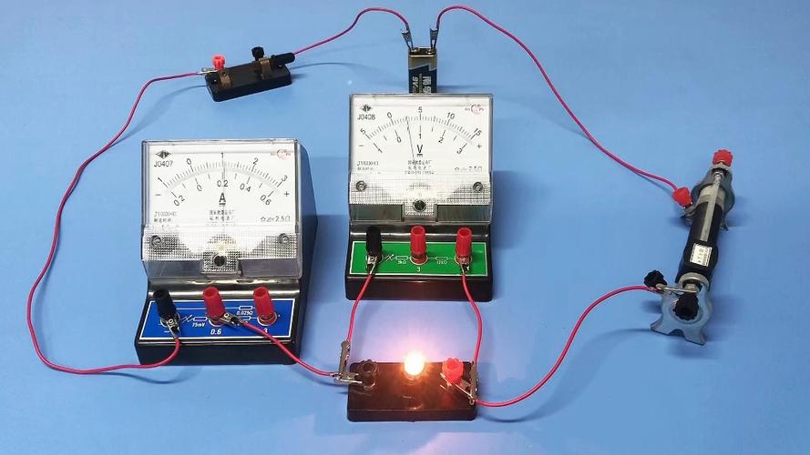
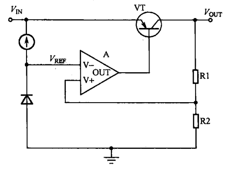
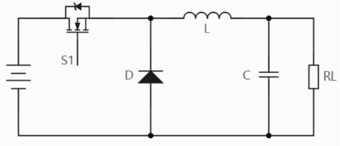
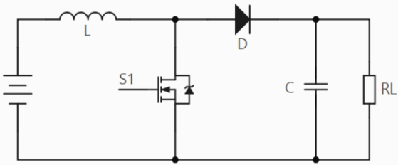
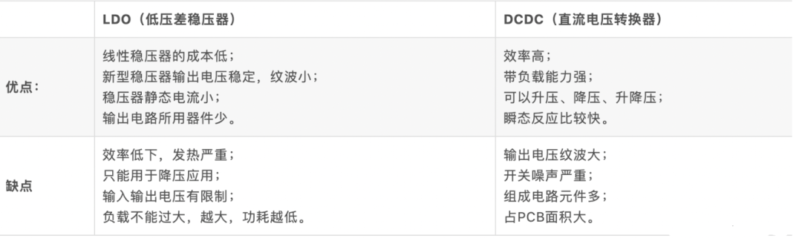

# 03 电源设计基础 LDO与DC-DC

> 前置要求：已读 [02 元器件选型](02%20元器件选型.md) 的电源树。本章回答两个问题：LDO 和 DC-DC 内部凭什么稳压？什么场合该用哪个？最后用示波器实测一次 DC-DC 的输出纹波。

**电源稳压器（Power Regulator）**：在输入电压或负载电流发生变化时，仍能提供稳定输出电压的元件。AMS1117 这类芯片我们都用过，但它内部到底怎么"稳"，值得展开。

## 1. LDO：一个会自动调节的"滑动变阻器"

### 1.1 从初中实验说起

电池 + 小灯泡 + 滑动变阻器串联。电池电压会变，想让灯泡亮度稳定，人可以这样做：眼睛观察亮度 → 太亮就把变阻器调大（灯泡分压变小、变暗）→ 太暗就调小。这是一个完整的闭环：**观察 → 比较 → 调节**。

LDO 的发明思路就一步：**用电路把"人"换掉**——眼睛换成电压采样，大脑比较换成误差放大器，手换成调整管。

### 1.2 内部四大电路与闭环过程

四个部分对应图中的四个位置：

| 电路 | 图中元件 | 作用 |
| --- | --- | --- |
| 电压基准 | 电流源 + 稳压二极管 | 产生不随输入/温度变化的参考电压 $V_{REF}$ |
| 误差放大器 | 三角形运放 A | 输出 = $\beta \times (V_+ - V_-)$，理想 $\beta \to \infty$；同相端接采样电压，反相端接 $V_{REF}$ |
| 调整管 | PNP 三极管 VT | 等效为一个受基极电压控制的**可变电阻**（基极电压升高 → 管压降电阻变大），串在输入与输出之间 |
| 采样电路 | R1、R2 分压 | 采样点电压 = $V_{OUT} \times \dfrac{R2}{R1+R2}$，正比于输出 |

**闭环调节过程**（对照"人调变阻器"的每一步）：

- 输出偏高：采样电压 > $V_{REF}$ → 运放同相端电位高 → 输出高电平 → 调整管等效电阻变大 → 串联分压中管子吃掉更多电压 → $V_{OUT}$ 回落；
- 输出偏低：采样电压 < $V_{REF}$ → 运放输出低电平 → 调整管等效电阻变小 → $V_{OUT}$ 回升。

输出就这样被"摁"在设定值附近。这里的运放知识如果没学过模电，只需记住：运放比较两个输入端的电压差并放大输出，同相端 > 反相端时输出高电平，反之输出低电平——足够理解 LDO 了。

### 1.3 电气特性与适用场合

特性全部可以从"串联分压"这个本质推出：

| 优点 | 缺点 |
| --- | --- |
| 外围器件少（一两个旁路电容），电路简单、成本低 | **效率低**：压差全部落在调整管上发热 |
| 负载响应快 | 压差不能太大（一般几伏以内） |
| 输出纹波小、噪声小（无开关动作） | 只能降压 |
| | 输出电流有限（大电流时调整管发热严重，一般一两安以内） |

**适用场合**：低压差 + 低纹波/低噪声 + 小电流。典型例子：51 单片机核心板工作电流只有几十 mA，5V→3.3V 用 AMS1117 恰到好处。

## 2. DC-DC 开关稳压器：先把电"斩"碎，再"滤"平

### 2.1 从 PWM 说起

还是小灯泡实验，这次没有滑动变阻器，只有一个开关：快速通断开关，速度足够快时灯泡呈现平稳的常亮，亮度比常通时低。定义：

- 周期 $T$，导通时间 $t$，**占空比** $D = \dfrac{t}{T}$；
- 该方波即 **PWM 波**，灯泡亮度（等效电压）取决于占空比。

调亮 = 调大占空比，调暗 = 调小。这个"手"在电源芯片里由 MOS 管担任——但 PWM 波波动太大，不能直接当电源用，需要储能元件把方波"滤"成直流。这就是 DC-DC 开关稳压器的核心：**MOS 管高频开关把直流斩成 PWM，LC 储能网络把 PWM 整形为稳定直流**。

> 术语澄清：DC-DC（直流转直流）是宽泛概念，含隔离型（正激、反激，用于强电场合）。本课程所指均为**非隔离型开关稳压器**：降压型叫 **Buck**，升压型叫 **Boost**。

### 2.2 Buck 降压电路

把电路拆成两个模块看：左边"电源 + MOS 管 S1"把直流斩成 PWM；右边"二极管 D + 电感 L + 电容 C + 负载 RL"负责整形。

**为什么必须有电感**：电容的电流满足 $i = C\dfrac{du}{dt}$。现实电流不能无穷大，所以电容两端电压不能突变；而开关切换瞬间 A 点电压跳变相当于 $\dfrac{du}{dt}\to\infty$，会让电容充电电流剧增，威胁后级稳定与开关管安全。电感恰好相反——**电感电流不能突变**。LC 网络配合，让后级电压、电流都平稳。

**为什么必须有续流二极管**：分两种状态分析完整回路——

- **S1 导通**：电源 → S1 → 节点 A → 电感 → 电容/负载，二极管反偏截止；LC 储能，B 点电压被充高但充不满电源电压；
- **S1 关断**：A 点失去电源、近似 0V；但电感电流不能突变，必须有泄放路径——电流经 **D（续流二极管）→ 电感 → 负载** 继续给负载供电。导通期储能、关断期释能，输出因此连续。

两个思考题：二极管能不能换成导线？不能——S1 导通时电源经导线直接对地短路。能不能换成别的元件？同步整流芯片把 D 换成第二颗 MOS 管降低压降，但原理角色不变。

**输出与调节**：

- B 点电压是带小纹波的直流，纹波大小由输出 LC 的选型决定；
- 芯片通过 **FB（反馈）引脚**采样输出：输出经分压接 FB，芯片据偏差调节 PWM 占空比。分压电阻的取值公式在数据手册的反馈分压一节（本板 TPS5450 的计算见 [05 原理图设计一](05%20原理图设计一%20电源电路与模数地分离.md)）；
- **效率高的原因**：对比 A、B 两点波形，开关导通期间高出 B 点的那部分能量没有变成热，而是存进了 LC，关断期再释放给负载——像水电站蓄水放水，效率可达 90% 以上。LDO 则像火电站，多余能量全程烧掉。

### 2.3 Boost 升压电路

元件与 Buck 相同，连接不同：电感在 MOS 管**前面**。

- **S1 导通**：电源直接给电感充电储能；此时 MOS 管近似短路，前后级隔离，负载由电容供电，输出缓慢下降；
- **S1 关断**：电感电流不能突变，只能经二极管向后级电容与负载泄放；泄放电流逐渐减小，电感感应出"右正左负"的电压阻碍电流减小。

用节点电压法看输出：$U_A = U_{L(感应)} + U_{IN} > U_{IN}$，故实现升压。占空比关系：

$$V_{OUT} = \frac{1}{1-D}\,U_{IN}$$

$0 < D < 1$，故 $V_{OUT} > U_{IN}$。类比：MOS 导通期相当于给电磁弹射器（电感）充电储能，关断瞬间把储存的能量瞬间释放——小电源也能顶出高电压。

### 2.4 LDO 与 DC-DC 全面对比

| 维度 | LDO（低压差线性稳压器） | DC-DC（开关稳压器） |
| --- | --- | --- |
| 效率 | 低（压差发热） | 高（约 90%，能量蓄放） |
| 压差 | 只能降压，且压差受限 | 输入范围宽，可升可降 |
| 纹波/噪声 | 小（无开关动作） | 大（PWM 开关噪声） |
| 外围与成本 | 器件少、简单、便宜 | 器件多（电感/电容/二极管/芯片）、复杂、贵 |
| 输出电流 | 受限（一两安内） | 大，功率可做得很大 |

**选型口诀**：大压差、大功率 → DC-DC；低压差、低纹波、小电流 → LDO。本板 12V→5V 用 DC-DC（TPS5450），5V→3.3V 用 LDO（AMS1117），正是这条口诀的应用。

## 3. 实验：用示波器测 DC-DC 输出纹波

原理讲完，用成品板实测一次。目标：量化 TPS5450 的输出纹波（峰峰值）。

**探头改装**：取下接地夹与探针帽，装上探头附赠的**接地弹簧**。作用：把测量时的接地回路长度缩到最短，减少环路耦合进来的噪声——否则测出来的"纹波"里混着自己的地环路噪声。

**示波器设置**（以通用示波器为例）：

| 设置项 | 取值 | 原因 |
| --- | --- | --- |
| 耦合方式 | 交流（AC） | 纹波是交流分量，隔掉 5V 直流才能放大看细节 |
| 带宽限制 | 20 MHz | 滤除不需要的高频系统噪声 |
| 探头 | 1:1 | 小信号直接测量 |
| 垂直分辨率 | 约 50 mV/格 | 与 30mV 级纹波匹配 |

**测量**：开发板接 12V DC 供电，探头探针与接地弹簧一起点在 **DC-DC 输出端的电容**上（输出电容处纹波最真实）。读数：纹波峰峰值约 **30 mV**。切到直流耦合档按 Auto，可见完整输出波形：顶端约 5V，峰峰值仍约 30mV。

做出自己的板子后，用同样方法测自己的纹波，与 30mV 这个量级对照。

## 4. 检查点

- 画出 LDO 四大电路，并推演"负载突然变大 → 输出被拉低 → 电路如何自动回到设定值"的完整闭环；
- 解释 Buck 中续流二极管的存在意义，以及为什么不能换成导线；
- 写出 Boost 的输出电压公式，并说明电感在升压中扮演的角色；
- 说出测纹波前为什么要装接地弹簧、为什么选交流耦合。

下一章：[04 电压基准与滤波电容](04%20电压基准与滤波电容.md)——单片机模拟部分的"电源标尺"与去耦电容。
