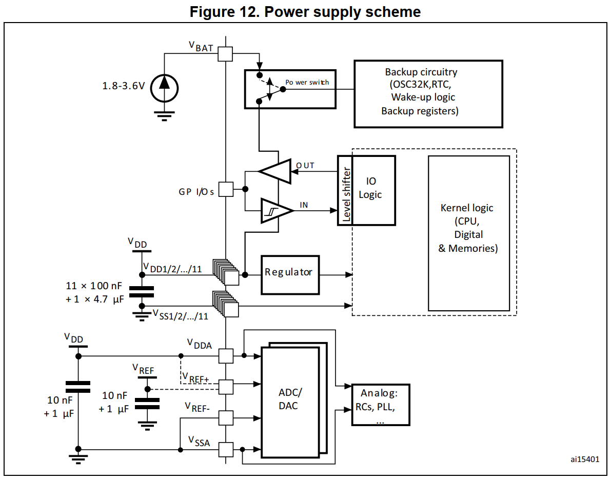
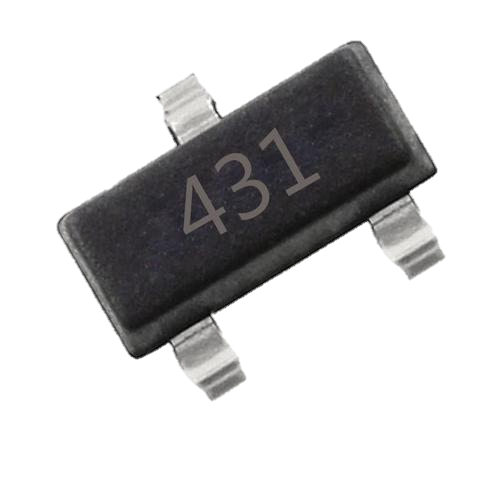
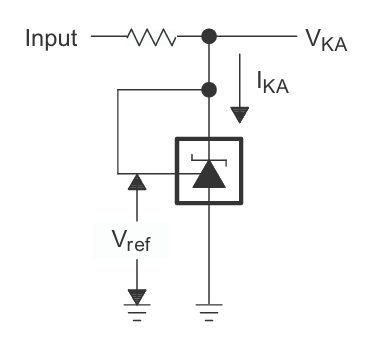
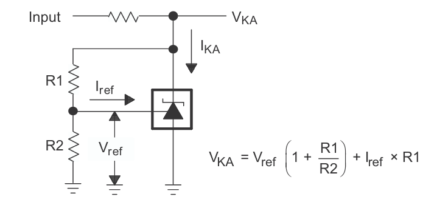

# 04 电压基准与滤波电容

> 前置要求：已读 [03 电源设计基础](03%20电源设计基础%20LDO与DC-DC.md)。本章解决 MCU 最小系统电源电路中的两个专题：ADC/DAC 需要的 VREF 基准（以 TL431 为例），以及遍布原理图的 100nF 去耦电容。

## 1. MCU 里为什么有两种"电源"

回到 STM32 数据手册的最小系统电源电路与 ADC/DAC 框图，会发现两类电源引脚：**VDD**（数字电源）和 **VREF**（基准电压）。数据手册给出的完整电源方案如下：

读图要点：

- 左上 **VDD/VSS**：数字电源，供 CPU、存储器、IO 逻辑，数据手册推荐 11×100nF + 1×4.7µF；
- 左下 **VDDA/VSSA + VREF+**：模拟电源与模拟基准，专供 ADC/DAC，推荐各自 10nF + 1µF 去耦；
- **VBAT**：接 1.8~3.6V 电池，断电后维持 RTC 与备份寄存器（见 [06 原理图设计二](06%20原理图设计二%20单片机最小系统.md)）。

VDD 与 LDO 输出的普通电源没有本质区别；而 **VREF 是 ADC/DAC 的"量尺"**——ADC 的转换结果 = 输入电压 / VREF × 满量程。尺子不准，一切采样都是错的。所以 VREF 需要比普通电源芯片高得多的精度与温漂指标，这就是**基准电压源**存在的意义。

> 基准电压源：能提供稳定、精确、不随温度、负载、电源电压波动而变化的电压源，广泛用于 ADC、DAC、稳压电路、传感器电路等高精度场合。

## 2. TL431：最经典的基准电压源

### 2.1 认识引脚

TL431 三个引脚：**K（Cathode，阴极）**、**A（Anode，阳极）**、**REF（Reference，参考）**。它的电路符号与稳压二极管非常相似，只是多出左侧一个参考引脚；电流方向从阳极流向阴极（三角形指向）。

### 2.2 内部逻辑：一只"聪明"的电子开关

内部结构可以简化为三件套：**2.5V 内部基准 + 运放（比较器）+ 三极管**。行为规则只有一条：

> 芯片总是设法把自己的 **REF 引脚维持在 2.5V**。

具体动作：

| REF 引脚电压 | 运放输出 | 三极管状态 | 等效效果 |
| --- | --- | --- | --- |
| > 2.5V | 高电平 | 导通 | 阴极 K 与阳极 A 近似短接（K 电位被拉向 A） |
| < 2.5V | 低电平 | 关断 | K 与 A 断开 |
| = 2.5V | 平衡 | 微调 | 稳定工作点 |

单独一颗芯片看不出用处——**基准源必须配合外部电路才能工作**。

### 2.3 应用电路一：固定 2.5V 输出

接法：REF 直接接 K，K 经限流电阻接电源，A 接地。以 5V 输入为例推演平衡过程：

1. 上电瞬间 K 点 = 5V，REF = K = 5V > 2.5V → 三极管导通 → K 被拉向地，电位下降；
2. K 降到 2.5V 以下时，REF < 2.5V → 三极管关断 → K 又被电阻拉回 5V 方向；
3. 由于是纯模拟电路，动态平衡速度极快，最终 **K 点稳定在 2.5V**。

这个接法输出固定等于内部基准 2.5V。

### 2.4 应用电路二：任意电压输出

在 REF 与 K 之间接入分压：R1 从 VKA 到 REF，R2 从 REF 到地。利用"REF 恒为 2.5V"与虚断（REF 端输入电流 $I_{ref}$ 极小可忽略）做支路电流分析，得到输出：

$$V_{KA} = V_{ref}\left(1 + \frac{R1}{R2}\right) + I_{ref} \times R1 \approx V_{ref}\left(1 + \frac{R1}{R2}\right)$$

使用边界（每条都很重要）：

- 因为系数 $(1+R1/R2) > 1$，输出**一定大于 2.5V**；
- 输出上限受芯片耐压限制，**不得超过 36V**（数据手册绝对最大值）；
- 即 TL431 的可调范围是 $2.5\text{V} \sim 36\text{V}$。

**本板的选择**：STM32 数据手册规定 VREF+ 的允许范围是 2.4V ~ VDDA（本板 VDDA=3.3V，即 2.4~3.3V）。取固定 2.5V 接法（应用电路一）刚好落在范围内，元件也最少——所以板上的 VREF 电路就是"应用一"再加输出电容。

### 2.5 输出电容：不看手册会震荡的坑

TL431 数据手册专门给出**稳定工作区曲线**：横轴为负载电容 $C_L$，纵轴为工作电流（阴极电流），曲线下方的区域电路会**震荡**。对本板 $V_{KA} = V_{ref} = 2.5\text{V}$ 的情况按曲线 A 查：把输出电容取到稳定区（如 **10µF**）即可保证不振荡。

工程备注：实测中此电路不加输出电容也能稳定工作，焊接时省略它通常不会出问题；但按手册设计仍建议焊上。

## 3. 100nF 电容：原理图上最常见的小元件

几乎每个电源引脚旁都挂着一颗 100nF 电容，它做两件事：

### 3.1 滤波：把电源"洗"干净

实际电源不是一条理想直线：稳压器输出本身带纹波，PCB 走线弯弯绕绕还会耦合系统噪声。任何实际电源都可分解为：

$$V_{实际} = V_{稳定直流} + V_{交流噪声}$$

负载只需要前者。电容**隔直通交**——交流噪声经电容旁路到地，直流继续供给负载，引脚上得到干净的电源。

### 3.2 去耦：把芯片自己的噪声也关在门口

芯片工作时（尤其是数字电路翻转）会向电源轨道注入噪声。靠近引脚的 100nF 电容为这些噪声提供就近的泄放回路，防止它顺着电源线传播、干扰板上其他器件——这正是"去耦（decoupling）"一词的含义。

**放置原则**（画原理图与 PCB 都适用）：100nF 电容必须**靠近被去耦的电源引脚**；大容量电容（储能用）可以放远一些。这一原则在 [08 PCB设计准备与模块化布局](08%20PCB设计准备与模块化布局.md) 的布局规则中会反复出现。

容值搭配的工程惯例：小电容滤高频、大电容补能量，两者并联各司其职（如数据手册的 11×100nF + 1×4.7µF）。

## 4. 检查点

- 说出 VREF 与 VDD 的角色差别，以及为什么 ADC 的量尺不能随便用 LDO 输出代替；
- 用"REF 恒为 2.5V"规则推演固定 2.5V 接法的平衡过程；
- 写出可调接法的输出公式，并指出两个使用边界（>2.5V、<36V）；
- 解释 100nF 电容"滤波"与"去耦"两重作用的区别。

下一章：[05 原理图设计一 电源电路与模数地分离](05%20原理图设计一%20电源电路与模数地分离.md)——打开嘉立创 EDA，把前三章的理论画成图纸。
