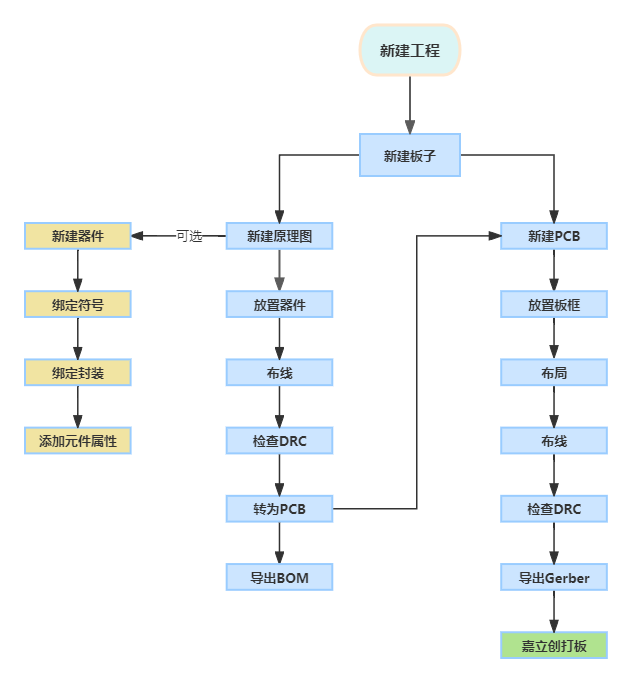
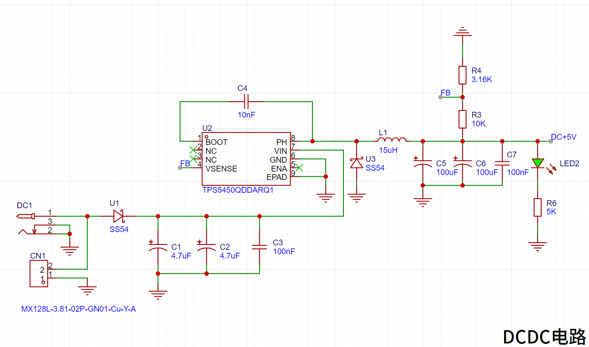
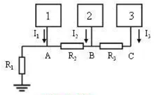
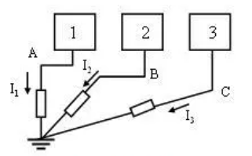
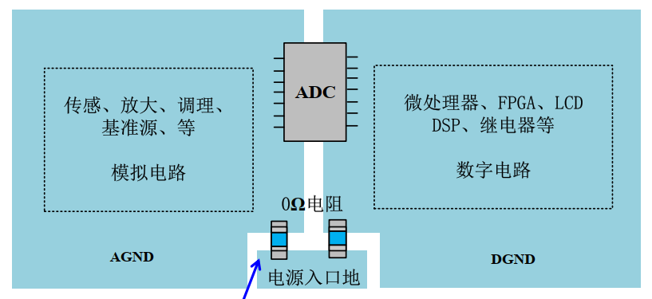

# 05 原理图设计一 电源电路与模数地分离

> 前置要求：已读 [03](03%20电源设计基础%20LDO与DC-DC.md)、[04](04%20电压基准与滤波电容.md)。本章正式进入嘉立创 EDA 专业版：建立工程、绘制电源图页（Type-C / DC-DC / 合路 / LDO / 指示灯），并完成模数地分离电路。软件版本迭代较快，菜单以**功能名称**查找为准。

## 1. 建立工程与图页规划

嘉立创 EDA 中一块板子的标准设计流程：

操作步骤：

1. **新建工程**：文件 → 新建 → 新建工程，命名 `STM32电赛单片机开发板`。工程自动包含一块板子，板内含原理图（Schematic）与 PCB 两部分；
2. **分图页**：本原理图较复杂，右键原理图 → 新建图页，建三页并重命名——**主控**（最小系统）、**电源**（本章）、**接口**（[07 章](07%20原理图设计三%20接口电路与串口自动下载.md)）。复杂工程按模块分图页是让原理图清晰的基本手段；
3. **调整 DRC 规则**：设计 → 设计规则，取消"元件属性需与供应商编号匹配"（序号 22）检查项——该检查面向 SMT 贴片下单，自行焊接时无意义，留着只会持续报错；
4. 图纸尺寸设为 A3；**放置 → 图片**把电源树贴进图页，对照画图。

全程**勤保存**：EDA 偶有崩溃或网络异常，丢失两小时进度的教训值得吸取。

## 2. 常用快捷键（本章起通用）

| 快捷键 | 功能 |
| --- | --- |
| `W` | 放置导线（布线） |
| `Q` | mil / mm 单位切换 |
| `Ctrl + S` | 保存 |

若与教程键位不一致：设置 → 快捷键，把配置切换为嘉立创 EDA 标准配置。

## 3. 电源图页逐电路绘制

本板全部电阻电容统一用 **0603 封装**。绘制顺序即电流流向：输入 → DC-DC → 合路 → LDO → 指示灯。

### 3.1 三路输入接口

- **Type-C 母座（16pin）**：库内搜索放置。引脚处理：
  - VBUS → 网络标签 `USB+5V`（USB 输入的 5V）；
  - **CC1/CC2 → 各串 5.1kΩ 电阻下拉到地**：CC 是快充识别引脚，下拉后充电器确认输出标准 5V 而非高压快充协议；
  - DP1/DN1 与 DP2/DN2 分别短接合并为 `DP`/`DN`：利用 USB 特性实现正反插都能识别 D+/D-；
  - SBU1/SBU2 为保留引脚，放**未连接标识符**；
  - EP（4 个固定焊盘脚）接地。
- **DC-005-2.5 电源座**与**螺钉式接线端子**：常用库直接放置，两者都是 12V 输入，正极并联，外壳/负极接地。

### 3.2 防反接二极管

螺钉端子接线经常被接反，反接会烧毁后级全部电路。在 12V 输入后串一颗 **SS54 肖特基二极管**（正向压降低、额定 5A，满足整板供电）：正极接 12V 输入，负极接后级。DC 座与 Type-C 有固定极性无需防反，只有螺钉端子这条路必须加。

### 3.3 DC-DC：TPS5450 12V→5V

TPS5450 的外围电路**完全照抄数据手册的应用电路**——电源芯片设计的第一原则。成品原理图如下，先看图再对步骤：

1. **输入滤波**：VIN 前两颗大容量电解电容 + 一颗 100nF 陶瓷电容。12V 输入电压高，电容**耐压要选高**（100nF 需 16V 以上否则易击穿）；习惯上**大电容靠电源输入端、小电容贴芯片**；
2. **GND（6 脚）直接接地；PowerPad（9 脚，散热焊盘）必须接地**——它是芯片的主要散热路径；
3. **ENA（5 脚）悬空**：数据手册规定 ENA < 0.5V 时芯片停止开关，悬空则内部上拉默认使能——本板永远开机，不接；
4. **BOOT 自举电容**：BOOT 与 PH 之间接 0.01µF（10nF），为内部开关管提供栅极驱动电压，贴芯片放；
5. **功率级**：PH（8 脚）→ 15µH 功率电感 → 输出；PH 与地之间接 SS54 做**续流二极管**（角色见 [03 章 Buck 电路](03%20电源设计基础%20LDO与DC-DC.md)）；
6. **输出滤波**：两颗电解电容并联 + 100nF。电容并联容值相加（公式同电阻串联），不必严格照抄手册值，按手头库存取值即可；
7. **反馈分压**：输出经 R1（10kΩ，上）、R2（3.16kΩ，下）分压后接入 FB/VSENSE 脚。阻值由数据手册公式算出：

$$V_{OUT} = 1.221 \times \left(1 + \frac{R1}{R2}\right) = 1.221 \times \left(1 + \frac{10\text{k}}{3.16\text{k}}\right) \approx 5.08\text{V} \approx 5\text{V}$$

   通用流程：先定 R1 = 10kΩ（手册推荐起点），再按目标输出解出 R2；
8. 输出加网络标签 `DC+5V`；VSENSE/输出相关的 NC 引脚放未连接标识符。

### 3.4 电源合路：DC+5V 与 USB+5V 二选一

DC-DC 出来的 5V 要与 USB 输入的 5V 合并成一路 VCC+5V：

1. **不能直接用导线连**：两个不同网络短接，DRC 直接报错；
2. 正确做法：放**短接标识符**（浮动工具箱中的菱形符号），它表示"这两个网络通过一段导线连通"；
3. **拨动开关**（6 脚）：上下各三个引脚为一组，中间是公共端，拨向一侧接通、另一侧断开。只用一组（如 4-5-6）：4 接合路输出、5-6 短接。**悬空不用的引脚也要接地**——防止焊接时引脚铜皮脱落；
4. **保险丝**串在合路输出上：额定电流按后级功率选，大功率器件选大保险丝，小功率就选小一些；输出网络标签 `VCC+5V`。

### 3.5 LDO：AMS1117-3.3

5V→3.3V 用经典 **AMS1117-3.3**：VIN 接 VCC+5V，VOUT 输出 `VCC+3.3V`，输入、输出各配 **10µF + 100nF** 滤波电容（陶瓷电容即可），GND 接地。电路一分钟画完——这正是 LDO"外围器件少"特性的体现。

### 3.6 电源指示灯

3.3V 与 5V 各配一颗 LED + 限流电阻：3.3V 回路用 2kΩ，5V 回路电压高、限流电阻取 5kΩ。

## 4. 模数地分离：为什么地要"分家"

### 4.1 问题：一根地线上的"跷跷板"

STM32 内部既有数字部分（CPU、存储、IO 逻辑，吃 VDD）也有模拟部分（ADC/DAC、PLL，吃 VDDA/VREF）。原理图上"地"是一根零阻抗导线，但 PCB 上地是**铜箔**，电阻虽小却不为零：

三个电路（1、2、3）就近共用接地线，数字电路工作电流 $I$ 流过地线电阻 R 产生压降 $U = I \times R$，把模拟电路的"地电位"抬高且随数字工作状态波动。ADC/DAC 需要高精度采样，波动的参考地直接拉低采样精度——**数字电路的噪声经公共地耦合进了模拟电路**。反过来模拟电路也会影响数字部分，但数字信号只有高低电平、抗扰能力强得多，所以常说：**数字是攻击方，模拟是受害方**。

### 4.2 对策：单点接地

让数字地与模拟地**各自独立走线，最后汇聚到同一点**。这样 $I \times R$ 压降只影响各自的电位，互不串扰。

PCB 上的两种实现（本章原理图阶段先定电路，物理分割在 [10 章](10%20PCB布线一%20信号线.md)、[12 章](12%20铺地与丝印DRC.md) 落地）：

1. 数字地与模拟地分割，**在电源入口处用 0Ω 电阻连接**；
2. 电源入口放在数字地上，模拟地用一小块铜皮连接。

**连接元件的选择**：0Ω 电阻并非真零，毫欧级；磁珠可理解为"带阻滤波器"（特定频段高阻），0Ω 电阻则对所有频段小幅衰减。单片机电路用 0Ω 电阻即可。

### 4.3 电路实现

在电源图页画出隔离电路：

1. `VCC+3.3V` → 0Ω 电阻 → 新网络 `DVCC+3.3`（数字电源）；
2. `VCC+3.3V` → 0Ω 电阻 → 新网络 `VCCA+3.3`（模拟电源），并挂一颗 **100nF 滤波电容，靠近模拟供电引脚**；
3. 模拟地使用**倒三角符号**（模拟地标识），与数字地 GND 区分；两个网络最终在电源入口经 0Ω 电阻单点相连。

模拟电源侧多加的那颗 100nF，就是"数字电源与模拟电源隔离"之外的二次滤波。

## 5. 整理与自检

- 图纸改 A4 重排：DC-DC 左上、LDO 右上、合路与隔离电路右下、Type-C 左下；
- **工具栏矩形框**把每个电路模块框住，框边对齐栅格线，配中文名称（DC-DC 电路 / LDO 电路 / 电源合路 / 模数地隔离 / Type-C 输入电路）——模块化框选是 [08 章](08%20PCB设计准备与模块化布局.md)"布局传递"的前提；
- 保存，检查网络标签拼写（USB+5V / DC+5V / VCC+5V / VCC+3.3V / DVCC+3.3 / VCCA+3.3）。

## 6. 检查点

- 说出 Type-C 的 CC 引脚为什么要 5.1kΩ 下拉、DP/DN 为什么要交叉短接；
- 背出 TPS5450 外围七大件的名称与作用（输入滤波 / PowerPad / ENA / BOOT / 电感 / 续流二极管 / 输出滤波+FB 分压），并写出反馈公式；
- 解释为什么两个 5V 网络合路要用短接标识符而不是导线；
- 画出单点接地的原理示意，并说明 0Ω 电阻与磁珠的差别。

下一章：[06 原理图设计二 单片机最小系统](06%20原理图设计二%20单片机最小系统.md)——主控图页：VBAT、晶振、复位、BOOT 与排针引出。
