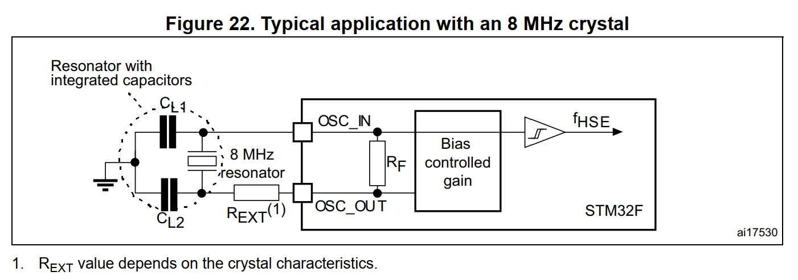

# 06 原理图设计二 单片机最小系统

> 前置要求：已读 [04](04%20电压基准与滤波电容.md)、[05](05%20原理图设计一%20电源电路与模数地分离.md)。本章绘制"主控"图页：STM32F103VET6 本体 + 时钟 / 电源 / 复位三大最小系统电路 + BOOT 启动选择 + GPIO 引出。

## 1. 放置主控与批量网络标签

- 图纸设 A3；库内搜索 `STM32F103VET6` 放置，**单片机放图页中心**——它是主控图页的主角，所有外围电路围绕它展开；
- 通用 GPIO（PA/PB/PC/PD/PE）用**批量添加网络标签**：按住 Ctrl 多选引脚 → 右键 → 按引脚名称填入网络名，几十个引脚一次完成。VDD、VBAT、晶振等特殊引脚先跳过，后面单独处理；
- 引出的标签线统一拖短，电气点对齐，图面紧凑美观。

## 2. 电源相关引脚

对照数据手册的电源方案（见 [04 章](04%20电压基准与滤波电容.md) 的框图）逐组连接：

### 2.1 VDD / VSS

VDD 接 `DVCC+3.3`（数字电源），VSS 接数字地。共 5 组引脚，**每个 VDD 引脚旁放一颗 100nF 滤波电容**（共 5 颗），电容另一端接地；排列用"顶部对齐 + 水平等距分布"整理。

### 2.2 VBAT：断电后 RTC 的救命电池

VBAT 在内部接 RTC 时钟与唤醒逻辑，接 1.8~3.6V 电池，**系统断电后由它维持 RTC 计时**——与电脑主板上的纽扣电池同理。

- 电池座：**CR1220 纽扣电池座**，符号长条为正极，1 脚对准 VBAT；
- **自动切换**用 **BAT54C**（双二极管共阴组合）实现电源选择：一颗二极管接纽扣电池、另一颗接 VCC+3.3V，公共端接 VBAT：
  - 系统上电时：3.3V 高于电池电压，上管压差更大**优先导通**，电池侧二极管无正向偏置不导通——不消耗电池；
  - 系统断电时：3.3V 消失，电池侧二极管导通，由电池维持 RTC。
- 判断二极管谁先导通的方法：先假设两管都不导通，分别计算两端压差，压差大者优先导通。这个双二极管电源选择电路用途极广（电池供电设备标配），值得记住；
- VBAT 引脚旁再放一颗 100nF 滤波电容。

### 2.3 VDDA / VSSA / VREF+：模拟电源与基准

19~22 号引脚对应数据手册的 VDDA、VREF+、VREF-、VSSA：

- VDDA → `VCCA+3.3`（模拟电源），VSSA → 模拟地（倒三角）；
- **VREF+ 接 TL431 产生的 2.5V 基准**（允许范围 2.4V~VDDA，见 [04 章](04%20电压基准与滤波电容.md)）：
  - `VCCA+3.3` 经 1kΩ 限流电阻进 TL431 阴极；REF 接阴极（固定 2.5V 接法）；阳极接**模拟地**（基准属于 ADC 电路，归模拟域）；
  - 输出端接 **10µF** 稳定电容——按 TL431 手册稳定区曲线取值防震荡（实测不焊也稳定，但按手册建议保留）。

## 3. 时钟电路：两颗晶振

STM32 有两个外部时钟入口（对照数据手册时钟树：OSC 支持外部输入 4~16MHz，OSC32 为 32.768kHz）：

| 引脚 | 名称 | 时钟 | 用途 |
| --- | --- | --- | --- |
| PH0/PH1（OSC_IN/OUT） | **HSE** 高速外部时钟 | 8 MHz 晶振 | 系统主时钟源 |
| PC14/PC15（OSC32） | **LSE** 低速外部时钟 | 32.768 kHz 晶振 | RTC 日历时钟基准 |

绘制要点：

- **高速晶振**（4 脚贴片）：1、3 脚接晶体，2、4 脚接外壳必须接地；起振电容 CL1/CL2 按手册推荐 **5~25pF 且两颗相等**，本设计取 20pF，电容分别接两个信号脚与地之间；
- **低速晶振**（2 脚贴片）：直接接 OSC32 两脚；起振电容手册推荐 **5~15pF**，取 10pF；
- 起振电容取值不是玄学：它按"晶振负载电容"匹配，**两颗必须相等**，否则波形不对称可能不起振。

## 4. 复位电路：上电复位 + 手动复位

STM32 是**低电平复位**：NRST 检测到持续一段时间低于 0.8V 的电平即复位。

电路：NRST 经 10kΩ 上拉到 3.3V，对地并联 100nF 电容，再并联一个复位按键：

- **手动复位**：按下按键 → NRST 直接接地 → 复位；
- **上电复位**：上电瞬间电容电压不能突变 → NRST 保持短暂低电平 → 电容充电、NRST 电压上升超过 0.8V → 退出复位进入正常工作。低电平持续时间由 RC 决定，约为 **1.1×RC**（10kΩ × 100nF ≈ 1.1ms 量级）。

## 5. BOOT 启动模式选择

### 5.1 启动模式表（必须记住）

单片机**复位时**采样 BOOT0/BOOT1 的电平决定启动模式：

| BOOT0 | BOOT1 | 启动方式 | 场景 |
| --- | --- | --- | --- |
| 0 | 任意（×） | 主 Flash 启动 | 正常运行用户程序 |
| 1 | 0 | 系统存储器 BootLoader | **串口下载**（烧录用） |
| 1 | 1 | 内置 SRAM 启动 | 调试，少见 |

### 5.2 引脚与电路

- BOOT0 是独立引脚；BOOT1 与 **PB2 复用**——在数据手册的引脚定义表（Pin Definitions）里按"复位后主要功能（Main function after reset）"查到 PB2/BOOT1，用**短接标识符**把 PB2 引脚与 `BOOT1` 网络标签连通（功能标注）；
- 配置电路：**6pin 排针 + 跳线帽 + 两颗 10kΩ**：1、2 脚接 3.3V，3 脚接 BOOT0，4 脚接 BOOT1，5、6 脚接地。用跳帽短接 1-3 或 3-5 即给 BOOT0 置高/低；短接 2-4 或 4-6 配置 BOOT1。

这个排针在 [07 章](07%20原理图设计三%20接口电路与串口自动下载.md) 的串口自动下载电路里会被自动拉高 BOOT0，配合实现"一根 USB 线烧录"。

## 6. GPIO 引出：顺序决定布线命运

作为开发板，所有可用 GPIO 与电源引脚都要引出。VET6 引脚多，用**双排 2×23pin（46pin）排针 ×2**。

**最重要的一条经验**：排针上的 GPIO 排列顺序不能照抄数据手册——顺序决定未来 PCB 走线是否通顺。胡乱排列的排针会让走线全部交叉缠绕，几乎无法布线。正确做法：

- 按**未来 PCB 的走线方向**排列引脚（单片机引脚位置 → 排针位置的映射关系）；
- 排针两端先引电源：`VCC+5V`、`VCC+3.3V`、`GND` 各占 4 个引脚；
- 左右两排排针分别按芯片左右两侧引脚的物理顺序展开，具体顺序对照成品工程抄录即可。

## 7. 整理与自检

- 单片机居中，晶振、复位、BOOT、排针按区域摆放；每个模块用矩形框框住并标注中文名称（晶振电路 / 复位电路 / 单片机电路 / 启动模式选择电路 / VBAT 电路 / 电压基准电路）；
- 自查清单：

| 检查项 | 期望 |
| --- | --- |
| 每个 VDD 旁 100nF | 5 颗齐全 |
| VBAT 二极管方向 | BAT54C 共阴端朝 VBAT |
| TL431 | 1kΩ 进、REF-K 短接、10µF 出、阳极接模拟地 |
| 起振电容 | 8M 晶振 20pF、32.768k 晶振 10pF，各自相等 |
| BOOT 排针 | 上 3.3V、下接地、中间 BOOT0/BOOT1 |
| 保存 | 随画随存 |

## 8. 检查点

- 说出 HSE 与 LSE 的频率与用途区别；
- 用"假设均不导通 → 比压差"的方法解释 BAT54C 为什么上电时用 3.3V、断电时用电池；
- 复述三种启动模式及 BOOT 电平组合；
- 解释"GPIO 排针顺序为什么不能照手册"。

下一章：[07 原理图设计三 接口电路与串口自动下载](07%20原理图设计三%20接口电路与串口自动下载.md)。
