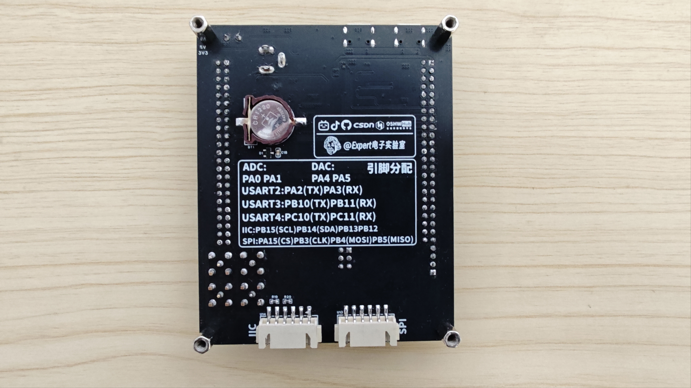

# 06 铺地与丝印DRC

> 前置要求：电源布线完成（[05 PCB布线 信号线与电源线](05%20PCB布线%20信号线与电源线.md)）。本章收尾铜箔：模拟地 AGND 的铺地与连接、数字地 GND 的缝合孔与整板铺铜、重建铺铜与泪滴；然后完成丝印标注、DRC 检查并导出 Gerber 打样。

## 1. 模拟地 AGND：小网络优先

AGND 集中在两处：LDO 输出端的模数隔离电路、右侧四个 SMA 座。**小网络先处理**，避免被整片 GND 淹没：

1. **SMA 区域铺地**：工具栏**铺铜**（虚线图标，别选成"填充区域"）→ 矩形 → 网络 `AGND`，顶层与底层各铺一次，罩住四个 SMA；
2. **单片机 AGND 焊盘**：切底层，填充区域-多边形把 VSSA 等四个模拟地焊盘包住（注意别把旁边的数字地 GND 焊盘裹进来）；顶层用填充区域把焊盘连出；旁边小 AGND 区同样填充；
3. **顶层底层互联**：模拟地区域内打过孔（多个、对称）连接顶底层铜皮；
4. **两块 AGND 连通**：SMA 区与隔离电路区用 **30mil 底层导线**连通；
5. 单片机的两个模拟地引脚用填充区域引出接入 AGND。完成后 AGND 飞线消失。

## 2. 数字地 GND：缝合孔 + 整板铺铜

### 2.1 缝合孔（stitching via）

GND 引脚数量巨大，处理策略：**先打过孔引出，最后整板铺铜统一连接**。

- 在板内空白区域成组打**接地过孔**（`V`，网络必须选 **GND**——不要选成 AGND），6 孔一组复制排列，四周与空白区都布上；
- 重点加密区：**电源引脚附近、DC-DC 输出端**（保证电源回流路径通顺）、AGND 与电源输出之间（兼做屏蔽）。

### 2.2 焊盘过孔引出

芯片 GND 引脚、滤波电容接地端这些"最后铺铜可能连不上"的焊盘，逐个打过孔或短地线引出到空旷处；本身就是通孔结构的排针插脚不用处理。

### 2.3 整板铺铜

工具 → 铺铜 → 矩形：**顶层与底层各铺一次**，框住整个板框，网络 `GND`。铺完仍有十来根飞线（禁铺区内的晶振地、USB 外壳、个别引脚），逐个用填充区域或 30mil 粗线手动连通。

### 2.4 重建与泪滴

- 右键铺铜区域 → **重建所有**：EDA 重算全部铜皮，把空白处铺满；若仍有空白，补两个接地过孔再重建一次；
- 框选全板 → 工具 → **泪滴** → 应用：全板补泪滴，增强焊盘-导线连接强度。

至此布局布线全部完成，保存。

## 3. 丝印：给未来的自己省时间

丝印就是 PCB 上的注释。最烦的就是用一块不标引脚的开发板还得查原理图——所以本板把所有引脚信息直接印在板上。**切换到丝印层**操作：

### 3.1 GPIO 排针标注

1. 丝印层放**矩形框**框住整个排针（长度与排针一致，宽度约 5.1mm，别超板边），左右各一；
2. 放**折线（短横线）**分隔：电源区与 GPIO 区之间一条，每两个 GPIO 之间一条，左排做好后整组复制到右排；
3. **文本工具**写标签（高度约 80mil）：顶部电源区 `5V`、`3V3`、`GND`，GPIO 区照排针网络标签逐个填写（PE3、PE5、PC13……）；左侧排好后整组复制到右侧再改文本，最后垂直等距分布对齐。

### 3.2 其他标注

| 位置 | 标注内容 |
| --- | --- |
| 螺钉端子旁 | `+` / `-`（防反接，接到丝印级提醒） |
| 电源指示灯 | 底层丝印 `5V`、`3V3`（正面没地方放） |
| 两个 Type-C | `USART`（左）/ `USB`（右）——区分串口与 USB 口 |
| SWD | 框 + `SWD` 大字（高约 100mil、线宽 10mil）；引脚标**功能**不标编号：`DIO`、`CLK`、`GND`、`5V`——调试线印的是 SWDIO/SWCLK，写 PA13/PA14 没意义 |
| 按键 | 复位键 `RST`；用户键标引脚号 `PE13/PE14/PE15`（高约 60mil，方便编程） |
| BOOT 排针 | 框 + `3V3`、`BOOT0`、`GND`、`BOOT1` |
| LED | 标引脚号 `PB6`、`PB7`、`PD8` |
| ADC/DAC SMA | 每个座旁标 `PA0/PA1/PA4/PA5`，外加圆角矩形大框（线宽 15mil、圆角 35）写 `ADC`、`DAC` |
| 串口座 | `USART2`、`USART3`、`USART4`（对应关系查数据手册） |

### 3.3 Logo 与背面

- **放置 → 图片** 导入 logo 到顶层丝印，锁定比例调整宽度；背面放频道 logo 与"电赛"标识；
- 底层丝印标出 SPI / I2C 座名称，并贴上整板**引脚分配注释**（ADC/DAC/USART/IIC/SPI 的引脚对照表）——成品效果见下图，背面这张速查表让板子不接电脑也能用：

配色建议：板厂下单时选**黑色阻焊** + 沉金/喷锡（银色焊盘），成品质感最好。

## 4. DRC 检查与排错

- 开着"自动检查 DRC"画完全程的话，此时大概率干净；仍手动跑一遍：左下角 DRC → **检查 DRC** → 0 错误即通过；
- **有错误怎么办**（以人为制造的案例演示）：把一个 GND 过孔压到信号线上，重跑 DRC 报出两条——"**导线到过孔**"间距不足与"**钻孔到导线**"间距不足（过孔内的钻孔离导线太近）；
- **定位方法**：在 DRC 面板点击错误条目，画布高亮对应对象；查看解释（实际距离 0，要求 > 6mil 安全间距）→ 把过孔移到安全位置 → 清除错误 → 重新检查 DRC。绝大多数错误都能这样"点击 → 高亮 → 看解释 → 修改"四步解决。

## 5. 导出 Gerber 与打样

1. 文件 → 导出 → **PCB 制版文件（Gerber）**；
2. 命名（如 `STM32单片机开发板`）→ 一键导出（可顺带再跑一次 DRC）→ 得到 **Gerber 压缩包**；
3. 打开嘉立创下单助手，导入 Gerber 压缩包 → 确认层数/工艺/丝印颜色 → 下单打样。

恭喜——到这里原理图、布局、布线、丝印、DRC、导出全链路完成。裸板到货后进入 [07 焊接与功能测试](07%20焊接与功能测试.md)。

## 6. 检查点

- 说出 AGND 的两块集中区与"小网络先铺"的理由；
- 解释缝合孔的作用与重点加密位置；
- 独立完成 GPIO 排针的丝印框 + 分隔线 + 标签全套标注；
- 演示 DRC 报错的"点击-高亮-解释-修改"四步排错法。

下一章：[07 焊接与功能测试](07%20焊接与功能测试.md)——把裸板变成能用的开发板。
