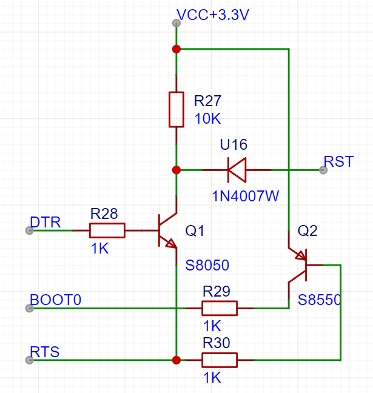
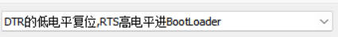

# 07 原理图设计三 接口电路与串口自动下载

> 前置要求：已读 [05](05%20原理图设计一%20电源电路与模数地分离.md)、[06](06%20原理图设计二%20单片机最小系统.md)。本章绘制"接口"图页：USB、SMA、LED、按键、SWD、SPI/I2C 座、串口座、CH340C 串口芯片与**自动下载电路**，最后整图 DRC 清零。

## 1. 接口清单回顾

接口图页要画的电路 = [01 章](01%20产品设计流程与需求分析.md)方案表的展开：

- 信号类：ADC×2 + DAC×2 的 **SMA 座**；
- 模块类：串口屏/WIFI 的**串口座**、OLED 的 **SPI/I2C 座**、**USB**；
- 调试类：**SWD**、GPIO 排针（[06 章](06%20原理图设计二%20单片机最小系统.md)已画）、**LED**、**按键**、M3 螺丝孔。

涉及单片机引脚时，统一查数据手册的**引脚功能定义表**：功能列里出现 `ADC123_IN0`、`DAC_OUT1`、`USART2_TX`、`USBDM` 等字样即代表该脚可用作对应功能。

## 2. USB 通信电路

从电源图页复制 Type-C 电路改标签（减少重复劳动）：

- CC 引脚标签改为 `CC11`/`CC12`（区分电源页的 CC21/CC22），下拉电阻同步改名——**复制电路忘改网络标签**是最常见的 DRC 报错源（单网络错误）；
- 数据脚合并后命名 `USBP`（D+）/`USBN`（D-）；
- 接单片机：查表得 **PA11=USBDM、PA12=USBDP**，用短接标识符把 `USBN`/`USBP` 分别接到 PA11/PA12；
- USBP 上拉 **10kΩ 到 3.3V**（USB 全速设备识别）。

## 3. ADC / DAC 的 SMA 接口

- 立式 SMA 座 ×4，方便插拔；
- 通道分配：**PA0、PA1 = ADC 输入；PA4、PA5 = DAC 输出**；
- SMA 外壳的 4 个引脚是屏蔽层，**全部接模拟地（倒三角）**——SMA 属于信号/模拟域，不接数字地。

## 4. LED 与按键

**LED 指示灯 ×3**（PB6、PB7、PD8）：

- 接法：GPIO 接 **LED 负极**、LED 正极经限流电阻（2kΩ）接 3.3V。原因：单片机**灌电流能力大于拉电流**，低电平点亮（灌电流）驱动能力更强；
- 这类"为什么这么接"的选型理由，比电路本身更值得记。

**用户按键 ×3**（PE13、PE14、PE15）：

- 一端接 GPIO，另一端接地，**按下读低电平**；
- 按键两侧并联 100nF 做**硬件消抖**（抖动毛刺被电容吸收，防误触发）；软件消抖亦可，两者取其一即可。

## 5. SWD 调试接口

4pin 排针：`VCC+5V`、GND、**SWDIO（PA13）**、**SWCLK（PA14）**（3.3V 供电亦可）。用短接标识符在旁边标注功能名，方便读图。

## 6. SPI / I2C 连接座

6pin 卧贴连接座 ×2（含外壳接地）：

| 座子 | 引脚分配 | 说明 |
| --- | --- | --- |
| SPI | 5V、GND、CS、SCLK、MISO、MOSI | **软件 SPI**；硬件 SPI 需对应到固定复用脚 |
| I2C | 5V、GND、SCL、SDA + 2 个自定义脚 | **软件 I2C**；SCL/SDA 是开漏输出，**必须 4.7kΩ 上拉到 3.3V** |

I2C 上拉电阻是 I2C 电路区别于 SPI 的唯一"必配件"——开漏结构自己拉不出高电平。

## 7. 串口座与"串口/ I2C 两用"设计

- 4pin 卧贴座 ×3：**USART2（PA2/PA3）、USART3（PB10/PB11）、USART4（PC10/PC11）**，每个座都引 5V 供电（给外接模块供电）；
- VET6 共 4 组 USART，**USART1（PA9/PA10）留给板载 CH340** 与电脑通信；
- **两用设计**：串口与 I2C 都是两线通信，唯一差别是 I2C 需要上拉。在每个串口座的 TX/RX 上各加一颗**可选上拉电阻**并加文字注释：焊上 = 可作 I2C 用，不焊 = 纯串口。按需焊接（DNP）是硬件调试的常用手段。

## 8. CH340C 与串口自动下载

### 8.1 CH340C 电路

CH340C 是沁恒的 USB 转串口芯片，**内置晶振**（无需外接）：

- 3.3V 供电接法：**VCC 与 V3 都接 VCC+3.3V**，VCC 旁 100nF 滤波（5V 供电时 V3 悬空，本板用 3.3V 接法）；
- **TXD/RXD 交叉接**：芯片 RXD ← MCU 的 TX（PA9），芯片 TXD → MCU 的 RX（PA10）；
- UD+ / UD- 接 Type-C 的 `USBP`/`USBN`；
- 需要 **DTR# / RTS#** 两脚引出做自动下载；NC、CTS、DSR 等其余流控脚不接。

### 8.2 自动下载电路

目标：烧录时不用手动按复位、不用挪跳线帽，一根 USB 线完成"进 BootLoader → 烧录 → 复位运行"。

元件：Q1 **S8050**（NPN）+ Q2 **S8550**（PNP）、电阻 10kΩ×1 + 1kΩ×3、二极管 **1N4007W**（SOD-123FL 封装）。网络：DTR、RTS、BOOT0、RST。

**先理清两个前提**：

1. CH340C 的 DTR#/RTS# 是**负逻辑**（名字带星号）：上位机软件（如上图的 MCUISP）选"DTR 低电平复位、RTS 高电平进 BootLoader"，芯片引脚实际输出 DTR=高、RTS=**低**——分析电路时要反着看；
2. [06 章](06%20原理图设计二%20单片机最小系统.md) 启动模式表：BOOT0=1 且 BOOT1=0（PB2 默认低）时复位后进入 BootLoader。

**时序推演**（对照上图，逐级跟踪三极管状态）：

| 阶段 | DTR#/RTS# 引脚电平 | Q1（S8050） | 效果 |
| --- | --- | --- | --- |
| 复位 | DTR#=**高**、RTS#=**低** | 基极高 → 导通，把 RST 拉低（经 1N4007W） | 单片机复位 |
| 进 BootLoader | RTS#=**低** | Q2（S8550）基极低 → 导通，BOOT0 接通电源 | BOOT0=1，复位采样后进入串口下载 |
| 释放复位（约 100ms 后） | DTR#=**低**、RTS# 仍低 | Q1 截止，RST 回高 | 结束复位，开始从串口接收固件 |
| 烧录完成 | RTS#=**高** | Q2 截止 | BOOT0 回低，之后按复位即从 Flash 正常启动 |

软件侧（MCUISP / FlyMcu，功能等价）：下拉框选择"DTR 的低电平复位，RTS 高电平进 BootLoader"，烧录日志中可见"延时 100 毫秒 → 复位 → RTS 维持 → 连接成功 115200bps → 芯片 BootLoader 版本 → 从 0x08000000 处开始运行"的完整过程。也可配置下载后自动运行，免去再按一次复位。

这套自动下载电路是通用方案——后续画 ESP32/ESP8266 开发板时会再次遇到它。

## 9. M3 螺丝孔

库内搜索 M3 螺丝（封装即圆形安装孔），放置 4 个，**网络全部接地**（兼做屏蔽与参考地）。

## 10. 布局整理与 DRC

- 按模块摆放并矩形框注名：USB 电路、ADC 接口、DAC 接口、SPI 接口、I2C 接口、串口/I2C 接口、按键电路、LED 电路、M3 螺丝、SWD、串口自动下载电路；
- 给串口座上拉电阻写注释说明"串口模式不焊"；
- **检查 DRC**：出现"导线 CC1 与 CC12 是单网络"→ 定位到复制 Type-C 时忘改的下拉电阻标签 → 改为 CC11/CC12 → 清除后重检 → **0 error 0 warning**。

至此三页原理图全部完成。原理图阶段收尾后即可转 PCB——从下一章开始进入物理设计。

## 11. 检查点

- 说出 LED 为什么负极接 GPIO（灌电流）、I2C 为什么必须上拉；
- 复述自动下载四个阶段的电平与三极管状态，并解释为什么分析时要把软件设置的电平反过来读；
- 遇到"单网络"DRC 报错时，说出最可能的原因与排查方法。

下一章：[08 PCB设计准备与模块化布局](08%20PCB设计准备与模块化布局.md)。
