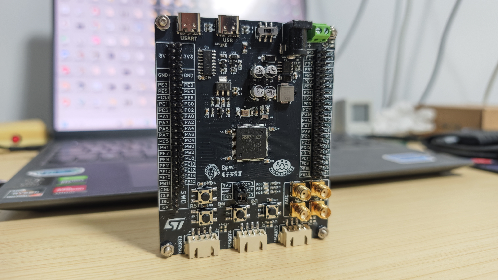
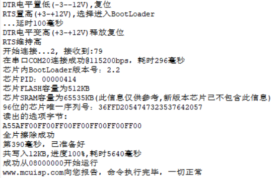

# 07 焊接与功能测试

## 学习目标

- 按"分块焊接、焊完即测"的顺序把裸板焊成成品。
- 在每一级上电前用万用表排除短路，避免烧板。
- 用串口自动下载与 SWD 两种方式烧录并判断成败。
- 逐项验证按键、DAC、串口、ADC，确认每个电路都工作。

## 目录

1. 开箱与工具
2. 焊接顺序与分级测试
3. 烧录程序：两种方法
4. 外设功能验证

## 1. 开箱与工具

下单数日后到货，一般 5 片同款裸板，取一片焊接即可。准备工具：

| 工具 | 用途 |
| --- | --- |
| 电烙铁 / 热风枪（或加热台） | 热风枪更适合贴片元件整体焊接 |
| 镊子 | 夹取贴片元件 |
| 助焊剂、焊锡膏 | 热风焊前涂敷，助焊防氧化 |
| 焊锡丝 | 烙铁焊 |
| 铜丝球 | 清理烙铁头 |
| PCB 固定座 | 固定板子方便操作 |

再补几样不贵但缺了就难受的：**吸锡带**（清连锡，比甩烙铁干净）、**放大镜或手机微距**（检查 0.5mm 间距的引脚有没有搭锡）、**万用表**（通断与电压，全程都要用）、**洗板水与棉签**（清助焊剂残留）。烙铁温度设在 330~360℃ 之间：太低焊锡不润湿，太高容易把焊盘烫脱；无铅焊锡比有铅需要再高 20℃ 左右。

## 2. 焊接顺序与分级测试

**核心原则：分块焊接、每块焊完就测试，绝不一焊到底。** 出问题时才能定位到刚焊的模块。

| 步骤 | 焊接内容 | 测试动作 | 通过标准 |
| --- | --- | --- | --- |
| 1 | 电源部分（输入、DC-DC、合路、LDO） | 焊完先用**万用表**测输入端是否短路；接 USB 5V 上电，测 3.3V/5V 输出；换 12V DC 供电再测一遍 | 两路输入下 5V、3.3V 均正常输出 |
| 2 | 主控（单片机 + 晶振 + 复位 + BOOT） | 用串口或 SWD 试着下载程序 | 能成功烧录 |
| 3 | 其余接口电路（座子、LED、按键、SMA） | 外设逐个验证 | 见第 4 节 |

电源部分焊完若测得短路，回头检查方向（二极管、电容极性）再上电——**短路状态下电是烧板第一原因**。

分级测试的核心是"让每次上电只增加一个变量"。焊完电源、还没焊单片机时上电，如果 3.3V 不对，问题必然在电源；等全部焊完再上电，同样的故障就要在几百个焊点里找。测短路用万用表的二极管档，红黑表笔分别点 5V 与 GND、3.3V 与 GND，读数接近 0 就是短路，先别通电。

第一次上电建议串一个限流措施：可调电源设 100mA 限流，或用 USB 电流表观察。正常板待机只有几十毫安，电流突然跳到限流值，说明有短路或器件装反，立刻断电还能保住芯片。12V 输入侧同理，先接 12V 再插 USB，确认两路都能独立供电。

全部焊完后用**洗板水**清理残留助焊剂，板子恢复乌黑锃亮。

## 3. 烧录程序：两种方法

### 3.1 方法一：USB 转串口（CH340 + 自动下载电路）

一根 USB 数据线接板上的 **USART** Type-C，电脑"叮咚"识别后：

1. 打开 **MCUISP**（或 FlyMcu，功能等价），端口选 **CH340 对应的 COM 口**（如 COM7），波特率 115200；
2. 加载固件：开源资料包 `测试代码` 内任一工程编译输出的 **hex 文件**（在工程 Output 目录）；
3. 底部勾选 **"DTR 的低电平复位，RTS 高电平进 BootLoader"**——正是 [03 章](03%20原理图设计%20电源、最小系统与接口电路.md) 自动下载电路约定的工作方式；
4. **开始编程**，进度条走完即烧录成功：

日志关键行对应了 [03 章](03%20原理图设计%20电源、最小系统与接口电路.md) 的时序推演：延时 100ms → 复位 → RTS 维持 → 连接成功 115200bps → 芯片为 BootLoader 版本 2.2、FLASH 512KB → 烧录 12KB 耗时 5640ms → **从 0x08000000 处开始运行**。

串口法有两个前提容易漏：电脑要先装 **CH340 驱动**，设备管理器里出现 COM 口才算通；板上 BOOT0 跳线要能被打高，若之前手动短接了 3-5，记得挪回 1-3，否则自动下载电路拉起 BOOT0 也无效。烧录失败时先看日志停在哪一步——停在"连接"多半是 COM 口或驱动，停在"擦除"多半是芯片没进 BootLoader。

### 3.2 方法二：SWD 下载器（推荐，快且免配置）

用 **ST-Link**（或 DAP-Link 等 dap 型调试器）接板上 SWD 排针：`5V↔5V、GND↔GND、CLK↔SWCLK、DIO↔SWDIO`，插电脑后直接在 **Keil** 里烧录：

1. 魔术棒 → **Debug** 选项卡 → 调试器选 **ST-Link Debugger**（dap 型调试器则选 DAP-Link Debugger）；
2. **Settings**：确认右侧正确识别出 ARM 内核芯片；
3. **Flash Download**：确认编程算法为 **STM32F1 High-density（512K）**，并勾选 **Reset and Run**——烧完自动复位运行；
4. 编译 → 点 Download，几秒完成。

SWD 接线只有四根，但顺序错一根就可能烧掉调试器：**先把 GND 接好，再接信号线，最后接电源**；板上与调试器都有 3.3V 时，只接一边的电源即可，两边同时对供会互相灌电流。Keil 里识别不到芯片时，先查接线与供电，再查 Debug 选项卡的端口是否选成 SW（不是 JTAG），最后才怀疑芯片。

## 4. 外设功能验证

建议把资料包里的测试代码**全部烧一遍**，确认板上每个电路都正常，再投入使用：

| 测试程序 | 验证内容 | 预期现象 |
| --- | --- | --- |
| 按键控制 LED | GPIO 输入 + LED 电路 | 按下板上按键，对应 LED 亮灭切换 |
| DAC 输出 | DAC + SMA 接口 | SMA 线接 DAC 通道（PA4/PA5），另一端进示波器，按 Auto 看到输出波形 |
| 串口收发 | USART 座 + CH340 | 电脑串口助手正常收发 |
| ADC 采样 | ADC + SMA + VREF 基准 | 采样值稳定、精度正常 |
| RTC 走时 | VBAT 电池 + 32.768kHz 晶振 | 断电几分钟后重新上电，时间连续 |

焊接与测试之后，这块板子才算真正完成：电源稳得住、程序烧得进、每个接口都验证过。同一套顺序可以迁移到任何新板子——先电源、再主控、后外设，每一级都先测短路再上电。

至此，从需求分析到成品验证的完整工程闭环走完。建议用同样的方法流程做一块属于自己的板子——比如 ESP32 最小系统板，把这套方法论迁移出去。

全系列章节返回：[README](README.md)
