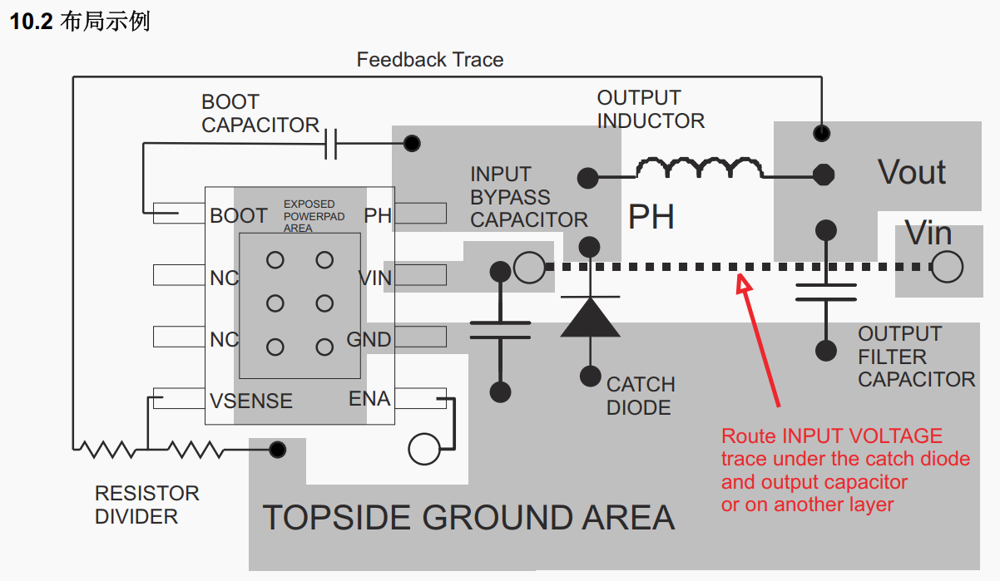
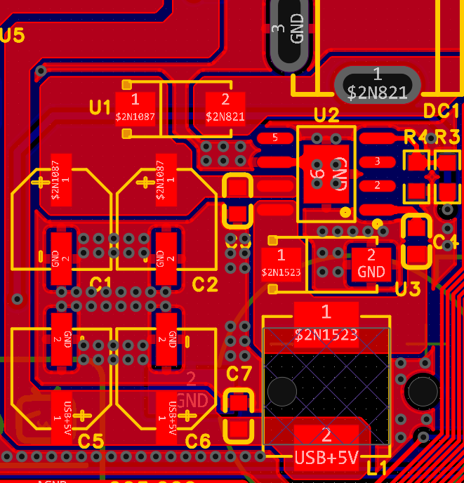

# 08 PCB设计准备与模块化布局

> 前置要求：原理图三页全部完成且 DRC 通过（[07 章](07%20原理图设计三%20接口电路与串口自动下载.md)）。本章把原理图转为 PCB：设定设计规则、画板框、放定位孔，并完成全部电路的**模块化布局**。

## 1. 先补一课：DC-DC 的布局布线两原则

普通 LDO 电路随便摆都能用，但开关电源不行。TPS5450 数据手册有整页布局指南，概括起来就两条（这也是一切开关电源的通用原则）：

### 1.1 原则一：通顺——大电流路径要短、要粗

回到 [03 章](03%20电源设计基础%20LDO与DC-DC.md) 的 Buck 电路，大电流回路有两条：

1. **导通回路**：输入电容 → MOS 管 → 电感 → 输出电容 → 负载 → 地 → 回输入；
2. **续流回路**：地 → 续流二极管 → 电感 → 输出电容 → 负载 → 地。

TPS5450 把控制电路与 MOS 管集成在芯片内，对应到本板，大电流路径就是三段：**输入 → VIN 引脚**、**PH 引脚 → 续流二极管/电感 → 输出电容**、**GND 回流**。布局时这些器件必须紧凑排列、路径尽量短、铜皮尽量大。

### 1.2 原则二：抗干扰——反馈线远离开关区

电源芯片靠 FB 反馈线感知输出电压来调占空比，**反馈线上的噪声直接变成输出电压的抖动**。而开关节点（MOS 之后、电感之前，即 PH 网络）是几百 kHz 的 PWM 大电流干扰源。因此：

- FB 反馈线**从电感区域外侧绕行**，绝不穿越开关节点上方；
- 进一步可在反馈线周围**包地**、打**接地屏蔽过孔**。

读图：灰色大铜皮是顶层地（TOPSIDE GROUND AREA），功率器件一字排开、回路极短；**Feedback Trace** 从电感上方远处绕回芯片 VSENSE；注释还提示输入走线可从续流二极管与输出电容下方走或换层——这就是"通顺 + 抗干扰"的标准答卷。

对照本板成品：输入电容、芯片、电感、续流二极管、输出电容紧凑排布，大电流路径铜皮宽大——下一章布局时按此目标执行。

## 2. 原理图转 PCB 与设计规则

### 2.1 转换

打开原理图 → 工具栏"更新/转换原理图到 PCB"（或设计菜单同名功能）→ 应用修改，所有元件带飞线进入 PCB 界面。

### 2.2 设计规则（DRC 的判据，先定规则后画图）

单位切到 mil（`Q` 切换）。本板（1oz 铜厚）关键参数：

| 规则项 | 取值 | 说明 |
| --- | --- | --- |
| 安全间距（默认） | **6 mil** | 含填充-泪滴-导线、填充-挖槽间距 |
| 默认线宽 | **8 mil** | 板子更小可用 6mil；嘉立创加工下限约 4mil，别低于它 |
| 差分线宽/间距 | 8 / 4 mil，对内误差 10 mil | USB 差分用（见 [10 章](10%20PCB布线一%20信号线.md)） |
| 过孔 | 外径 24 / 孔径 12 mil | 默认即可 |
| 铺铜连接方式 | **发散**，焊盘连接线宽 20 mil | 为焊接服务：发散连接散热慢、好焊；直连散热快但难焊；不连接则需手动导线 |
| 盲埋孔 / 内电层 | 不用 | 两层板用不到 |

## 3. 板框与定位孔

### 3.1 板框

图层切换到**板框层** → 放置 → 线条 → 矩形，从原点（对准焊盘十字中心）拉出矩形，属性里精确输入：**宽 80mm × 高 100mm**（`Q` 切成 mm；嘉立创免费打样上限 100×100mm），**圆角半径 3mm**——倒角防焊接时被板边划伤，也更美观。板框尺寸就是 PCB 尺寸。

### 3.2 定位孔

先放定位孔（位置最确定），4 个 M3 安装孔（即 [07 章](07%20原理图设计三%20接口电路与串口自动下载.md) 的螺丝孔封装），坐标**参数化输入**（不要目测拖放）：

| 孔 | X (mm) | Y (mm) |
| --- | --- | --- |
| 左上 | 3.2 | -3.2 |
| 右上 | 76.8（=80-3.2） | -3.2 |
| 左下 | 3.2 | -96.8 |
| 右下 | 76.8 | -96.8 |

放好后**右键锁定**——后续拖元件时误碰定位孔会非常影响操作。

## 4. 模块化布局：先拼零件，再装整机

布局原则在入门篇讲过：**按电路功能模块分块**。原理图里每个矩形框就是一个模块，PCB 布局照搬这个结构。类比拼装变形金刚：先把每个模块拼好，再总装；一上来把全部零件摊在成品上只会杂乱无章。

### 4.1 两个高效工具

| 快捷键 | 名称 | 用法 |
| --- | --- | --- |
| `Ctrl+Shift+X` | **布局传递** | 在原理图框选某模块 → PCB 中元件自动按原理图相对位置摆放 |
| `Shift+X` | **交叉选择** | 双向定位：PCB 选中元件 ↔ 原理图高亮同一元件，理清"这颗料在图上哪" |

### 4.2 操作顺序

1. **飞线降噪**：网络面板先把 **GND 飞线隐藏**（最后铺地统一处理），电源飞线在电源布局时再开；
2. **逐模块布局传递**：LDO 电路、电源合路、模数地隔离、Type-C 输入、DC-DC 电路、晶振、复位、单片机、排针（交叉选择摆位）、SMA、串口/SPI/I2C 座、按键、LED、SWD、自动下载电路，每块 `Ctrl+Shift+X` 后微调；
3. **模块内整理**（以 DC-DC 为例，严格按电流流向）：
   - DC 座与螺钉端子靠板边、**开口朝外**（端子丝印箭头指向插线方向）；
   - 顺着电流：SS54 防反管 → 输入大电解 → 100nF 贴芯片 VIN → 芯片 → 续流二极管贴 PH → 电感 → 输出滤波电容贴地并左右对称 → 自举电容贴芯片 → 反馈电阻贴芯片；
   - 大小电容铁律：**小电容（100nF）贴芯片，大电容（电解）远离芯片**——滤波效果更好（原理见 [04 章](04%20电压基准与滤波电容.md)）；
4. **最小系统**：
   - 单片机小圆点旋到右上角；H3 排针放右、H2 排针放左，原点朝向一致；
   - **把排针飞线拉直理顺、不允许交叉**——[06 章](06%20原理图设计二%20单片机最小系统.md) 按走线顺序排的引脚在这里兑现回报：飞线自然平行，布线极其顺畅；
   - 3.3V 滤波电容每引脚一颗、顺引脚方向放（不挡 GPIO 走线）；晶振贴引脚（高速左、低速右）；
5. 模块全部整理完再整体挪上板框——模块布局是判断"每块电路占多大地方、相对位置怎么放"的依据。

## 5. 检查点

- 背出 DC-DC 布局两原则，并在数据手册布局示例图上指出两条大电流回路与反馈走线；
- 说出本板设计规则中线宽、间距、过孔、铺铜连接方式四项的取值与理由；
- 用布局传递 + 交叉选择完成一个模块的摆放，并解释"先模块后整体"的布局法为什么高效。

下一章：[09 PCB整体布局与精细化](09%20PCB整体布局与精细化.md)——把拼好的模块装进 80×100mm 的板框。
