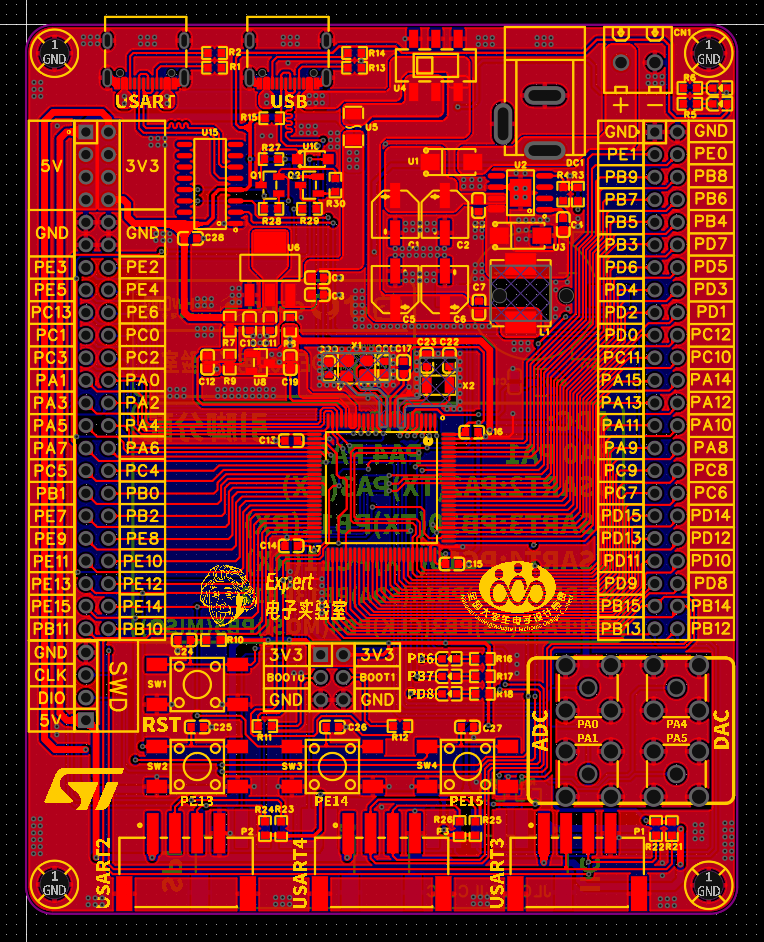

# 09 PCB整体布局与精细化

> 前置要求：已完成模块化布局（[08 章](08%20PCB设计准备与模块化布局.md)）。本章把各模块装进 80×100mm 板框，确定整板布局，并做精细化对齐。

## 1. 整体布局的通用原则

1. **需要拔插的器件放板边**：Type-C、DC 座、连接座、SMA 全部贴边；Type-C 可**略微超出板框**（插拔时插座不受板边阻挡），DC 座与螺钉端子不超出；
2. **开关放边缘**：方便手指拨动；
3. **芯片放板中央**：单片机置于板中心附近（本板约 X=40mm、Y=-52mm），四周留走线与扩展空间；
4. **同一功能模块的电路放一起**，模块相对位置按**信号流向**排布。

## 2. 各模块落位（信号流向为主线）

电源流向：12V 输入（顶部）→ 开关/保险丝 → DC-DC（左上）→ 合路 → LDO → 3.3V → 单片机（中央）。接口按各自连接对象就近：

| 区域 | 摆放内容 | 布局要点 |
| --- | --- | --- |
| 顶部 | Type-C ×2、CC 电阻、USB 上拉电阻、开关、保险丝、DC 座、螺钉端子 | 左 Type-C = 串口（接 CH340），右 Type-C = USB；开关拨动手感方向朝外 |
| 左上 | 自动下载电路（贴串口 Type-C，因为信号源是它）、CH340 | 三极管、电阻按电路顺序 |
| 上中 | DC-DC（左）→ LDO（右），TL431 贴 LDO 输出端 | 沿 12V→5V→3.3V 流向排布；TL431 的输入电源是 LDO 输出 |
| 中央 | 单片机 + 晶振 + 复位 + BOOT + 滤波电容 | 见 [08 章](08%20PCB设计准备与模块化布局.md) 模块内规则 |
| 两侧 | 双排 GPIO 排针 | **左右对称**：X=8 与 72，Y=-40；SWD 排针与排针同侧放 |
| 右侧板边 | SMA ×4 | 2 ADC（上）+ 2 DAC（下） |
| 底部 | 串口座 ×3（4pin，顶层）、SPI/I2C 座（6pin，**放底层**） | 4pin 座 X=18/40/62 均布；6pin 座 X=28/52 |
| 中下 | 按键 ×3、复位键 | 按键对齐、等距分布 |
| 底层 | 纽扣电池（右上）、SPI/I2C 座 | 顶层空间不足时果断放背面 |

## 3. 精细化调整

粗摆完成后逐区打磨：

1. **对齐与等距**：多用顶对齐/底对齐/左对齐/右对齐、水平/垂直等距分布、中心对称。例如按键三颗顶对齐 + 水平等距；LED 与按键区中心对称；两个 Type-C 顶对齐。**对称布置的板子天然美观**；
2. **丝印位号统一方向与位置**（如统一右上/左上），为丝印阶段留足空间；左右排针附近要预留引脚名称丝印的位置（见 [12 章](12%20铺地与丝印DRC.md)）；
3. **遇到干涉就回改原理图**：保险丝挡住 DC-DC 摆位时，回到原理图把开关左右翻转、交换引脚连线（6 脚接 DC+5V、4/5 接保险丝），再"更新原理图到 PCB"。**根据布局需要回改原理图是常态**，不要硬凑 PCB；
4. **SMA 间距校验**：不同 SMA 座的螺母会互相干涉，间距必须 ≥ 3mm。用测量工具（长度测量）量相邻 SMA 边缘距离，本板左右间距 3.3mm、上下间距约 3mm，安全；
5. 摆放中随时留意 DRC 报错（离板边太近等），当场解决；
6. 3D 预览整体检查一遍再收工。

## 4. 检查点

- 说出"拔插件靠边、芯片居中、模块成块"三原则在本板的具体落位；
- 复述一次"PCB 布局反推原理图修改"的完整操作（哪个电路、改了什么、怎么更新）；
- 解释 SMA 之间为什么要量 3mm 间距。

下一章：[10 PCB布线一 信号线](10%20PCB布线一%20信号线.md)。
