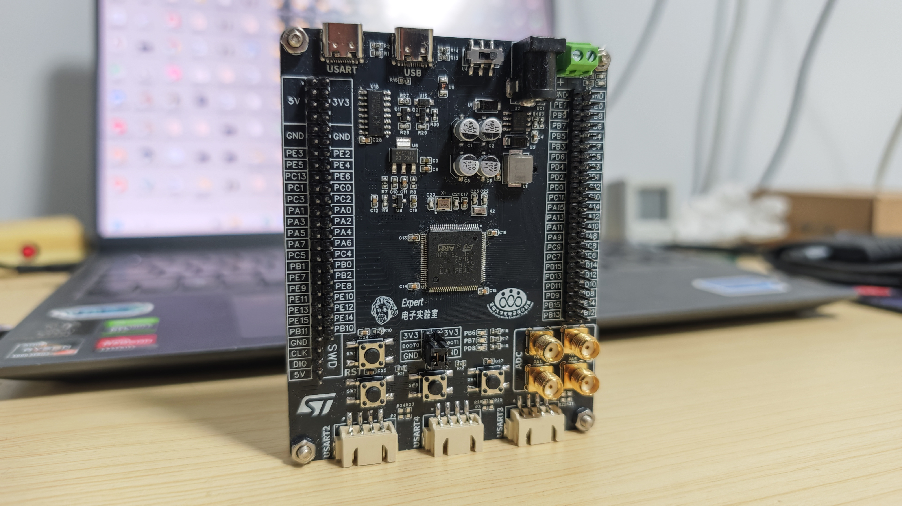
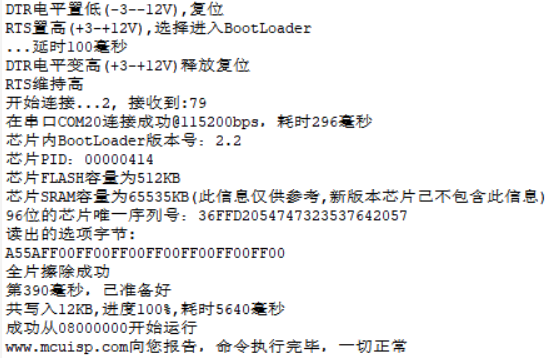

# 13 焊接与功能测试

> 前置要求：Gerber 已打样（[12 章](12%20铺地与丝印DRC.md)）。本章把裸板变成能用的开发板：焊接 → 分级上电测试 → 两种方式烧录 → 外设功能验证。

## 1. 开箱与工具

下单数日后到货，一般 5 片同款裸板，取一片焊接即可。准备工具：

| 工具 | 用途 |
| --- | --- |
| 电烙铁 / 热风枪（或加热台） | 热风枪更适合贴片元件整体焊接 |
| 镊子 | 夹取贴片元件 |
| 助焊剂、焊锡膏 | 热风焊前涂敷，助焊防氧化 |
| 焊锡丝 | 烙铁焊 |
| 铜丝球 | 清理烙铁头 |
| PCB 固定座 | 固定板子方便操作 |

## 2. 焊接顺序与分级测试

**核心原则：分块焊接、每块焊完就测试，绝不一焊到底。** 出问题时才能定位到刚焊的模块。

| 步骤 | 焊接内容 | 测试动作 | 通过标准 |
| --- | --- | --- | --- |
| 1 | 电源部分（输入、DC-DC、合路、LDO） | 焊完先用**万用表**测输入端是否短路；接 USB 5V 上电，测 3.3V/5V 输出；换 12V DC 供电再测一遍 | 两路输入下 5V、3.3V 均正常输出 |
| 2 | 主控（单片机 + 晶振 + 复位 + BOOT） | 用串口或 SWD 试着下载程序 | 能成功烧录 |
| 3 | 其余接口电路（座子、LED、按键、SMA） | 外设逐个验证 | 见第 4 节 |

电源部分焊完若测得短路，回头检查方向（二极管、电容极性）再上电——**短路状态下电是烧板第一原因**。

全部焊完后用**洗板水**清理残留助焊剂，板子恢复乌黑锃亮。

## 3. 烧录程序：两种方法

### 3.1 方法一：USB 转串口（CH340 + 自动下载电路）

一根 USB 数据线接板上的 **USART** Type-C，电脑"叮咚"识别后：

1. 打开 **MCUISP**（或 FlyMcu，功能等价），端口选 **CH340 对应的 COM 口**（如 COM7），波特率 115200；
2. 加载固件：开源资料包 `测试代码` 内任一工程编译输出的 **hex 文件**（在工程 Output 目录）；
3. 底部勾选 **"DTR 的低电平复位，RTS 高电平进 BootLoader"**——正是 [07 章](07%20原理图设计三%20接口电路与串口自动下载.md) 自动下载电路约定的工作方式；
4. **开始编程**，进度条走完即烧录成功：

日志关键行对应了 [07 章](07%20原理图设计三%20接口电路与串口自动下载.md) 的时序推演：延时 100ms → 复位 → RTS 维持 → 连接成功 115200bps → 芯片为 BootLoader 版本 2.2、FLASH 512KB → 烧录 12KB 耗时 5640ms → **从 0x08000000 处开始运行**。

### 3.2 方法二：SWD 下载器（推荐，快且免配置）

用 **ST-Link**（或 DAP-Link 等 dap 型调试器）接板上 SWD 排针：`5V↔5V、GND↔GND、CLK↔SWCLK、DIO↔SWDIO`，插电脑后直接在 **Keil** 里烧录：

1. 魔术棒 → **Debug** 选项卡 → 调试器选 **ST-Link Debugger**（dap 型调试器则选 DAP-Link Debugger）；
2. **Settings**：确认右侧正确识别出 ARM 内核芯片；
3. **Flash Download**：确认编程算法为 **STM32F1 High-density（512K）**，并勾选 **Reset and Run**——烧完自动复位运行；
4. 编译 → 点 Download，几秒完成。

## 4. 外设功能验证

建议把资料包里的测试代码**全部烧一遍**，确认板上每个电路都正常，再投入使用：

| 测试程序 | 验证内容 | 预期现象 |
| --- | --- | --- |
| 按键控制 LED | GPIO 输入 + LED 电路 | 按下板上按键，对应 LED 亮灭切换 |
| DAC 输出 | DAC + SMA 接口 | SMA 线接 DAC 通道（PA4/PA5），另一端进示波器，按 Auto 看到输出波形 |
| 串口收发 | USART 座 + CH340 | 电脑串口助手正常收发 |
| ADC 采样 | ADC + SMA + VREF 基准 | 采样值稳定、精度正常 |

## 5. 检查点

- 复述"分块焊接、分级测试"的顺序表与每步通过标准；
- 两种烧录方法各自的前置条件（串口法：CH340 驱动 + BootLoader 模式；SWD 法：调试器接线 + Keil 算法配置）；
- 至少完成一次完整烧录并复现"从 0x08000000 处开始运行"的日志。

至此，从需求分析到成品验证的完整工程闭环走完。建议用同样的方法流程做一块属于自己的板子——比如 ESP32 最小系统板，把这套方法论迁移出去。

全系列章节返回：[README](README.md)
