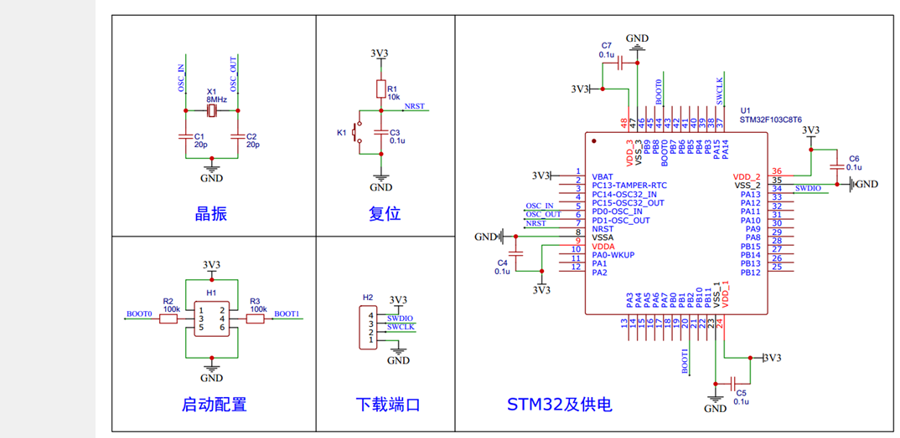

# 00 从零建立HAL工程

## 本章问题

后面每一章都要往同一个工程底座上加外设，所以先把“能编译、能下载、能继续改”这条链路跑通。本章从一个空白 CubeMX 工程开始，最后让板载 LED 闪起来。

## 学习目标

- 在 CubeMX 中建立 STM32F103C8T6 工程。
- 用 VS Code 编译并通过 ST-LINK 下载程序。
- 分清 CubeMX 生成的代码和自己维护的代码。
- 让板载 LED 周期闪烁。

## 0. 实验准备

| 物品 | 说明 |
| --- | --- |
| STM32F103C8T6 最小系统板 | 俗称 Blue Pill，板载 LED 接在 `PC13` |
| ST-LINK 下载器 | 把程序写进芯片，常见为蓝色小棒 |
| 杜邦线 4 根 | 连接 ST-LINK 与最小系统板 |
| USB 数据线 | 给板子或 ST-LINK 供电 |

本章只用板载 LED，不需要面包板和外接元件。最小系统板已经把 MCU 正常工作所需的电源、晶振、复位电路都做好了，本章要用的引脚都在这张图上：



图中 `H2` 是 ST-LINK 的接入点，`PA13`/`PA14` 旁标注的 `SWDIO`/`SWCLK` 是下载调试线。

软件方面需要 STM32CubeMX（基线 6.17.0）、VS Code 加 STM32 官方扩展、F1 系列 HAL 固件包（V1.8.7），以及扩展自动管理的 CMake、Ninja 和 arm-none-eabi-gcc。版本前后相差不大一般都能照做，安装 CubeMX 时记得勾选 F1 固件包。如果编译时报“找不到 Ninja”“找不到 arm-none-eabi-gcc”或“CMake 版本过低”，先更新插件，再单独安装 GCC 工具链和较新的 CMake。

## 1. 三个工具怎么分工

整条工作流只有三步：

```text
① 配置芯片          ② 编译               ③ 下载运行
STM32CubeMX    →    VS Code 插件      →   ST-LINK
产出 .c/.h 源码      GCC+CMake 编译        写入芯片并调试
（.ioc 是图纸）      产出 .elf 可执行文件    LED 开始闪烁
```

CubeMX 按 `.ioc` 里的引脚和外设配置生成初始化代码；VS Code 的 STM32 扩展调用 CMake 和 GCC，把源码编译成 `.elf`；ST-LINK 通过 `SWDIO`、`SWCLK`、`GND` 和供电线把程序写进芯片。

出问题时按“生成 → 编译 → 下载”三段分别定位，一次只改一段，才能知道是哪一步坏的。

## 2. 工程怎么放

每个实验单独建工程，一章有多个实验就在章目录下开子目录。不同章节的外设配置不要混进同一个工程：一个配置出错会污染所有实验，排查时分不清是谁引入的。

需要保留某个实验的现场时，可以复制整个工程，但不要复制 `build/` 和 CMake 缓存，它们记录的是旧工程名的绝对路径。已经复制了又编译报错，直接删掉 `build/`，重新用 VS Code 打开工程根目录，插件会自动重新 Configure。

## 3. 新建工程

第一次建议亲手走一遍“选芯片 → 配引脚 → 配时钟 → 生成代码”，这是后面每章都要重复的基本功。

1. 打开 CubeMX，在首页选 `ACCESS TO MCU SELECTOR`。
2. 在 `Commercial Part Number` 输入 `STM32F103C8`，选 `STM32F103C8Tx`，双击进入配置界面。
3. 在 `Pinout & Configuration` 页完成三项设置：
   - `System Core → RCC`：`HSE` 选 `Crystal/Ceramic Resonator`，使用板载 8 MHz 晶振；
   - `System Core → SYS`：`Debug` 选 `Serial Wire`。不选它，SWD 引脚会被当成普通 GPIO 释放，程序就下载不进去了；
   - 在芯片图上点 `PC13`，选 `GPIO_Output`。
4. 切到 `Clock Configuration`：`PLL Source Mux` 选 `HSE`，`PLLMul` 选 `x9`，`System Clock Mux` 选 `PLLCLK`，`APB1 Prescaler` 选 `/2`，`APB2` 保持 `/1`。配置正确时 `HCLK` 显示 `72`。
5. 切到 `Project Manager`：工程名填 `00_HAL_Template`，选好保存位置，`Toolchain/IDE` 选 `CMake`。`Code Generator` 页保持默认。
6. 点右上角 `GENERATE CODE`。生成成功后目录里会出现 `.ioc`、`Core/`、`Drivers/`、根 `CMakeLists.txt`、`cmake/`、启动文件和链接脚本。

## 4. CubeMX 和用户代码的边界

这是本章最需要记住的规则：CubeMX 重新生成时会重写的地方，不能长期写自己的代码；它不碰的地方，才归你。

### 4.1 CubeMX 负责的文件

每次点 `GENERATE CODE`，CubeMX 都按 `.ioc` 重画下面这些内容：

```text
Core/
Drivers/
startup_stm32f103xb.s
STM32F103XX_FLASH.ld
```

`Core/` 放主程序和中断处理，`main.c` 在 `Core/Src/`；`Drivers/` 是 ST 的 HAL 库源码，不必通读，用到哪个函数再查；`startup_*.s` 是启动文件，上电后先初始化堆栈和中断向量表，再跳进 `main()`；`.ld` 是链接脚本，说明芯片有多少 Flash 和 RAM、代码放在哪。

### 4.2 自己负责的文件

自己的代码放在工程根目录下的这三个目录：

```text
User/Inc/
User/Src/
User/Drivers/
```

少量入口改动放进 CubeMX 留出的注释区域：

```c
/* USER CODE BEGIN ... */
/* USER CODE END ... */
```

重新生成时，CubeMX 只重写这对标记以外的内容。常用的区域有：

| 区域 | 位置 | 放什么 |
| --- | --- | --- |
| `USER CODE BEGIN 0` | `main()` 之前 | 私有函数（`static`） |
| `USER CODE BEGIN PV` | `main()` 之前 | 全局变量 |
| `USER CODE BEGIN Includes` | `main()` 之前 | 自己的 `#include` |
| `USER CODE BEGIN 2` | 各 `MX_*_Init()` 之后 | 外设初始化、校准等 |
| `USER CODE BEGIN WHILE` | `while (1)` 内 | 主循环代码 |

`PV` 区只能放常量初始化，因为全局变量的初值必须在链接前算出来，写 `uint32_t t0 = HAL_GetTick();` 会直接报错。要取运行后的时间戳，就在 `USER CODE BEGIN 2` 里赋值。`WHILE` 区的代码要写在 `END WHILE` 标记之前，否则不会被 `while (1)` 包住。

写错位置的后果很直接：

```c
/* USER CODE BEGIN 2 */
HAL_GPIO_WritePin(GPIOC, GPIO_PIN_13, GPIO_PIN_RESET);  /* 安全，重新生成时保留 */
/* USER CODE END 2 */

HAL_GPIO_WritePin(GPIOC, GPIO_PIN_13, GPIO_PIN_RESET);  /* 危险，下次生成就消失 */
```

功能“突然没了”，先检查代码原先写在什么位置。成百上千行的驱动（OLED、传感器等）统一放 `User/Drivers/`，`USER CODE` 区域里只留几行调用。

改完配置后再次 `GENERATE CODE` 即可，`User/` 和 `USER CODE` 区域的内容不受影响。

## 5. 在 CMakeLists 中登记源文件

放进 `User/` 的 `.c` 文件不会自动参与编译，必须在根 `CMakeLists.txt` 里登记：

```cmake
target_sources(${CMAKE_PROJECT_NAME} PRIVATE
    User/Src/main_app.c
    User/Drivers/OLED/OLED.c
    User/Drivers/OLED/OLED_Data.c
)

target_include_directories(${CMAKE_PROJECT_NAME} PRIVATE
    User/Inc
    User/Drivers/OLED
)
```

`target_sources` 列出要编译的 `.c` 文件，每新增一个就加一行；`target_include_directories` 告诉编译器去哪里找头文件，漏了会报 `fatal error: OLED.h: No such file or directory`。`PRIVATE` 表示这些设置只对当前目标生效，单目标工程照抄即可。`${CMAKE_PROJECT_NAME}` 是根 `CMakeLists.txt` 里定义的工程名，改名后会自动跟着变。

OLED 驱动必须同时编译 `OLED.c` 和 `OLED_Data.c`：字模数组在后者里面，只登记 `OLED.c` 时，第一次显示字符就会报 `undefined reference to OLED_F8x16`。

忘记登记 `.c` 的典型症状是链接期报未定义引用：

```text
undefined reference to `OLED_Init'
collect2.exe: error: ld returned 1 exit status
```

看到这个报错，先回根 `CMakeLists.txt` 查对应文件有没有登记。若报 `multiple definition of ...`，则是两个不同的 `.c` 定义了同一个函数或全局变量。

## 6. 编译、下载与接线

### 6.1 编译下载流程

1. 用 VS Code 打开工程根目录，不要打开 `build/`。
2. 让 STM32 扩展读取 CubeMX 生成的 CMake 配置，选择 `Debug` 配置。
3. 点 Build（或按 `F7`），输出面板显示编译进度，末尾出现 `Build finished` 且没有 `error` 即成功。
4. 确认 ST-LINK 接好、板子通电，点 Download/Flash 下载。
5. 按复位键，观察程序现象。

`build/Debug/` 下能看到 `<工程名>.elf` 就说明链接成功。改动 `CMakeLists.txt` 或工程名之后要重新 Configure：先在 CMake 侧边栏点 `Configure`；改过工程名或大改过构建脚本时，用命令面板执行 `CMake: Delete Cache and Reconfigure`。

调试时最常用的三个动作：

| 想做什么 | 怎么做 | 看到什么 |
| --- | --- | --- |
| 只烧程序运行 | 点 Download/Flash | 板子立刻运行 |
| 停在某一行 | 行号左侧点断点，点 Debug，按 `F5` 继续 | 程序在该行停住并高亮 |
| 看变量值 | Debug 时在 Watch 面板点 `+` 输入变量名 | 暂停时显示当前值 |

`Call Stack` 显示调用关系，`Variables` 显示当前函数的局部变量。查“中断为什么没进来”时，先看 Call Stack 停在哪一层。

### 6.2 接线与供电

ST-LINK 与最小系统板之间接四根线：

```text
ST-LINK   →   最小系统板
SWDIO     →   SWDIO (PA13)
SWCLK     →   SWCLK (PA14)
GND       →   GND
3.3V      →   3.3V
```

`3.3V` 这根线是由 ST-LINK 给板子供电，接上它之后就不要再用 USB 给板子供电；反过来，只用 USB 供电时要把这根线拔掉。两路同时接，两个 3.3 V 电源会互相顶住，轻则下载不稳，重则烧坏 ST-LINK。

ST-LINK 的 3.3 V 输出电流很小，只够最小系统板加一两个 LED。后面接电机、舵机时不要靠它供电，改用 USB 或独立电源，并把 `3.3V` 线拔掉。

## 7. 实验：LED 闪烁

### 7.1 配置

1. 在 `.ioc` 的芯片图上点 `PC13`，选 `GPIO_Output`。右键可以 `Enter User Label` 起名，非必需。
2. 在 `GPIO` 面板确认：`GPIO output level` 选 `High`，`GPIO mode` 选 `Output Push Pull`，上下拉选 `No pull-up and no pull-down`，`Maximum output speed` 选 `Low`。
3. 点 `GENERATE CODE`，回到 VS Code。

板载 LED 的阳极经限流电阻接 `VDD`，阴极接 `PC13`，所以引脚输出低电平时点亮。初始电平选 `High`，上电时 LED 保持熄灭。推挽输出能主动输出高低电平，LED 这种负载用低速档就够。

### 7.2 代码

打开 `Core/Src/main.c`，在 `while (1)` 的 `USER CODE END WHILE` 之前写入两行：

```c
/* USER CODE BEGIN WHILE */
while (1)
{
    HAL_GPIO_TogglePin(GPIOC, GPIO_PIN_13);  /* 翻转 PC13，亮变灭、灭变亮 */
    HAL_Delay(500U);                         /* 等待 500 ms */
    /* USER CODE END WHILE */

    /* USER CODE BEGIN 3 */
}
/* USER CODE END 3 */
```

`HAL_GPIO_TogglePin()` 每调用一次就把 `PC13` 的电平取反；`HAL_Delay(500)` 让 CPU 原地等待 500 ms。后者是阻塞式延时，入门阶段够用，后面会用定时器替代。

### 7.3 下载与现象

编译出现 `Build finished`，接线无误后点 Download/Flash，下载完成按一下复位键。板载 LED 应每 500 ms 亮灭一次，周期 1 s。

LED 正常闪烁，说明 GPIO 初始化、编译、下载三段链路都通了。

这套模板工程和倒立摆的 PID 工程共用同一套 CubeMX、CMake 和 ST-LINK 流程，差别只在工程名、用户目录和外设配置；进入倒立摆时不需要重新学工具链，按 [[STM32倒立摆/00 项目背景与技术#5. 工程目录]] 的组织即可。

下一篇：[[01 GPIO：引脚、八种模式与 HAL 读写]]
