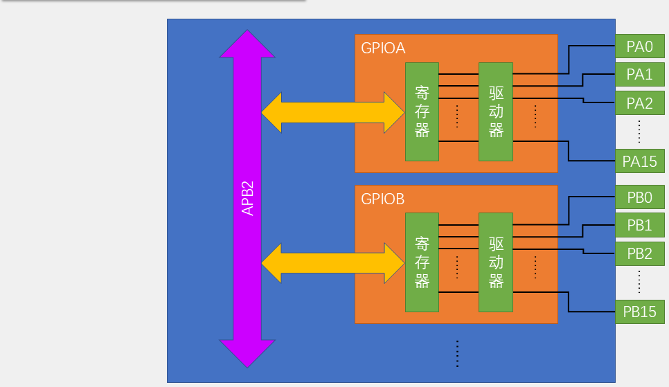
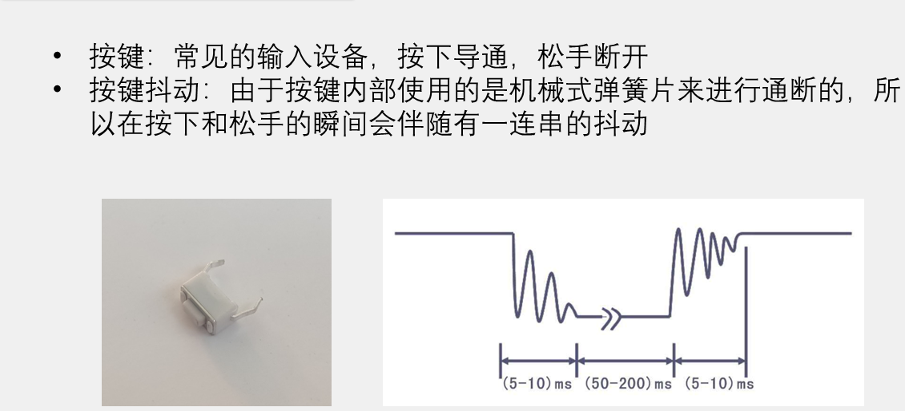

# 01 GPIO：引脚、八种模式与 HAL 读写

## 本章问题

<<<<<<< Updated upstream
怎样选择合适的 GPIO 模式，并让 LED、按键和 SWD 调试接口都按预期工作？

第 0 章已经打通“配置—编译—下载”的流水线，并让 LED 闪了起来。本章进一步解释 GPIO 引脚如何工作。GPIO（General Purpose Input/Output，通用输入输出）是后续外设实验的基础：LED 需要输出电平，按键需要读回电平，其他外设最终也要连接到具体引脚。理解本章后，你应能回答三个问题：

- 引脚名字里的 `PA9`、`PC13` 到底是什么意思，哪些引脚不能随便用？
- 同一根线，为什么有时配成输出、有时配成输入？八种模式各在什么场合用？
- "写 0"和"LED 亮"之间隔着几层关系？谁决定亮，谁决定灭？
=======
GPIO 是所有外设的地基：LED 要输出电平，按键要读回电平，串口和 I2C 最终也落在具体引脚上。本章回答三个问题：引脚名字怎么读、八种模式各在什么场合用、“写 0”和“LED 亮”之间是什么关系。
>>>>>>> Stashed changes

## 学习目标

- 识别 STM32F103 的引脚分组和特殊引脚。
- 按用途选择 GPIO 模式、上下拉和输出速度。
- 用 HAL 写出 LED 与按键程序。
- 根据现象定位接线和配置错误。

<<<<<<< Updated upstream
每条目标都在本章验收清单（第 8 节）里有对应检查项。两个实验请按本章步骤在 `MyCode` 中从零配置和编写；`E:\ProjectStm\Courses\HAL01_GPIO`（`01_LED`、`02_Key_Control_LED`）是配置正确时的对照答案，排错时再打开比对。

## 1. 引脚、分组与复用

### 1.1 端口与引脚编号：先学会"报地址"

把芯片想象成一栋宿舍楼：每栋楼是一个端口，楼里有 16 个房间，房间号 0~15 就是引脚编号。你要找"PA9"，其实是在报"GPIOA 栋 9 号房"。CPU 访问一个端口，就是读写一组 32 位寄存器——其中低 16 位一一对应 16 个引脚，一次能同时照看整栋楼的 16 个房间——这就是"按端口分组"的原因。

STM32F103C8T6 的 GPIO 端口通常以字母分组，编号从 `0` 到 `15`：
=======
## 1. 引脚、端口与复用

### 1.1 端口和编号

STM32F103C8T6 的 GPIO 按字母分组，每组最多 16 个引脚，编号 `0`~`15`：
>>>>>>> Stashed changes

```text
GPIOA: PA0 ... PA15
GPIOB: PB0 ... PB15
GPIOC: PC13、PC14、PC15
GPIOD: PD0、PD1
```

<<<<<<< Updated upstream
注意 `GPIOC` 只有 13~15、`GPIOD` 只有 0~1。这不是它们天生残缺，而是 48 脚封装（LQFP48）引脚数量有限：扣除电源、晶振、调试引脚后，能分给 GPIO 的脚就这么多。

代码中组和编号分开表示：`PA9` 对应 `GPIOA` 与 `GPIO_PIN_9`，`PC13` 对应 `GPIOC` 与 `GPIO_PIN_13`。

为什么要拆成"端口 + 编号"两个参数？因为 HAL 用一个端口指针加一个 16 位掩码定位引脚：`GPIO_PIN_9` 是宏 `((uint16_t)0x0200)`，即只有第 9 位为 1 的掩码（可在工程 `Drivers/STM32F1xx_HAL_Driver/Inc/stm32f1xx_hal_gpio.h` 中核对全部 `GPIO_PIN_x` 定义）。掩码设计允许一次选中多个引脚（如 `GPIO_PIN_9 | GPIO_PIN_13`），本教程的例子都只用单个引脚。

**新手最容易踩的坑**是把编号直接当掩码传：`HAL_GPIO_WritePin(GPIOA, 9, ...)`。数字 9 的二进制是 `0b1001`，会被理解成"PIN_0 和 PIN_3 同时选中"——编译器不报错，但操作的完全是另外两个引脚。永远写 `GPIO_PIN_9`，不要写裸数字。
=======
`GPIOC` 只有 13~15、`GPIOD` 只有 0~1，是因为 48 脚封装扣掉电源、晶振和调试引脚后，能分给 GPIO 的只剩这么多。

代码里端口和编号分开写：`PA9` 对应 `GPIOA` 与 `GPIO_PIN_9`，`PC13` 对应 `GPIOC` 与 `GPIO_PIN_13`。HAL 用一个端口指针加一个 16 位掩码定位引脚，所以参数总是“端口 + 编号”两项。



每个端口由寄存器和驱动器两部分组成。寄存器挂在 `APB2` 总线上，CPU 写的是寄存器，电流要经驱动器才到引脚。
>>>>>>> Stashed changes

### 1.2 特殊引脚

| 引脚 | 作用 |
| --- | --- |
<<<<<<< Updated upstream
| `VDD` / `VSS` | 电源正端 / 地；接线时也常写作 `VCC` / `GND` |
| `VBAT` | 后备域电源，不应随意当作普通 GPIO |
| `NRST` | 复位输入 |
| `BOOT0` | 启动模式选择 |
| `PC14/PC15` | 常用于低速外部晶振 `LSE` |
| `PD0/PD1` | 常用于高速外部晶振 `HSE` |
| `PA13 (SWDIO)` / `PA14 (SWCLK)` | SWD 数据线 / 时钟线，初学阶段保持调试功能 |
| `PA15` / `PB3` / `PB4` | JTAG 引脚；关闭 JTAG 或改用 SWD 后可按复用规则使用 |

逐项理解这些特殊引脚：

- `VDD`/`VSS` 是芯片的供电血管，接错或忘记共地，一切现象都不可信；
- `VBAT` 专供后备域（如 RTC），本章不使用它；
- `NRST` 拉低会让芯片复位，外接电路误碰它会让程序"莫名其妙重启"；
- `BOOT0` 决定上电从哪里启动（闪存还是系统存储器），最小系统板上通常已有跳线固定，不要把它接进自己的电路；
- `PD0/PD1` 在两个参考工程里正是接 8 MHz 外部晶振作 `HSE`（见 `.ioc` 中的 `PD0-OSC_IN`、`PD1-OSC_OUT`），第 3 章讲时钟时会再遇到；
- `PA13`/`PA14` 是下载调试的生命线；
- `PA15`/`PB3`/`PB4` 复位后默认处于 JTAG 功能，要用作普通 GPIO 需按第 9.4 节的重映射说明处理。

不要把电源、复位、晶振或启动配置引脚当作普通 GPIO。`PA13`、`PA14` 被 LED、按键或普通复用功能占用时，可能导致下载和调试失败；本实验让它们保持 `Serial Wire` 调试功能。
=======
| `VDD` / `VSS` | 电源正端 / 地，接线时常写作 `VCC` / `GND` |
| `VBAT` | 后备域电源 |
| `NRST` | 复位输入 |
| `BOOT0` | 启动模式选择 |
| `PC14/PC15` | 常用作低速外部晶振 `LSE` |
| `PD0/PD1` | 常用作高速外部晶振 `HSE` |
| `PA13 (SWDIO)` / `PA14 (SWCLK)` | SWD 数据线 / 时钟线 |
| `PA15` / `PB3` / `PB4` | JTAG 引脚 |

电源、复位、晶振和启动配置引脚都不能当普通 GPIO 用。`NRST` 被误碰会随机复位；`BOOT0` 决定上电从哪里启动；`PA13`/`PA14` 是下载调试的生命线，被占用后可能无法下载。`PA15`、`PB3`、`PB4` 复位后默认是 JTAG 功能，要当普通 GPIO 必须先关闭 JTAG。

### 1.3 复用

一个引脚内部连着一排开关，配置决定它接到 GPIO 单元，还是接到串口、定时器等外设。`PA9` 既可以是普通 GPIO，也可以是 `USART1_TX`。启用 USART1 后，这个引脚由串口外设控制，应用代码不能再用 GPIO API 翻转它。
>>>>>>> Stashed changes

所以实验二把 `PA9` 当按键用之后，就不能同时把它分配给 USART1。

<<<<<<< Updated upstream
芯片引脚像多功能插座：同一插孔，平时给普通电器用（普通 GPIO），也可以切换给专用设备用（外设）。引脚内部连着一排"开关"，由配置决定这一脚最终接到 CPU 的 GPIO 单元，还是接到串口、定时器等外设的引出线上。

同一引脚也可以承担不同外设功能。例如 `PA9` 可作普通 GPIO，也可作 `USART1_TX`；启用 USART1 后，引脚由串口外设控制，应用代码不应再用 GPIO API 随意翻转。这正是第 2.2 节"复用输出"的含义，也解释了为什么实验二把 PA9 用作按键后，第 8 章串口实验不能同时占用它。外设默认引脚冲突时，先在芯片引脚图中查可用映射，再在 CubeMX 中配置 AFIO 重映射。

## 2. 八种 GPIO 工作模式

GPIO 的方向只有输入和输出。STM32F1 的 8 种模式可按"通用/复用"和"推挽/开漏"区分：
=======
## 2. 八种工作模式

方向只有输入和输出两种，八种模式是方向、输出结构和控制权三件事的组合：
>>>>>>> Stashed changes

| 方向 | 模式 | 典型用途 |
| --- | --- | --- |
| 输出 | 通用输出推挽 | LED、数字控制线 |
| 输出 | 通用输出开漏 | I2C、线与逻辑、需要外部上拉的信号 |
| 复用输出 | 复用输出推挽 | USART、SPI、定时器输出 |
| 复用输出 | 复用输出开漏 | 外设的开漏复用功能 |
| 输入 | 输入浮空 | 外部电路始终提供确定电平 |
| 输入 | 输入上拉 | 按键断开时默认读 `1` |
| 输入 | 输入下拉 | 按键断开时默认读 `0` |
| 模拟 | 模拟输入 | ADC 采样，不作数字读取 |

<<<<<<< Updated upstream
第一次看表不必死记。下面三小节分别解释“推挽/开漏”“通用/复用”和三种数字输入模式；理解它们的工作方式后，再回头查表即可。HAL 中这些模式对应的枚举（`GPIO_MODE_OUTPUT_PP`、`GPIO_MODE_OUTPUT_OD`、`GPIO_MODE_INPUT`、`GPIO_MODE_ANALOG` 等）都定义在工程内 `stm32f1xx_hal_gpio.h` 中，生成的初始化代码会使用它们。

### 2.1 推挽与开漏输出：谁来"推"谁来"拉"

**推挽（Push-Pull）**：想象引脚内部有两个电子开关——上管接电源 `VDD`，下管接地 `VSS`。写 `0` 时上管断开、下管导通，引脚被牢牢接向地，输出低电平；写 `1` 时下管断开、上管导通，引脚被牢牢接向电源，输出高电平。无论高低，总有一个开关"在出力"，所以信号既有力又快。"推挽"这个名字就是"一推一挽"两个管子轮流干活。

**开漏（Open-Drain）**：把上管撤掉，只留下接地的下管。写 `0` 时下管导通，把引脚拉到低——这一点和推挽一样有力；写 `1` 时连下管也断开，引脚悬空（高阻态），此时电平完全由外部电路决定，要得到稳定的高电平必须外接一个上拉电阻把引脚"扶"到电源。

一个类比：推挽像一根双向液压杆，说高就顶到高、说低就压到低；开漏像一根拴在墙上的绳子——你只能往低处拉，一松手（写 `1`），靠弹簧（上拉电阻）把它带回高处。
=======
### 2.1 推挽与开漏

推挽输出内部有两个开关：上管接 `VDD`，下管接 `VSS`。写 `0` 时下管导通，引脚被拉到地；写 `1` 时上管导通，引脚被拉到电源。高低电平都有管子主动出力，边沿快、驱动能力强。

开漏输出去掉了上管，只留下管。写 `0` 时引脚被拉到地，写 `1` 时下管也断开，引脚呈高阻态，电平由外部电路决定。要得到稳定的高电平，必须外接上拉电阻。

开漏适合多设备共用一条总线。如果两个推挽输出一个拉高、一个拉低，电源到地会形成短路；开漏输出只会拉低，任何一方拉低总线就是低电平，不会互相冲突。I2C 的 `SCL`、`SDA` 就是靠这个机制工作的。
>>>>>>> Stashed changes

I2C 的 `SCL`、`SDA` 就依赖开漏机制实现总线仲裁和线与逻辑。为什么多设备总线偏爱开漏？如果 A 设备推高、B 设备同时拉低，电源到地会形成一条短路通路；而开漏下每个设备"只会拉低"，只要任何一方拉低，总线就是低——这就是"线与"，谁也不会和谁打架。第 9 章软件 I2C 会直接用到这个结论。

<<<<<<< Updated upstream
还要强调一次：推挽和开漏描述的是输出级结构，与 LED 亮不亮没有直接关系；决定亮灭的是"写 0/写 1"与"LED 接法"的组合，见第 5 节。

### 2.2 通用与复用输出：开关归谁管

房间里普通的电灯开关由你自己扳（通用输出：用户代码说了算）；有些开关被物业接管（复用输出：片上外设说了算），你伸手去扳它也不听。

通用输出由用户代码直接控制，例如 `HAL_GPIO_WritePin()` 改变 `PA9` 电平。复用输出则把引脚控制权交给片上外设，例如启用 `USART1_TX` 后，串口发送逻辑自动产生波形，不能再把同一引脚当作普通 GPIO 随意翻转。复用模式下调用 `HAL_GPIO_WritePin()` 不一定报错，但波形由外设决定，你的写入要么无效要么造成干扰——"这个引脚现在归谁管"，是排查"我明明写了为什么没反应"的第一问。
=======
### 2.2 通用与复用

通用输出的控制权在用户代码，`HAL_GPIO_WritePin()` 写哪个引脚就改哪个引脚。复用输出把控制权交给外设，启用 `USART1_TX` 后波形由串口逻辑产生，同一引脚不能再当普通 GPIO 用。
>>>>>>> Stashed changes

### 2.3 三种数字输入

<<<<<<< Updated upstream
输入模式相当于用高内阻电压表观察外部电平——表笔几乎不取电流，不会影响被测点。三种数字输入模式的区别只在一件事：外部没人说话时，引脚自己"听"到什么。
=======
输入模式相当于用高内阻电压表观察外部电平，几乎不取电流。它们的区别只在于外部没有驱动时引脚读到什么：
>>>>>>> Stashed changes

- 浮空输入：内部不接电阻，引脚悬空，干扰会让读数在 0/1 之间乱跳；
- 上拉输入：内部经弱电阻接 `VDD`，无驱动时默认读 `1`；
- 下拉输入：内部经弱电阻接 `VSS`，无驱动时默认读 `0`。

<<<<<<< Updated upstream
类比：上拉像一根弹簧把开关默认停在"高"的位置，按键按下才被强行扳到"低"，松手弹回；下拉则相反。凡是可能"断开"的信号（按键、开关、某些传感器输出），都必须给一个默认值。

模拟输入关闭数字输入路径，供 ADC 等模拟外设使用，不能把它当作普通数字输入来判断 `0/1`。第 6 章 ADC 采集电位器电压时用的就是它。
=======
按键、开关这类可能断开的信号，必须给一个默认电平，否则读数不确定。以按键一端接地为例，配上拉后松开读 `1`，按下时触点把引脚接到地，读 `0`。

模拟输入会关闭数字输入通路，只供 ADC 使用，不能当普通输入判断 0/1。
>>>>>>> Stashed changes

### 2.4 怎么选

<<<<<<< Updated upstream
| 你要做什么 | 推荐配置 | 一句话原因 |
| --- | --- | --- |
| 点 LED（引脚经电阻接阳极，高电平亮） | 输出推挽，初始 `Low` | 0/1 都要有力 |
| 点板载 LED（阳极接电源、阴极接引脚，低电平亮） | 输出开漏或推挽，初始 `High` | 低电平点亮；开漏写 `1` 时引脚释放，LED 支路无电流即灭 |
| 按键一端接 `GND` | 输入上拉 | 松开有默认 `1`，按下读 `0` |
| 按键一端接 `VDD` | 输入下拉 | 松开有默认 `0`，按下读 `1` |
| 采集电位器等模拟电压 | 模拟输入 | 数字输入路径要给 ADC 让路 |
| 外设信号引出（串口、定时器等） | 复用输出 | 控制权交给外设 |

本章两个实验会用到表中前三行；开漏配高电平点亮 LED 时必须有外部上拉（见 2.1 节）。

## 3. 输出速度

引脚电平从 0 跳到 1 不是瞬间完成的，像汽车起步需要加速时间：上升沿和下降沿都有"爬坡"过程。速度档位决定爬坡的陡峭程度（边沿驱动能力）。档位越高，边沿越陡，能支持的翻转频率越高；边沿越缓，通常对邻近线路的干扰越小。具体的电气特性以数据手册为准。

GPIO 电平切换需要上升时间和下降时间；边沿过慢时，信号可能来不及在目标周期内稳定下来。STM32F1 常见档位如下，表中时间是数据手册测试条件下的参考值：

| 档位 | 上升/下降时间参考 | 速度档位上限 |
=======
| 任务 | 推荐配置 | 初始电平 | 有效电平 |
| --- | --- | --- | --- |
| 引脚经电阻接 LED 阳极，高电平亮 | 输出推挽 | `Low` | 高 |
| 阳极接电源、阴极接引脚，低电平亮 | 输出推挽或开漏 | `High` | 低 |
| 按键一端接 `GND` | 输入上拉 | — | 低（按下） |
| 按键一端接 `VDD` | 输入下拉 | — | 高（按下） |
| 采集模拟电压 | 模拟输入 | — | — |
| 串口、定时器等外设信号 | 复用输出 | 由外设决定 | 由外设决定 |

初始电平和有效电平是两件事。初始电平只在引脚刚配成输出的瞬间起作用，用来避免上电闪烁；有效电平由电路接法决定，决定写 `SET` 还是 `RESET` 才能点亮。板载 LED 就是初始写 `High`（上电灭）、点亮靠写 `RESET`。

## 3. 输出速度

电平从 0 跳到 1 需要时间，速度档位决定边沿有多陡：

| 档位 | 上升/下降时间（参考） | 可用频率上限 |
>>>>>>> Stashed changes
| --- | ---: | ---: |
| 低速 | 约 `125 ns` | 约 `2 MHz` |
| 中速 | 约 `25 ns` | 约 `10 MHz` |
| 高速 | 约 `5 ns` | 约 `50 MHz` |

<<<<<<< Updated upstream
理解两点就够了。第一，档位是"能力上限"，不是"要求频率"：LED 以 1 Hz 闪烁，离 `2 MHz` 的低速上限还差几个数量级，选低速绰绰有余。第二，档位只影响边沿快慢，不改变逻辑电平：低速档写 `1` 一样能读到 `1`。LED 和低速控制线通常选低速；SPI、定时器等较快信号再按边沿和信号完整性选择中速或高速。USB `D+/D-` 使用专用 USB 复用功能，不能按普通 GPIO 速度档位简单套用。

HAL 中三个档位对应 `GPIO_SPEED_FREQ_LOW` / `GPIO_SPEED_FREQ_MEDIUM` / `GPIO_SPEED_FREQ_HIGH`（工程内 `stm32f1xx_hal_gpio.h` 可核对），CubeMX 界面对应 `Maximum output speed` 下拉框。

## 4. HAL 与 GPIO 编程接口

### 4.1 初始化顺序：上电后发生了什么

典型初始化链为：
=======
档位是能力上限，不是必须达到的频率。LED 以 1 Hz 闪烁，选低速绰绰有余。档位只影响边沿快慢，不改变逻辑电平。LED 和低速控制线用低速，SPI、定时器等较快信号再按需选中速或高速。

## 4. HAL 的 GPIO 接口

### 4.1 初始化顺序
>>>>>>> Stashed changes

```text
HAL_Init()
→ SystemClock_Config()
→ MX_GPIO_Init()
→ 其他外设初始化
→ while (1)
```

<<<<<<< Updated upstream
三步各干一件事：`HAL_Init()` 启动 HAL 库的时基（SysTick，后面 `HAL_Delay()` 靠它计数）；`SystemClock_Config()` 把主频配到 72 MHz（第 3 章展开）；`MX_GPIO_Init()` 把引脚配置成你要的样子。任何一步没完成就进入主循环，后面的现象都不可信——比如 `HAL_Delay()` 的时长会随系统时钟而变。

生成的 `MX_GPIO_Init()`（本实验在 `Core/Src/gpio.c` 中）内部是下面这个完整顺序：
=======
`HAL_Init()` 启动 SysTick 时基，`HAL_Delay()` 靠它计数；`SystemClock_Config()` 把主频配到 72 MHz；`MX_GPIO_Init()` 配置引脚。顺序不能调换，时钟没起来就配置外设不会生效。

以实验一为例，`Core/Src/gpio.c` 中的初始化函数是：
>>>>>>> Stashed changes

```c
void MX_GPIO_Init(void)
{
  GPIO_InitTypeDef GPIO_InitStruct = {0};

  /* 先开端口时钟 */
  __HAL_RCC_GPIOC_CLK_ENABLE();
  __HAL_RCC_GPIOD_CLK_ENABLE();
  __HAL_RCC_GPIOA_CLK_ENABLE();

  /* 先写初始电平，再改模式，避免上电毛刺 */
  HAL_GPIO_WritePin(GPIOC, GPIO_PIN_13, GPIO_PIN_SET);
  HAL_GPIO_WritePin(GPIOA, GPIO_PIN_9, GPIO_PIN_RESET);

  GPIO_InitStruct.Pin = GPIO_PIN_13;
  GPIO_InitStruct.Mode = GPIO_MODE_OUTPUT_OD;
  GPIO_InitStruct.Pull = GPIO_NOPULL;
  GPIO_InitStruct.Speed = GPIO_SPEED_FREQ_LOW;
  HAL_GPIO_Init(GPIOC, &GPIO_InitStruct);

  GPIO_InitStruct.Pin = GPIO_PIN_9;
  GPIO_InitStruct.Mode = GPIO_MODE_OUTPUT_PP;
  GPIO_InitStruct.Pull = GPIO_NOPULL;
  GPIO_InitStruct.Speed = GPIO_SPEED_FREQ_LOW;
  HAL_GPIO_Init(GPIOA, &GPIO_InitStruct);
}
```

<<<<<<< Updated upstream
为什么第一步必须是开时钟？STM32 为了省电，每个外设（包括每个 GPIO 端口）都有自己的时钟开关，默认是关的；时钟没开时去写它的寄存器不会生效。这解释了一个经典错误：绕过 CubeMX 手写 GPIO 代码却忘了 `__HAL_RCC_GPIOx_CLK_ENABLE()`，结果引脚毫无反应。

CubeMX 生成的 GPIO 配置应放在 `MX_GPIO_Init()` 中；用户逻辑放在 `USER CODE BEGIN/END` 区域，以免重新生成代码时被覆盖（这套边界规则在第 0 章第 4 节已详细讲过）。

### 4.2 写、读和延时：逐个函数拆参数

关键 HAL 函数签名如下：
=======
第一步必须是开时钟。STM32 每个外设都有独立的时钟开关，默认关闭，时钟没开时写寄存器不会生效。

第二步是先写电平、再改模式。引脚配成输出的瞬间，电平由输出数据寄存器 `ODR` 决定，而它的复位值是 `0`。如果先调用 `HAL_GPIO_Init()`，`PC13` 会先变低，板载 LED 会闪一下才熄灭。

### 4.2 读、写、翻转、延时
>>>>>>> Stashed changes

```c
void HAL_GPIO_WritePin(GPIO_TypeDef *GPIOx, uint16_t GPIO_Pin,
                       GPIO_PinState PinState);
GPIO_PinState HAL_GPIO_ReadPin(GPIO_TypeDef *GPIOx, uint16_t GPIO_Pin);
void HAL_GPIO_TogglePin(GPIO_TypeDef *GPIOx, uint16_t GPIO_Pin);
void HAL_Delay(uint32_t Delay);
```

<<<<<<< Updated upstream
**`HAL_GPIO_WritePin()`**——往引脚写一个确定电平：

| 参数 | 含义 | 用错的后果 |
| --- | --- | --- |
| `GPIOx` | 端口，如 `GPIOA`、`GPIOC` | 传错端口：编译不报错，电平写到另一栋"楼"的同号引脚上 |
| `GPIO_Pin` | 引脚位掩码，如 `GPIO_PIN_9` | 传裸数字 `9`：被当成 `0b1001`，同时选中 PIN_0 和 PIN_3 |
| `PinState` | `GPIO_PIN_SET`（写 `1`）或 `GPIO_PIN_RESET`（写 `0`） | 两个枚举在头文件中定义为 `1` 和 `0`，传 1/0 数值上等价，但用枚举可读性更好，也不易和引脚编号混淆 |

`HAL_GPIO_ReadPin()` 的返回值也是这两个枚举之一，见下文。

```c
HAL_GPIO_WritePin(GPIOA, GPIO_PIN_9, GPIO_PIN_SET);
GPIO_PinState state = HAL_GPIO_ReadPin(GPIOA, GPIO_PIN_9);
HAL_Delay(500U);   /* 延时 500 ms */
```

写入值和 LED 是否点亮不是同一件事：LED 的有效电平由阳极、阴极和限流电阻的接法决定（2.1 节）；高电平有效的 LED 使用开漏输出时，写 `1` 只是释放为高阻，仍需要外部上拉。

`HAL_GPIO_WritePin()` 在 STM32F1 HAL 中通过 `BSRR` 单次写入：低 16 位写 `1` 置位，高 16 位写 `1` 复位，不是对 `ODR` 做读改写。"原子写"的好处是一条指令完成，中间不会被中断插进来改出中间态。`HAL_GPIO_ReadPin()` 读取 `IDR`，得到引脚实际输入电平；`ODR` 只是输出锁存值。开漏或复用输出下，不能用 `ODR` 代替 `IDR` 判断引脚电平——开漏写 `1` 后 `ODR` 记着"1"，引脚实际电平却由外部电路决定；复用模式下 `ODR` 更是根本不代表外设正在输出的波形。

`HAL_GPIO_TogglePin()` 翻转的是 `ODR`（实现上是读 `ODR` 后经 `BSRR` 原子写回，与 `WritePin` 的单次写不冲突）。普通推挽输出中通常表现为引脚翻转；开漏无外部上拉或复用输出中，不应把它理解为真实引脚电平必然改变。需要明确指定亮灭时，使用 `HAL_GPIO_WritePin()`——第 0 章的闪烁实验用翻转很方便，本章实验一要"同时指定两个灯各自的状态"，用写入更直白。

**`HAL_GPIO_ReadPin()`**——读回引脚当前电平，返回 `GPIO_PIN_RESET` 或 `GPIO_PIN_SET`。判断按键时推荐写成 `if (key == GPIO_PIN_RESET)` 而不是 `if (key == 0)`：枚举让"按下"这个语义一目了然。它读的是 `IDR`（引脚真实电平），所以既适用于输入模式，也能读回输出引脚的实际状态。

**`HAL_Delay()`**——阻塞式毫秒延时。参数是毫秒数：`HAL_Delay(500U)` 就是半秒，不要把参数误当秒数；结尾的 `U` 表示无符号常量，与参数类型 `uint32_t` 匹配，是良好习惯。它依赖 HAL Tick（SysTick 中断累计计数），适合入门实验和低实时性任务；精确周期或非阻塞任务应使用定时器、中断等机制。先记住一个限制，第 4 章中断里会再遇到：在中断服务函数里调用 `HAL_Delay()` 可能因时基中断得不到响应而死等，延时要放在主循环或低优先级上下文里用。

### 4.3 从标准库迁移

学过标准库的同学可以按这张表对照迁移，HAL 的参数更啰嗦，但所有外设的写法统一：

| 标准库 | HAL | 关键点 |
| --- | --- | --- |
| `GPIO_SetBits(GPIOx, GPIO_Pin)` | `HAL_GPIO_WritePin(GPIOx, GPIO_Pin, GPIO_PIN_SET)` | 写 `BSRR`，单次原子写 |
| `GPIO_ResetBits(GPIOx, GPIO_Pin)` | `HAL_GPIO_WritePin(GPIOx, GPIO_Pin, GPIO_PIN_RESET)` | 通过 `BSRR` 高 16 位写低电平 |
| `GPIO_ReadInputDataBit(GPIOx, GPIO_Pin)` | `HAL_GPIO_ReadPin(GPIOx, GPIO_Pin)` | 读 `IDR` |
| 自行对 `ODR` 取反 | `HAL_GPIO_TogglePin(GPIOx, GPIO_Pin)` | HAL 提供的翻转接口 |

两个库底层面对的是同样的寄存器（`BSRR`、`IDR`、`ODR`），区别只在封装风格。标准库时代常见的"初始化结构体 + 各字段按手册填"在 HAL 里一样存在（见 `GPIO_InitTypeDef`），只是 CubeMX 替你把填写这步生成了。

## 5. 实验一：LED 闪烁

### 5.1 接线：先想清楚电流怎么流
=======
`GPIOx` 是端口，如 `GPIOA`；`GPIO_Pin` 是引脚掩码，如 `GPIO_PIN_9`；`PinState` 取 `GPIO_PIN_SET`（写 1）或 `GPIO_PIN_RESET`（写 0）。`HAL_GPIO_ReadPin()` 返回这两个枚举之一，读的是引脚真实电平，输出模式下也能读回当前状态。

`HAL_Delay()` 的参数单位是毫秒，`HAL_Delay(500U)` 是半秒。它靠 SysTick 中断计数，适合入门实验；需要精确周期或不阻塞时，应改用定时器。

## 5. 实验一：LED 闪烁

目标是让板载 LED 和外接 LED 同亮同灭，亮 500 ms、灭 500 ms，用两种相反的有效电平说明“写电平 + 知道接法”。

### 5.1 接线
>>>>>>> Stashed changes

- 板载 LED 接 `PC13`，常见的接法是阳极经板载电阻接 `VDD`、阴极接 `PC13`，写 `0` 点亮，属低电平有效；
- 外接 LED 从 `PA9` 经限流电阻接阳极、阴极接 `GND`，写 `1` 点亮，属高电平有效。

<<<<<<< Updated upstream
- 板载 LED 接 `PC13`，常见接法是阳极经板载支路接 `VDD`、阴极接 `PC13`，因此写 `0` 点亮。电流路径是：电源 → LED → 限流电阻 → PC13 → 芯片内部到地。这叫"低电平有效"；
- 外接 LED 接 `PA9 -> 限流电阻 -> LED 阳极`，阴极接 `GND`，因此写 `1` 点亮。电流路径是：PA9 → 电阻 → LED → 地。这叫"高电平有效"；
- `PC13` 是受限 I/O，不用于大电流负载；它也不是 5 V 容忍输入，额外负载应使用普通 GPIO 并遵守引脚电流限制。

为什么板载 LED 要接到"受限"的 PC13 上？因为板厂只用它做状态指示，电流很小，够用；你自己设计的电路则应优先用 `PA0~PA15`、`PB0~PB15` 这些普通引脚。

外接 LED 的限流电阻可从 `470 Ω~1 kΩ` 选择，再按 LED 正向压降、颜色和目标电流调整：
=======
限流电阻不能省。LED 导通后压降基本固定，剩下的电压若没有电阻承担，电流就只受引脚内阻限制，可能烧坏 LED 和引脚。阻值可在 `470 Ω~1 kΩ` 之间选，再按颜色和目标电流调整：
>>>>>>> Stashed changes

$$
I \approx \frac{3.3\,\mathrm{V}-V_f}{R}
$$

其中 $V_f$ 是 LED 正向压降。LED 长脚一般为阳极，短脚为阴极；也不要把 5 V 直接接到 `PA9`。

### 5.2 CubeMX 配置

<<<<<<< Updated upstream
1. 双击工程 `.ioc` 进入 CubeMX。先配调试口：`System Core -> SYS -> Debug` 下拉框选 `Serial Wire`。漏选或选错（比如选成 `JTAG (4 pins)` 或 `Disable`），PA13/PA14 不会以 SWD 方式保留，后续配置或其他程序占用它们后可能导致下载失败。参考工程 `.ioc` 中对应记录为 `PA13.Mode=Serial_Wire`、`PA14.Mode=Serial_Wire`；
2. 在右侧芯片图上点击 `PC13` 引脚，弹出菜单选 `GPIO_Output`，引脚变绿表示已启用。点错成 `GPIO_Input` 也不危险，重新点一遍改回来即可；
3. 在下方 `GPIO` 配置面板逐项确认（填错项的后果写在括号里）：
   - `GPIO output level` 选 `High`（选成 `Low`：上电瞬间板载 LED 常亮，直到主循环第一次写入才恢复正常）；
   - `GPIO mode` 选 `Output Open Drain`（选成 `Output Push Pull`：本实验低电平点亮时现象相同；这里选开漏，是为了借实验练 2.1 节"写 `1` 释放引脚"的行为——等做到"高电平点亮 + 开漏"的场景，它就是必需配置）；
   - `GPIO Pull-up/Pull-down` 选 `No pull-up and no pull-down`（输出模式下上下拉影响很小，保持默认即可）；
   - `Maximum output speed` 选 `Low`（选成 `High`：对本实验无可见影响，但养成"按需选档"的习惯）；
4. （可选）右键 `PC13` -> `Enter User Label`，起个名字如 `LED0`，生成代码后可读性更好；
5. 点击 `PA9` -> `GPIO_Output`；面板中 `GPIO output level` 选 `Low`，`GPIO mode` 选 `Output Push Pull`，速度 `Low`（初始 `Low` 是故意的：外接 LED 高电平有效，上电即灭）；
6. `Project Manager` 页确认 Toolchain 仍是 `CMake`，点右上角 `GENERATE CODE`，回 VS Code 重新编译。

### 5.3 数据流：输入、处理、输出各是什么

```text
输入：上电时 MX_GPIO_Init() 写好的初始电平（PC13=高、PA9=低，两灯都灭）
       以及每次 HAL_Delay() 到时的"时间到"事件
处理：主循环交替写入两组电平
输出：PC13 与 PA9 的引脚电平
现象：两个 LED 同亮同灭，亮 500 ms、灭 500 ms，周期 1 s
```

### 5.4 最小主循环与逐行解释
=======
1. 打开 `.ioc`，确认 `System Core → SYS → Debug` 为 `Serial Wire`。
2. 点 `PC13`，选 `GPIO_Output`，在 `GPIO` 面板设置：初始电平 `High`，模式 `Output Open Drain`，无上下拉，速度 `Low`。
3. 点 `PA9`，选 `GPIO_Output`，设置：初始电平 `Low`，模式 `Output Push Pull`，速度 `Low`。
4. 确认 `Toolchain/IDE` 仍是 `CMake`，点 `GENERATE CODE`。

`PC13` 驱动板载 LED 只灌电流，推挽和开漏都能点亮；这里用开漏，与第 00 章的推挽配置形成对照，实验二沿用这个配置。
>>>>>>> Stashed changes

### 5.3 主循环

```c
while (1)
{
<<<<<<< Updated upstream
    /* 处理：同时点亮两个 LED。
       PC13 低电平有效（阴极接引脚）：写 RESET 把引脚拉低，电流流通，亮；
       PA9 高电平有效（引脚经电阻接阳极）：写 SET 把引脚推高，电流流通，亮。
       两行写入的含义相反，靠的都是"写电平 + 知道接法"。 */
    HAL_GPIO_WritePin(GPIOC, GPIO_PIN_13, GPIO_PIN_RESET);
    HAL_GPIO_WritePin(GPIOA, GPIO_PIN_9, GPIO_PIN_SET);
    HAL_Delay(500U);   /* 停 500 ms，让"亮"停留半秒。U 表示无符号常量 */
=======
    /* PC13 低电平点亮，PA9 高电平点亮 */
    HAL_GPIO_WritePin(GPIOC, GPIO_PIN_13, GPIO_PIN_RESET);
    HAL_GPIO_WritePin(GPIOA, GPIO_PIN_9, GPIO_PIN_SET);
    HAL_Delay(500U);
>>>>>>> Stashed changes

    HAL_GPIO_WritePin(GPIOC, GPIO_PIN_13, GPIO_PIN_SET);
    HAL_GPIO_WritePin(GPIOA, GPIO_PIN_9, GPIO_PIN_RESET);
<<<<<<< Updated upstream
    HAL_Delay(500U);   /* 再停 500 ms，"灭"也停留半秒，如此往复 */
}
```

逐行说明：

- 四条 `HAL_GPIO_WritePin()` 两两成对：第一对让两个 LED 各自处于"点亮电平"，第二对各自处于"熄灭电平"。注意两行写的枚举不同（一行 `RESET` 一行 `SET`），因为两个 LED 的有效电平相反；
- `HAL_Delay(500U)` 决定闪烁节奏。想改成 2 Hz 闪烁，把两处 500 改成 250 即可；
- 循环没有出口（`while (1)` 永真），这是单片机程序的常态：初始化一次，主循环永远转。

### 5.5 预期现象与即时判断

下载运行后，预期两个 LED 每 `500 ms` 交替亮灭；实际亮灭关系仍由 LED 接法决定。看到现象后，立即做两个"如果看到 X，说明 Y"的判断：

| 如果看到 | 说明 | 下一步 |
| --- | --- | --- |
| 只有一个 LED 闪 | 另一路接线或引脚配置有问题 | 断电查接线；对照 `gpio.c` 中该引脚的 `Mode`/`Pin` 是否与设计一致 |
| 两个 LED 常灭、从不闪 | 程序没跑进主循环，或根本没下载成功 | 确认编译下载输出无报错；检查是否卡在 `Error_Handler()`（时钟配置失败会进死循环） |
| 板载 LED 常亮不闪 | 初始电平或写入电平与"低电平有效"弄反 | 核对 5.2 步骤 3 的 `GPIO output level` 和代码中 PC13 写的是 `RESET`（亮）还是 `SET`（灭） |
| 闪烁快慢明显不对 | `HAL_Delay` 参数填错，或系统时钟异常导致节拍不准 | 确认延时数值；第 3 章前保持参考工程的 72 MHz 时钟配置不动 |

## 6. 实验二：按钮控制 LED

### 6.1 接线与安全提醒
=======
    HAL_Delay(500U);
}
```

两行写电平的含义相反，靠的都是“知道接法”。

下载后两个 LED 应每 500 ms 交替亮灭一次，周期 1 s。

## 6. 实验二：按键控制 LED
>>>>>>> Stashed changes

目标是按住按键时板载 LED 亮，松开熄灭，走通“读输入 → 判断 → 写输出”。

先断电拆掉实验一接在 `PA9` 上的外接 LED。按键一端接 `PA9`，另一端接 `GND`，`PA9` 配成上拉输入：松开时内部上拉把引脚拉到高，读 `1`；按下时触点接地，读 `0`。

<<<<<<< Updated upstream
为什么必须配上拉？回忆 2.3 节：按键是"可能断开"的信号，松开时引脚不能悬空。上拉电阻让"松开"有确定的默认值 `1`，"按下"被强行拉到 `0`——两种状态都确定，读数才可靠。

这里有一条重要的安全顺序：按钮直接接地时，必须先把 `PA9` 改为输入上拉并重新下载程序，再按按钮；若仍是高电平输出，按下按钮会把输出端直接接地，可能损坏引脚。原因：推挽输出写 `1` 时上管导通、引脚内部接向电源，此时按下按钮等于用导线把电源直接短路到地，电流只受芯片内阻限制。接线或切换配置前先断开电源。

本实验暂不处理机械抖动，快速按下或松开可能出现瞬态跳变；抖动的原理和最小消抖做法见第 7 节。

### 6.2 CubeMX 配置：点什么、填什么、填错会怎样

1. 双击 `02_Key_Control_LED` 的 `.ioc`（或在自己的复刻工程中改）；
2. `PC13` 保持实验一配置：`GPIO_Output`、`Output Open Drain`、初始电平 `High`、速度 `Low`。低电平点亮时推挽或开漏都可写 `0`，高电平点亮时使用开漏必须有外部上拉；
3. 在芯片图上点击 `PA9`，弹出菜单选 `GPIO_Input`（注意不是 `GPIO_Output`——配成输出后，读到的电平由输出驱动决定而不是按键：实验一的配置下会一直读到 0、LED 常亮；推挽输出接按键还有 6.1 节所说的短路风险）；
4. `GPIO` 面板中 `GPIO mode` 确认为 `Input mode`；`GPIO Pull-up/Pull-down` 选 `Pull-up`。漏配成 `No pull-up and no pull-down` 的后果：引脚浮空，读数随机跳变，见 9.2 节；选成 `Pull-down` 的后果：松开读 `0`，程序会把"松开"当成"按下"，亮灭关系整个反过来；
5. 重新 `GENERATE CODE` 并确认 `MX_GPIO_Init()` 已执行。

配置结果分两处核对：`.ioc` 文本里核对 `PA9.Mode=Input`、`PA9.GPIO_PuPd=GPIO_PULLUP`；生成代码里核对 `gpio.c`——PC13 一段应为 `Mode = GPIO_MODE_OUTPUT_OD`、初始写 `GPIO_PIN_SET`，PA9 一段应为 `Mode = GPIO_MODE_INPUT`、`Pull = GPIO_PULLUP`。

### 6.3 数据流与最小主循环

```text
输入：PA9 的电平（上拉保证松开为 1，按下为 0）
处理：读电平，判断按下与否
输出：按下时把 PC13 写低（亮），松开时写高（灭）
现象：松开熄灭，按住点亮；松手立即熄灭
```

下面代码放入 CubeMX 已生成的 `while (1)` 中：
=======
CubeMX 中 `PC13` 保持实验一的配置，把 `PA9` 改成 `GPIO_Input`，`GPIO mode` 选 `Input mode`，上下拉选 `Pull-up`。若漏配上拉，引脚浮空，读数会随机跳变。
>>>>>>> Stashed changes

```c
while (1)
{
    GPIO_PinState key = HAL_GPIO_ReadPin(GPIOA, GPIO_PIN_9);

<<<<<<< Updated upstream
    /* 处理：用"按下=低电平"这个事实做分支。
       比较对象是枚举 GPIO_PIN_RESET，而不是裸数字 0，语义清楚。 */
=======
>>>>>>> Stashed changes
    if (key == GPIO_PIN_RESET)
    {
        HAL_GPIO_WritePin(GPIOC, GPIO_PIN_13, GPIO_PIN_RESET);  /* 按下点亮 */
    }
    else
    {
        HAL_GPIO_WritePin(GPIOC, GPIO_PIN_13, GPIO_PIN_SET);    /* 松开熄灭 */
    }

    HAL_Delay(10U);   /* 轮询间隔 10 ms */
}
```

<<<<<<< Updated upstream
这是一个典型的"轮询"结构：主循环每 10 ms 看一眼按键，用 `if/else` 把输入映射到输出。程序不记得"上次是什么状态"，只反映"现在是什么状态"，所以叫电平跟随——按住多久亮多久，松手立刻灭。

### 6.4 预期现象与即时判断

预期松开时 LED 熄灭，按下时点亮；若按下与松开对应关系相反，应先检查按钮是否接地以及输入上拉是否生效。完整的判断表：

| 如果看到 | 说明 | 下一步 |
| --- | --- | --- |
| 松开灭、按住亮，稳定可重复 | 一切正常 | 通过验收，进入第 7 节思考抖动 |
| 按下和松开的亮灭关系相反 | 按钮另一端接了 `VDD` 而不是 `GND`，或上拉配成了下拉 | 断电核对接线；核对 `.ioc` 中 `PA9.GPIO_PuPd=GPIO_PULLUP` |
| 不按键 LED 也随机亮灭 | 引脚浮空或接线接触不良 | 确认 `Pull-up` 已配置并重新生成下载；检查按钮到 `GND` 的连线 |
| 按下完全无反应 | `PA9` 还是输出模式（没重新生成/下载），或按钮两脚接到了同一侧 | 核对生成的 `MX_GPIO_Init()` 中 PA9 为 `GPIO_MODE_INPUT`；换接按钮对角引脚 |

`PA9` 是 `USART1_TX` 的默认引脚，后续串口实验不要把它与串口模块同时占用；若要把按键状态显示到屏幕上，可参考 [[02 OLED 调试：I2C 显示数据流]]。
=======
主循环每 10 ms 看一次按键，用 `if/else` 把输入映射到输出。程序不记录上一次的状态，只反映当前电平，所以按住多久亮多久，松手立刻灭。
>>>>>>> Stashed changes

## 7. 按键抖动与软件消抖

<<<<<<< Updated upstream
### 7.1 抖动是什么：示波器下的按键波形

按键内部是两片金属触点。你按下的一瞬间，触点并不是"啪"地一次贴合，而是像拍手掌一样弹跳几下才稳定接触。体现在电平上，就是按下瞬间信号在 0/1 之间反复跳变几次，持续几毫秒后才稳定（弹跳次数和时长与按键结构、老化程度有关，以实际测量为准）：

```text
理想波形（以为的）              真实波形（示波器看到的，示意）

电平 1 ─────────┐               电平 1 ─────────┐ ┌ ┐┌ ────────
                │ 按下                           └─┘ └─┘
电平 0          └─────────       电平 0
                                                  ↑
                                     按下瞬间的弹跳区：低-高-低反复，
                                     持续几毫秒后稳定为低
```

对实验二这种"电平跟随"的用法，抖动几乎无感：弹跳的那几毫秒里 LED 本来就在亮灭切换，肉眼分辨不出。但只要程序要数"按了几次"，抖动就是致命的：一次物理按下可能被读成十几次 `0→1→0` 的跳变，计数、切换、菜单选择全部失灵。

### 7.2 最小软件消抖

思路很朴素：读到"按下"后不要马上相信，等弹跳结束（`10~20 ms`）再读一次确认，两次一致才算有效：
=======
按键内部是两片金属触点，按下瞬间会弹跳几次才稳定接触。反映在电平上，就是在几毫秒内反复跳变：



按下和松手时的弹跳各约 `5~10 ms`，中间稳定段约 `50~200 ms`。

实验二这种“电平跟随”的用法对抖动不敏感，肉眼分辨不出那几毫秒的闪烁。但只要程序要数“按了几次”，抖动就会让一次按下被读成多次，计数和菜单选择全部失灵。

消抖的思路是：读到低电平后等 15 ms 越过弹跳区，再读一次，两次一致才算有效。还要等按键松开，否则按住不放会被反复计数。

在 `USER CODE BEGIN PV` 区域声明计数器：

```c
static uint32_t press_count = 0U;
```

把主循环换成：
>>>>>>> Stashed changes

```c
/* 示意：最小软件消抖。本实验二的主循环暂不这样写，见 7.3 节。 */
if (HAL_GPIO_ReadPin(GPIOA, GPIO_PIN_9) == GPIO_PIN_RESET)  /* 第一次读到低：疑似按下 */
{
<<<<<<< Updated upstream
    HAL_Delay(15U);   /* 越过弹跳区，10~20 ms 之间取一档均可 */
    if (HAL_GPIO_ReadPin(GPIOA, GPIO_PIN_9) == GPIO_PIN_RESET)  /* 再读一次确认 */
    {
        /* 两次一致，确认为有效按下，这里处理"按了一次"的事件 */
=======
    if (HAL_GPIO_ReadPin(GPIOA, GPIO_PIN_9) == GPIO_PIN_RESET)
    {
        HAL_Delay(15U);
        if (HAL_GPIO_ReadPin(GPIOA, GPIO_PIN_9) == GPIO_PIN_RESET)
        {
            press_count++;
            HAL_GPIO_TogglePin(GPIOC, GPIO_PIN_13);

            /* 等松手，避免重复计数 */
            while (HAL_GPIO_ReadPin(GPIOA, GPIO_PIN_9) == GPIO_PIN_RESET)
            {
                HAL_Delay(10U);
            }
        }
    }

    HAL_Delay(10U);
}
```

## 8. 用驱动库封装

前面直接调 `HAL_GPIO_*`，是为了看清底层链路。项目里通常把重复的消抖和电平取反封装成 `LED_*`、`Key_*`，主循环只保留语义。

`E:\ProjectStm\驱动库` 中的接口是：

```c
/* LED */
void LED_Init(void);
void LED_ON(void);
void LED_OFF(void);
void LED_Turn(void);

/* 按键 */
void Key_Init(void);
uint8_t Key_GetNum(void);    /* 有新按键返回 1~4，无则返回 0，读后自动清零 */
uint8_t Key_GetState(void);  /* 当前按住的键码，不消抖 */
void Key_Tick(void);         /* 每 1 ms 调用一次，内部 20 分频 */
```

把 `led.c`、`key.c` 和对应头文件复制到 `User/Drivers/`，按 [[00 从零建立HAL工程]] 第 5 节登记。`main()` 开头在 `MX_GPIO_Init()` 之后各调一次 `LED_Init()`、`Key_Init()`。

引脚不写在调用处，而是放在驱动顶部的宏里：

| 宏 | 默认值 | 说明 |
| --- | --- | --- |
| `LED_PORT` / `LED_PIN` | `GPIOC` / `GPIO_PIN_13` | 板载 LED |
| `LED_ON_LEVEL` | `GPIO_PIN_RESET` | 低电平点亮，高电平点亮的板子改成 `GPIO_PIN_SET` |
| `KEY1~KEY4_PORT/PIN` | `PB10`、`PB11`、`PA11`、`PA12` | 上拉输入，低电平按下 |
| `KEY_PRESSED_LEVEL` | `GPIO_PIN_RESET` | 按键接地时按下为低 |

实验二把按键接在 `PA9`，驱动库默认是 `KEY1 = PB10`。改用 `Key_GetNum()` 时二选一：把按键改接到 `PB10`，或把 `KEY1_PORT/KEY1_PIN` 改成 `GPIOA`/`GPIO_PIN_9`；只改代码不改接线（或反过来）会一直读不到按键。

实验一的主循环因此只剩：

```c
while (1)
{
    LED_Turn();
    HAL_Delay(500U);
}
```

实验二也不再需要阻塞式消抖，`Key_Tick()` 在后台每 20 ms 采样一次，主循环只取结果：

```c
uint8_t key = Key_GetNum();
if (key != 0U)
{
    LED_Turn();
}
```

`Key_GetNum()` 依赖一个 1 ms 的定时中断调用 `Key_Tick()`：

```c
void HAL_TIM_PeriodElapsedCallback(TIM_HandleTypeDef *htim)
{
    if (htim->Instance == TIM1)
    {
        Key_Tick();
>>>>>>> Stashed changes
    }
}
```

<<<<<<< Updated upstream
缺点也直观：`HAL_Delay(15U)` 让 CPU 干等 15 ms，且这种写法只消了"按下沿"，松开时的弹跳还要另外处理。更工程化的做法（状态机记录上次状态、用定时器延时代替阻塞延时、中断里做消抖等）到第 4、5 章有了中断和定时器工具之后再说。硬件上也可以用小电容滤除抖动，参数取决于具体电路，以实际设计为准。

### 7.3 本章为什么先不实现

实验二只要求"按住点亮"的电平跟随现象，抖动在这个用法下不构成可观察的问题，主循环保持 6.3 节的最小写法即可。什么时候必须加消抖：程序需要把"一次物理按下"当"一次事件"处理时——按键计数、按一次切换 LED 状态、按键选择菜单项。到那时再回头把 7.2 节的做法搬进去。

## 8. 本章验收

- [ ] 能在 CubeMX 中解释 GPIO 方向、模式和初始电平；
- [ ] LED 闪烁实验的亮灭关系与接线一致；
- [ ] 按键松开/按下时的输入电平已测量；
- [ ] PA13/PA14 仍保留 SWD；
- [ ] 能从"模式—有效电平—复用—接线"定位故障；
- [ ] 能解释开漏输出为什么需要外部上拉、板载 LED 为什么写 `0` 亮；
- [ ] 能画出按键抖动波形，并说出什么场合必须消抖。

## 9. 常见故障排查

遇到现象时按“供电与接线 → 引脚编号 → 模式与有效电平 → 复用映射 → 程序逻辑 → 下载方式”的顺序检查。下面各小节都按“症状 → 可能原因 → 检查步骤”展开，并尽量落到可打开的文件和可测量的节点。

### 9.1 LED 不亮或亮灭相反

**可能原因**：LED 长短脚接反、限流电阻开路、未共地、引脚编号写错、有效电平判断错、程序没进主循环。

**检查步骤**：

1. 断电，核对 LED 长短脚与限流电阻：阳极经电阻接电源、阴极接引脚时低电平点亮；引脚经电阻接阳极、阴极接 GND 时高电平点亮。推挽和开漏是输出级结构，不能替代对 LED 接法的判断；
2. 万用表确认芯片 `GND` 与 LED 回路的 `GND` 连通（没共地，回路不闭合）；
3. 核对代码里的端口与引脚号：`GPIO_PIN_13` 对应 PC13，别把裸数字当掩码（见 1.1 节）；
4. 打开生成的 `Core/Src/gpio.c`，核对该引脚的 `Mode`、`PinState` 与设计一致；再核对 `main.c` 主循环写入的电平；
5. 若两个灯全无动静，先排除"没跑起来"：编译下载无报错、没有卡在 `Error_Handler()`。

### 9.2 按键读数随机

**可能原因**：输入浮空（没配上拉）、接触不良、引脚号错、残留上一实验的 LED 支路、按键抖动。

**检查步骤**：

1. 确认输入没有浮空：`.ioc` 中搜 `PA9.GPIO_PuPd`，应为 `GPIO_PULLUP`；生成的 `MX_GPIO_Init()` 中应为 `Pull = GPIO_PULLUP`，改过配置必须重新生成并重新下载；
2. 检查按钮触点与连线：用万用表通断档测"按下导通、松开断开"；按钮四脚元件常两两内部相连，接到电路的应是"对角"两脚（以所用按键规格为准）；
3. 检查 GPIO 组和引脚号：读的是 `GPIOA` 的 `GPIO_PIN_9`，不要组号和引脚号对不上；
4. 确认 `PA9` 上没有残留实验一的 LED 支路：那条支路会改变引脚上的电路，松开时读数可能不再是被上拉定义的 `1`；
5. 区分抖动与浮空：按住不动仍随机跳变，是浮空或接触问题；只在按下/松开的瞬间乱一下，是抖动（见第 7 节），需要可靠按键事件时再加入硬件或软件消抖。

### 9.3 复用外设没有波形

**可能原因**：外设没使能、引脚被别处占用、重映射不对、GPIO 参数不匹配。

**检查步骤**：

1. 确认外设已启用：CubeMX 中该外设状态、生成代码中对应的 `MX_xxx_Init()` 是否被调用；
2. 确认引脚未被其他模块占用：该脚是否仍是普通 `GPIO_Output`，或被两个外设同时选中；
3. 确认 AFIO 重映射正确：默认引脚冲突时先查芯片引脚图的可用映射，再在 CubeMX 配置重映射（见 1.3 节）；
4. 检查 GPIO 速度、上下拉是否与该外设的时序要求匹配，以及生成的外设初始化代码顺序是否在 `MX_GPIO_Init()` 之后。

### 9.4 下载失败或调试接口被锁死

**先冷静**：STM32F103 复位后 SWJ 调试口默认使能；未勾选 `Serial Wire` 不等于已经锁死。优先检查：

1. `PA13 (SWDIO)`、`PA14 (SWCLK)` 是否被用户代码占用；
2. 是否显式生成了 `__HAL_AFIO_REMAP_SWJ_DISABLE()`；保留 SWD、关闭 JTAG 通常对应 `__HAL_AFIO_REMAP_SWJ_NOJTAG()`，以本地 HAL 头文件和生成代码为准；
3. 时钟、低功耗配置和 ST-LINK 的 `SWDIO`、`SWCLK`、`GND`、供电是否正常，避免多个电源互相顶住（如 ST-LINK 和 USB 同时供电时电平冲突）。

下载失败时，先确认 VS Code 插件选择了正确的 ST-Link 和 SWD 工程配置。检查 `PA13/PA14` 是否仍为 Serial Wire、SWDIO/SWCLK/GND 是否接好、目标板是否供电。日常下载只使用插件的 Download/Debug 功能，不把 Bootloader 或整片擦除作为教程步骤。若程序里把 `PA13/PA14` 配成了其他功能导致连不上，可用"按住板上复位、点下载、松开复位"的方式在芯片复位窗口期抢回调试口（该方法依赖复位窗口期，不同板子成功率不同）。
=======
这个 1 ms 节拍由 `TIMER` 目录的 `Timer_Init()` 启动，定时器配置见第 05 章。`Timer_Init()` 只负责启动中断，回调仍要自己写在 `main.c` 里；`TIMER_INSTANCE` 换成别的定时器时，这里的判断也要跟着改。

这套 `LED_*`/`Key_*` 接口默认对应倒立摆的 `PC13` 和 `PB10/PB11/PA11/PA12`，宏表与 [[STM32倒立摆/03 基础驱动：CubeMX与HAL库实现#1.5 与入门教程共用驱动]] 的对照表一致；换板时只改宏和 CubeMX，调用代码不动。
>>>>>>> Stashed changes

上一篇：[[00 从零建立HAL工程]] ｜ 下一篇：[[02 OLED 调试：I2C 显示数据流]]
