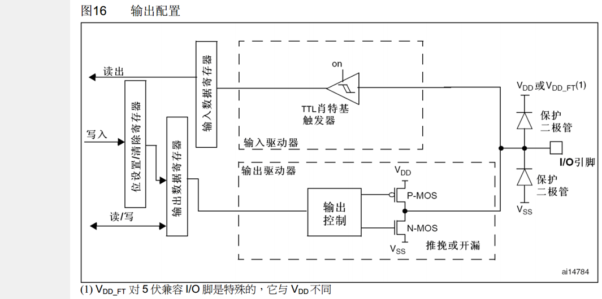

# 01 GPIO：引脚、八种模式与 HAL 读写

## 本章问题

GPIO 是所有外设的地基：LED 要输出电平，按键要读回电平，串口和 I2C 最终也落在具体引脚上。本章回答三个问题：引脚名字怎么读、八种模式各在什么场合用、“写 0”和“LED 亮”之间是什么关系。

## 学习目标

- 识别 STM32F103 的引脚分组和特殊引脚。
- 按用途选择 GPIO 模式、上下拉和输出速度。
- 用 HAL 写出 LED 与按键程序。
- 根据现象定位接线和配置错误。

## 1. 引脚、端口与复用

### 1.1 端口和编号

STM32F103C8T6 的 GPIO 按字母分组，每组最多 16 个引脚，编号 `0`~`15`：

```text
GPIOA: PA0 ... PA15
GPIOB: PB0 ... PB15
GPIOC: PC13、PC14、PC15
GPIOD: PD0、PD1
```

`GPIOC` 只有 13~15、`GPIOD` 只有 0~1，是因为 48 脚封装扣掉电源、晶振和调试引脚后，能分给 GPIO 的只剩这么多。

代码里端口和编号分开写：`PA9` 对应 `GPIOA` 与 `GPIO_PIN_9`，`PC13` 对应 `GPIOC` 与 `GPIO_PIN_13`。HAL 用一个端口指针加一个 16 位掩码定位引脚，所以参数总是“端口 + 编号”两项。


每个端口由寄存器和驱动器两部分组成。寄存器挂在 `APB2` 总线上，CPU 写的是寄存器，电流要经驱动器才到引脚。

### 1.2 特殊引脚

| 引脚 | 作用 |
| --- | --- |
| `VDD` / `VSS` | 电源正端 / 地，接线时常写作 `VCC` / `GND` |
| `VBAT` | 后备域电源 |
| `NRST` | 复位输入 |
| `BOOT0` | 启动模式选择 |
| `PC14/PC15` | 常用作低速外部晶振 `LSE` |
| `PD0/PD1` | 常用作高速外部晶振 `HSE` |
| `PA13 (SWDIO)` / `PA14 (SWCLK)` | SWD 数据线 / 时钟线 |
| `PA15` / `PB3` / `PB4` | JTAG 引脚 |

电源、复位、晶振和启动配置引脚都不能当普通 GPIO 用。`NRST` 被误碰会随机复位；`BOOT0` 决定上电从哪里启动；`PA13`/`PA14` 是下载调试的生命线，被占用后可能无法下载。`PA15`、`PB3`、`PB4` 复位后默认是 JTAG 功能，要当普通 GPIO 必须先关闭 JTAG。

### 1.3 复用

一个引脚内部连着一排开关，配置决定它接到 GPIO 单元，还是接到串口、定时器等外设。`PA9` 既可以是普通 GPIO，也可以是 `USART1_TX`。启用 USART1 后，这个引脚由串口外设控制，应用代码不能再用 GPIO API 翻转它。

所以实验二把 `PA9` 当按键用之后，就不能同时把它分配给 USART1。

## 2. 八种工作模式

方向只有输入和输出两种，八种模式是方向、输出结构和控制权三件事的组合：

| 方向 | 模式 | 典型用途 |
| --- | --- | --- |
| 输出 | 通用输出推挽 | LED、数字控制线 |
| 输出 | 通用输出开漏 | I2C、线与逻辑、需要外部上拉的信号 |
| 复用输出 | 复用输出推挽 | USART、SPI、定时器输出 |
| 复用输出 | 复用输出开漏 | 外设的开漏复用功能 |
| 输入 | 输入浮空 | 外部电路始终提供确定电平 |
| 输入 | 输入上拉 | 按键断开时默认读 `1` |
| 输入 | 输入下拉 | 按键断开时默认读 `0` |
| 模拟 | 模拟输入 | ADC 采样，不作数字读取 |

### 2.1 推挽与开漏

推挽输出内部有两个开关：上管接 `VDD`，下管接 `VSS`。写 `0` 时下管导通，引脚被拉到地；写 `1` 时上管导通，引脚被拉到电源。高低电平都有管子主动出力，边沿快、驱动能力强。

开漏输出去掉了上管，只留下管。写 `0` 时引脚被拉到地，写 `1` 时下管也断开，引脚呈高阻态，电平由外部电路决定。要得到稳定的高电平，必须外接上拉电阻。

开漏适合多设备共用一条总线。如果两个推挽输出一个拉高、一个拉低，电源到地会形成短路；开漏输出只会拉低，任何一方拉低总线就是低电平，不会互相冲突。I2C 的 `SCL`、`SDA` 就是靠这个机制工作的。



### 2.2 通用与复用

通用输出的控制权在用户代码，`HAL_GPIO_WritePin()` 写哪个引脚就改哪个引脚。复用输出把控制权交给外设，启用 `USART1_TX` 后波形由串口逻辑产生，同一引脚不能再当普通 GPIO 用。

### 2.3 三种数字输入

输入模式相当于用高内阻电压表观察外部电平，几乎不取电流。它们的区别只在于外部没有驱动时引脚读到什么：

- 浮空输入：内部不接电阻，引脚悬空，干扰会让读数在 0/1 之间乱跳；
- 上拉输入：内部经弱电阻接 `VDD`，无驱动时默认读 `1`；
- 下拉输入：内部经弱电阻接 `VSS`，无驱动时默认读 `0`。

按键、开关这类可能断开的信号，必须给一个默认电平，否则读数不确定。以按键一端接地为例，配上拉后松开读 `1`，按下时触点把引脚接到地，读 `0`。

模拟输入会关闭数字输入通路，只供 ADC 使用，不能当普通输入判断 0/1。

### 2.4 怎么选

| 任务 | 推荐配置 | 初始电平 | 有效电平 |
| --- | --- | --- | --- |
| 引脚经电阻接 LED 阳极，高电平亮 | 输出推挽 | `Low` | 高 |
| 阳极接电源、阴极接引脚，低电平亮 | 输出推挽或开漏 | `High` | 低 |
| 按键一端接 `GND` | 输入上拉 | — | 低（按下） |
| 按键一端接 `VDD` | 输入下拉 | — | 高（按下） |
| 采集模拟电压 | 模拟输入 | — | — |
| 串口、定时器等外设信号 | 复用输出 | 由外设决定 | 由外设决定 |

初始电平和有效电平是两件事。初始电平只在引脚刚配成输出的瞬间起作用，用来避免上电闪烁；有效电平由电路接法决定，决定写 `SET` 还是 `RESET` 才能点亮。板载 LED 就是初始写 `High`（上电灭）、点亮靠写 `RESET`。

## 3. 输出速度

电平从 0 跳到 1 需要时间，速度档位决定边沿有多陡：

| 档位 | 上升/下降时间（参考） | 可用频率上限 |
| --- | ---: | ---: |
| 低速 | 约 `125 ns` | 约 `2 MHz` |
| 中速 | 约 `25 ns` | 约 `10 MHz` |
| 高速 | 约 `5 ns` | 约 `50 MHz` |

档位是能力上限，不是必须达到的频率。LED 以 1 Hz 闪烁，选低速绰绰有余。档位只影响边沿快慢，不改变逻辑电平。LED 和低速控制线用低速，SPI、定时器等较快信号再按需选中速或高速。

## 4. HAL 的 GPIO 接口

### 4.1 初始化顺序

```text
HAL_Init()
→ SystemClock_Config()
→ MX_GPIO_Init()
→ 其他外设初始化
→ while (1)
```

`HAL_Init()` 启动 SysTick 时基，`HAL_Delay()` 靠它计数；`SystemClock_Config()` 把主频配到 72 MHz；`MX_GPIO_Init()` 配置引脚。顺序不能调换，时钟没起来就配置外设不会生效。

以实验一为例，`Core/Src/gpio.c` 中的初始化函数是：

```c
void MX_GPIO_Init(void)
{
  GPIO_InitTypeDef GPIO_InitStruct = {0};

  /* 先开端口时钟 */
  __HAL_RCC_GPIOC_CLK_ENABLE();
  __HAL_RCC_GPIOD_CLK_ENABLE();
  __HAL_RCC_GPIOA_CLK_ENABLE();

  /* 先写初始电平，再改模式，避免上电毛刺 */
  HAL_GPIO_WritePin(GPIOC, GPIO_PIN_13, GPIO_PIN_SET);
  HAL_GPIO_WritePin(GPIOA, GPIO_PIN_9, GPIO_PIN_RESET);

  GPIO_InitStruct.Pin = GPIO_PIN_13;
  GPIO_InitStruct.Mode = GPIO_MODE_OUTPUT_OD;
  GPIO_InitStruct.Pull = GPIO_NOPULL;
  GPIO_InitStruct.Speed = GPIO_SPEED_FREQ_LOW;
  HAL_GPIO_Init(GPIOC, &GPIO_InitStruct);

  GPIO_InitStruct.Pin = GPIO_PIN_9;
  GPIO_InitStruct.Mode = GPIO_MODE_OUTPUT_PP;
  GPIO_InitStruct.Pull = GPIO_NOPULL;
  GPIO_InitStruct.Speed = GPIO_SPEED_FREQ_LOW;
  HAL_GPIO_Init(GPIOA, &GPIO_InitStruct);
}
```

第一步必须是开时钟。STM32 每个外设都有独立的时钟开关，默认关闭，时钟没开时写寄存器不会生效。

第二步是先写电平、再改模式。引脚配成输出的瞬间，电平由输出数据寄存器 `ODR` 决定，而它的复位值是 `0`。如果先调用 `HAL_GPIO_Init()`，`PC13` 会先变低，板载 LED 会闪一下才熄灭。

### 4.2 读、写、翻转、延时

```c
void HAL_GPIO_WritePin(GPIO_TypeDef *GPIOx, uint16_t GPIO_Pin,
                       GPIO_PinState PinState);
GPIO_PinState HAL_GPIO_ReadPin(GPIO_TypeDef *GPIOx, uint16_t GPIO_Pin);
void HAL_GPIO_TogglePin(GPIO_TypeDef *GPIOx, uint16_t GPIO_Pin);
void HAL_Delay(uint32_t Delay);
```

`GPIOx` 是端口，如 `GPIOA`；`GPIO_Pin` 是引脚掩码，如 `GPIO_PIN_9`；`PinState` 取 `GPIO_PIN_SET`（写 1）或 `GPIO_PIN_RESET`（写 0）。`HAL_GPIO_ReadPin()` 返回这两个枚举之一，读的是引脚真实电平，输出模式下也能读回当前状态。

`HAL_Delay()` 的参数单位是毫秒，`HAL_Delay(500U)` 是半秒。它靠 SysTick 中断计数，适合入门实验；需要精确周期或不阻塞时，应改用定时器。

## 5. 实验一：LED 闪烁

目标是让板载 LED 和外接 LED 同亮同灭，亮 500 ms、灭 500 ms，用两种相反的有效电平说明“写电平 + 知道接法”。

### 5.1 接线

- 板载 LED 接 `PC13`，常见的接法是阳极经板载电阻接 `VDD`、阴极接 `PC13`，写 `0` 点亮，属低电平有效；
- 外接 LED 从 `PA9` 经限流电阻接阳极、阴极接 `GND`，写 `1` 点亮，属高电平有效。

限流电阻不能省。LED 导通后压降基本固定，剩下的电压若没有电阻承担，电流就只受引脚内阻限制，可能烧坏 LED 和引脚。阻值可在 `470 Ω~1 kΩ` 之间选，再按颜色和目标电流调整：

$$
I \approx \frac{3.3\,\mathrm{V}-V_f}{R}
$$

其中 $V_f$ 是 LED 正向压降。LED 长脚一般为阳极，短脚为阴极；也不要把 5 V 直接接到 `PA9`。

### 5.2 CubeMX 配置

1. 打开 `.ioc`，确认 `System Core → SYS → Debug` 为 `Serial Wire`。
2. 点 `PC13`，选 `GPIO_Output`，在 `GPIO` 面板设置：初始电平 `High`，模式 `Output Open Drain`，无上下拉，速度 `Low`。
3. 点 `PA9`，选 `GPIO_Output`，设置：初始电平 `Low`，模式 `Output Push Pull`，速度 `Low`。
4. 确认 `Toolchain/IDE` 仍是 `CMake`，点 `GENERATE CODE`。

`PC13` 驱动板载 LED 只灌电流，推挽和开漏都能点亮；这里用开漏，与第 00 章的推挽配置形成对照，实验二沿用这个配置。

### 5.3 主循环

```c
while (1)
{
    /* PC13 低电平点亮，PA9 高电平点亮 */
    HAL_GPIO_WritePin(GPIOC, GPIO_PIN_13, GPIO_PIN_RESET);
    HAL_GPIO_WritePin(GPIOA, GPIO_PIN_9, GPIO_PIN_SET);
    HAL_Delay(500U);

    HAL_GPIO_WritePin(GPIOC, GPIO_PIN_13, GPIO_PIN_SET);
    HAL_GPIO_WritePin(GPIOA, GPIO_PIN_9, GPIO_PIN_RESET);
    HAL_Delay(500U);
}
```

两行写电平的含义相反，靠的都是“知道接法”。

下载后两个 LED 应每 500 ms 交替亮灭一次，周期 1 s。

## 6. 实验二：按键控制 LED

目标是按住按键时板载 LED 亮，松开熄灭，走通“读输入 → 判断 → 写输出”。

先断电拆掉实验一接在 `PA9` 上的外接 LED。按键一端接 `PA9`，另一端接 `GND`，`PA9` 配成上拉输入：松开时内部上拉把引脚拉到高，读 `1`；按下时触点接地，读 `0`。

CubeMX 中 `PC13` 保持实验一的配置，把 `PA9` 改成 `GPIO_Input`，`GPIO mode` 选 `Input mode`，上下拉选 `Pull-up`。若漏配上拉，引脚浮空，读数会随机跳变。

```c
while (1)
{
    GPIO_PinState key = HAL_GPIO_ReadPin(GPIOA, GPIO_PIN_9);

    if (key == GPIO_PIN_RESET)
    {
        HAL_GPIO_WritePin(GPIOC, GPIO_PIN_13, GPIO_PIN_RESET);  /* 按下点亮 */
    }
    else
    {
        HAL_GPIO_WritePin(GPIOC, GPIO_PIN_13, GPIO_PIN_SET);    /* 松开熄灭 */
    }

    HAL_Delay(10U);   /* 轮询间隔 10 ms */
}
```

主循环每 10 ms 看一次按键，用 `if/else` 把输入映射到输出。程序不记录上一次的状态，只反映当前电平，所以按住多久亮多久，松手立刻灭。

## 7. 按键抖动与软件消抖

按键内部是两片金属触点，按下瞬间会弹跳几次才稳定接触。反映在电平上，就是在几毫秒内反复跳变：


按下和松手时的弹跳各约 `5~10 ms`，中间稳定段约 `50~200 ms`。

实验二这种“电平跟随”的用法对抖动不敏感，肉眼分辨不出那几毫秒的闪烁。但只要程序要数“按了几次”，抖动就会让一次按下被读成多次，计数和菜单选择全部失灵。

消抖的思路是：读到低电平后等 15 ms 越过弹跳区，再读一次，两次一致才算有效。还要等按键松开，否则按住不放会被反复计数。

在 `USER CODE BEGIN PV` 区域声明计数器：

```c
static uint32_t press_count = 0U;
```

把主循环换成：

```c
while (1)
{
    if (HAL_GPIO_ReadPin(GPIOA, GPIO_PIN_9) == GPIO_PIN_RESET)
    {
        HAL_Delay(15U);
        if (HAL_GPIO_ReadPin(GPIOA, GPIO_PIN_9) == GPIO_PIN_RESET)
        {
            press_count++;
            HAL_GPIO_TogglePin(GPIOC, GPIO_PIN_13);

            /* 等松手，避免重复计数 */
            while (HAL_GPIO_ReadPin(GPIOA, GPIO_PIN_9) == GPIO_PIN_RESET)
            {
                HAL_Delay(10U);
            }
        }
    }

    HAL_Delay(10U);
}
```

## 8. 用驱动库封装

前面直接调 `HAL_GPIO_*`，是为了看清底层链路。项目里通常把重复的消抖和电平取反封装成 `LED_*`、`Key_*`，主循环只保留语义。

`E:\ProjectStm\驱动库` 中的接口是：

```c
/* LED */
void LED_Init(void);
void LED_ON(void);
void LED_OFF(void);
void LED_Turn(void);

/* 按键 */
void Key_Init(void);
uint8_t Key_GetNum(void);    /* 有新按键返回 1~4，无则返回 0，读后自动清零 */
uint8_t Key_GetState(void);  /* 当前按住的键码，不消抖 */
void Key_Tick(void);         /* 每 1 ms 调用一次，内部 20 分频 */
```

把 `led.c`、`key.c` 和对应头文件复制到 `User/Drivers/`，按 [[00 从零建立HAL工程]] 第 5 节登记。`main()` 开头在 `MX_GPIO_Init()` 之后各调一次 `LED_Init()`、`Key_Init()`。

引脚不写在调用处，而是放在驱动顶部的宏里：

| 宏 | 默认值 | 说明 |
| --- | --- | --- |
| `LED_PORT` / `LED_PIN` | `GPIOC` / `GPIO_PIN_13` | 板载 LED |
| `LED_ON_LEVEL` | `GPIO_PIN_RESET` | 低电平点亮，高电平点亮的板子改成 `GPIO_PIN_SET` |
| `KEY1~KEY4_PORT/PIN` | `PB10`、`PB11`、`PA11`、`PA12` | 上拉输入，低电平按下 |
| `KEY_PRESSED_LEVEL` | `GPIO_PIN_RESET` | 按键接地时按下为低 |

实验二把按键接在 `PA9`，驱动库默认是 `KEY1 = PB10`。改用 `Key_GetNum()` 时二选一：把按键改接到 `PB10`，或把 `KEY1_PORT/KEY1_PIN` 改成 `GPIOA`/`GPIO_PIN_9`；只改代码不改接线（或反过来）会一直读不到按键。

实验一的主循环因此只剩：

```c
while (1)
{
    LED_Turn();
    HAL_Delay(500U);
}
```

实验二也不再需要阻塞式消抖，`Key_Tick()` 在后台每 20 ms 采样一次，主循环只取结果：

```c
uint8_t key = Key_GetNum();
if (key != 0U)
{
    LED_Turn();
}
```

`Key_GetNum()` 依赖一个 1 ms 的定时中断调用 `Key_Tick()`：

```c
void HAL_TIM_PeriodElapsedCallback(TIM_HandleTypeDef *htim)
{
    if (htim->Instance == TIM1)
    {
        Key_Tick();
    }
}
```

这个 1 ms 节拍由 `TIMER` 目录的 `Timer_Init()` 启动，定时器配置见第 05 章。`Timer_Init()` 只负责启动中断，回调仍要自己写在 `main.c` 里；`TIMER_INSTANCE` 换成别的定时器时，这里的判断也要跟着改。

这套 `LED_*`/`Key_*` 接口默认对应倒立摆的 `PC13` 和 `PB10/PB11/PA11/PA12`，宏表与 [[STM32倒立摆/03 基础驱动：CubeMX与HAL库实现#1.5 与入门教程共用驱动]] 的对照表一致；换板时只改宏和 CubeMX，调用代码不动。

上一篇：[[00 从零建立HAL工程]] ｜ 下一篇：[[02 OLED 调试：I2C 显示数据流]]
