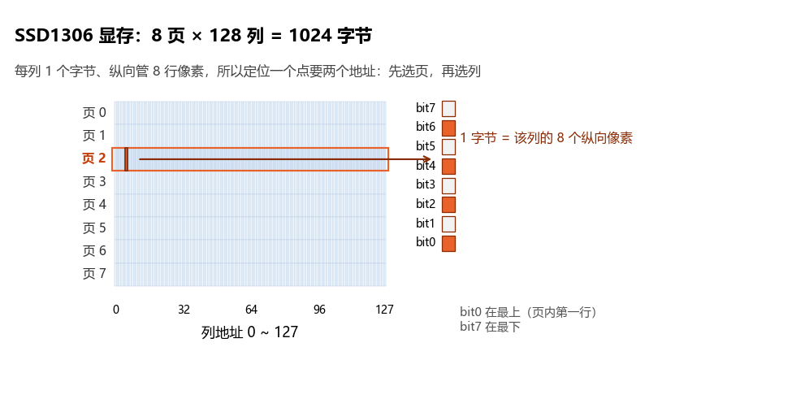

# 02 OLED 调试：I2C 显示数据流

## 本章问题

<<<<<<< Updated upstream
怎样让 I2C2、SSD1306 和显示缓冲区组成一条可以观察的显示链？

第 01 章中，`HAL_GPIO_WritePin()` 让 LED 的状态立刻可见。本章把这条链路扩展到一块 0.96 寸 OLED：让屏幕显示文字、数字和图形。后续 ADC、传感器等实验都可以把变量和运行状态显示在屏幕上，减少对外部仪器的依赖。屏幕与 STM32 只有两根信号线，数据如何传过去？本章以硬件 `I2C2` 外设和 SSD1306 控制器为例，完整追踪“应用代码修改显存 → I2C 事务 → 屏幕更新”的数据流。

## 学习目标

- 配置 `I2C2`、`PB10/PB11` 和 `hi2c2`，知道 CubeMX 里每个字段填什么、填错会怎样；
- 区分 SSD1306 的 7 位地址与软件线上地址字节，明白 `0x3C` 和 `0x78` 是同一个地址的两种写法；
- 看懂 `oled.c` 驱动的关键函数（初始化序列、清屏、写字符、显存写入），以及每次 I2C 事务在线上到底发了什么；
- 用帧接口显示文字、变量和图形；
- 按供电、地址和总线现象定位故障，能解释全黑、花屏、错位、乱码各对应什么问题。

## 0. 先建立直觉：第一次见 I2C 和点阵屏

如果你从没接触过 I2C，先跳过本节直接照抄配置也能把屏幕点亮——但出了任何问题你就无从下手。本节用三个直觉模型把 I2C 和 OLED 的基本原理讲清楚，后面所有配置和代码都能对应回这里。

### 0.1 两根线怎么传一串数据

I2C（Inter-Integrated Circuit）是一种**同步串行**总线：一根线传时钟、一根线传数据，两根线配合把一串字节一位一位地送出去。

- **SCL（时钟线）像打拍子**：发送方（主机）在 SCL 上产生一串方波，每一拍对应一个数据位；
- **SDA（数据线）像递纸条**：SCL 处于**低电平**时，发送方把下一位放到 SDA 上；SCL 拉到**高电平**期间，接收方读取 SDA——拍子停一下，纸条递出一张。

一个字节数据 = 连续 8 拍，高位（bit7）先发。第 9 拍是**应答位（ACK）**：接收方把 SDA 拉低，表示"我收到了"；如果这一拍 SDA 保持高电平，就是无应答（NACK）——这是后面排查"地址无应答"问题的直接依据。

一次完整的 I2C 通信有头有尾：`起始信号 → 地址字节 → 应答 → 数据字节 → 应答 → … → 停止信号`。**起始信号**是 SCL 高电平期间 SDA 由高变低（总线上所有人都注意到"要开始了"），**停止信号**是 SCL 高电平期间 SDA 由低变高（"说完了"）；起始和停止只能由主机发起——这就是"主机控制总线"。

### 0.2 一条总线上怎么"叫对"设备：主从与地址

I2C 总线上可以同时挂多个设备，但任何时候只允许一个主机（这里就是 STM32）发起通信。主机在起始信号后紧跟发送一个**地址字节**，相当于点名："这个编号的设备请注意，接下来是说给你听的。"总线上所有从机都听得见，但只有地址对得上的那一个会应答。

地址字节的结构是 **7 位地址 + 1 位读/写方向**：

```text
7 位从机地址       读写位      线上地址字节
0b0111100 (0x3C)   0 = 写      0b01111000 = 0x78
0b0111101 (0x3D)   0 = 写      0b01111010 = 0x7A
```

看清楚这个对应关系，两个常见困惑就解开了：

- SSD1306 手册上标的地址是 7 位的 `0x3C`，而很多代码里写 `0x78`——它们不是两个地址，`0x78` 就是 `0x3C` 左移一位、补上"写"方向位 0 之后的**线上字节**。主机发送（写）时该位为 0，读取（读）时为 1；
- 一条总线上每个设备必须占用不同的 7 位地址。OLED 的 `0x3C/0x3D` 由模块上的地址焊脚决定，同一个 I2C2 上还可以再挂其他不同地址的传感器。

本章的 STM32 是主机，SSD1306 是从机；SSD1306 没有可读的数据，STM32 只发不收，所以只用到"写"方向。

### 0.3 点阵屏怎么点亮一个像素：GDDRAM、页、列

0.96 寸 OLED 的分辨率是 `128x64`：横向 128 列、纵向 64 行像素，每个像素只有亮和灭两种状态（单色屏）。控制这块屏的芯片叫 SSD1306，它内部有一块显存，叫 **GDDRAM**——屏幕上每个像素都对应 GDDRAM 里的一个位，位是 1 就亮、是 0 就灭。**只要把 GDDRAM 里的位写对，屏幕就会自动持续显示对应画面**（SSD1306 自己负责反复扫描刷新这些位到物理像素上）。

GDDRAM 的组织方式不是"一行一行"的，而是**按页（Page）分层**：64 行像素分成 8 页、每页管 8 行，每页 128 列、每列对应 GDDRAM 里**一个字节**。

- 一个字节的 8 个位按纵向排列，bit0 对应页内**最上面**一行像素，bit7 对应最下面一行（这个映射方向从本章驱动 `OLED_SetPixel()` 的实现可以读出，见第 4 节）。

```text
GDDRAM = 8 页 × 128 列字节

         列0     列1    ...   列127
页0   [字节]   [字节]   ...  [字节]    管 y = 0~7
页1   [字节]   [字节]   ...  [字节]    管 y = 8~15
 ...
页7   [字节]   [字节]   ...  [字节]    管 y = 56~63

一个字节 = 一列 8 个像素：bit0 对应该页最上面一行，bit7 对应最下面一行
```

于是"点亮屏幕"归结为一件事：STM32 通过 I2C 把 8×128=1024 个字节按页写进 SSD1306 的 GDDRAM。本章驱动在这之上做了一层封装：先在 STM32 自己的内存里准备好这 1024 个字节（显存），再一次性发过去。

## 1. 显示数据流与驱动配置

应用代码先修改 MCU 内存中的显存，再把整帧发送给 SSD1306：

```text
CubeMX 配置 I2C2
        ↓
MX_I2C2_Init() 创建并初始化 hi2c2
        ↓
OLED_Init() 初始化 SSD1306
        ↓
OLED_NewFrame() 清空显存
        ↓
文字/变量/图形函数修改显存
        ↓
OLED_ShowFrame() 逐页发送整帧
        ↓
OLED 屏幕更新
```

为什么要有"先画进显存、再整帧发送"这个两步流程？因为 I2C 写 GDDRAM 的速度有限（第 8 节会算：一帧约 100 ms）。如果每画一个字符就直接写屏，画面会一个字一个字地"蹦"出来；先在 RAM 里秒速画完，再统一发送，屏幕上看到的是"啪"一下整屏出现。

本章使用 SSD1306、`128x64` 单色屏和硬件 `I2C2`：

| 项目 | 配置 |
| --- | --- |
| 控制器 | SSD1306 |
| 分辨率 | `128x64`，8 页、每页 128 列 |
| 总线 | `I2C2`，句柄 `hi2c2` |
| HAL 地址参数 | `0x78`（本课程 STM32F1 HAL 使用已左移的地址字节） |
| 7 位从机地址 | 默认假定为 `0x3C`，须用模块资料或扫描确认 |
| 刷新方式 | 在 MCU 显存绘制后整帧刷新 |

驱动文件在配套工程 `HAL02_OLED_I2C2` 的 `User/Drivers/OLED/` 下，注意文件名是**小写**的：`oled.c`（驱动实现：显存、绘图、文字、I2C 发送）、`oled.h`（驱动接口：函数原型与颜色模式枚举）、`font.c`（字模数据：ASCII 字库、中文字库、示例图片）、`font.h`（字体结构体定义）。这两个文件改编自开源项目「波特律动 OLED 驱动」，示例画面中的「波特律动」与示例图片即原项目的示例内容，特此说明来源。第 09 章的软件 I2C 工程里是另一套实现（文件名为 `OLED.c`）：Windows 文件系统对大小写不敏感，同名文件放进同一目录会互相覆盖，所以两套驱动靠"放在各自工程的独立目录"区分；不要把两套实现同时加入编译，否则会出现重定义或链接到错误实现。

将 `oled.c`、`font.c` 加入编译，并让 `oled.h`、`font.h` 可被包含（登记方法见 [[00 从零建立HAL工程]] 第 5 节：根目录 `CMakeLists.txt` 的 `target_sources` 加源文件、`target_include_directories` 加头文件目录）。5.3 节会先带你从 0 写一个约 30 行的最小驱动，打通"显存 → I2C → 屏幕"的主干，之后再用这套完整驱动做文字、图形和中文显示。

配套工程还需要 CubeMX 侧的两个登记（生成工程时已自动完成）：`cmake/stm32cubemx/CMakeLists.txt` 中加入 `Core/Src/i2c.c` 和 HAL 的 `stm32f1xx_hal_i2c.c`；`Core/Inc/stm32f1xx_hal_conf.h` 中 `HAL_I2C_MODULE_ENABLED` 处于启用状态。漏掉后者时，HAL 的 I2C 函数原型整个不可见，编译会报函数未声明。

## 2. 硬件连接与总线前提

四针 I2C OLED 通常有 `GND`、`VCC`、`SCL`、`SDA`：

| OLED | STM32F103C8T6 常见连接 | 作用 |
| --- | --- | --- |
| `GND` | `GND` | 共地 |
| `VCC` | `3.3 V` 或模块规定的电源 | 供电 |
| `SCL` | `PB10 / I2C2_SCL` | 时钟 |
| `SDA` | `PB11 / I2C2_SDA` | 数据 |

```text
PB10 / I2C2_SCL  --------  SCL
PB11 / I2C2_SDA  --------  SDA
3.3 V            --------  VCC
GND              --------  GND
```

屏幕与 STM32 必须共地，`SCL`、`SDA` 不能接反。I2C 使用开漏输出，并依靠上拉电阻恢复高电平；成品模块可能已经带上拉，仍应查阅模块资料确认。逻辑信号按 `3.3 V` 处理，不要把不兼容的 `5 V` 直接接到 STM32 IO。

"开漏 + 上拉"值得多说一句，因为它是 I2C 硬件问题的根源：**开漏输出只能主动把线拉到低电平，不能主动输出高电平**——松手之后线是悬空的，必须靠一个外部电阻把线"拽"回 3.3 V（这就是上拉电阻）。没有上拉电阻，总线永远回不到高电平，起始信号、ACK 应答都无从谈起，屏幕自然点不亮（见第 10 节）；上拉电阻越大，"拽回来"越慢，允许的总线速率越低——本章用 `100 kHz` 的低速，常见的 `4.7 kΩ` 级模块上拉都够用，想要 `400 kHz` 快速模式时，上拉阻值和线长就要讲究一些。

另外要注意：STM32F1 系列在复用输出模式下**没有内部上拉电阻可用**（HAL 的 GPIO 初始化只在输入模式下处理上拉配置，本工程 `HAL_I2C_MspInit()` 生成的复用开漏配置同样没有内部上拉），所以硬件 I2C2 的上拉只能来自外部电阻或模块自带电阻。

STM32F103C8T6 的 `PB10/PB11` 同时是 USART3 默认 TX/RX，本封装没有可用的替代映射，因此硬件 I2C2 OLED 与 USART3 蓝牙实验通常冲突；需要共存时，改用第 09 章 [[09 I2C：总线时序与软件 I2C 驱动 OLED]] 的 `PB8/PB9` 软件 I2C 方案——软件 I2C 用普通 GPIO 翻转电平模拟时序，引脚可以任选，代价是占用 CPU 时间，且不能与本章硬件驱动混用（混用症状见第 10.2 节）。

## 3. 地址、句柄与初始化

驱动底层发送函数直接使用 `hi2c2` 与 `OLED_ADDRESS`（节选自 `User/Drivers/OLED/oled.c`）：

```c
// OLED器件地址
#define OLED_ADDRESS 0x78
#define OLED_I2C_TIMEOUT_MS 100U

static void OLED_Send(uint8_t *data, uint16_t len)
{
  HAL_I2C_Master_Transmit(&hi2c2, OLED_ADDRESS, data, len, OLED_I2C_TIMEOUT_MS);
}
```

逐行看这段"所有 I2C 流量的总出口"：

- `hi2c2` 是 I2C2 外设的**句柄**——HAL 用一个结构体代表一个外设实例，装着外设寄存器地址、配置参数和运行状态；所有 HAL I2C 函数的第一个参数都是它，"对哪个外设说话"由它决定；
- `OLED_ADDRESS`（`0x78`）就是第 0.2 节说的线上地址字节：`0x3C << 1 | 写方向 0`；
- `data`/`len` 是要发送的载荷。"起始信号、地址字节、ACK 等待、数据逐字节、停止信号"全部由 HAL 打包，调用者只管给载荷；
- `OLED_I2C_TIMEOUT_MS`（`100U`）是超时：HAL 等待 ACK 或总线空闲时若超过 100 ms 仍不成功，就放弃并返回错误状态。这里使用 `100U` 有限超时，不使用 `HAL_MAX_DELAY` 无限等待——否则总线一旦故障（比如没接上拉），程序会永远卡死在这次调用里，连"主循环还在跑"这个判断依据都没有了。入门示例忽略 `OLED_Send()` 的返回值，出现问题时通过 ACK 和总线波形定位。

STM32F1 HAL 的相关函数签名为：

```c
HAL_StatusTypeDef HAL_I2C_Master_Transmit(I2C_HandleTypeDef *hi2c,
                                          uint16_t DevAddress,
                                          uint8_t *pData,
                                          uint16_t Size,
                                          uint32_t Timeout);
HAL_StatusTypeDef HAL_I2C_IsDeviceReady(I2C_HandleTypeDef *hi2c,
                                        uint16_t DevAddress,
                                        uint32_t Trials,
                                        uint32_t Timeout);
```

工程内 HAL 源码对 `DevAddress` 参数的注释原文（英文）是 *"The device 7 bits address value in datasheet must be shifted to the left before calling the interface"*，意思是"数据手册中的 7 位地址必须在调用前左移"。这就是 `0x78` 写法的官方依据。

SSD1306 常见的 7 位地址是 `0x3C`，部分模块配置为 `0x3D`。本课程 STM32F1 HAL 的地址宏要求传入已经左移的地址字节：

| 实物 7 位地址 | HAL 地址参数 |
| ---: | ---: |
| `0x3C` | `0x78` |
| `0x3D` | `0x7A` |

因此模块确认是 `0x3C` 时，`HAL_I2C_IsDeviceReady()` 和 `HAL_I2C_Master_Transmit()` 都传 `0x78`；若实际是 `0x3D`，同步修改 `OLED_ADDRESS` 和探测代码。不同 STM32 HAL 版本的地址约定可能不同，升级 HAL 后要重新核对头文件和生成代码。

### 3.1 CubeMX 配置与调用顺序

在 CubeMX 里点这些菜单、填这些字段（字段名以 CubeMX 6.17 为准，填错后果一并列出）：

1. 在 `SYS` 中保留 `Serial Wire`。这是下载调试口，丢了 ST-LINK 就连不上芯片；误把 `PA13/PA14` 配成普通 GPIO 同样会导致下载失败；
2. 左侧 `Connectivity → I2C2`，把 `Mode` 下拉框选为 `I2C`。芯片图上 `PB10`、`PB11` 自动变绿并标注 `I2C2_SCL`、`I2C2_SDA`——不需要手动点引脚。确认这两个标注没有张冠李戴（接反了 SCL/SDA，总线上什么也不会发生）；
3. `Parameter Settings` 中逐项确认（对应生成代码 `i2c.c` 的 `hi2c2.Init`）：

| CubeMX 字段 | 本工程取值 | 生成代码对应 | 填错的后果 |
| --- | --- | --- | --- |
| I2C Speed Mode | Standard Mode | （由 Clock Speed 推导） | 误选 Fast 而上拉/接线没跟上，波形变差、通信不稳 |
| I2C Clock Speed (Hz) | `100000` | `hi2c2.Init.ClockSpeed = 100000` | HAL 限定该值不超过 `400000`；填 `400000` 时 CubeMX 会自动切到 Fast 模式并要求配置 Duty Cycle |
| Fast Mode Duty Cycle | Duty Cycle 2 | `I2C_DUTYCYCLE_2` | 只在 Fast 模式下生效，Standard 模式填什么都不影响 |
| Clock No Stretch Mode | Disabled | `I2C_NOSTRETCH_DISABLE` | 保持默认即可 |
| I2C Addressing Mode | 7-bit | `I2C_ADDRESSINGMODE_7BIT` | 这是**本机作为从机**时 `Own Address` 的格式，与 OLED 的地址位数无关——最常见的新手误解就在这里 |
| I2C Own Address1 | `0` | `hi2c2.Init.OwnAddress1 = 0` | 本工程 STM32 只当主机，保持 0 |
| General Call Address Detection | Disabled | `I2C_GENERALCALL_DISABLE` | 保持默认即可 |

   入门阶段把 SCL 速率设为 `100 kHz`（对应 `hi2c2.Init.ClockSpeed = 100000`）；`I2C2` 位于 APB1，HAL 内部按 `HAL_RCC_GetPCLK1Freq()` 读到的 APB1 时钟来计算分频，所以修改系统时钟后要检查该值。本章配套工程沿用了 CubeMX 默认的 HSI 8 MHz 时钟——I2C 显示对主频没有要求，这恰好说明外设时钟来自分频链、实验能否跑通与"主频是不是最高"无关；如何把主频配到 72 MHz 是第 03 章的主题。STM32F1 的 `I2C_InitTypeDef` 没有新系列芯片常见的 `Timing` 字段，不能照搬 F4/F7 配置；
4. 点 `GENERATE CODE`，然后检查生成的 `i2c.c`：应存在全局定义 `I2C_HandleTypeDef hi2c2`、`MX_I2C2_Init()` 函数，且文件底部的 `HAL_I2C_MspInit(I2C2Handle)` 将 `PB10/PB11` 配为 `GPIO_MODE_AF_OD`（复用开漏）。MspInit 还自动打开了 GPIOB 和 I2C2 的时钟——这些"底层杂活"由 HAL 自动完成，不需要手写，但要知道它们发生在哪；
5. 按以下顺序执行，不能在 `MX_I2C2_Init()` 之前调用 OLED 驱动：

```text
HAL_Init()
-> SystemClock_Config()
-> MX_I2C2_Init()
-> HAL_Delay(20U)
-> HAL_I2C_IsDeviceReady(&hi2c2, 0x78U, 3U, 100U)
-> OLED_Init()
```

   这个顺序每一环都有理由：`MX_I2C2_Init()` 没执行时 `hi2c2` 还是空壳，驱动一调用就超时报错；`HAL_Delay(20U)` 是因为 STM32 启动比 OLED 模块上电快，给模块留出稳定时间（驱动文件头注释也要求如此）；`HAL_I2C_IsDeviceReady()` 发一次地址探测（参数 `3U` 表示试 3 次，`100U` 是超时毫秒数），确认 `0x78` 上有设备应答才继续，否则进入 `Error_Handler()`。

当前驱动使用阻塞式 `HAL_I2C_Master_Transmit()`，每次调用等到发送完成（或超时）才返回，入门实验不需要额外开启中断或 DMA。若改用 `I2C1`，必须同时修改驱动句柄、CubeMX 配置和实际接线。I2C2 的 GPIO 复用可回到 [[01 GPIO：引脚、八种模式与 HAL 读写]]，APB1 时钟来源见 [[03 时钟系统：时钟树、PLL 与 HAL 配置]]。

### 3.2 OLED_Init() 逐段讲解：初始化序列都发了什么

`OLED_Init()` 做的事是把一堆配置命令逐条写进 SSD1306。每次 `OLED_SendCmd(cmd)` 在线上产生一次完整的 I2C 事务：`起始 → 0x78（地址+写）→ 0x00（控制字节：后随字节是命令）→ cmd → 停止`。其中 `0x00` 这个控制字节告诉 SSD1306"收到的是命令而不是显示数据"——命令和数据走同一条线，全靠它区分（显示数据用 `0x40`，见第 4 节）。

整个初始化序列按功能分六段（下面按功能归组讲解，不严格按发送顺序排列，实际顺序以 `oled.c` 中 `OLED_Init()` 为准）：

1. **关显示**：`0xAE`。改配置前先让屏幕闭眼，避免半配置状态下的画面闪烁；
2. **寻址与扫描方向**：`0x20` + `0x10` 设置 GDDRAM 为页寻址模式（正好配合第 4 节逐页刷新的方式）；`0xB0` 页地址归 0；`0x00`、`0x10` 把列地址低 4 位、高 4 位都清 0（列从 0 开始）；`0x40` 显示起始行设为第 0 行；`0xC8` 设置 COM（行）扫描方向；
3. **面板参数**：`0xA1` 段（列）映射、`0xA6` 正常显示（非反色）、`0xA8` + `0x3F` 复用率 64 行（对应 64 行像素）、`0xA4` 按 GDDRAM 内容显示、`0x81` + `0xDF` 对比度 0xDF、`0xD3` + `0x00` 显示偏移、`0xD5` + `0xF0` 内部时钟与分频、`0xD9` + `0x22` 预充电周期、`0xDA` + `0x12` COM 引脚配置、`0xDB` + `0x20` VCOMH 电平。这一段是"屏幕出厂调校"，初学照抄即可；但它不是魔法——把对比度参数 `0xDF` 改成 `0x00`（最暗）或 `0xFF`（最亮）重新编译下载，屏幕亮度应有明显变化。改一条命令、看一个现象，是消化初始化序列最直接的办法；
4. **电荷泵**：`0x8D` + `0x14` 开启内部电荷泵。OLED 像素需要的电压比 3.3 V 高，模块靠 SSD1306 内部的升压电路（电荷泵）供电，不开它整屏永远点不亮；
5. **清一帧空白**：先调用 `OLED_NewFrame()` + `OLED_ShowFrame()`，把 1024 字节显存清零并发送一整帧空白，保证开屏瞬间画面是确定的，而不是 GDDRAM 里残留的随机内容；
6. **开显示**：`0xAF`。从此屏幕持续显示 GDDRAM 的内容。

移植到其他控制器时，整个 `OLED_Init()` 都要按新芯片的命令集重写——驱动注释里也把这两个函数（`OLED_Send()` 和 `OLED_Init()`）标注为移植时的关键函数。

## 4. 显存与刷新边界

驱动维护一块页式显存：

```c
uint8_t OLED_GRAM[8][128];
```

第一维是页号（0~7），第二维是列号（0~127），共 1024 字节，正好镜像 SSD1306 的 GDDRAM——你在 `OLED_GRAM` 里画了什么，`OLED_ShowFrame()` 一发，屏幕就是什么。

坐标原点在左上角：`x=0~127` 向右增加，`y=0~63` 向下增加。SSD1306 按页组织纵向像素，每页对应 8 行：

```text
OLED_GRAM[0][x] -> y = 0~7
OLED_GRAM[1][x] -> y = 8~15
...
OLED_GRAM[7][x] -> y = 56~63
```

"一个字节管一列 8 行"的位映射直接写在这段代码里：

```c
void OLED_SetPixel(uint8_t x, uint8_t y, OLED_ColorMode color)
{
  if (x >= OLED_COLUMN || y >= OLED_ROW)
    return;                              /* 越界直接丢弃，不会写坏别的像素 */
  if (!color)
  {
    OLED_GRAM[y / 8][x] |= 1 << (y % 8); /* OLED_COLOR_NORMAL(0)：点亮该位 */
  }
  else
  {
    OLED_GRAM[y / 8][x] &= ~(1 << (y % 8)); /* OLED_COLOR_REVERSED(1)：熄灭该位 */
  }
}
```

`y / 8` 算出像素落在哪一页，`y % 8` 算出落在该页字节的哪一位——第 0.3 节的页-列-位模型就是它。这也是位运算的实战用例：一个 `|=` 置位、一个 `&= ~` 清位。

一帧显示按以下顺序完成：

```c
OLED_NewFrame();   // 清空 MCU 显存
/* 绘制文字、图形或图片 */
OLED_ShowFrame();  // 逐页发送到 SSD1306
```

`OLED_NewFrame()` 内部只有一句 `memset(OLED_GRAM, 0, sizeof(OLED_GRAM))`——把显存全部清零，相当于"铺一张白纸再开始画"。`OLED_NewFrame()` 和绘图函数只改 RAM，`OLED_ShowFrame()` 才发送命令和数据；忘记刷新时，程序仍在运行但屏幕不变（这是新手最常见的"程序没坏、屏幕没反应"）。`OLED_ShowFrame()` 循环发送 8 页，每页 128 字节显示数据；整帧是逻辑概念，实际由多次 I2C 事务逐页完成，因此刷新期间理论上可能出现页面撕裂。

把 `OLED_ShowFrame()` 的循环体摊开，看每页到底发了什么：

```c
static uint8_t sendBuffer[OLED_COLUMN + 1];  /* 129 字节 */
sendBuffer[0] = 0x40;                        /* 控制字节：后随字节是显示数据 */
for (uint8_t i = 0; i < OLED_PAGE; i++)
{
  OLED_SendCmd(0xB0 + i); /* 设置页地址：第 i 页 */
  OLED_SendCmd(0x00);     /* 设置列地址低 4 位 = 0 */
  OLED_SendCmd(0x10);     /* 设置列地址高 4 位 = 0，列从 0 开始 */
  memcpy(sendBuffer + 1, OLED_GRAM[i], OLED_COLUMN);
  OLED_Send(sendBuffer, OLED_COLUMN + 1);    /* 129 字节一次发出 */
}
```

每页在线上是 4 次 I2C 事务：3 条命令（各一次"地址+0x00+命令"）加 1 次数据（"地址+0x40+128 字节显存"）。地址字节每次都发——I2C 的规矩是每次事务都要重新点名。

`OLED_GRAM` 不作为应用层公开接口，代码应通过帧接口访问。`OLED_Init()` 会先清空显存并刷新一帧空白画面。底层发送使用静态缓冲区（`OLED_SendCmd()` 和 `OLED_ShowFrame()` 中都是 `static` 局部缓冲），不能重入；中断中只更新变量，主循环负责绘制和刷新。

## 5. 最小显示实验

### 5.1 实验设计

- **输入**：无外部输入，纯静态画面；
- **处理**：在 MCU 显存中绘制英文、中文和矩形；
- **输出**：`OLED_ShowFrame()` 把显存整帧发到 SSD1306；
- **预期现象**：一次整帧刷新后，英文 `STM32 HAL`、中文 `波特律动` 和一个横跨整屏宽度的空心矩形框同时出现（不是逐个打出）。

CubeMX 负责生成 `HAL_Init()`、`SystemClock_Config()`、`MX_I2C2_Init()` 及 `Error_Handler()`；`PB10/PB11` 的复用开漏由 `HAL_I2C_MspInit()` 配置，不需要再手动调用 `MX_GPIO_Init()`。要写的只有 `USER CODE` 区域里的内容——头文件放 `Includes` 区，初始化与首帧绘制放 `USER CODE 2`，主循环暂时保持空：
=======
程序运行到哪一步、变量变成多少，光看 LED 只能猜。本章给板子接一块 0.96 寸 OLED，把状态直接显示出来；同时第一次接触 I2C 总线，说清硬件 I2C 和软件 I2C 两条路怎么选、怎么配。

## 学习目标

- 配好硬件 I2C（`PB10/PB11`）或软件 I2C（`PB8/PB9`）的接线与参数。
- 说清一条显示数据从函数调用到屏幕像素经过哪几层。
- 用数字、字符串和中文字符接口显示变量。
- 用局部刷新写出数值变化时不错位的界面。
- 用绘图接口画线和图形。

## 1. 两条 I2C 路线

驱动有两版，对外函数名、参数和返回值完全相同，差别只在底层通信：

| | 硬件 I2C 版 | 软件 I2C 版 |
| --- | --- | --- |
| 引脚 | `PB10`(SCL)、`PB11`(SDA)，由 `I2C2` 外设控制 | 任意两个 GPIO，本章用 `PB8`(SCL)、`PB9`(SDA) |
| 通信方式 | CPU 把字节交给 I2C 外设 | 程序逐位翻转引脚电平 |
| 占用 CPU | 少 | 多，每一位都要等 |
| 适用场合 | 正式使用，`I2C2` 引脚空闲 | `I2C2` 引脚被串口等外设占用 |

两版源码文件名相同、函数同名，不能同时登记进工程，否则链接时会报重复定义。`CMakeLists.txt` 里登记哪一套，就只编译哪一套。

### 1.1 接线

| OLED | 硬件 I2C 版 | 软件 I2C 版 | 作用 |
| --- | --- | --- | --- |
| `GND` | `GND` | `GND` | 共地 |
| `VCC` | `3.3 V` | `3.3 V` | 供电 |
| `SCL` | `PB10` | `PB8` | 时钟 |
| `SDA` | `PB11` | `PB9` | 数据 |

上电前确认三件事：STM32 与 OLED 共地；模块供电规格允许 3.3 V；SDA、SCL 有上拉电阻。多数四针模块自带上拉，阻值约 4.7 kΩ。

### 1.2 CubeMX 配置

两版都要先保留 `SYS → Debug = Serial Wire`。

硬件版在 `Connectivity → I2C2` 把 `Mode` 选为 `I2C`，`PB10`、`PB11` 会自动变成 `I2C2_SCL`、`I2C2_SDA`。参数按下表：

| 字段 | 取值 |
| --- | --- |
| I2C Speed Mode | Standard Mode |
| I2C Clock Speed | `100000` |
| I2C Addressing Mode | 7-bit |
| 其余项 | 保持默认 |

软件版把 `PB8`、`PB9` 选为 `GPIO_Output`，每个引脚确认四项：

- 初始电平 `High`，总线空闲时必须是高电平；
- 模式 `Output Open Drain`，开漏才能让从机在应答位拉低 SDA；
- 上下拉 `No pull-up and no pull-down`，上拉交给模块上的电阻；
- 速度 `High`。

两版分别来自 `E:\ProjectStm\驱动库\OLED（硬件iic）` 和 `OLED（软件IIC）`，用哪版就把那四个文件复制到工程 `User/Drivers/OLED/`。可调项都在 `OLED.c` 开头：

```c
/* 硬件版：换 I2C 外设就改这里 */
#define OLED_I2C_HANDLE    hi2c2
#define OLED_I2C_ADDR      0x78U   /* 7 位地址 0x3C 左移一位，补写方向位 */
#define OLED_I2C_TIMEOUT   100U

/* 软件版：换引脚改这四行，SCL 速度改 OLED_DELAY_LOOPS */
#define OLED_SCL_PORT       GPIOB
#define OLED_SCL_PIN        GPIO_PIN_8
#define OLED_SDA_PORT       GPIOB
#define OLED_SDA_PIN        GPIO_PIN_9
#define OLED_DELAY_LOOPS    40U    /* 空循环次数，越大 SCL 越慢 */
```

软件 I2C 的速度由 `OLED_DELAY_LOOPS` 决定。72 MHz 下 40 次空循环约 1~2 µs，SCL 约 300 kHz，在 SSD1306 的 400 kHz 上限之内。屏幕花屏或初始化偶尔失败，先把这里调大。

### 1.3 什么时候必须用软件 I2C

`PB10/PB11` 除了 `I2C2`，还复用为 `USART3_TX/RX`、`TIM2_CH3/CH4` 等功能。本章一块屏独占 `I2C2` 没有问题；第 08 章的实验用 `USART2` 的 `PA2/PA3`，若改用 `USART3` 接蓝牙，`PB10/PB11` 就得让给串口，只能改走软件 I2C。软件 I2C 的引脚可以任选，代价是占用 CPU 时间。

后续章节的 OLED 接线按资源占用切换：06、07 章不占用 `PB10/PB11`，用硬件 I2C2 版；09 章把这两根线让给 MPU6050，OLED 回到软件 I2C 的 `PB8/PB9`；10 章的 SPI 用 `PA4~PA7`，也不与 `PB8/PB9` 冲突。切换版本只换驱动文件和 CMake 登记，显示代码不变。

## 2. 数据怎么走到屏幕

### 2.1 五层链路

1. 应用函数：`OLED_ShowString()`、`OLED_ShowNum()` 等按坐标算出要改哪些位。
2. 显存：结果写进 MCU 内存里的 `OLED_DisplayBuf[8][128]`。到这一步屏幕还没有变化。
3. `OLED_Update()`：逐页读出显存，打包成 I2C 事务。
4. I2C 传输：硬件版调用 `HAL_I2C_Master_Transmit()`，软件版逐位翻转引脚。
5. SSD1306 的 GDDRAM：屏幕芯片收到数据后写入自己的显存，并持续扫描点亮像素。

关键只有一句：显示函数只改 MCU 内存，`OLED_Update()` 才把内容发到屏幕。

### 2.2 驱动文件

| 文件 | 内容 |
| --- | --- |
| `OLED.c` | 显存、初始化命令、绘图、文字和字节发送 |
| `OLED.h` | 对外函数声明、字体宏、填充标志 |
| `OLED_Data.c` | 字模和示例图像 |
| `OLED_Data.h` | 字模类型、字符集开关 |

常用的对外接口：

```c
void OLED_Init(void);
void OLED_Update(void);
void OLED_UpdateArea(int16_t X, int16_t Y, uint8_t Width, uint8_t Height);

void OLED_Clear(void);
void OLED_Reverse(void);
void OLED_ReverseArea(int16_t X, int16_t Y, uint8_t Width, uint8_t Height);
void OLED_ShowChar(int16_t X, int16_t Y, char Char, uint8_t FontSize);
void OLED_ShowString(int16_t X, int16_t Y, char *String, uint8_t FontSize);
void OLED_ShowNum(int16_t X, int16_t Y, uint32_t Number, uint8_t Length, uint8_t FontSize);
void OLED_ShowSignedNum(int16_t X, int16_t Y, int32_t Number, uint8_t Length, uint8_t FontSize);
void OLED_ShowHexNum(int16_t X, int16_t Y, uint32_t Number, uint8_t Length, uint8_t FontSize);
void OLED_ShowBinNum(int16_t X, int16_t Y, uint32_t Number, uint8_t Length, uint8_t FontSize);
void OLED_ShowFloatNum(int16_t X, int16_t Y, double Number, uint8_t IntLength, uint8_t FraLength, uint8_t FontSize);
void OLED_Printf(int16_t X, int16_t Y, uint8_t FontSize, char *format, ...);

void OLED_DrawPoint(int16_t X, int16_t Y);
void OLED_DrawLine(int16_t X0, int16_t Y0, int16_t X1, int16_t Y1);
void OLED_DrawRectangle(int16_t X, int16_t Y, uint8_t Width, uint8_t Height, uint8_t IsFilled);
void OLED_DrawCircle(int16_t X, int16_t Y, uint8_t Radius, uint8_t IsFilled);
void OLED_ShowImage(int16_t X, int16_t Y, uint8_t Width, uint8_t Height, const uint8_t *Image);
```

### 2.3 坐标与字体

屏幕分辨率 `128×64`，原点在左上角，`X` 向右 0~127，`Y` 向下 0~63。SSD1306 的显存按页组织：64 行分成 8 页，每页 8 行、128 列，每列一个字节对应 8 个像素。



字体用两个宏选择：

| 宏 | 宽 × 高 | 一行放几个字符 | 屏幕能放几行 |
| --- | ---: | ---: | ---: |
| `OLED_8X16` | 8 × 16 | 16 | 4 |
| `OLED_6X8` | 6 × 8 | 21 | 8 |

`Y` 按字体高度心算：用 `OLED_8X16` 时，四行起点分别是 0、16、32、48；想让行之间留空隙，就取 0、24、48。`X` 是字符起点，后续字符按字体宽度自动右移。

## 3. 最小实验：在屏幕上显示内容

要写的只有 `USER CODE` 区域：头文件放 `Includes`，初始化和首帧绘制放 `USER CODE 2`。
>>>>>>> Stashed changes

```c
/* USER CODE BEGIN Includes */
#include "oled.h"
/* USER CODE END Includes */

/* USER CODE BEGIN 2 */
HAL_Delay(20U);
if (HAL_I2C_IsDeviceReady(&hi2c2, 0x78U, 3U, 100U) != HAL_OK)
{
    Error_Handler();     /* 0x78 上没有设备应答，先查接线和供电 */
}
OLED_Init();

<<<<<<< Updated upstream
/* 输入：无；处理：绘制显存；输出：刷新屏幕。 */
OLED_NewFrame();
OLED_PrintASCIIString(0, 0, "STM32 HAL", &afont16x8,
                      OLED_COLOR_NORMAL);
OLED_PrintString(0, 24, "波特律动", &font16x16,
                 OLED_COLOR_NORMAL);
OLED_DrawRectangle(0, 48, 127, 15, OLED_COLOR_NORMAL);
OLED_ShowFrame();
/* USER CODE END 2 */

/* USER CODE BEGIN WHILE */
while (1)
{
    /* 后续动态变量显示放在这里。 */
    /* USER CODE END WHILE */

    /* USER CODE BEGIN 3 */
}
/* USER CODE END 3 */
```

每个坐标都可以对着第 0.3 节的模型心算一遍：`STM32 HAL` 从 (0,0) 开始、字高 16，占 y=0~15（第 0、1 页）；`波特律动` 从 (0,24) 开始，4 个 16×16 的汉字占 y=24~39；矩形从 (0,48) 画到 (127,63)（参数含义见第 7.1 节），正好是屏幕最底部两页。

地址探测只能证明从机在 HAL 地址 `0x78` 上产生了 ACK，不能证明初始化命令和后续显存数据全部成功；未通过探测时不应继续调用 `OLED_Init()`。探测失败的路径会走进 `Error_Handler()`——本工程里它关中断后死循环，表现为程序"停住了"，这本身就是一种可观察的故障信号。

按第 00 章的流程编译、烧录并复位，然后对照 5.2 节核对现象。

### 5.2 如果看到 X，说明 Y

预期现象是英文、字库中已有的中文和底部矩形框同时出现。先记住四个典型画面对应的问题方向：

| 看到的画面 | 最可能的原因 | 先查什么 |
| --- | --- | --- |
| 全黑，什么都没有 | 通信根本没建立 | 供电、共地、接线、上拉、地址，再走第 10.3 节检查单 |
| 英文正常，中文是空白 | 字库覆盖或编码问题 | 第 6.4 节；驱动对字库中找不到的汉字会画一个空格，恰好是这种画面 |
| 内容显示但位置不对/镜像/上下颠倒 | 坐标理解错误或模块扫描方向差异 | 先核对坐标计算（第 7.1 节）；方向异常多半是初始化里的扫描方向命令（第 3.2 节）与模块面板不一致 |
| 整屏随机像素/花屏 | 总线数据被破坏或显存被越界写坏 | 上拉是否缺失、共地是否可靠；核对绘图坐标是否越界（第 7.1 节） |

若英文正常而中文为空格，先检查源文件/编译器编码和中文字库；若屏幕完全不亮，再按供电、地址、接线和 I2C 波形逐层检查。

### 5.3 动手：从 0 写一个约 30 行的最小驱动

上面两节先有现象、后有原理；现在反过来——**不看 `oled.c`，自己把屏幕点亮**。这件事只需要三样东西：一块页式显存（第 0.3 节）、一个"控制字节 + 载荷"的发送函数（第 3 节）、一条初始化命令序列（第 3.2 节）。全部代码如下，可以直接放进本章工程的 `main.c` 用户区（驱动文件可以先不加入编译，互不冲突）：

```c
/* USER CODE BEGIN Includes */
#include "i2c.h"
#include <string.h>
/* USER CODE END Includes */

/* USER CODE BEGIN PV */
#define MIN_OLED_ADDR 0x78U        /* 0x3C 左移一位，第 0.2 节 */

static uint8_t min_gram[8][128];   /* 页式显存：8 页 × 128 列，同 OLED_GRAM */
/* USER CODE END PV */

/* USER CODE BEGIN 0 */
static void Min_Cmd(uint8_t cmd)
{
    uint8_t buf[2] = {0x00, cmd};  /* 控制字节 0x00：后随字节是命令 */
    HAL_I2C_Master_Transmit(&hi2c2, MIN_OLED_ADDR, buf, 2U, 100U);
}

static void Min_SendFrame(void)
{
    uint8_t page[129];
    page[0] = 0x40;                /* 控制字节 0x40：后随字节是显示数据 */
    for (uint8_t p = 0; p < 8; p++)
    {
        Min_Cmd(0xB0 + p);         /* 页地址 */
        Min_Cmd(0x00);             /* 列地址低 4 位 */
        Min_Cmd(0x10);             /* 列地址高 4 位 */
        memcpy(page + 1, min_gram[p], 128U);
        HAL_I2C_Master_Transmit(&hi2c2, MIN_OLED_ADDR, page, 129U, 100U);
    }
}
/* USER CODE END 0 */

/* USER CODE BEGIN 2 */
HAL_Delay(20U);
if (HAL_I2C_IsDeviceReady(&hi2c2, MIN_OLED_ADDR, 3U, 100U) != HAL_OK)
{
    Error_Handler();
}

/* 初始化命令序列，与 3.2 节六段一一对应。 */
static const uint8_t init_cmds[] = {
    0xAE,             /* 关显示 */
    0x20, 0x10,       /* 页寻址模式 */
    0xB0, 0xC8,       /* 页地址归零；COM 扫描方向 */
    0x00, 0x10, 0x40, /* 列地址清零；显示起始行 0 */
    0x81, 0xDF,       /* 对比度 */
    0xA1, 0xA6,       /* 段映射；正常显示 */
    0xA8, 0x3F,       /* 复用率 64 行 */
    0xA4,             /* 按 GDDRAM 内容显示 */
    0xD3, 0x00,       /* 显示偏移 0 */
    0xD5, 0xF0,       /* 内部时钟与分频 */
    0xD9, 0x22,       /* 预充电周期 */
    0xDA, 0x12,       /* COM 引脚配置 */
    0xDB, 0x20,       /* VCOMH 电平 */
    0x8D, 0x14,       /* 开电荷泵：不开它整屏点不亮 */
};
for (uint32_t i = 0U; i < sizeof(init_cmds); i++)
{
    Min_Cmd(init_cmds[i]);
}

memset(min_gram, 0xFF, sizeof(min_gram));  /* 显存全部置 1 */
Min_SendFrame();                           /* 发送整帧 */
Min_Cmd(0xAF);                             /* 开显示 */
/* USER CODE END 2 */
```

**预期现象**：屏幕所有像素点亮。把 `memset` 的 `0xFF` 改成 `0x00`，屏幕应全灭；改成 `0xAA`，应看到"隔行点亮"的花纹——0xAA 的 1、3、5、7 位是 1，而第 0.3 节讲过"一个字节纵向管 8 行像素"，所以亮的是每页里的奇数行。这三个现象分别验证了"数据能到屏""显存清零有效""位映射方向"，正好把 0.3 节的模型逐条落到硬件上。

这 30 行就是本章完整驱动和第 09 章软件 I2C 驱动的共同内核：**显存 + 页地址 + 控制字节 + 整帧发送**。后面的文字、图形、字库，都只是往这个主干上加"算出哪些像素该置 1"的算法。写完这个最小版再回头看 `oled.c`，就没有黑盒了。

## 6. 文字、变量与中文

### 6.1 ASCII 字体与坐标

当前 `font.c` 提供的 ASCII 字体按"高 × 宽"命名：

| 字体对象 | 尺寸（高 × 宽） | 用途 |
| --- | ---: | --- |
| `afont8x6` | `8x6` | 小标签、状态栏 |
| `afont12x6` | `12x6` | 紧凑正文 |
| `afont16x8` | `16x8` | 常规调试信息 |
| `afont24x12` | `24x12` | 大号数值或标题 |

例如：

```c
OLED_PrintASCIIString(0, 0, "ADC:", &afont16x8,
                      OLED_COLOR_NORMAL);
```

字符串函数使用 16 位光标向右绘制，不会自动换行；到达右边界后停止，不会回绕。`afont16x8` 每个字符宽 8 像素，一行最多容纳 16 个完整字符。

把 `OLED_PrintASCIIString()` 的循环读一遍，"不回绕"就一目了然：

```c
uint16_t cursor = x;
while (*str && cursor < OLED_COLUMN)  /* 光标到 128 就停 */
{
  OLED_PrintASCIIChar(cursor, y, *str, font, color);
  cursor += font->w;                  /* 每画一个字符右移一个字宽 */
  str++;
=======
OLED_ShowString(0, 0, "STM32 HAL", OLED_8X16);
OLED_ShowString(0, 24, "你好世界", OLED_8X16);
OLED_DrawRectangle(0, 48, 128, 16, OLED_UNFILLED);
OLED_Update();
/* USER CODE END 2 */
```

软件版没有外设可探测，去掉 `HAL_I2C_IsDeviceReady()` 那几行即可：

```c
OLED_Init();
OLED_ShowChar(0, 0, 'A', OLED_8X16);
OLED_Update();
```

下载后应当同时看到英文、中文和底部矩形框。每改一次显存，都要再调用一次 `OLED_Update()` 才会显示。

## 4. 显示变量

### 4.1 固定宽度数字

调试界面里数字不断变化，如果宽度跟着位数走，后面的标签会被推着跳。`OLED_ShowNum()` 一族用 `Length` 参数固定字符数，不足补 0，超出只保留低位：

```c
OLED_ShowString(0,  0, "CNT:", OLED_8X16);
OLED_ShowNum(32, 0, 2048U, 4U, OLED_8X16);       /* CNT:2048 */
OLED_ShowSignedNum(0, 16, -125, 5U, OLED_8X16);   /* -00125 */
OLED_ShowHexNum(0, 32, 0xA5U, 2U, OLED_8X16);     /* A5 */
OLED_ShowBinNum(0, 48, 0x5AU, 6U, OLED_8X16);     /* 011010 */
OLED_Update();
```

`OLED_ShowSignedNum()` 固定占“符号 + `Length` 位数字”，算 `X` 时要给符号留位置。`OLED_ShowFloatNum()` 输出 `±整数.小数`，会四舍五入；F103 没有硬件浮点单元，浮点运算慢且占空间，非必要不用。

### 4.2 动态界面的标准写法

标签位置固定，数据用固定宽度写在固定行，每轮只刷新数据区：

```c
/* USER CODE BEGIN PV */
uint16_t adc_value = 2048U;
int16_t  speed = -125;
uint8_t  cnt = 0U;
/* USER CODE END PV */

/* USER CODE BEGIN WHILE */
OLED_ShowString(0,  0, "ADC:", OLED_8X16);
OLED_ShowString(0, 16, "SPD:", OLED_8X16);
OLED_ShowString(0, 32, "CNT:", OLED_8X16);
OLED_Update();

while (1)
{
    /* adc_value 换成真实数据源，例如第 06 章的 ADC 读取 */
    speed++;
    cnt++;

    OLED_ShowNum(32,  0, adc_value, 4U, OLED_8X16);
    OLED_ShowSignedNum(32, 16, speed, 5U, OLED_8X16);
    OLED_ShowNum(32, 32, cnt, 3U, OLED_8X16);

    OLED_UpdateArea(0, 0, 128, 48);   /* 只刷前三行 */
    HAL_Delay(100U);
>>>>>>> Stashed changes
}
```

<<<<<<< Updated upstream
字符的点阵从字库表里按 `(ch - ' ') × 每字符字节数` 直接索引——所以 ASCII 入口只收可打印字符，见第 6.2 节末尾的说明。

### 6.2 按行列编号的兼容接口（Show 系列）

每次都算像素坐标很麻烦，驱动提供了一组"像 LED 点阵屏说明书那样按行列"的兼容接口。它们固定使用 `afont16x8`，把屏幕划分为 4 行 × 16 列：`64/16=4` 行、`128/8=16` 列，行列编号从 `1` 开始（不是从 0！）。

| 函数 | 说明 |
| --- | --- |
| `OLED_ShowChar(Line, Column, Char)` | 显示一个 ASCII 字符 |
| `OLED_ShowString(Line, Column, String)` | 显示字符串，超出第 16 列裁剪 |
| `OLED_ShowNum(Line, Column, Number, Length)` | 无符号十进制，固定 `Length` 位，高位补 `0` |
| `OLED_ShowSignedNum(Line, Column, Number, Length)` | 显示符号和 `Length` 位数字，共占 `Length + 1` 列 |
| `OLED_ShowHexNum(Line, Column, Number, Length)` | 大写十六进制，不带 `0x` |
| `OLED_ShowBinNum(Line, Column, Number, Length)` | 固定 `Length` 位二进制 |

```c
OLED_ShowString(1, 1, "CNT:");
OLED_ShowNum(1, 5, 2048U, 4U);      /* CNT:2048 */
OLED_ShowSignedNum(2, 1, -125, 5);  /* -00125 */
OLED_ShowHexNum(3, 1, 0xA5U, 2U);   /* A5 */
```

数字是"固定位数"的：`OLED_ShowNum(1, 5, 5U, 4U)` 会显示 `0005`——每一位都由除法/取余算出，不足的高位自然补 0。固定宽度的好处是数字变化时列位置不跳动，但超过 `Length` 位的高位会被截掉（显示低 `Length` 位），所以 `Length` 要按变量最大位数选。

每个兼容函数都会在返回前自动调用一次 `OLED_ShowFrame()`，所以连续更新多个值时应合并成一帧；这些函数不能在中断中调用。本驱动的 ASCII 入口只接受可打印范围 `0x20~0x7E`，控制字符和非 ASCII 字节按空格处理。行列越界时函数不动作（内部 `OLED_CompatXY()` 校验：行 1~4、列 1~16，越界直接返回）；`Length` 还要结合起始列和剩余宽度选择，超出右侧会被裁剪。

硬件 I2C 版的 Show 接口会自动整帧刷新；软件 I2C 版的同名接口通过 `OLED_SetCursor()`、`OLED_WriteData()` 直接写屏，调用后不再刷新整帧，不能混用两套实现。

### 6.3 用 `snprintf()` 格式化显示

变长字符串、符号数或寄存器值可先格式化，再交给帧接口：
=======
标签必须在进入循环前先 `OLED_Update()` 一次，否则第一帧只有数据没有标签。`OLED_UpdateArea()` 只发送矩形覆盖到的页，横向可以只发指定列，纵向必须按 8 像素的页发送。因此 `Y` 取 8 的倍数、`Height` 取 8 的倍数时最省传输；不满足时，边界页里同一列的其他像素也会一起重发，内容仍来自显存，不会花屏。

### 4.3 格式化字符串

变长内容和混合格式可以先格式化到缓冲区，再交给 `OLED_ShowString()`：
>>>>>>> Stashed changes

```c
#include <stdio.h>

char text[20];
<<<<<<< Updated upstream
uint16_t adc_value = 2048U;
int16_t speed = -125;

OLED_NewFrame();

=======
>>>>>>> Stashed changes
snprintf(text, sizeof(text), "ADC:%u", (unsigned int)adc_value);
OLED_PrintASCIIString(0, 0, text, &afont16x8,
                      OLED_COLOR_NORMAL);

snprintf(text, sizeof(text), "SPD:%d", (int)speed);
<<<<<<< Updated upstream
OLED_PrintASCIIString(0, 20, text, &afont16x8,
                      OLED_COLOR_NORMAL);

snprintf(text, sizeof(text), "REG:%02X", (unsigned int)0xA5U);
OLED_PrintASCIIString(0, 40, text, &afont16x8,
                      OLED_COLOR_NORMAL);

OLED_ShowFrame();
```

`%u` 表示无符号十进制，`%d` 表示有符号十进制，`%X` 表示寄存器或通信数据。`snprintf()` 会写入结尾的 `\0`；空间不足时会截断，应按最大可能位数留出余量。相比 Show 系列，`snprintf()` 的优势是"一行内容一次画完、最后只刷新一次"：上面三行文字在同一个帧里绘制，只在 `OLED_ShowFrame()` 时发送一帧——而用 Show 系列连写三行会触发三次整帧刷新（每次约 100 ms，见第 8 节）。同一行内标签加数值变化时，`snprintf()` 也是更顺手的写法。

### 6.4 中文字库边界
=======
OLED_ShowString(0, 16, text, OLED_8X16);
```

`%u` 是无符号十进制，`%d` 是有符号十进制，`%X` 常用于寄存器值。`snprintf()` 会补结尾的 `\0`，空间不足时截断，缓冲区要按最大位数留余量。

驱动还提供一步到位的版本：
>>>>>>> Stashed changes

```c
OLED_PrintString(0, 0, "波特律动", &font16x16,
                 OLED_COLOR_NORMAL);
```

<<<<<<< Updated upstream
中文显示同时依赖源文件和编译器按 UTF-8 解释字符串、`font.c` 包含目标汉字，以及字模格式与驱动读取方向一致。`font16x16` 只覆盖字库中实际定义的字，驱动不会自动为任意汉字生成点阵。

这个限制能从代码里看清楚。`Font` 结构体里 `chars` 指向的字库表每条 36 字节 = 3 字节 UTF-8 编码 + 1 字节 `0x00` 补位 + 32 字节点阵（16×16 像素 ÷ 8）；当前 `zh16x16` 表只有 4 条，就是 `波`、`特`、`律`、`动`。`OLED_PrintString()` 逐字符在表里**线性查找** UTF-8 编码，查到才画点阵；查不到时：

- 该字符是 ASCII（单字节）→ 退回 `Font` 结构体 `ascii` 字段指定的缺省字体（本工程是 `afont16x8`）画出来；
- 该字符是多字节汉字 → 画一个空格占位。

所以"中文显示成空白"不是 bug，是字库没收录的正常表现——要么换字库里有的字，要么用 OLED 取模工具按列行式格式生成新字模加进表里（`font.c` 头部注释记录了原字库的生成工具），并把 `len` 同步加一。

## 7. 图形、图片与颜色模式

图形仍先写入显存，再统一刷新：

```c
OLED_NewFrame();
OLED_DrawLine(0, 0, 127, 63, OLED_COLOR_NORMAL);
OLED_DrawCircle(32, 32, 15, OLED_COLOR_NORMAL);
OLED_DrawFilledRectangle(70, 10, 39, 20,
                         OLED_COLOR_NORMAL);
OLED_DrawImage(0, 16, &bilibiliImg, OLED_COLOR_NORMAL);
OLED_ShowFrame();
```

驱动还提供三角形、填充三角形、椭圆和单像素接口。`OLED_COLOR_NORMAL` 把目标像素置为 `1`，`OLED_COLOR_REVERSED` 把目标像素清为 `0`；它们表示绘制或擦除，不是第二种物理颜色。白底黑字时，先填充背景，再用 `OLED_COLOR_REVERSED` 绘制文字。

所有图形函数最终都落到 `OLED_SetPixel()` 这一个点上：画线用 Bresenham 直线算法逐像素走，画圆用 Bresenham 圆算法算八分对称点，填充矩形逐行调用画线。理解了第 4 节的"置位/清位"，任何图形函数对你都不再是黑盒——只是"哪些像素置 1"的数学不同而已。

### 7.1 矩形尺寸

当前矩形函数把横向终点写成 `x + w`，因此：

- `OLED_DrawRectangle()` 覆盖 `(w + 1) x (h + 1)` 个像素；
- `OLED_DrawFilledRectangle()` 覆盖 `(w + 1) x h` 个像素；
- 需要空心 `40x20` 时传 `w=39, h=19`；
- 需要填充 `40x20` 时传 `w=39, h=20`。

为什么空心矩形多一圈？看它的实现就明白——四条 `OLED_DrawLine()` 的起终点都是含头含尾的（从 `x` 画到 `x+w`，两端各占一个像素），所以横向、纵向都比 `w`、`h` 各多出 1 个像素；而填充矩形逐行画线、只画 `h` 行，高度上没有这个"+1"。最小实验里 `OLED_DrawRectangle(0, 48, 127, 15, ...)` 正是利用这一点：横向到 `0+127=127`、纵向到 `48+15=63`，矩形底边恰好贴住屏幕最后一行。

绘制前检查 `x+w`、`y+h` 是否越过 `127`、`63`。越界不会崩溃（`OLED_SetPixel()` 会丢弃越界像素），但图形会被"切掉"一截，看起来像画错。

### 7.2 图片数据

图片结构为：

```c
typedef struct Image {
    uint8_t w;
    uint8_t h;
    const uint8_t *data;
} Image;
```

`font.c` 提供示例图片 `bilibiliImg`，尺寸 `51x48`——第 7 节示例把它放在 `(0, 16)`，纵向 `16+48=64`，正好铺满屏幕下半部。自定义图片必须同时提供宽、高和取模数据，并保证取模方向、位序与 `OLED_SetBlock()` 使用的列行式格式一致；图片倾斜、错位或每 8 行交错时优先检查这些参数。

"列行式"就是把第 0.3 节的 GDDRAM 组织原样照搬：数据按列排列，每列从上到下 8 个像素装进一个字节（bit0 在上）。图片数据本质就是"一张已经按显存格式预压缩好的位图"，取模工具的选项（逐列式、顺向/逆向）任何一个选错，显示出来的都是碎片。

## 8. 刷新时序与周期更新

把显示更新组织成固定数据链：

```text
采集变量 -> 格式化字符串 -> 清帧 -> 绘制整屏 -> 刷新
```

`OLED_ShowFrame()` 每页发送 3 条命令和 1 次显示数据；把每次 I2C 事务的 1 字节从机地址也计入，一页线上数据量约为：

$$
B_{\text{page}}=3(1+2)+(1+129)=139\ \text{B}
$$

3 条命令事务各是 3 字节（地址 + 控制字节 0x00 + 命令），1 次数据事务是 130 字节（地址 + 控制字节 0x40 + 128 字节显存）——正是第 4 节逐行读过的那 4 次事务。

8 页一帧共 $B_{\text{frame}}=8\times139=1112\ \text{B}$。按每字节 9 bit（8 位数据和 1 位 ACK）估算，$f$ 为以 bit/s 表示的 SCL 频率时：

$$
t_{\text{frame}}\approx\frac{1112\times9}{f}
=\frac{10008}{f}
$$

因此 `100 kHz` 下单次整帧刷新约 `100 ms`，`400 kHz` 下约 `25 ms`；未计入 HAL 事务和总线切换开销，实际时间会更长。

刷新是阻塞操作：不要在中断服务函数或 I2C 完成回调中刷新整屏；中断只更新变量或置位"数据就绪"标志，主循环负责绘制和刷新。一个周期内应合并一屏内容，只调用一次 `OLED_ShowFrame()`；在 `100 kHz` 下刷新本身已接近 `100 ms`，刷新后不要再追加同样长度的 `HAL_Delay()`。多个设备共用 `I2C2` 时，由应用层保证事务顺序，避免同一句柄重入。

按固定节拍刷新可采用：

```c
uint32_t next_refresh = HAL_GetTick();

while (1)
{
    if ((int32_t)(HAL_GetTick() - next_refresh) >= 0)
    {
        OLED_NewFrame();
        /* 读取当前变量并绘制整屏。 */
        OLED_ShowFrame();
        next_refresh = HAL_GetTick() + 100U;  /* 以刷新完成时刻为锚点 */
    }
}
```

`HAL_GetTick()` 返回开机以来的毫秒数；`(int32_t)` 的减法处理了计数回绕。锚点要写成"刷新完成后 + 周期"，而不是累加式 `next_refresh += 100U`：后者只有每次刷新都严格快于 100 ms 时才成立，而 `100 kHz` 下整帧刷新本身就要约 `100 ms`——一旦某次刷新超时，`next_refresh` 会永远落后于当前时刻，条件恒成立，刷新变成无间隔的背靠背，节拍彻底失控。锚点式的实际节拍是"刷新耗时 + 100 ms"，`100 kHz` 下约 `200 ms` 一帧、每秒 5 次上下；想更快就缩短绘制内容或提高 SCL 速率。入门阶段知道这个量级就够：**在 100 kHz 下，OLED 适合显示"每秒最多更新几次"的缓慢数据，不适合刷动画**。

`OLED_DisPlay_Off()` 和 `OLED_DisPlay_On()` 只改变 SSD1306 的显示开关（分别对应 `0x8D+0x10`、`0xAE` 关屏和 `0x8D+0x14`、`0xAF` 开屏这两组命令），不等于清空 `OLED_GRAM`；重新开启后若要得到确定画面，应重新清帧、绘制并刷新。

## 9. 本章验收

- [ ] I2C2 的 PB10/PB11、SCL 频率和 OLED 地址已记录；
- [ ] OLED 能稳定显示最小字符、字符串和变量；
- [ ] 中文、图形和图片的缓冲区边界已验证；
- [ ] 刷新代码不会阻塞到影响主循环；
- [ ] 能区分地址、供电、ACK、时序和字库问题。

## 10. 故障排查

### 10.1 排查顺序

按"供电与接线 -> I2C2 初始化 -> 地址 ACK -> OLED 初始化 -> 显存与绘图"的顺序排查，先确认底层通信，再判断字库或绘图逻辑。

这条顺序的依据就是本章的数据流：I2C 事务走不通时，上层画得再对也到不了屏幕；反之屏幕不亮时，先怀疑最底层。每往上一层，都是在确认下一层已经通过的前提下（`IsDeviceReady` 过了才进 `OLED_Init()`，初始化过了才画图）。

### 10.2 症状速查表

| 现象 | 优先检查 |
| --- | --- |
| OLED 全黑 | 供电、共地、`PB10/PB11`、上拉、地址、上电后的 `20 ms` 延时 |
| 地址无应答 | 先确认 7 位地址，再按本地 HAL 约定转换；本课程 F1 HAL 常用 `0x78/0x7A`；检查 SCL/SDA、上拉和供电 |
| 初始化或刷新超时 | `hi2c2` 是否已初始化，总线是否被拉低，从机是否持续 NACK，`100 ms` 超时是否触发 |
| `PB10/PB11` 无波形 | `MX_I2C2_Init()` 是否执行，引脚是否被其他外设占用 |
| 找不到 `i2c.h` 或 `main.h` | 驱动目录是否加入头文件搜索路径 |
| 链接时报 OLED/字体未定义 | `oled.c`、`font.c` 是否加入编译 |
| 绘制后屏幕不变 | 是否调用 `OLED_ShowFrame()`；是否把 `OLED_NewFrame()` 误放在绘图之后（开新帧会清空刚画的内容） |
| 兼容 Show 系列无显示 | 行列是否越界、`OLED_Init()` 是否已执行、是否把硬件版和软件版驱动混用 |
| 英文正常、中文为空格 | UTF-8 编码、编译器设置、`font16x16` 是否包含目标汉字 |
| 矩形尺寸不符 | 空心矩形为 `(w+1)x(h+1)`，填充矩形为 `(w+1)xh` |
| 图片错位或每 8 行交错 | 图片宽高、取模方向、位序和列行式格式 |
| 主循环明显变慢 | 刷新次数过多，或同一 `I2C2` 上存在其他阻塞事务 |

### 10.3 症状详解：OLED 全黑

**症状**：屏幕完全没有任何像素点亮，`IsDeviceReady` 失败进入 `Error_Handler()` 后程序停住，或发送全部超时。

**可能原因**：供电断、没共地、SCL/SDA 接反、上拉缺失、地址不对、初始化时序过早。

**具体检查步骤**：

1. 目测供电并用万用表量 OLED 模块 `VCC` 与 `GND` 之间是否为 3.3 V；屏幕通电瞬间像素有无变化；
2. 量 `GND` 是否真正共地——STM32 的 GND 和 OLED 的 GND 之间应接近 0 V。只接信号线不共地是最隐蔽的错误；
3. 核对四根线：`SCL→PB10`、`SDA→PB11`，不能互换；确认插的是屏的丝印而不是排针错位；
4. 量上拉：两根信号线空闲时（程序没跑时）应被上拉到 3.3 V 左右；若接近 0 V 或悬空，见第 10.5 节；
5. 核对地址：按第 3 节表格把模块 7 位地址换算成 HAL 参数 `0x78/0x7A`；确认 `MX_I2C2_Init()` 之后有 `HAL_Delay(20U)` 再初始化 OLED；
6. 以上都对仍无应答时，换一组杜邦线或换一块屏验证——杜邦线接触不良是高频原因。

### 10.4 症状详解：地址无应答（NACK）

**症状**：`HAL_I2C_IsDeviceReady()` 返回非 `HAL_OK`；用逻辑分析仪看，第 9 个时钟周期 SDA 保持高电平。

**可能原因**：7 位地址认错、HAL 地址参数忘了左移、从机没上电、总线时序根本没建立起来。

**具体检查步骤**：

1. 确认模块的 7 位地址（`0x3C` 还是 `0x3D`），再查左移表换算——**不要**直接把 7 位地址 `0x3C` 原样传给 HAL 函数，那样线上点名的就是 `0x3C` 这个字节（对应 7 位地址 `0x1E`），自然没人应答；换算后可反过来右移一位验证，顺带试 `0x7A`（`0x3D` 的左移值）探测一次，有些模块地址焊脚与丝印不符；
2. 排除引脚问题：`PB10/PB11` 无波形时查 `MX_I2C2_Init()` 是否执行、引脚是否被其他外设（如 USART3）占用；
3. NACK 与全黑并发时，先走第 10.3 节的供电检查——没上电的从机永远 NACK。

### 10.5 症状详解：上拉缺失

**症状**：时好时坏、随机花屏，或完全无应答；把 SCL/SDA 线断开后量线对地电压，空闲时不是稳定的高电平。

**可能原因**：模块没带上拉，或外接面包板把上拉断开；两根线都拉不回高电平，起始信号都产生不了。

**具体检查步骤**：

1. 程序不运行时，量 SCL、SDA 对 GND 的电压：正常应接近 3.3 V（上拉到位）；若读数接近 0 V 或乱漂，查模块丝印和资料确认自带上拉，没有就外接两个 `4.7 kΩ` 左右的上拉到 3.3 V（具体阻值按模块资料）；
2. STM32F1 复用输出模式没有内部上拉可救（见第 2 节），不要指望改 GPIO 配置解决；
3. 上拉补上后，先用第 5 节最小实验验证，再谈速率。

### 10.6 症状详解：显示内容不对（错位、乱码、花屏）

**症状**：屏幕亮了，但内容错位、镜像、上下颠倒，或整屏随机像素。

**可能原因**：坐标/尺寸计算错误、两套驱动混用、字库或取模方向不符、总线位错误、模块扫描方向与驱动初始化假定不一致。

**具体检查步骤**：

1. 内容整体偏移 → 核对坐标计算：兼容接口行列从 1 开始（第 6.2 节），矩形是 `(w+1)x(h+1)`（第 7.1 节）；
2. ASCII 正常、中文空白 → 字库边界问题，走第 6.4 节，不是接线问题；
3. 文字错位成"每 8 行插花" → 图片/字模取模方向与列行式不符（第 7.2 节）；
4. 整屏随机像素 → 上拉缺失或共地不良导致位错误（第 10.5 节），同时检查绘图代码是否越界写显存；
5. 内容镜像或上下颠倒 → 先确认不是自己坐标弄反；仍异常时检查 `OLED_Init()` 里的段映射与 COM 扫描方向命令（第 3.2 节）是否与模块面板匹配，个别厂商模块方向相反，需要调整这两个命令；
6. 一切只在"动了某个配置后"出现 → 回看最近改动：混入了软件 I2C 版驱动、或 `HAL_I2C_MspInit` 被重新生成时破坏，都是高频原因。
=======
它内部先 `vsnprintf` 再调用 `OLED_ShowString()`，缓冲区大小由 `OLED_PRINTF_BUFFER_SIZE` 决定，长字符串同样会截断。

### 4.4 中文显示

`OLED_ShowString()` 支持 ASCII 与中文混排。字符集在 `OLED_Data.h` 里二选一：

```c
#define OLED_CHARSET_UTF8       /* 默认，源文件存 UTF-8 */
//#define OLED_CHARSET_GB2312   /* 可选，源文件存 GB2312 */
```

两个宏只能开一个，源文件编码必须与所选字符集一致，否则汉字查不到，只显示方框问号。每个汉字占 16×16 像素，`OLED_8X16` 一行能放 8 个汉字。用 `OLED_6X8` 显示汉字会退化成 `?`。

汉字字模放在 `OLED_Data.c` 的 `OLED_CF16x16[]` 里，格式是“字符串 + 32 字节点阵”。数组最后一项必须是空字符串 `""`，查找失败时靠它判断结束；删掉会导致越界。本工程预置了 `你`、`好`、`世`、`界` 等几个字。

## 5. 图形、图片与反色

图形和文字走同一条路：先改显存，再统一刷新。

```c
OLED_Clear();
OLED_DrawLine(0, 0, 127, 63);
OLED_DrawCircle(32, 32, 15, OLED_UNFILLED);
OLED_DrawRectangle(70, 10, 40, 20, OLED_FILLED);
OLED_ShowImage(0, 16, 16, 16, Diode);
OLED_Update();
```

绘图函数都接受负坐标，超出屏幕的部分自动丢弃，可以用“画在屏幕外再平移进来”的方式做滚动，不必自己算边界。

`OLED_Reverse()` 把整屏取反，`OLED_ReverseArea()` 只取反一块区域。调试界面里常用来标出当前选中行。取反是按位异或，执行两次回到原样。

`OLED_ShowImage()` 显示的是一张已经按显存格式排好的位图：纵向 8 点一组，低位在上，从左到右、从上到下排列。它会先清空目标区域再写入。示例图像 `Diode` 是 16×16 的二极管符号。

倒立摆的 OLED 固定走 `PB8/PB9` 软件 I2C，直接复用本章驱动；其引脚总表见 [[STM32倒立摆/03 基础驱动：CubeMX与HAL库实现#1.4 本工程的引脚与外设总表]]。
>>>>>>> Stashed changes

上一篇：[[01 GPIO：引脚、八种模式与 HAL 读写]] ｜ 下一篇：[[03 时钟系统：时钟树、PLL 与 HAL 配置]]
