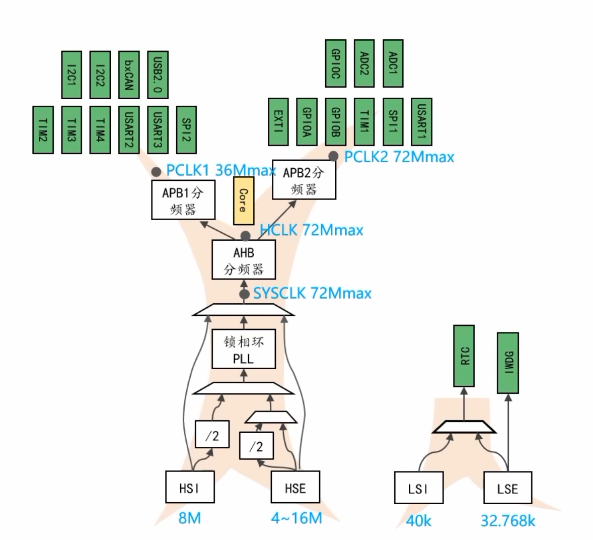

# 03 时钟系统：时钟树、PLL 与 HAL 配置

## 本章问题

前两章的延时、I2C 速度都默认芯片跑在 72 MHz，这个数字从第 0 章就填在 CubeMX 里，却一直没解释。本章沿着时钟树看节拍从哪里来，把 8 MHz 算成 72 MHz，再配置到工程里，最后用 LED 闪烁速度验证。

## 学习目标

- 画出 HSI/HSE 到 SYSCLK、HCLK、PCLK1、PCLK2 的路径。
- 用 `8 MHz × 9 = 72 MHz` 算主频，并核对 PLL 的输入输出范围。
- 按分频关系算出三条总线频率，判断是否超限。
- 按顺序配置 HSE、PLL、SYSCLK、分频和 Flash 等待周期。
- 用 HAL 读数或 MCO 引脚核对实际时钟。

## 1. 时钟与时钟树

CPU、存储器和外设按同一个节拍工作，这个节拍就是时钟。节拍快，同一段代码跑得就快；串口波特率、定时器步长、ADC 采样率也都由它分出来，所以时钟错了，所有跟时间有关的数字都会跟着错。



时钟树的主线是三行：

```text
HSI/HSE → PLL → SYSCLK
              → AHB 分频 → HCLK
              → APB1/APB2 分频 → PCLK1/PCLK2 → GPIO、串口、定时器、ADC
```

四个时钟源的名字由“高速/低速”和“内部/外部”组合而成：

| 时钟源 | 频率与特点 | 用途 |
| --- | --- | --- |
| `HSI` | 片内 RC，8 MHz，启动快、精度低 | 默认系统时钟、PLL 输入 |
| `HSE` | 外部晶振，常见 4~16 MHz，精度高 | 系统主频、PLL 输入 |
| `LSI` | 片内低速 RC，约 40 kHz | 独立看门狗、RTC 备选 |
| `LSE` | 外部 32.768 kHz 晶振 | RTC |

HSI 不依赖外部元件，上电即可用，但频率会随温度和电压漂移；HSE 是板上的石英晶振，频率稳定，需要精确时钟时都用它。CubeMX 里使用板载晶振，选 `Crystal/Ceramic Resonator`。

时钟送到总线之后，每个外设还有自己的门控开关，用对应的 `__HAL_RCC_*_CLK_ENABLE()` 打开：

```c
__HAL_RCC_GPIOC_CLK_ENABLE();  /* GPIOC 在 APB2 */
__HAL_RCC_TIM2_CLK_ENABLE();   /* TIM2 在 APB1 */
__HAL_RCC_DMA1_CLK_ENABLE();   /* DMA1 在 AHB */
```

门控没开，写外设寄存器不会有任何反应。它只决定时钟是否送到外设，不改变总线频率。

## 2. PLL 与主频计算

### 2.1 从 8 MHz 到 72 MHz

PLL 是一个可控倍频器，输出频率等于输入频率乘以倍频系数：

$$
f_{\mathrm{PLL}} = f_{\mathrm{PLL\ in}} \times M
$$

F103 的 PLL 输入可以选 `HSI/2`、`HSE` 或 `HSE/2`，倍频挡位为 `x2~x16`。输入必须在 1~25 MHz，输出必须在 16~72 MHz，越界会锁不住或超规运行。

本章用 8 MHz 的 HSE，倍频系数取 9：

$$
f_{\mathrm{SYSCLK}} = 8 \times 9 = 72\,\mathrm{MHz}
$$

72 MHz 是 F103 的设计上限，再高不能保证正常工作。`8 × 9` 也没有取整余量，所以板载晶振必须确实是 8 MHz。

### 2.2 AHB 与 APB 分频

不是所有外设都能跑 72 MHz，所以 SYSCLK 先经 AHB 分频得到 HCLK，再经两个 APB 分频得到 PCLK1 和 PCLK2：

$$
f_{\mathrm{HCLK}} = \frac{f_{\mathrm{SYSCLK}}}{N_{\mathrm{AHB}}}, \qquad
f_{\mathrm{PCLK1}} = \frac{f_{\mathrm{HCLK}}}{N_{\mathrm{APB1}}}, \qquad
f_{\mathrm{PCLK2}} = \frac{f_{\mathrm{HCLK}}}{N_{\mathrm{APB2}}}
$$

三条总线的上限和挂载对象：

| 节点 | 上限 | 典型对象 |
| --- | --- | --- |
| `HCLK` | 72 MHz | Cortex-M3、Flash、SRAM、DMA |
| `PCLK1` | 36 MHz | USART2/3、I2C、TIM2~TIM4 |
| `PCLK2` | 72 MHz | GPIO、ADC、USART1、SPI1、TIM1 |

常用的 72 MHz 配置是：

```text
HSE = 8 MHz
PLL = HSE × 9 = 72 MHz
SYSCLK = 72 MHz
AHB  = /1 → HCLK  = 72 MHz
APB1 = /2 → PCLK1 = 36 MHz
APB2 = /1 → PCLK2 = 72 MHz
```

CubeMX 的 `Clock Configuration` 页会在参数非法时标红。页面上的频率只是按输入算出的图纸值，它不知道板上的晶振实际有多快。

### 2.3 定时器与专用外设时钟

APB 上的定时器不直接使用 PCLK，而是按下面的规则取时钟：

$$
f_{\mathrm{TIM}x} =
\begin{cases}
f_{\mathrm{PCLK}x}, & N_{\mathrm{APB}x} = 1 \\
2 f_{\mathrm{PCLK}x}, & N_{\mathrm{APB}x} > 1
\end{cases}
$$

所以本章 `PCLK1 = 36 MHz`，但 TIM2/3/4 的时钟是 72 MHz。第 5 章算 PWM 频率时若拿 36 MHz 去算，实测周期会正好差一倍。

其余几路时钟：

- SysTick 由 HCLK 驱动，`HAL_Init()` 按 `SystemCoreClock` 配出 1 ms 中断，`HAL_Delay()` 靠它计时；
- ADC 时钟由 PCLK2 再分频，72 MHz 下 `/6` 得 12 MHz、`/8` 得 9 MHz，`/2`、`/4` 会超过常见的 14 MHz 上限；
- USB 需要精确的 48 MHz，由 PLL 经 1.5 分频得到；
- RTC 可选 LSE、LSI 或 HSE/128，32.768 kHz 经 32768 分频得到 1 Hz；
- 独立看门狗只能由 LSI 驱动；
- Flash 频率越高，读取越跟不上 CPU，必须插入等待周期，本章 72 MHz 用 `FLASH_LATENCY_2`。

## 3. CubeMX 与 HAL 配置

### 3.1 CubeMX 设置

以 HSE 8 MHz、PLL ×9、72 MHz 为例：

1. `Pinout & Configuration → RCC`，`HSE` 选 `Crystal/Ceramic Resonator`。
2. `Clock Configuration` 确认 `HSE = 8 MHz`。
3. `PLL Source` 选 `HSE`，HSE 预分频 `/1`，`PLL Mul` 选 `x9`。
4. `System Clock Mux` 选 `PLLCLK`。
5. `AHB = /1`、`APB1 = /2`、`APB2 = /1`，确认没有红色错误提示。
6. 生成代码。

8 MHz 与 72 MHz 各存一份 `.ioc`，切换时在 CubeMX 的 `Clock Configuration` 页按下面几项核对，不要手改 `.ioc`：

| 设置 | 8 MHz 对照组 | 72 MHz 实验组 |
| --- | --- | --- |
| `HSE` | 关闭 | `Crystal/Ceramic Resonator` |
| `PLL` | 关闭 | 源 `HSE`，倍频 `x9` |
| `System Clock Mux` | `HSI` | `PLLCLK` |
| `AHB Prescaler` | `/1` | `/1` |
| `APB1 Prescaler` | `/1` | `/2` |
| `APB2 Prescaler` | `/1` | `/1` |

`.ioc` 是 CubeMX 的私有文本格式，键名随版本变化。要在文件里核对 72 MHz 组，关键几项是 `PD0-OSC_IN.Mode=HSE-External-Oscillator`、`RCC.PLLSourceVirtual=RCC_PLLSOURCE_HSE`、`RCC.PLLMUL=RCC_PLL_MUL9`、`RCC.SYSCLKSource=RCC_SYSCLKSOURCE_PLLCLK`、`RCC.APB1CLKDivider=RCC_HCLK_DIV2`；8 MHz 对照组由另一份纯 HSI 的 `.ioc` 保存，不靠手改同一文件。

### 3.2 初始化顺序

```text
Reset_Handler → SystemInit() → C 运行库 → main()
main() → HAL_Init() → SystemClock_Config() → MX_xxx_Init() → 主循环
```

`SystemInit()` 只做最基础的系统初始化，此时芯片还跑在复位默认的 HSI 8 MHz 上。`HAL_Init()` 设置 NVIC 分组并把 SysTick 配成 1 ms。真正把主频推到 72 MHz 的是 `SystemClock_Config()`：

```c
void SystemClock_Config(void)
{
  RCC_OscInitTypeDef RCC_OscInitStruct = {0};
  RCC_ClkInitTypeDef RCC_ClkInitStruct = {0};

  /* 打开 HSE，PLL 以 HSE 为输入，倍频 ×9 */
  RCC_OscInitStruct.OscillatorType = RCC_OSCILLATORTYPE_HSE;
  RCC_OscInitStruct.HSEState       = RCC_HSE_ON;
  RCC_OscInitStruct.HSEPredivValue = RCC_HSE_PREDIV_DIV1;
  RCC_OscInitStruct.PLL.PLLState   = RCC_PLL_ON;
  RCC_OscInitStruct.PLL.PLLSource  = RCC_PLLSOURCE_HSE;
  RCC_OscInitStruct.PLL.PLLMUL     = RCC_PLL_MUL9;
  HAL_RCC_OscConfig(&RCC_OscInitStruct);

  /* SYSCLK 走 PLLCLK，AHB /1、APB1 /2、APB2 /1 */
  RCC_ClkInitStruct.ClockType      = RCC_CLOCKTYPE_HCLK | RCC_CLOCKTYPE_SYSCLK
                                   | RCC_CLOCKTYPE_PCLK1 | RCC_CLOCKTYPE_PCLK2;
  RCC_ClkInitStruct.SYSCLKSource   = RCC_SYSCLKSOURCE_PLLCLK;
  RCC_ClkInitStruct.AHBCLKDivider  = RCC_SYSCLK_DIV1;
  RCC_ClkInitStruct.APB1CLKDivider = RCC_HCLK_DIV2;
  RCC_ClkInitStruct.APB2CLKDivider = RCC_HCLK_DIV1;
  HAL_RCC_ClockConfig(&RCC_ClkInitStruct, FLASH_LATENCY_2);
}
```

第一段 `HAL_RCC_OscConfig()` 打开晶振、把 PLL 挂到 HSE 上并设置倍频，等 PLL 锁定。第二段 `HAL_RCC_ClockConfig()` 切换系统时钟源、设置分频，同时按新的 HCLK 重配 SysTick 和 Flash 等待周期。CubeMX 生成的代码还会检查返回值，失败就进 `Error_Handler()`，所以配置错误的表现通常是停在启动阶段，而不是跑飞。

时钟必须先于外设初始化。先初始化串口再改主频，波特率就会按错误的时钟算出来。

## 4. 实验：比较 8 MHz 与 72 MHz

接线只需要最小系统板和 ST-LINK，`PC13` 配成 GPIO 输出，保留 `Serial Wire`。对照组不启用 HSE 和 PLL，SYSCLK 停在 HSI 8 MHz；实验组用上一节的 72 MHz 配置。

```c
/* USER CODE BEGIN PV */
volatile uint32_t i;
/* USER CODE END PV */

int main(void)
{
  HAL_Init();
  SystemClock_Config();
  MX_GPIO_Init();

  while (1)
  {
    HAL_GPIO_TogglePin(GPIOC, GPIO_PIN_13);
    for (i = 0U; i < 1000000U; i++)
    {
    }
  }
}
```

`volatile` 防止编译器把空循环优化掉。循环时间还受优化等级和 Flash 等待周期影响，所以这个实验只做定性比较：同样一百万次计数，72 MHz 下 LED 闪烁应明显快于 8 MHz，理想比值约 9 倍，快一个量级就算对。

LED 变快只能说明执行速度变了，不能证明 PLL 已锁定。要拿到硬证据，就把时钟输出到 `PA8` 的 MCO 引脚测量：

```c
HAL_RCC_MCOConfig(RCC_MCO1, RCC_MCO1SOURCE_PLLCLK, RCC_MCODIV_1);
```

F1 的 `RCC_MCO1SOURCE_PLLCLK` 输出的是 PLL/2，本章配置下预期约 36 MHz。测不到时，先确认 `PA8` 已配成 MCO、探头带宽足够，再切到 `RCC_MCO1SOURCE_HSE` 看 8 MHz 晶振是否起振。也可以用 `HAL_RCC_GetSysClockFreq()` 读配置推算值，但它不能替代实际测量。用完记得关闭 MCO，把 `PA8` 还给原来的功能。

这套 72 MHz / 36 MHz / 12 MHz 的分配也是后面定时器、ADC 和串口计算的共同基准。倒立摆工程沿用同一棵时钟树（HSE 8 MHz ×9，APB1 二分频，ADC 六分频），其引脚与总线表见 [[STM32倒立摆/03 基础驱动：CubeMX与HAL库实现#1.4 本工程的引脚与外设总表]]。

上一篇：[[02 OLED 调试：I2C 显示数据流]] ｜ 下一篇：[[04 中断系统：EXTI 与 NVIC 优先级]]
