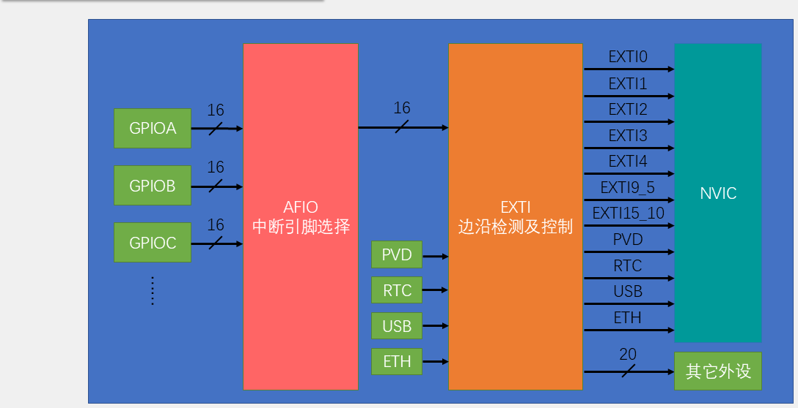

# 04 中断系统：EXTI 与 NVIC 优先级

## 本章问题

前面的程序靠主循环反复读引脚，问得再勤也有两个漏洞：持续低电平会被当成很多次事件，几微秒的短脉冲又可能正好落在两次读取之间。本章让硬件替你盯着输入：边沿来了先由 EXTI 记录，NVIC 决定何时响应，HAL 回调把事件交给你的代码。

本章有两个独立实验：PB14 红外计次和 PB0/PB1 编码器判向，分别建立工程。

## 学习目标

- 画出 GPIO、EXTI、NVIC、IRQHandler 和 HAL 回调的执行链。
- 在 CubeMX 中配置 EXTI 引脚、触发边沿和 NVIC。
- 用抢占优先级安排中断嵌套顺序。
- 用 `volatile` 计数器完成红外计次。
- 用 A/B 两相信号判断编码器方向。

## 1. 中断的工作方式

轮询代码有两个绕不过去的问题：

```c
while (1)
{
    if (HAL_GPIO_ReadPin(GPIOB, GPIO_PIN_14) == GPIO_PIN_RESET)
    {
        count++;     /* 遮挡 1 秒会加几万次 */
    }
}
```

一是分不清“一次事件”和“一直保持”，二是主循环忙别的事时会完全错过短脉冲。

中断把边沿检测交给硬件。即使主循环正停在 `HAL_Delay(500)` 里，EXTI 也会在边沿到来时置位挂起寄存器，等 CPU 有空再响应，事件不会丢。

完整的执行链是：

```text
外部电平变化
→ GPIO 输入
→ EXTI 按上升沿/下降沿检测并置位 EXTI_PR
→ NVIC 按优先级决定是否响应
→ IRQHandler
→ HAL_GPIO_EXTI_IRQHandler() 检查并清除挂起位
→ HAL_GPIO_EXTI_Callback() 更新计数或状态
→ 返回被中断的代码
```

各层的分工：

| 层次 | 谁负责 | 你参与什么 |
| --- | --- | --- |
| GPIO 输入 | 外部电路和 GPIO 硬件 | 接线、引脚模式和上下拉 |
| EXTI | EXTI 硬件 | 选择触发边沿 |
| NVIC | NVIC 硬件 | 使能中断、填两个优先级 |
| IRQHandler | 启动文件和 `stm32f1xx_it.c` | CubeMX 生成，不改 |
| HAL 中间层 | HAL 库 | 不写代码 |
| 用户回调 | 你的 `app_exti.c` | 区分引脚、改计数 |

`EXTI_PR` 只记录“这条线发生过事件”，不记录发生了几次。CPU 忙的时候同一根线再来十个边沿，挂起位仍然只有一个 1。这就是“一次遮挡只计一次”的硬件基础，也是调试时停在断点上会漏计数的原因。

清挂起位是必须的。`HAL_GPIO_EXTI_IRQHandler()` 已经代劳：它检查 `EXTI_PR`，命中就清掉，再调用回调。不清的话，函数一返回 NVIC 又看到请求，会立刻再进一次。

中断入口和默认回调都由硬件或 HAL 准备好，保存现场、恢复现场也由 Cortex-M3 自动完成，不需要写入栈出栈代码。

### 1.1 回调里只做三件事

回调执行期间，同级和更低优先级的中断都在排队。所以回调只做三件事：确认引脚、读必要电平、改少量状态。刷屏、打印、耗时计算都留给主循环。

```c
/* 错误示范 */
void HAL_GPIO_EXTI_Callback(uint16_t GPIO_Pin)
{
    if (GPIO_Pin == GPIO_PIN_0)
    {
        encoder_count++;
        OLED_ShowNum(32, 0, encoder_count, 4U, OLED_8X16);
        OLED_Update();     /* 一次刷屏约 90 ms，这期间的脉冲全丢 */
    }
}
```

现象是编码器转得越快，计数偏得越多。比慢更糟的是卡死：在回调里调用 `HAL_Delay()`，它依赖的 SysTick 优先级比 EXTI 低，打不断回调，`uwTick` 永远不涨，程序就停在那里。需要等待时，把逻辑留给主循环，回调只置标志位。

## 2. EXTI 的线路与寄存器

### 2.1 线路按引脚编号共享

`PA0`、`PB0`、`PC0` 都连到 `EXTI0`，但同一时刻只能选一个端口。配置 `PB14` 时，AFIO 把 `EXTI14` 的源端口选为 GPIOB：

```text
PB14 → EXTI14 → AFIO_EXTICR 选择 GPIOB
```

若之后又把 `PA14` 配成 `EXTI14`，后一次选择会覆盖前一次，原来那路中断就不触发了。使用 AFIO 前要先开时钟，CubeMX 已在 `HAL_MspInit()` 里生成：

```c
__HAL_RCC_AFIO_CLK_ENABLE();
__HAL_RCC_PWR_CLK_ENABLE();
```



### 2.2 关键寄存器

| 环节 | 寄存器 | 对应操作 |
| --- | --- | --- |
| 选择源端口 | `AFIO_EXTICR` | `HAL_GPIO_Init()` 按端口写入 |
| 选择触发边沿 | `EXTI_RTSR`、`EXTI_FTSR` | 上升沿、下降沿或双边沿 |
| 记录待处理事件 | `EXTI_PR` | 硬件置位，中断处理函数清除 |
| 软件触发 | `EXTI_SWIER` | 测试用，平时不用 |
| NVIC 使能与优先级 | NVIC 寄存器 | `HAL_NVIC_EnableIRQ()`、`HAL_NVIC_SetPriority()` |

`EXTI_PR` 在 F1 上要写 1 才能清零，写 0 无效。

### 2.3 事件与中断是两条路

EXTI 检测到边沿后有两条出路：

| 模式 | HAL 宏 | 去向 |
| --- | --- | --- |
| 中断 | `GPIO_MODE_IT_RISING/FALLING/RISING_FALLING` | 请求 NVIC，进入回调 |
| 事件 | `GPIO_MODE_EVT_RISING/FALLING/RISING_FALLING` | 只发硬件事件，不进 NVIC |

事件模式可以触发 ADC、定时器，但不执行代码。选成事件模式后代码怎么写都不进中断，这是新手常犯的错误。

## 3. NVIC 优先级

### 3.1 抢占与响应

数字越小越急，`0` 最高。抢占优先级决定一个中断能否打断正在执行的中断：新中断的抢占优先级更小才能嵌套，相同则不能互相打断。响应优先级（子优先级）只在抢占优先级相同时决定谁先响应。

Cortex-M3 的主程序没有异常优先级，任何使能的中断都能打断主循环。

F103 用 4 位表示优先级，共 16 级。这 4 位如何分给抢占和响应，由优先级分组决定：

| 分组 | 抢占位数 | 响应位数 |
| --- | ---: | ---: |
| `NVIC_PRIORITYGROUP_0` | 0 | 4 |
| `NVIC_PRIORITYGROUP_1` | 1 | 3 |
| `NVIC_PRIORITYGROUP_2` | 2 | 2 |
| `NVIC_PRIORITYGROUP_3` | 3 | 1 |
| `NVIC_PRIORITYGROUP_4` | 4 | 0 |

`HAL_Init()` 默认调用 `HAL_NVIC_SetPriorityGrouping(NVIC_PRIORITYGROUP_4)`，4 位全给抢占，所以子优先级参数写多少都不起作用。要真正使用子优先级，得先把分组改成 `GROUP_2`，再把所有中断的抢占值压到 `0~3`。

CubeMX 生成的配置是：

```c
HAL_NVIC_SetPriority(EXTI15_10_IRQn, 2U, 0U);
HAL_NVIC_EnableIRQ(EXTI15_10_IRQn);
```

第一个参数是 IRQ 编号，第二个是抢占优先级，第三个是响应优先级。分组必须先在 `HAL_Init()` 里设好，再填具体数值。

本教程统一使用的优先级：

| 中断 | 抢占优先级 | 理由 |
| --- | ---: | --- |
| `SysTick` | 15 | 系统时基，最不重要，HAL 默认就是 15 |
| `EXTI15_10` / `EXTI0` | 2 | 红外、编码器脉冲，漏一个丢一次计数 |
| `TIM1` | 2 | 1 ms 按键节拍，与 EXTI 同档 |
| `TIM4` | 2 | 1 s 时基与舵机实验，同档 |
| `DMA1_Channel1` | 1 | 及时处理 ADC 扫描完成通知 |

后面加新中断时照这张表对齐，不要随手填一个数。全设成 0 会让所有中断都不能互相嵌套，也失去优先级规划的意义。

### 3.2 多路线路共享一个 IRQ

16 条 EXTI 线只对应 7 个 NVIC 入口：

| EXTI 线路 | NVIC IRQ |
| --- | --- |
| `EXTI0`~`EXTI4` | 各自的 `EXTIn_IRQn` |
| `EXTI5`~`EXTI9` | `EXTI9_5_IRQn` |
| `EXTI10`~`EXTI15` | `EXTI15_10_IRQn` |

共享 IRQ 里的线路只能用同一组优先级，处理时还要判断是哪条线挂起。`PB0` 和 `PB1` 是两个独立 IRQ，本实验只给 `PB0` 配 EXTI，`PB1` 当普通输入读取。

## 4. 从向量表到用户回调

以 `PB14` 为例，中断进入后依次经过四层。

第一层是向量表。`startup_stm32f103xb.s` 里保存着各中断入口地址，`EXTI15_10_IRQHandler` 必须和这里一字不差，写错会落到默认死循环。

第二层是 CubeMX 生成的入口：

```c
void EXTI15_10_IRQHandler(void)
{
  HAL_GPIO_EXTI_IRQHandler(GPIO_PIN_14);
}
```

第三层是 HAL 的处理函数，它检查挂起位、清掉挂起位，再调用回调：

```c
void HAL_GPIO_EXTI_IRQHandler(uint16_t GPIO_Pin)
{
  if (__HAL_GPIO_EXTI_GET_IT(GPIO_Pin) != 0x00u)
  {
    __HAL_GPIO_EXTI_CLEAR_IT(GPIO_Pin);
    HAL_GPIO_EXTI_Callback(GPIO_Pin);
  }
}
```

第四层是你写的回调。HAL 里有一个 `__weak` 空实现，你在自己的文件里定义同名函数，链接器就会改用你的版本，不需要改 HAL 源码。

共享 IRQ 有多条线时，入口要逐个处理：

```c
HAL_GPIO_EXTI_IRQHandler(GPIO_PIN_14);
HAL_GPIO_EXTI_IRQHandler(GPIO_PIN_15);
```

回调里再用参数区分：

```c
void HAL_GPIO_EXTI_Callback(uint16_t GPIO_Pin)
{
    if (GPIO_Pin == GPIO_PIN_14)       { /* PB14 的事件 */ }
    else if (GPIO_Pin == GPIO_PIN_15)  { /* PB15 的事件 */ }
}
```

回调实现在 `User/Src/app_exti.c`，这个目录不受 CubeMX 管理，比把业务代码塞进 `stm32f1xx_it.c` 清晰。

### 4.1 中断与主循环共享的变量

中断写、主循环读的变量要加 `volatile`：

```c
static volatile uint32_t g_event_count = 0U;
```

不加的话，编译器可能把变量缓存进寄存器，主循环永远看不到中断里的修改，表现是“调试器里值在变，程序没反应”。

`volatile` 只保证每次都访问内存，不保证复合操作原子。对齐的 32 位单次读写可以直接用；如果主循环要“读取并清零”，读和清之间可能被中断插入，需要短临界区或改成只读接口。本章的计数只由中断写、主循环读，不涉及这个问题。

`app_exti.c` 要登记进根 `CMakeLists.txt`。漏登记会报 `undefined reference to 'IR_GetCount'`，漏包含头文件会报隐式声明。

## 5. 实验一：PB14 红外计次

目标是用下降沿统计遮挡次数，主循环只负责发现计数变化并翻灯。

### 5.1 接线与配置

```text
VCC → 3.3 V（按模块规格）
GND → GND
DO  → PB14
```

本例假设无遮挡为高、遮挡为低，只在下降沿计数。模块电平相反时，触发边沿也要跟着改。

CubeMX 配置：

1. 点 `PB14` 选 `GPIO_EXTI14`，`GPIO Mode` 选 `External Interrupt Mode with Falling edge trigger detection`。选成普通输入或事件模式都不会进回调。
2. 上下拉按信号源选。本模块 DO 空闲时主动输出确定电平，选 `No pull-up and no pull-down`；若模块是开漏输出，必须配上拉，否则引脚悬空会产生大量假边沿。
3. 在 `System Core → NVIC` 勾选 `EXTI line[15:10] interrupts`，抢占优先级填 `2`，子优先级填 `0`。不勾这一项，前面配置全对也不会进中断。
4. `PC13` 设为 `GPIO_Output`，模式 `Output Open Drain`，初始 `High`。

数据链是：

```text
物体遮挡 → PB14 下降沿 → 计数加 1 → 主循环发现变化 → PC13 翻转
```

### 5.2 代码

`User/Src/app_exti.c`：

```c
#include "app_exti.h"
#include "main.h"

static volatile uint32_t g_ir_count = 0U;
static uint32_t g_last_tick = 0U;

uint32_t IR_GetCount(void)
{
    return g_ir_count;
}

void HAL_GPIO_EXTI_Callback(uint16_t GPIO_Pin)
{
    if (GPIO_Pin == GPIO_PIN_14)
    {
        uint32_t now = HAL_GetTick();

        /* 过滤间隔小于 20 ms 的重复边沿 */
        if ((uint32_t)(now - g_last_tick) >= 20U)
        {
            g_ir_count++;
            g_last_tick = now;
        }
    }
}
```

`User/Inc/app_exti.h`：

```c
#ifndef __APP_EXTI_H
#define __APP_EXTI_H

#include <stdint.h>

uint32_t IR_GetCount(void);

#endif
```

`main.c` 的 `USER CODE BEGIN PV` 里声明 `static uint32_t last_count = 0U;`，主循环写：

```c
while (1)
{
    uint32_t count = IR_GetCount();
    if (count != last_count)
    {
        last_count = count;
        HAL_GPIO_TogglePin(GPIOC, GPIO_PIN_13);
    }
}
```

`20 ms` 门限来自第 01 章测到的按键弹跳时间 `5~10 ms`，取一倍余量。无符号减法即使 `HAL_GetTick()` 回绕，差值仍然正确。

### 5.3 现象与排查

低速遮挡一次，计数加 1，PC13 翻转一次，调试器的 Watch 窗口能看到计数增加。

完全不计数，按接线、GPIO 模式、NVIC 勾选逐层查。遮挡时不计数、移开时反而计数，说明模块电平与假设相反，把触发边沿改成上升沿。一次遮挡计 2~3 次，说明抖动间隔超过了 20 ms，可以加大门限，或改用硬件滤波、输入捕获。主循环读到的计数不更新，先检查变量有没有加 `volatile`。

## 6. 实验二：PB0/PB1 编码器判向

### 6.1 判向原理

增量式编码器的 A、B 两路频率相同、相位相差约 90°。以 A 领先 B 为正转，一个周期有四个状态：

| 状态 | A | B | 正转下一状态 | 反转下一状态 |
| --- | ---: | ---: | --- | --- |
| S0 | 0 | 0 | S1 | S3 |
| S1 | 1 | 0 | S2 | S0 |
| S2 | 1 | 1 | S3 | S1 |
| S3 | 0 | 1 | S0 | S2 |

判向只需在 A 的边沿瞬间看 B 的电平。本例用 x1 解码，只在 A 相下降沿采样：`B=1` 计 `+1`，`B=0` 计 `-1`。x1 每个周期只计一次，分辨率低但实现简单。

方向取决于 A/B 接线和编码器型号。整体反了，交换 A/B 或对调加减号即可。

### 6.2 接线与配置

`A → PB0`、`B → PB1`，模块与 MCU 共地。

1. `PB0` 选 `GPIO_EXTI0`，模式 `External Interrupt Mode with Falling edge trigger detection`，上下拉选 `Pull-up`。
2. `PB1` 选 `GPIO_Input`，同样 `Pull-up`。B 相要随时读取，悬空会读到噪声。
3. NVIC 勾选 `EXTI line0 interrupt`，抢占 `2`，响应 `0`。不要勾 `EXTI line1`，本方案不需要。
4. `PC13` 与实验一相同。

`PB0` 和 `PB1` 属于两个独立 IRQ，只给 A 相开中断，B 相用普通输入随时可读。

生成的入口是 `EXTI0_IRQHandler()`，内容与实验一同构，只是换成 `GPIO_PIN_0`。

### 6.3 代码

`User/Src/app_exti.c`：

```c
#include "app_exti.h"
#include "main.h"

static volatile int16_t g_encoder_count = 0;

int16_t Encoder_GetCount(void)
{
    return g_encoder_count;
}

void HAL_GPIO_EXTI_Callback(uint16_t GPIO_Pin)
{
    if (GPIO_Pin == GPIO_PIN_0)
    {
        GPIO_PinState b = HAL_GPIO_ReadPin(GPIOB, GPIO_PIN_1);

        if (b == GPIO_PIN_SET)
        {
            if (g_encoder_count < INT16_MAX) g_encoder_count++;
        }
        else
        {
            if (g_encoder_count > INT16_MIN) g_encoder_count--;
        }
    }
}
```

`app_exti.h` 里把声明换成 `int16_t Encoder_GetCount(void);`。`main.c` 的 `USER CODE BEGIN PV` 声明 `static int16_t last_count = 0;`，主循环：

```c
while (1)
{
    int16_t count = Encoder_GetCount();
    if (count != last_count)
    {
        last_count = count;
        HAL_GPIO_TogglePin(GPIOC, GPIO_PIN_13);
    }
}
```

计数用有符号 `int16_t`，到 `INT16_MAX`、`INT16_MIN` 就停住，避免长时间单向转动后溢出。

### 6.4 现象与排查

正转时计数增大，反转时减小，每次变化翻一次灯。

方向相反时交换 A/B 接线或对调加减号。静止时计数还在变，先查上下拉、接线和机械抖动，GPIO EXTI 没有数字滤波。快速旋转时明显丢计数，说明超出了 GPIO 中断加 x1 解码的能力，改用第 05 章的定时器编码器模式。

本章的 EXTI 适合红外、限位这类偶发事件；倒立摆的按键改为 TIM1 每 1 ms 轮询，编码器改用 TIM3 硬件接口，两套方案的分工见 [[STM32倒立摆/03 基础驱动：CubeMX与HAL库实现#1.5 与入门教程共用驱动]]。

上一篇：[[03 时钟系统：时钟树、PLL 与 HAL 配置]] ｜ 下一篇：[[05 定时器：时基、PWM、输入捕获与电机控制]]
