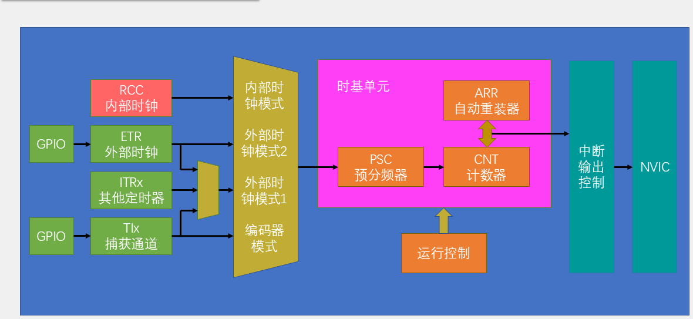
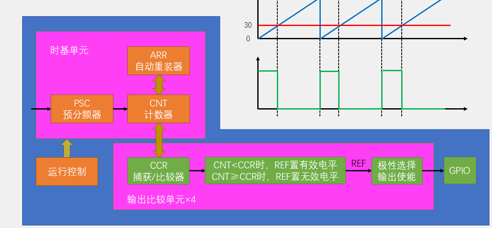
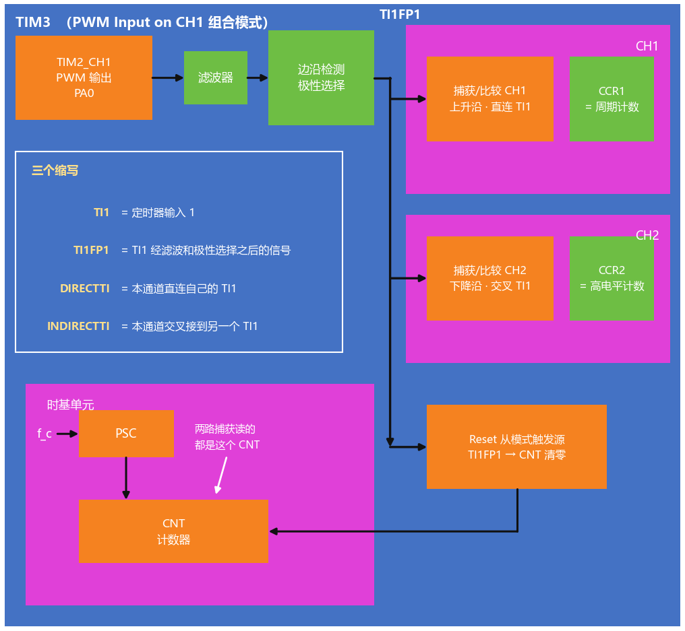
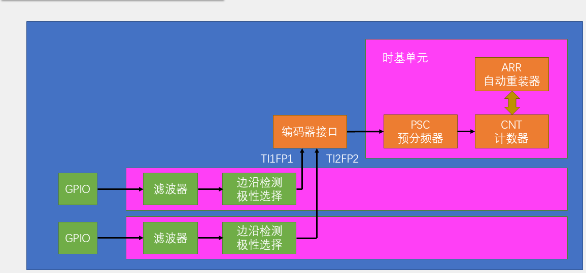
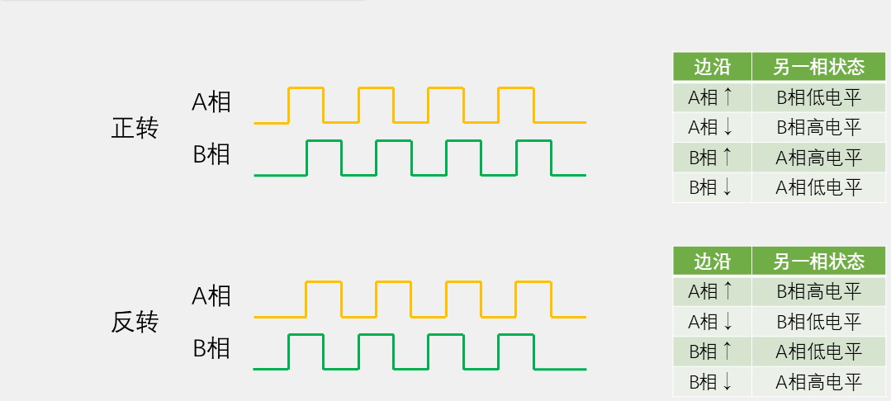

# 05 定时器：时基、PWM、输入捕获与电机控制

## 本章问题

`HAL_Delay()` 让 CPU 干等，既不准，也没法同时做别的事。电机调速、舵机转角、测频都需要芯片按时间表自己干活。定时器把“时间”变成硬件行为：用 `PSC/ARR` 得到固定周期，就是时基；让计数值撞上 `CCR` 时翻转电平，就是 PWM；在外部边沿出现时把 `CNT` 抄进 `CCR`，就是输入捕获。

## 学习目标

- 用 `PSC/ARR` 配置 1 Hz 更新中断。
- 用 PWM 控制 LED、舵机和直流电机。
- 用输入捕获测量 PWM 的频率和占空比。
- 用外部时钟统计输入脉冲。
- 用编码器接口读取方向和增量。

## 0. 硬件与工程

| 物品 | 实验 | 注意 |
| --- | --- | --- |
| 最小系统板 + ST-LINK | 全程 | 第 0 章底座 |
| 红外对管类光电传感器 | 实验二 | 输出限 3.3 V，开漏需上拉 |
| LED + 约 1 kΩ 电阻 | 实验三 | 串在 PA6 与 LED 之间 |
| SG90 类舵机 | 实验四 | 独立 5 V 供电，与 MCU 共地 |
| TB6612 + 直流减速电机 | 实验五 | VM 用独立电机电源 |
| 杜邦线 | 实验六 | PA0 自环到 PA6 |
| 增量编码器 | 实验七 | A/B 接 PA8/PA9，共地 |

七个实验各建一个工程：

| 实验 | 目录 | 定时器用法 |
| --- | --- | --- |
| 一：1 s 定时中断 | `01_BaseTimer` | TIM4 更新中断 |
| 二：外部时钟计数 | `02_ExternalClock` | TIM2 ETR |
| 三：LED 呼吸灯 | `03_PWM_LED` | TIM3 CH1 PWM |
| 四：舵机 | `04_PWM_Servo` | TIM4 CH3，50 Hz |
| 五：TB6612 电机 | `05_Motor` | TIM3 CH1 PWM + 方向 GPIO |
| 六：测频测占空比 | `06_PWMI` | TIM2 输出 + TIM3 捕获 |
| 七：编码器 | `07_Encoder` | TIM1 编码器模式 |

F103C8T6 可用 `TIM1`（挂 APB2）和 `TIM2~TIM4`（挂 APB1）。同一引脚不能同时承担两个复用功能，`PA6/TIM3_CH1` 在这些实验里只能单独用作 PWM 或捕获。`htimx` 是 CubeMX 生成的定时器句柄，后续 HAL 调用都通过它操作外设。

## 1. 定时器计数与时基

### 1.1 定时器就是一个计数器

定时器只做三件事：按节拍加一或减一，当前值存在 `CNT`；数到 `ARR` 就回到起点，同时产生更新事件；节拍快慢由 `PSC` 决定。

在计数器上再挂三种硬件动作，就得到本章的全部用法：

- 输出比较：`CNT` 匹配 `CCR` 时改变输出电平，得到 PWM；
- 输入捕获：指定边沿出现时把 `CNT` 抄进 `CCR`，用来测时间；
- 编码器接口：用 A/B 两相正交信号在硬件里判向，直接让 `CNT` 加或减。



### 1.2 PSC、CNT、ARR

`PSC` 是预分频器，实际分频系数为 `PSC+1`；`CNT` 是当前计数值；`ARR` 是计数边界；`CCR` 是比较值或捕获值。

向上计数时，`CNT` 从 0 数到 `ARR`，下一个时钟回到 0 并产生更新事件。计数节拍是：

$$
f_{\mathrm{CNT}}=\frac{f_{\mathrm{TIM}}}{\mathrm{PSC}+1}
$$

更新频率和周期是：

$$
f_{\mathrm{update}}=\frac{f_{\mathrm{TIM}}}{(\mathrm{PSC}+1)(\mathrm{ARR}+1)},\qquad
T_{\mathrm{update}}=\frac{(\mathrm{PSC}+1)(\mathrm{ARR}+1)}{f_{\mathrm{TIM}}}
$$

两个 `+1` 是因为分频器和计数器都从 0 开始。`PSC=0` 就是 1 分频，`ARR=999` 对应 1000 个计数节拍。

以 72 MHz 的 TIM4 配 1 s 为例，先取 `PSC=7199`，节拍降到 10 kHz；再取 `ARR=9999`，正好数 10000 拍：

$$
T_{\mathrm{update}}=\frac{10000}{10\,\mathrm{kHz}}=1\,\mathrm{s}
$$

对应配置是 `Prescaler=7199`、`Counter Period=9999`、向上计数。

`PSC` 和 `ARR` 都是 16 位时，最长的单次定时是：

$$
T_{\max}=\frac{65536\times65536}{72\times10^6}\approx59.65\,\mathrm{s}
$$

需要更长周期时，让定时器按较短周期反复中断，再在软件里累计。

### 1.3 预装载与启动

`PSC` 始终经过缓冲，运行中写入的新值要等到下一次更新事件才生效。`ARR` 是否缓冲由 `AutoReloadPreload` 决定：使能时同样等更新事件，禁用时立即改变周期。

`HAL_TIM_Base_Init()` 在配置末尾会产生一次更新事件，把 `CNT` 清零并装入预装载值，同时可能置位 `UIF`。启动前先清一次标志，避免把这次初始化当成第一次定时到点：

```c
__HAL_TIM_CLEAR_FLAG(&htim4, TIM_FLAG_UPDATE);
HAL_TIM_Base_Start_IT(&htim4);
```

常用的 HAL 接口：

| 操作 | 接口 |
| --- | --- |
| 启动/停止更新中断 | `HAL_TIM_Base_Start_IT()` / `HAL_TIM_Base_Stop_IT()` |
| 更新中断回调 | `HAL_TIM_PeriodElapsedCallback()` |
| 读写计数值 | `__HAL_TIM_GET_COUNTER()` / `__HAL_TIM_SET_COUNTER()` |

`Start_IT` 和 `Start` 的区别只在于是否开放更新中断：需要回调就用 `_IT`，只读计数值用普通版本。

### 1.4 实验一：1 s 定时中断

目标是让 TIM4 每秒产生一次更新中断，回调里只让 `g_tick` 加一。

CubeMX 中打开 `TIM4`，`Clock Source` 选 `Internal Clock`，`Prescaler=7199`、`Counter Period=9999`、`Counter Mode=Up`、`auto-reload preload=Disable`；在 `NVIC Settings` 勾选 `TIM4 update interrupt`，抢占优先级按第 04 章的表填 `2`。

```c
volatile uint32_t g_tick;

void HAL_TIM_PeriodElapsedCallback(TIM_HandleTypeDef *htim)
{
    if (htim->Instance == TIM4)
    {
        g_tick++;
    }
}

int main(void)
{
    HAL_Init();
    SystemClock_Config();
    MX_GPIO_Init();
    MX_TIM4_Init();

    __HAL_TIM_CLEAR_FLAG(&htim4, TIM_FLAG_UPDATE);
    HAL_TIM_Base_Start_IT(&htim4);

    while (1)
    {
    }
}
```

`g_tick` 同时被中断和主程序访问，必须加 `volatile`。回调里判断 `Instance`，是为了以后增加第二个定时器时两条中断不会串台。下载后 `g_tick` 应每秒加一，启动时没有多余跳变。

驱动库的 `Timer_Init()` 内部只有一句 `HAL_TIM_Base_Start_IT(&TIMER_HANDLE)`，只负责启动中断；时基由 CubeMX 配好，默认对应 `TIM1`，`PSC=71`、`ARR=999`，即 1 ms 节拍。项目里通常保留 1 ms，在回调中每 1000 次再递增秒计数，这样一个定时器可以同时喂给按键扫描和 PID 采样。

### 1.5 实验二：外部时钟计数

外部时钟模式 2 让 `ETR` 引脚上的每个有效边沿替代一次计数时钟。F103 的 `TIM2_ETR` 映射到 `PA0`，CubeMX 中 `Clock Source` 选 `ETR2`，`PSC=0`、`Counter Period=65535`，ETR 分频和滤波保持默认。

接线：传感器 `DO → PA0`，与 MCU 共地，开漏输出上拉到 3.3 V。

```c
static uint16_t last_count = 0U;

int main(void)
{
    HAL_Init();
    SystemClock_Config();
    MX_GPIO_Init();
    MX_TIM2_Init();
    HAL_TIM_Base_Start(&htim2);

    while (1)
    {
        uint16_t now = (uint16_t)__HAL_TIM_GET_COUNTER(&htim2);
        if (now != last_count)
        {
            last_count = now;
            HAL_GPIO_TogglePin(GPIOC, GPIO_PIN_13);
        }
        HAL_Delay(100U);
    }
}
```

`HAL_Delay(100)` 只决定多久看一次，不影响计数本身。`CNT` 由硬件递增，CPU 睡着也不丢脉冲。传感器静止时计数应基本不变；若抖动，先查电平、共地和滤波。

## 2. 输出比较与 PWM

### 2.1 PWM 的原理

PWM 是输出比较在整段计数周期里反复执行的结果。PWM 模式 1 下，`CNT < CCR` 时输出有效电平，否则输出无效电平：

```text
CNT < CCR  → 高
CNT >= CCR → 低
```

占空比和分辨率分别是：

$$
D=\frac{\mathrm{CCR}}{\mathrm{ARR}+1},\qquad \Delta D=\frac{1}{\mathrm{ARR}+1}
$$

`CCR=0` 是 0%，`CCR=ARR+1` 是严格的 100%。同一定时器的多个通道共享 `PSC`、`CNT` 和 `ARR`，频率一致，各通道的 `CCR` 独立。



以 20 kHz 电机 PWM 为例，72 MHz 下取 `PSC=0`、`ARR=3599`：

$$
f_{\mathrm{PWM}}=\frac{72\,\mathrm{MHz}}{(0+1)(3599+1)}=20\,\mathrm{kHz}
$$

`CCR=1800` 约为 50%。3600 档的分辨率让占空比每加 1 只变约 0.028%，呼吸灯过渡足够平滑。选 20 kHz 是因为它刚好在入耳范围上沿，既避开可闻啸叫，又不会让开关损耗和干扰明显增加。

### 2.2 实验三：LED 呼吸灯

接线：`PA6 → 约 1 kΩ 电阻 → LED 阳极`，阴极接 `GND`。高电平有效时，`CCR` 越大，平均电流越大。

CubeMX 中把 `PA6` 选为 `TIM3_CH1`，`TIM3` 的 `Channel1` 选 `PWM Generation CH1`，`PSC=0`、`Counter Period=3599`、`Pulse=0`，PWM mode 1、Polarity High。

```c
int main(void)
{
    int32_t ccr;

    HAL_Init();
    SystemClock_Config();
    MX_GPIO_Init();
    MX_TIM3_Init();

    HAL_TIM_PWM_Start(&htim3, TIM_CHANNEL_1);

    while (1)
    {
        for (ccr = 0; ccr <= 3599; ccr += 10)
        {
            __HAL_TIM_SET_COMPARE(&htim3, TIM_CHANNEL_1, (uint32_t)ccr);
            HAL_Delay(5U);
        }
        for (ccr = 3599; ccr >= 0; ccr -= 10)
        {
            __HAL_TIM_SET_COMPARE(&htim3, TIM_CHANNEL_1, (uint32_t)ccr);
            HAL_Delay(5U);
        }
    }
}
```

LED 约每 3.6 s 完成一次亮暗循环。亮度与 `CCR` 不是线性关系，限流电阻不能省。

驱动库把启动和写比较值封装成 `PWM_Init()` 与 `PWM_SetCompare1()`，默认句柄是 `htim2`，本实验把 `PWM_HANDLE` 改成 `htim3` 即可。

### 2.3 实验四：PWM 控制舵机

SG90 类舵机收到固定周期的脉冲就转到对应角度，内部有电机、减速齿轮和角度反馈。控制它只需要稳定输出 50 Hz，并改变高电平宽度。本教程按 `500~2500 µs` 对应 `0°~180°`，1500 µs 是中位。

| 舵机线 | 接到 |
| --- | --- |
| 橙/黄（信号） | `PB8`（3.3 V） |
| 红（电源） | 独立 5 V 正极 |
| 棕/黑（地） | 与 STM32 `GND` 共地 |

`PB8` 设为 `TIM4_CH3`，`TIM4` 选 `PWM Generation CH3`，`PSC=71`、`Counter Period=19999`、`Pulse=1500`。这样计数频率正好 1 MHz，一个计数就是 1 µs，`CCR` 可以直接填微秒数：

$$
f_{\mathrm{PWM}}=\frac{72\,\mathrm{MHz}}{(71+1)(19999+1)}=50\,\mathrm{Hz}
$$

角度到脉宽的换算：

$$
t_{\mathrm{pulse}}(\theta)=500+\frac{2000\,\theta}{180}\ \mu\mathrm{s}
$$

```c
#define SERVO_MIN_US  500U
#define SERVO_MAX_US  2500U
#define SERVO_MAX_DEG 180U

static uint16_t Servo_AngleToPulse(uint16_t angle)
{
    if (angle > SERVO_MAX_DEG) angle = SERVO_MAX_DEG;
    return (uint16_t)(SERVO_MIN_US +
                       ((SERVO_MAX_US - SERVO_MIN_US) * angle) / SERVO_MAX_DEG);
}

int main(void)
{
    int16_t a;

    HAL_Init();
    SystemClock_Config();
    MX_GPIO_Init();
    MX_TIM4_Init();
    HAL_TIM_PWM_Start(&htim4, TIM_CHANNEL_3);

    while (1)
    {
        for (a = 0; a <= 180; a += 5)
        {
            __HAL_TIM_SET_COMPARE(&htim4, TIM_CHANNEL_3,
                                  Servo_AngleToPulse((uint16_t)a));
            HAL_Delay(50U);
        }
        for (a = 180; a >= 0; a -= 5)
        {
            __HAL_TIM_SET_COMPARE(&htim4, TIM_CHANNEL_3,
                                  Servo_AngleToPulse((uint16_t)a));
            HAL_Delay(50U);
        }
    }
}
```

舵机从 0° 到 180° 往复，单程约 1.85 s。脉宽顶到 500/2500 µs 时到达机械端点属正常；若舵机规格书范围更窄，端点会顶住限位、持续发热，这时把两个宏改回规格书数值。

### 2.4 TB6612 与直流电机

STM32 只输出方向和 PWM 信号，电机电流由 TB6612 的 H 桥和独立电源承担。H 桥由四只功率管组成，切换导通组合就改变电机两端电压方向。

TB6612 的控制引脚：

- `AIN1`、`AIN2` 是方向开关，用推挽输出控制；
- `PWMA` 接 PWM，占空比决定平均电压和转速；
- `STBY` 是总使能，低电平时输出高阻，拉高后方向和 PWM 才生效。

本实验把 `STBY` 直接接 3.3 V 常使能，驱动不再控制它。

`IN1`、`IN2`、`PWM` 的组合如下（`STBY=1`）：

| IN1 | IN2 | PWM | 状态 |
| ---: | ---: | ---: | --- |
| 1 | 0 | 有效 | 一个方向转动 |
| 0 | 1 | 有效 | 反方向转动 |
| 0 | 0 | 任意 | 滑行，电机自然减速 |
| 1 | 1 | 任意 | 短路刹车，快速停转 |
| 方向相反 | | 低 | 短路刹车 |

信号链是 `PA0/PA1（方向）+ PA6（调速）→ AIN1/AIN2/PWMA → OUT1/OUT2 → 电机`。

### 2.5 实验五：TB6612 驱动电机

接线：`PWMA → PA6/TIM3_CH1`，`AIN1 → PA0`，`AIN2 → PA1`，`STBY → 3.3 V`（常使能），`VM` 接独立电机电源，全板共地。

CubeMX 中 `PA0`、`PA1` 设为 `GPIO_Output`，`PA6` 设为 `TIM3_CH1`，`TIM3` 选 `PWM Generation CH1`，`PSC=0`、`Counter Period=3599`、`Pulse=0`。

把 `MOTOR`、`PWM` 驱动放进 `User/Drivers/` 并登记到 `CMakeLists.txt`，再改驱动顶部的宏适配本实验：

| 宏 | 默认值 | 改成 |
| --- | --- | --- |
| `MOTOR_IN1_PORT/PIN` | `GPIOB` / `GPIO_PIN_12` | `GPIOA` / `GPIO_PIN_0` |
| `MOTOR_IN2_PORT/PIN` | `GPIOB` / `GPIO_PIN_13` | `GPIOA` / `GPIO_PIN_1` |
| `PWM_HANDLE` | `htim2` | `htim3` |
| `PWM_PERIOD_COUNTS` | `100` | `3600`（仅标注） |

`Motor_SetPWM()` 直接写 `CCR`，不做百分比换算，也不限幅；主程序按 `ARR+1`（本例 3600）限制带符号指令。`PWM_HANDLE` 也要改，因为 `Motor_Init()` 内部调用的是 `PWM_Init()`，它读的是 `pwm.h` 的宏。

```c
#include "motor.h"

int main(void)
{
    HAL_Init();
    SystemClock_Config();
    MX_GPIO_Init();
    MX_TIM3_Init();

    Motor_Init();

    while (1)
    {
        Motor_SetPWM(1440);  /* 正转 40%：1440 / 3600 */
        HAL_Delay(1000U);

        Motor_SetPWM(0);     /* 短路刹车 */
        HAL_Delay(200U);

        Motor_SetPWM(-1440); /* 反转 40% */
        HAL_Delay(1000U);

        Motor_SetPWM(0);
        HAL_Delay(500U);
    }
}
```

`Motor_SetPWM()` 接受带符号 `CCR`，正负表示方向，绝对值直接写入比较寄存器；驱动不换算、不限幅。上例的 1440 已在 ±3600 内；若指令来自按键、PID 或其他计算，主程序先按 `ARR+1`（本例 3600）限幅再调用：

```c
int16_t duty = 5000;              /* 示例值；实际来自按键、PID 或其他计算 */
if (duty >  3600) duty =  3600;   /* 限幅到 100% */
if (duty < -3600) duty = -3600;
Motor_SetPWM(duty);
```

实际转向还取决于电机线序，接反了就交换 `OUT1`/`OUT2`。`Motor_SetPWM(0)` 是短路刹车；要滑行，应让 `IN1=IN2=0`（PWM 电平不影响这个状态）。

现象是正转 1 s、短刹 0.2 s、反转 1 s、短刹 0.5 s，循环往复。

## 3. 输入捕获与从模式

### 3.1 捕获的原理

输入捕获把“写 `CCR` 让它比较”反过来：外部边沿到来时，硬件把当前 `CNT` 锁存进 `CCR`。路径是：

```text
引脚 → 极性选择 → 输入滤波与分频 → TI1FP1
     → 捕获比较器把 CNT 锁存进 CCR1
     → 同时送给从模式控制器
```

CPU 在忙别的事也不会错过这一瞬。两次捕获值 $N_1$、$N_2$ 之间经过的时间是：

$$
t=(N_2-N_1)\frac{1}{f_c}
$$

若 `PSC=71`、`f_TIM=72 MHz`，则 $f_c=1$ MHz，一个计数就是 1 µs，可以直接把计数当微秒用。计数器回绕时要用无符号模差：

```c
static uint16_t CaptureDelta16(uint16_t first, uint16_t second)
{
    return (uint16_t)(second - first);
}
```

这要求单次间隔小于计数器模数对应的时间。

### 3.2 从模式：让硬件清 CNT

单靠捕获，CPU 还要记住上次的值再相减。从模式控制器可以把这一步也交给硬件：

| 从模式 | 触发后的行为 |
| --- | --- |
| Reset | 清零 `CNT` 后重新计数 |
| Gated | 触发有效时计数，无效时暂停 |
| Trigger | 触发后开始计数 |
| 外部时钟模式 1 | 选定的 `TIx/ITRx/ETR` 作为计数时钟 |

把 CH1 设为 `TI1FP1` 上升沿捕获，同时把 `TI1FP1` 设为 Reset 触发源，每个上升沿先锁存上一周期计数值，再把 `CNT` 清零，读 `CCR1` 就是周期。捕获标志 `TIF` 和更新标志 `UIF` 不是一回事，同时用两类中断时要分别处理。

### 3.3 测频法与测周法

测频率有两条路：

$$
f_x=\frac{N}{T_g}\ \text{（测频法）},\qquad
f_x=\frac{f_c}{N}\ \text{（测周法）}
$$

| | 测频法 | 测周法 |
| --- | --- | --- |
| 数什么 | 固定闸门内的边沿数 | 相邻同类边沿之间的计数 |
| 适合 | 较高频率 | 较低频率或单次事件 |
| 更新速度 | 一个闸门出一次 | 每个周期出一次 |
| 误差 | 约一个计数 | 约一个计数，$N\ge100$ 时相对误差不超过约 1% |

中界频率是 $f_m=\sqrt{f_c/T_g}$。低于它用测周法，高于它用测频法。本章测 PWM 用测周法，测编码器速度用测频法。

### 3.4 捕获配置要点

通道选 `Input Capture direct mode`，设置捕获极性、输入滤波和分频；需要自动测周时把 `Slave Mode` 设为 `Reset`、`Trigger Source` 设为 `TIxFPx`。用中断时在 `HAL_TIM_IC_CaptureCallback()` 里读 `HAL_TIM_ReadCapturedValue()`；信号持续存在、更新率要求不高时，也可以在主循环轮询 `CCR`。

滤波越强，延迟越大。信号可能随时消失、或要在边沿后立刻响应时，才值得开捕获中断。

### 3.5 实验六：PWMI 测频率和占空比

用 TIM2 输出一路已知 PWM，由 TIM3 的 PWMI 模式同时测频率和占空比。CH1 观察上升沿得到整周期计数，CH2 交叉到同一引脚观察下降沿得到高电平计数，`TI1FP1` 同时作为 Reset 触发源。



$$
f_{\mathrm{PWM}}=\frac{f_c}{\mathrm{CCR1}},\qquad
D=\frac{\mathrm{CCR2}}{\mathrm{CCR1}}\times100\%
$$

接线：`PA0/TIM2_CH1 → PA6/TIM3_CH1`，一根杜邦线即可。PA6 不是 5 V 容忍引脚，外部信号必须限制在 3.3 V 以内。

CubeMX 中 `PA0` 设为 `TIM2_CH1`，`TIM2` 选 `PWM Generation CH1`，`PSC=719`、`Counter Period=99`；`PA6` 设为 `TIM3_CH1`，`TIM3` 的 `Channel1` 选 `PWM Input on CH1`，`PSC=71`、`Counter Period=65535`，确认 `Slave Mode=Reset`、`Trigger Source=TI1FP1`。

输出端 100 个计数、计数频率 100 kHz，得到 1 kHz 方波：

$$
f_{\mathrm{PWM}}=\frac{72\,\mathrm{MHz}}{(719+1)(99+1)}=1\,\mathrm{kHz}
$$

捕获端 `PSC=71` 把计数频率降到 1 MHz，`ARR=65535` 留满量程。本例轮询 `CCR`，不开捕获中断。

```c
#include "tim.h"

#define TEST_PWM_DUTY 50U

uint32_t pwm_frequency_hz = 0U;
uint32_t pwm_duty_percent = 0U;

static void Pwm_Measure(void)
{
    uint16_t period = (uint16_t)HAL_TIM_ReadCapturedValue(&htim3, TIM_CHANNEL_1);
    uint16_t high = (uint16_t)HAL_TIM_ReadCapturedValue(&htim3, TIM_CHANNEL_2);

    if (period == 0U)
    {
        pwm_frequency_hz = 0U;
        pwm_duty_percent = 0U;
        return;
    }

    pwm_frequency_hz = 1000000UL / period;
    pwm_duty_percent = ((uint32_t)high * 100UL) / period;
}

int main(void)
{
    HAL_Init();
    SystemClock_Config();
    MX_GPIO_Init();
    MX_TIM2_Init();
    MX_TIM3_Init();

    __HAL_TIM_SET_COMPARE(&htim2, TIM_CHANNEL_1, TEST_PWM_DUTY);
    HAL_TIM_IC_Start(&htim3, TIM_CHANNEL_1);
    HAL_TIM_IC_Start(&htim3, TIM_CHANNEL_2);
    HAL_TIM_PWM_Start(&htim2, TIM_CHANNEL_1);

    while (1)
    {
        Pwm_Measure();
        HAL_Delay(100U);
    }
}
```

两个捕获通道都要启动，只启动一个时另一个不会更新。`CCR1` 启动后还没捕获到信号时是 0，除法前必须判断。

现象：`CCR1` 约 1000、`CCR2` 约 500，频率约 1000 Hz，占空比约 50%。把 `TEST_PWM_DUTY` 改成 20，频率不变、占空比接近 20%。

## 4. 编码器接口

### 4.1 硬件判向

增量编码器的 A、B 两路方波相差约 90°，方向藏在“谁先翻转”里。定时器内部状态机每来一个边沿，就根据另一相的电平决定加一还是减一，不需要 CPU 参与。

| 模式 | 计数边沿 | 判向来源 | 分辨率 | HAL 参数 |
| --- | --- | --- | --- | --- |
| 模式 1 | TI1 的边沿 | TI2 电平 | x2 | `TIM_ENCODERMODE_TI1` |
| 模式 2 | TI2 的边沿 | TI1 电平 | x2 | `TIM_ENCODERMODE_TI2` |
| 模式 3 | TI1、TI2 两边沿 | 另一相电平 | x4 | `TIM_ENCODERMODE_TI12` |

本章选模式 3，A、B 两相的每个边沿都计数，分辨率最高。





本实验用 TIM1：A 相接 `PA8/TIM1_CH1`，B 相接 `PA9/TIM1_CH2`，编码器与 STM32 共地。CubeMX 中 `Encoder Mode` 选 `TI1 and TI2`，`IC1/IC2 Polarity=Rising`，`PSC=0`、`ARR=65535`，输入滤波先保持 0；读数跳变时再加大，数值越大延迟越大。

### 4.2 实验七：读取方向与增量

```c
static uint16_t last_count = 0U;

int main(void)
{
    HAL_Init();
    SystemClock_Config();
    MX_GPIO_Init();
    MX_TIM1_Init();
    HAL_TIM_Encoder_Start(&htim1, TIM_CHANNEL_ALL);

    last_count = (uint16_t)__HAL_TIM_GET_COUNTER(&htim1);

    while (1)
    {
        uint16_t now = (uint16_t)__HAL_TIM_GET_COUNTER(&htim1);
        uint16_t raw_delta = (uint16_t)(now - last_count);
        int16_t delta = (int16_t)raw_delta;
        last_count = now;

        if (delta != 0)
        {
            HAL_GPIO_TogglePin(GPIOC, GPIO_PIN_13);
        }
        HAL_Delay(100U);
    }
}
```

`HAL_TIM_Encoder_Start()` 必须传 `TIM_CHANNEL_ALL`，它同时使能两个捕获通道。先做 16 位模差再转成 `int16_t`，正转增量为正，反转增量为负。`HAL_Delay(100)` 是采样闸门，缩短它响应更快，但同样误差下速度分辨率会变粗。

### 4.3 驱动库写法

`E:\ProjectStm\驱动库\ENCODER` 采用“读后清零”：

```c
void Encoder_Init(void);
int16_t Encoder_Get(void);   /* 返回上次调用以来的增量，并清零 CNT */
```

主循环只剩 `int16_t delta = Encoder_Get();`。`Encoder_Init()` 要放在 `MX_TIM1_Init()` 之后调用。这个函数只能有一个调用者，读和清不是原子操作，窗口内的边沿可能丢失；高速连续测速时仍用上面的自由计数加模差方案。驱动默认绑定 `TIM3`（`PA6/PA7`），换到本章的 `TIM1` 只需改 `encoder.h` 的 `ENCODER_HANDLE`。

倒立摆把定时器固定成 TIM1 1 ms 按键节拍、TIM2 20 kHz 电机 PWM、TIM3 编码器接口；本章的七个实验是为了逐项看清用法，综合时按 [[STM32倒立摆/03 基础驱动：CubeMX与HAL库实现#1.4 本工程的引脚与外设总表]] 恢复固定引脚，不能把各实验的 `.ioc` 直接拼接。

上一篇：[[04 中断系统：EXTI 与 NVIC 优先级]] ｜ 下一篇：[[06 ADC：量化、采样时间与单次转换]]
