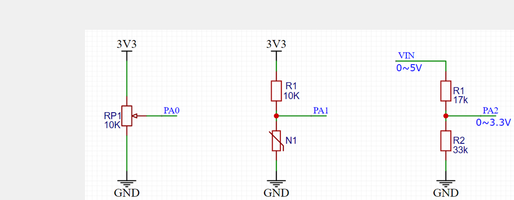
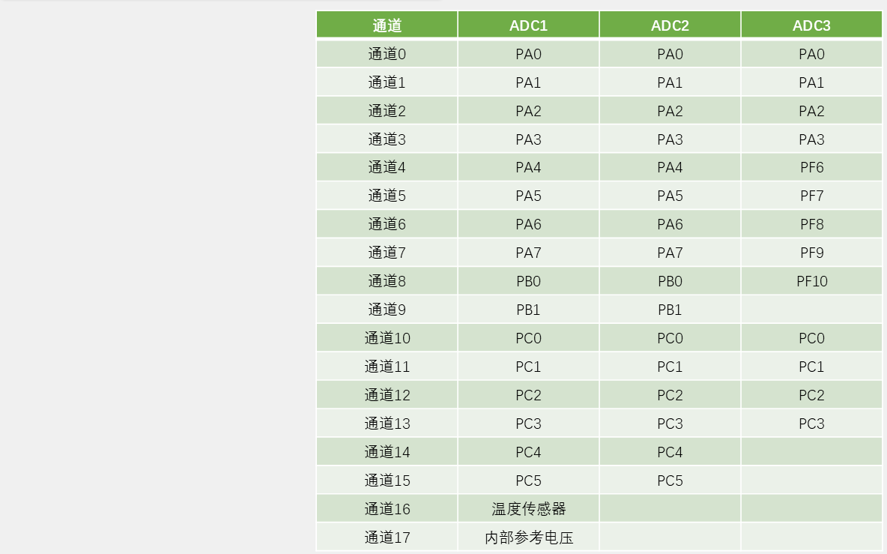
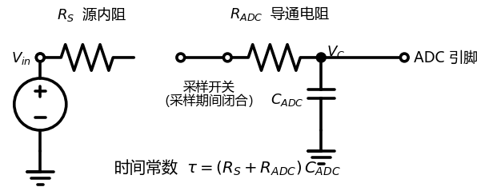
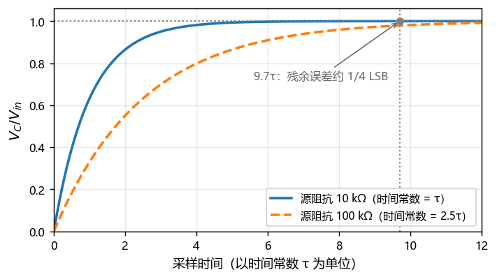

# 06 ADC：量化、采样时间与单次转换

## 本章问题

模拟电压怎样变成芯片里的一个数？做这件事的是 ADC。读数准不准，取决于参考电压、采样时间和转换模式。本章用一只电位器走完“采样 → 量化 → 显示”的完整链路。

## 学习目标

- 换算 12 位 ADC 原码对应的输入电压。
- 按 ADC 时钟和信号源内阻选择采样档位。
- 用单次、非扫描模式完成一个通道的采集。
- 分层定位 ADC 读数异常。

## 1. ADC 的工作

ADC 在指定时刻把模拟电压映射成有限位数的数字码。12 位 ADC 只有 4096 个格子，两个相差不到一格电压的输入会得到同一个结果。

STM32F1 的 ADC 采用逐次逼近结构，一次转换分四步：

1. 采样开关闭合，外部电压给采样电容充电；
2. 开关断开，电容上的电压被保持；
3. SAR 从最高位开始，逐位与保持电压比较，定出 12 位结果；
4. 结果写入数据寄存器 `DR`，由 CPU 或 DMA 取走。

```text
外部输入 → 采样保持 → 逐次逼近 → DR → CPU/DMA → 换算 → 显示或控制
```

## 2. 分辨率、参考电压与输入范围

### 2.1 原码与电压

12 位 ADC 的输出范围是 `0~4095`。原码只是比例，满量程对应参考电压 $V_{REF}$：

$$
V_{in}\approx\frac{\mathrm{ADC\_Code}}{4095}V_{REF}
$$

$V_{REF}=3.3$ V、原码 2048 时：

$$
V_{in}\approx\frac{2048}{4095}\times3.3\approx1.6504\ \mathrm{V}
$$

一个码对应的电压约为：

$$
1\,LSB\approx\frac{3.3}{4096}\approx0.806\ \mathrm{mV}
$$

参考电压必须准确稳定。若实际 VDDA 只有 3.25 V，所有读数会整体偏大约 1.5%。

### 2.2 数据对齐

12 位结果放进 16 位寄存器有两种摆法：

- 右对齐：高 4 位补 0，读数是 `0~4095`；
- 左对齐：结果左移 4 位，读数是原码的 16 倍。

本章统一用右对齐（`ADC_DATAALIGN_RIGHT`）。若用了左对齐，读回后要右移 4 位，否则数值会大 16 倍。

### 2.3 输入范围

ADC 输入必须落在 `VSSA~VDDA` 之间。超过 VDDA 时，采样电容只能充到 VDDA，原码停在 4095，读数失去意义，还可能损坏引脚。不要把 5 V 信号直接接进 F103 的模拟引脚。

ADC 引脚要配成 `GPIO_MODE_ANALOG`，关闭数字输入通路，减少干扰和功耗。常见的模拟输入接法有三种：



电位器滑动端直接输出可调电压；NTC 与固定电阻分压测温度；5 V 信号则要先用电阻分压到 3.3 V，例如 17 kΩ 与 33 kΩ 分压得到 $5\times33/(17+33)=3.3$ V。

## 3. 通道与 ADC 时钟

### 3.1 外部通道

STM32F103C8T6 有 ADC1 和 ADC2，每个 ADC 同一时刻只转换一路。常用通道映射：

| 通道 | 引脚 | 通道 | 引脚 |
| --- | --- | --- | --- |
| `ADC_CHANNEL_0` | PA0 | `ADC_CHANNEL_5` | PA5 |
| `ADC_CHANNEL_1` | PA1 | `ADC_CHANNEL_6` | PA6 |
| `ADC_CHANNEL_2` | PA2 | `ADC_CHANNEL_7` | PA7 |
| `ADC_CHANNEL_3` | PA3 | `ADC_CHANNEL_8` | PB0 |
| `ADC_CHANNEL_4` | PA4 | `ADC_CHANNEL_9` | PB1 |

通道号与引脚由硬件绑定，不能互换。C8T6 的 LQFP48 封装只引出这 10 个外部通道。片内温度传感器（通道 16）和参考电压 `VREFINT`（通道 17）不占引脚，且只接在 ADC1 上。



多通道扫描时，切换通道后采样电容里还残留着上一路的电荷，必须重新充满。通道数越多、源阻抗越大，一轮扫描的时间越紧。

### 3.2 ADC 时钟

ADC 时钟由 `PCLK2` 经专用预分频器得到：

$$
f_{ADC}=\frac{\mathrm{PCLK2}}{\mathrm{ADC\_Prescaler}}
$$

F103 的 ADC 时钟上限是 14 MHz。`PCLK2=72 MHz` 时：

| 预分频 | $f_{ADC}$ | 是否可用 |
| --- | ---: | --- |
| /2 | 36 MHz | 否 |
| /4 | 18 MHz | 否 |
| /6 | 12 MHz | 是 |
| /8 | 9 MHz | 是 |

本章选 `/6`，得到 12 MHz。STM32F1 的 ADC 分频属于 RCC 配置，不在 `ADC_InitTypeDef` 里，而在 `SystemClock_Config()` 末尾：

```c
PeriphClkInit.PeriphClockSelection = RCC_PERIPHCLK_ADC;
PeriphClkInit.AdcClockSelection = RCC_ADCPCLK2_DIV6;
if (HAL_RCCEx_PeriphCLKConfig(&PeriphClkInit) != HAL_OK)
{
  Error_Handler();
}
```

这段代码经常缺失。`.ioc` 和时钟树都显示 12 MHz，生成代码里却没有对应配置，ADC 就仍按复位默认的 `/2` 跑在 36 MHz，超出上限。直接核对两处：`.ioc` 里有没有 `RCC.ADCPresc=RCC_ADCPCLK2_DIV6`，`SystemClock_Config()` 末尾有没有 `HAL_RCCEx_PeriphCLKConfig()`。

## 4. 采样时间

### 4.1 转换时间

一次转换由采样窗口和逐次逼近两段组成：

$$
T_{\mathrm{total}}=\frac{T_{\mathrm{sample}}+12.5}{f_{ADC}}
$$

12.5 个周期来自 12 位比较和半拍固定开销。可选采样档位是：

```text
1.5、7.5、13.5、28.5、41.5、55.5、71.5、239.5 个 ADC 周期
```

例如 14 MHz、采样 1.5 周期时，一次转换约 1 µs。这是理论值，不包含触发、总线和软件开销。

### 4.2 采样窗口与源阻抗

采样窗口是采样开关闭合的时间，电容在这段时间里充电。窗口太短，电容没充满，读数会偏低。



充电按指数规律进行：

$$
V_C(t)=V_{in}\left(1-e^{-t/\tau}\right),\qquad \tau=(R_S+R_{ADC})C_{ADC}
$$



要让残余误差小于约四分之一 LSB，采样时间至少取 $9.7\tau$。以 $R_{ADC}\le1$ kΩ、$C_{ADC}\approx8$ pF、源阻抗 10 kΩ 为例：

$$
\tau=(10+1)\,\mathrm{k}\Omega\times8\,\mathrm{pF}\approx88\ \mathrm{ns}
$$

$$
t\ge9.7\times88\ \mathrm{ns}\approx0.85\ \mu\mathrm{s}
$$

12 MHz 下约 10.3 个周期，所以最短应选 13.5 档。实验用 55.5 档，采样时间约 4.6 µs，约为时间常数的 52 倍，对常见 10 kΩ 电位器余量充足。

### 4.3 档位怎么选

| 信号源 | 源阻抗 | 建议档位 | 理由 |
| --- | --- | --- | --- |
| 运放缓冲输出 | 很低 | 1.5~7.5 | 电容瞬间充满，可提高吞吐率 |
| 电位器、NTC、电阻分压 | 1 kΩ~100 kΩ | 55.5 起步 | 10 kΩ 下约有 52τ 余量 |
| 内部温度、VREFINT | 片内 | 按数据手册 | 各有最小采样时间 |

源阻抗 100 kΩ 时，55.5 档只剩约 5.7τ，误差折合约 13 LSB，应改用 239.5 档，或在信号源后加电压跟随器。跟随器输出阻抗极低，相当于在 ADC 前放了一个蓄水池，源阻抗大又想跑高采样率时常用。

读数系统性偏低、无故跳动或切换通道后突变，先查源阻抗，再加大采样时间或加缓冲。

## 5. 转换模式与校准

扫描、连续、触发和 Rank 的关系可以记成：触发决定什么时候开始，扫描决定一次走几个通道，Rank 决定通道顺序。

| 触发 | 扫描 | 一次触发后的行为 | 数据去向 |
| --- | --- | --- | --- |
| 单次 | 关 | 转换 Rank 1 后停止 | CPU 轮询读 `DR` |
| 连续 | 关 | 反复转换 Rank 1 | CPU 每次读最新值 |
| 单次 | 开 | 按 Rank 走一轮后停止 | DMA 搬进数组 |
| 连续 | 开 | 一轮接一轮 | DMA 循环覆盖数组 |

非扫描时只用 Rank 1。要轮流读不同通道，可以停机后重配 Rank 1；要一次得到多个结果，应固定 Rank 顺序并用 DMA，见第 07 章。

F103 在第一次正式转换前应校准一次：

```c
if (HAL_ADCEx_Calibration_Start(&hadc1) != HAL_OK)
{
    Error_Handler();
}
```

校准在 `MX_ADC1_Init()` 之后、第一次 `HAL_ADC_Start()` 之前执行。漏掉不会报错，典型表现是最低几位在几个码之间来回摆，容易被误当成干扰。CubeMX 不会自动生成这行代码。

## 6. 实验：单通道软件触发采集

### 6.1 接线

```text
3.3 V   → 电位器固定端
GND     → 另一个固定端
滑动端  → PA0 / ADC_CHANNEL_0
```

开发板与外部电路共地，PA0 不得高于 VDDA。先用万用表确认滑动端电压在 0~3.3 V 之间。

本章的 OLED 沿用 [[02 OLED 调试：I2C 显示数据流]] 的硬件 I2C2 版（`PB10/PB11`，地址 `0x78`）。若工程里用的是软件 I2C 版，6.3 节删掉 `HAL_I2C_IsDeviceReady()` 那几行和 `#include "i2c.h"` 即可，`OLED_Init()` 和显示代码不变；两版不要同时登记。

### 6.2 CubeMX 配置

1. `PA0` 配置为 `Analog`。
2. 启用 ADC1 的 Regular Conversions，转换数量为 1。
3. Rank 1 选择 `ADC_CHANNEL_0`。
4. 采样时间选 `ADC_SAMPLETIME_55CYCLES_5`。
5. 关闭扫描和连续转换，外部触发选软件启动。
6. ADC 预分频选 `/6`，确认生成代码里有对应配置。
7. 第一次转换前执行校准。

生成的初始化代码如下：

```c
ADC_HandleTypeDef hadc1;

void MX_ADC1_Init(void)
{
    ADC_ChannelConfTypeDef channel = {0};

    hadc1.Instance = ADC1;
    hadc1.Init.ScanConvMode = ADC_SCAN_DISABLE;
    hadc1.Init.ContinuousConvMode = DISABLE;
    hadc1.Init.DiscontinuousConvMode = DISABLE;
    hadc1.Init.NbrOfConversion = 1U;
    hadc1.Init.ExternalTrigConv = ADC_SOFTWARE_START;
    hadc1.Init.DataAlign = ADC_DATAALIGN_RIGHT;
    if (HAL_ADC_Init(&hadc1) != HAL_OK)
    {
        Error_Handler();
    }

    channel.Channel = ADC_CHANNEL_0;
    channel.Rank = ADC_REGULAR_RANK_1;
    channel.SamplingTime = ADC_SAMPLETIME_55CYCLES_5;
    if (HAL_ADC_ConfigChannel(&hadc1, &channel) != HAL_OK)
    {
        Error_Handler();
    }
}
```

关键字段：

| 字段 | 含义 | 填错的后果 |
| --- | --- | --- |
| `ScanConvMode` | 关闭扫描，只转 Rank 1 | 开扫描却轮询读 `DR`，结果会被下一通道覆盖 |
| `ContinuousConvMode` | 一次触发只转一次 | 选连续后会一直转换，占用 ADC |
| `NbrOfConversion` | 规则组长度 | 与实际 Rank 数不符时，数据会少一半或多出残留值 |
| `ExternalTrigConv` | 软件启动 | 选硬件触发却没启动定时器，永远等不到转换 |
| `DataAlign` | 结果右对齐 | 左对齐未右移，读数大 16 倍 |
| `SamplingTime` | 每通道的采样窗口 | 太短且源阻抗大时读数偏低 |

F103 的 `ADC_InitTypeDef` 没有分辨率字段，ADC 固定 12 位。采样时间也不在总初始化里，而是按通道配置，所以每个 Rank 可以用不同档位。

PA0 的模拟模式在 `adc.c` 底部的 `HAL_ADC_MspInit()` 中配置，`HAL_ADC_Init()` 会回调它。

### 6.3 代码

先在 `USER CODE BEGIN Includes` 和 `PV` 里补齐本章要用的头文件与变量：

```c
/* USER CODE BEGIN Includes */
#include <stdio.h>
#include "i2c.h"
#include "OLED.h"
/* USER CODE END Includes */

/* USER CODE BEGIN PV */
uint16_t adc_code = 0U;
uint32_t voltage_mv = 0U;
char text[16];
/* USER CODE END PV */
```

`USER CODE BEGIN 2` 里先初始化显示和 ADC，再做校准：

```c
HAL_Delay(20U);
if (HAL_I2C_IsDeviceReady(&hi2c2, 0x78U, 3U, 100U) != HAL_OK)
{
  Error_Handler();
}
OLED_Init();
if (HAL_ADCEx_Calibration_Start(&hadc1) != HAL_OK)
{
  Error_Handler();
}
```

主循环里启动转换、等待完成、读值并显示：

```c
if (HAL_ADC_Start(&hadc1) == HAL_OK &&
    HAL_ADC_PollForConversion(&hadc1, 10U) == HAL_OK)
{
  adc_code = (uint16_t)HAL_ADC_GetValue(&hadc1);
  voltage_mv = ((uint32_t)adc_code * 3300U + 2047U) / 4095U;
}

OLED_Clear();
snprintf(text, sizeof(text), "ADC:%4u", (unsigned int)adc_code);
OLED_ShowString(0, 0, text, OLED_8X16);
snprintf(text, sizeof(text), "V:%u.%03uV",
         (unsigned int)(voltage_mv / 1000U),
         (unsigned int)(voltage_mv % 1000U));
OLED_ShowString(0, 16, text, OLED_8X16);
OLED_Update();
HAL_Delay(100U);
```

电压换算用整数毫伏，避免浮点：

$$
V_{\mathrm{mv}}\approx\frac{\mathrm{ADC\_Code}\times3300}{4095}
$$

`adc_code` 先转成 `uint32_t` 再乘，防止溢出；加 2047 是四舍五入；显示时拆成整数伏和三位小数。显示函数只改显存，`OLED_Update()` 才发送到屏幕。

55.5 加 12.5 共 68 个周期，12 MHz 下一次转换约 5.67 µs，远快于 100 ms 的显示刷新，不是瓶颈。

### 6.4 现象与排查

旋转电位器，原码在 `0~4095` 之间变化，电压按原码比例变化。接近 GND 时读数接近 0，接近 3.3 V 时接近 4095。OLED 读数应与万用表趋势一致，末位轻微波动正常。

没有电位器时，把 PA0 分别短接到 GND 和 3.3 V 做对照。两端都不对，查模拟输入配置、通道映射、参考电压和共地；两端正常而电位器读数异常，查电位器接线和分压。先量滑动端，再量 PA0 引脚，两处一致才说明连线没问题。

### 6.5 驱动库写法

`E:\ProjectStm\驱动库\RP` 把“配通道、启动、等完成、读值”封成两个函数：

```c
void RP_Init(void);                 /* 内部执行校准 */
uint16_t RP_GetValue(uint8_t n);    /* n = 1~4，返回 0~4095 */
```

把 `rp.c`、`rp.h` 复制到 `User/Drivers/RP/` 并登记；`main.c` 里 `MX_ADC1_Init()` 之后要先调一次 `RP_Init()`。

主循环只剩 `adc_code = RP_GetValue(1);`。它每次调用都会重配通道，所以 CubeMX 里 ADC 必须保持单次、非扫描、软件触发。默认绑定 ADC2 的通道 2~5（`PA2~PA5`），本实验改两个宏：

```c
#define RP_ADC_HANDLE   hadc1              /* 默认 hadc2 */
#define RP1_CHANNEL     ADC_CHANNEL_0      /* 默认 ADC_CHANNEL_2 */
```

`RP_SAMPLING_TIME` 才是驱动实际使用的采样档位，CubeMX 里那一档只对直接调用 HAL 的写法有效，两处填成同一档最省心。

封装省掉的是重复代码，不是原理。`RP_GetValue()` 没有超时处理，ADC 真坏了程序会一直等下去。调试阶段直接调 HAL 更容易看清每一步。

倒立摆的 RP 驱动默认用 ADC2 的 `CH2~CH5`（`PA2~PA5`），本章用 ADC1/`PA0` 只是单通道最小实验；换回综合工程时把 6.5 节改过的 `RP_ADC_HANDLE` 与通道宏改回 `hadc2`、`ADC_CHANNEL_2~5` 即可，采样结构不变，见 [[STM32倒立摆/03 基础驱动：CubeMX与HAL库实现#1.5 与入门教程共用驱动]]。

上一篇：[[05 定时器：时基、PWM、输入捕获与电机控制]] ｜ 下一篇：[[07 DMA：数据搬运与 ADC 多通道采集]]
