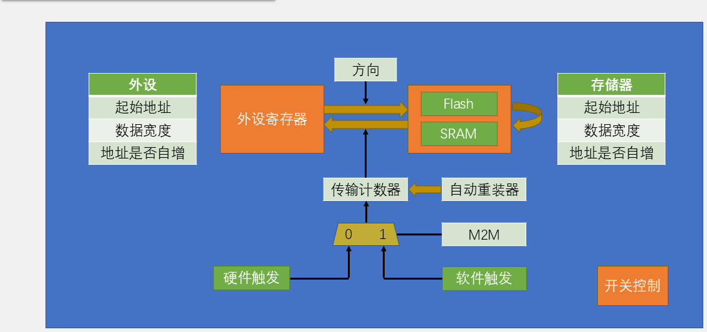
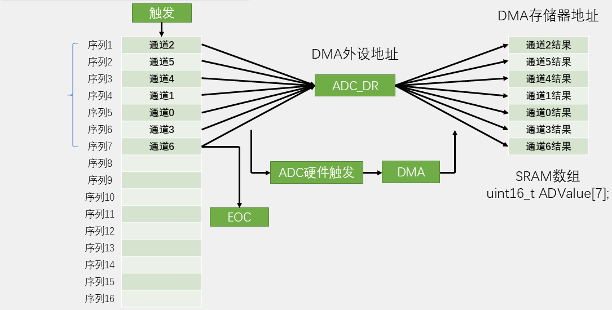

# 07 DMA：数据搬运与 ADC 多通道采集

## 本章问题

第 06 章的 ADC 采集靠 CPU 轮询，转一个读一个。通道一多、采样一密，CPU 的时间就花在等转换、读 `DR`、存数组上。本章让 DMA 替 CPU 搬数据：配置一次，硬件按请求把一批结果直接写进内存。

## 学习目标

- 说清 DMA 的源地址、目的地址、宽度、自增和数量。
- 根据请求映射选择 STM32F103 的 DMA 通道。
- 用 HAL 完成一次内存到内存复制。
- 配置 ADC 扫描与 DMA，区分 Normal 和 Circular。
- 用定时器 TRGO 固定多通道采样的触发周期。

## 1. DMA 与 CPU 的分工

DMA 是独立于 CPU 的总线主控。CPU 只负责写配置：源地址、目的地址、数据宽度、是否自增、传输数量、模式和优先级。使能通道后，软件或外设发出请求，DMA 自己完成一次读、一次写，更新地址并把计数减一；计数归零时置完成标志，必要时通知 CPU。

CPU 只在开始和结束时出场，中间每一次搬运都不占它的指令周期。

对比中断方式：4 个通道、1 kHz 采样，每秒要进 4000 次中断。用 DMA，CPU 只配置一次，整帧结束才通知一次。

代价是 DMA 与 CPU 共用总线。搬运期间 CPU 仍能运行，只是访问内存可能略慢。数据量很小时，直接赋值反而更快。

DMA 不保证“绝不漏”。外设每来一个请求只是按一次门铃，如果通道正忙着搬上一次，这次请求不会被记住。ADC 的下一次结果会覆盖 `DR`，数组看不出异常，程序也不报错。要避免丢数据，数据产生速度必须低于搬运能力，必要时提高通道优先级或缩短单次传输。

### 1.1 地址怎么走

外设寄存器只有一个位置，ADC 结果永远落在 `ADC1->DR`；数组要一格一格往后写：

```text
外设端：ADC1->DR → ADC1->DR → ADC1->DR    （不自增）
内存端：values[0] → values[1] → values[2]  （递增）
```

所以 ADC 采集要配成“外设地址不自增、内存地址递增”。数组复制时两端都在 SRAM，两端都要自增。

### 1.2 三种取数方式

| 方式 | CPU 做什么 | 适用场景 | 代价 |
| --- | --- | --- | --- |
| 轮询 | 一直查状态并亲自读写 | 低频、流程简单 | 等待期间做不了别的 |
| 中断 | 每次事件进一次服务函数 | 事件不频繁、每次数据少 | 高频事件中断开销大 |
| DMA | 配置一次，按请求搬一批 | 连续采样、串口、SPI | 配置和缓冲区管理复杂 |

## 2. 一次搬运怎么发生



把搬运配置落到界面上，要回答七个问题：

| 问题 | 配置项 |
| --- | --- |
| 从哪里取 | 外设地址或源内存地址 |
| 送到哪里 | 外设地址或目的内存地址 |
| 每次搬多宽 | Byte、Half Word、Word |
| 地址是否后移 | 两端各自的自增开关 |
| 总共搬几项 | 传输数量 |
| 搬完是否重来 | Normal 或 Circular |
| 冲突时谁先走 | 通道优先级 |

外设通常在“可以接收下一项”或“产生了新数据”时发请求：USART 发送寄存器空、收到一个字节、ADC 转换完成、定时器更新。基本节拍是：

```text
外设事件 → DMA 请求 → 搬运一项 → 剩余计数减 1
```

内存到内存没有外设请求，使能通道后直接开始。

### 2.1 F103 的请求映射

STM32F103C8T6 只有 DMA1，包含 7 个通道。哪个外设接哪个通道由芯片内部固定，不能改：

| 通道 | 本教程用到的请求 |
| --- | --- |
| `Channel1` | `ADC1` |
| `Channel2` | `SPI1_RX` |
| `Channel3` | `SPI1_TX` / `USART3_RX` |
| `Channel4` | `I2C2_TX` |
| `Channel5` | `I2C2_RX` |
| `Channel6` | `USART2_RX` / `I2C1_TX` |
| `Channel7` | `USART2_TX` / `I2C1_RX` |

本章三个实验都落在 `DMA1_Channel1`，不能同时运行，所以各建一个工程。

同一控制器收到多个请求时，按软件优先级和通道号仲裁。优先级只改变冲突时的顺序，不能提高外设产生数据的速度。

## 3. 关键配置

### 3.1 宽度与数量

| CubeMX 名称 | 位宽 | 常见类型 |
| --- | ---: | --- |
| Byte | 8 bit | `uint8_t` |
| Half Word | 16 bit | `uint16_t` |
| Word | 32 bit | `uint32_t` |

12 位 ADC 结果用 Half Word，串口逐字节收发用 Byte。两端宽度必须一致，也要和数组元素类型一致。DMA 不认识 C 类型，只知道“每次搬 N 字节，地址前移 N 字节”。

类型不匹配编译器不报错。宽度选 Word、数组却是 `uint16_t[4]` 时，DMA 按 4 字节步长写下去，越过数组末尾，把相邻变量一起改掉。

传输数量填元素个数，不是字节数。4 个 `uint16_t` 元素就填 4：

```c
#define ARRAY_LEN(a) (sizeof(a) / sizeof((a)[0]))

HAL_ADC_Start_DMA(&hadc1,
                  (uint32_t *)adc_values,
                  ARRAY_LEN(adc_values));
```

`(uint32_t *)` 强转是因为 F1 的 HAL 形参写成了 `uint32_t *`。强转只让编译器闭嘴，不改变内存布局；每次搬多少字节仍由 Data Width 决定。

### 3.2 地址自增

ADC 采集：外设端不自增，内存端自增。忘记开内存自增，所有结果会反复覆盖 `values[0]`。内存到内存复制：两端都自增。

### 3.3 Normal 与 Circular

Normal：计数归零后停止，缓冲区保持不变，下一批数据要由软件重新启动。适合单帧采集和命令式收发。

Circular：计数归零后自动重装地址和数量，继续覆盖同一缓冲区。适合连续 ADC、持续串口接收。CPU 读取时 DMA 可能正在写同一块内存。

F1 的 Memory-to-Memory 模式不能与 Circular 同时使用，需要重复复制时在一轮 Normal 结束后重新启动。

### 3.4 中断

中断只通知“某个阶段完成了”，搬运仍由 DMA 执行。以传输数量 8 为例：

```text
搬完第 4 项 → Half Transfer
搬完第 8 项 → Transfer Complete
总线出错   → Transfer Error
```

Half Transfer 精确对应剩余计数从 8 减到 4 的时刻。Normal 模式下触发一次后 HAL 会自动关闭这个中断，只有 Circular 模式才每轮成对触发。

回调里只置标志、复制稳定半区，刷屏和格式化留给主循环。

## 4. 从任务反推配置

### 4.1 内存复制

```text
source[0..7] → DMA1_Channel1 → destination[0..7]
```

| 配置项 | 选择 | 理由 |
| --- | --- | --- |
| 方向 | Memory to Memory | 两端都是内存 |
| 源地址 | `source` | 填在外设端 |
| 目的地址 | `destination` | 存储器端 |
| 宽度 | Word | 元素是 `uint32_t` |
| 两端自增 | Enable | 逐项访问 |
| 数量 | 8 | 元素个数 |
| 模式 | Normal | 只复制一轮 |
| 触发 | M2M | 没有外设请求 |

### 4.2 ADC 四通道

```text
ADC1->DR（固定） → DMA1_Channel1 → adc_values[0..3]（递增）
```

| 配置项 | 选择 | 理由 |
| --- | --- | --- |
| 方向 | Peripheral to Memory | ADC 寄存器是源 |
| 外设地址 | `&ADC1->DR` | 所有 Rank 共用 |
| 内存地址 | `adc_values` | 结果数组 |
| 宽度 | Half Word | 对应 `uint16_t` |
| 外设自增 | Disable | 每次都读 `DR` |
| 内存自增 | Enable | 依次写入 |
| 数量 | 4 | 每帧四个结果 |
| 模式 | Normal 或 Circular | 由采集节奏决定 |
| 触发 | 硬件请求 | 每次转换完成 |

数组下标由 Rank 顺序决定，与通道号大小无关。

## 5. HAL 初始化与回调

### 5.1 配置顺序

1. 先启用产生或消费数据的外设。
2. 在外设的 DMA Settings 中添加请求。
3. 确认 DMA 控制器和通道。
4. 设置方向、宽度和两端自增。
5. 选择 Normal 或 Circular，设置优先级。
6. 需要回调时打开对应 DMA 通道的 NVIC。
7. 生成后检查 `MX_DMA_Init()`、`__HAL_LINKDMA` 和中断入口。

`MX_DMA_Init()` 必须在 `MX_ADC1_Init()` 之前执行：它先打开 DMA1 时钟并配置通道 NVIC；ADC 的 `__HAL_LINKDMA` 和 `HAL_DMA_Init()` 在 `HAL_ADC_MspInit()` 里执行，DMA 时钟没开时这些寄存器写入不会生效。

| 填错项 | 典型后果 |
| --- | --- |
| 内存自增没开 | 结果反复写 `adc_values[0]`，其余元素不变 |
| 宽度选成 Word | 数值错位，越过数组末尾 |
| 该 Normal 选成 Circular | 数组被持续覆盖 |
| 请求没加或选错外设 | DMA 不启动，数组始终为 0 |
| NVIC 没勾 | 数据照搬，但回调不执行 |

### 5.2 常用接口

| API | 作用 |
| --- | --- |
| `HAL_DMA_Start()` | 启动普通传输 |
| `HAL_DMA_Start_IT()` | 启动并允许中断 |
| `HAL_DMA_PollForTransfer()` | 轮询等待完成 |
| `HAL_DMA_IRQHandler()` | 处理中断并调用回调 |
| `HAL_ADC_Start_DMA()` | 启动 ADC 并把结果交给 DMA |
| `HAL_ADC_Stop_DMA()` | 停止 ADC DMA |

ADC DMA 场景不要用 `HAL_DMA_RegisterCallback()` 覆盖 `XferCpltCallback`。`HAL_ADC_Start_DMA()` 已经把它指向驱动内部处理，覆盖后 `HAL_ADC_ConvCpltCallback()` 就不会执行。

### 5.3 回调链

```text
DMA1 Channel 1 传输完成
→ DMA1_Channel1_IRQHandler()
→ HAL_DMA_IRQHandler()
→ ADC_DMAConvCplt()
→ HAL_ADC_ConvCpltCallback()
```

`HAL_ADC_ConvCpltCallback()` 不执行时，除了 ADC，还要查 DMA 通道的 NVIC、中断入口和句柄关联。

## 6. 实验一：内存到内存复制

目标是用 DMA 把 `source[8]` 复制到 `destination[8]`，再逐项比较。不接外部器件，`PC13` 配成开漏输出、初始高，作为心跳灯。

### 6.1 CubeMX 配置

打开 `System Core → DMA` 点 `Add`，`Select` 选 `MEM2MEM`：

| 项目 | 设置 |
| --- | --- |
| 通道 | `DMA1_Channel1` |
| Mode | Normal |
| Direction | Memory to Memory |
| Source Increment | Enable |
| Destination Increment | Enable |
| Source / Destination Data Width | Word |
| Priority | Low |

内存到内存模式下，CubeMX 的 Source/Destination 在 HAL 里叫 `PeriphInc` 和 `MemInc`，两端填的都是 SRAM 地址，自增开关仍要各自设置。

本实验用轮询等待完成，不需要勾 DMA 中断。

### 6.2 代码

```c
#include "main.h"
#include <stdint.h>

#define COPY_COUNT 8U

uint32_t source[COPY_COUNT] =
{
    0x11111111U, 0x22222222U, 0x33333333U, 0x44444444U,
    0x55555555U, 0x66666666U, 0x77777777U, 0x88888888U
};

uint32_t destination[COPY_COUNT] = {0};
volatile uint8_t copy_ok = 0U;

static void DMA_CopyOnce(void)
{
    HAL_StatusTypeDef status;
    uint32_t i;

    status = HAL_DMA_Start(&hdma_memtomem_dma1_channel1,
                           (uint32_t)source,
                           (uint32_t)destination,
                           COPY_COUNT);
    if (status != HAL_OK)
    {
        Error_Handler();
    }

    status = HAL_DMA_PollForTransfer(&hdma_memtomem_dma1_channel1,
                                     HAL_DMA_FULL_TRANSFER,
                                     HAL_MAX_DELAY);
    if (status != HAL_OK)
    {
        Error_Handler();
    }

    copy_ok = 1U;
    for (i = 0U; i < COPY_COUNT; i++)
    {
        if (destination[i] != source[i])
        {
            copy_ok = 0U;
            break;
        }
    }
}
```

在所有 `MX_xxx_Init()` 之后调用一次。Normal 模式要重复复制时，确认上一轮已停止，再调用 `HAL_DMA_Start()` 重装计数：

```c
DMA_CopyOnce();

while (1)
{
    source[0]++;
    DMA_CopyOnce();
    HAL_Delay(1000);
}
```

第三个参数是元素数 8，不是字节数 32。`HAL_DMA_PollForTransfer()` 返回后才比较数组，DMA 还在搬时读到的内容没有意义。

### 6.3 现象与排查

下载后在 Watch 窗口看 `copy_ok` 和 `destination`：数组应与 `source` 完全相同，`copy_ok` 为 1。

`destination` 全 0，说明 DMA 没启动，先确认 `MX_DMA_Init()` 在调用之前、`HAL_DMA_Start()` 是否返回 `HAL_OK`。程序停在 `Error_Handler()`，常见于上一轮还没结束就再次启动。只有部分元素正确，查自增开关和传输数量。

## 7. 实验二：ADC 扫描加 DMA 单帧采集

目标是让 ADC 按 Rank 扫描四个通道，DMA 把结果依次写进数组，回调后主循环读取。先用 Normal 模式验证顺序和边界。

```text
启动一次 ADC DMA
→ ADC 按 Rank 扫描一轮
→ DMA 填满数组后停止
→ 回调置位
→ 主循环处理稳定数组
→ 软件重新启动
```

多个 Rank 共用同一个 `DR`：



每一拍由“该 Rank 转换完成”触发，所以 `adc_values[0]` 一定是 Rank 1 的结果。

### 7.1 接线与 Rank

| Rank | 通道 | 示例输入 | 数组位置 |
| ---: | --- | --- | --- |
| 1 | IN0 / PA0 | 电位器 | `adc_values[0]` |
| 2 | IN1 / PA1 | 光敏分压 | `adc_values[1]` |
| 3 | IN2 / PA2 | NTC 分压 | `adc_values[2]` |
| 4 | IN3 / PA3 | 红外分压 | `adc_values[3]` |

模拟输入要与开发板共地、不超 3.3 V，GPIO 配成 Analog。先固定 Rank，再确定数组含义。

### 7.2 CubeMX 配置

1. 在 `Analog` 中勾选 `ADC1`，把 `PA0~PA3` 点成 `ADC1_IN0~IN3`。
2. 勾选四个通道，`Number of Conversion` 填 4，在 Rank 1~4 中确认顺序。
3. 打开 `Scan Conversion Mode`，关闭 `Continuous Conversion Mode`，触发先选 `Software Start`。
4. 每个通道设置足够的采样时间，参考第 06 章。
5. 在 `DMA Settings` 点 `Add`，`Select` 选 `ADC1`，通道自动为 `DMA1 Channel 1`。
6. 按表填写 DMA 字段，连续采集时才把 Mode 改成 Circular：

| 项目 | 设置 |
| --- | --- |
| Direction | Peripheral to Memory |
| Peripheral Increment | Disable |
| Memory Increment | Enable |
| 两端宽度 | Half Word |
| Mode | Normal |
| Priority | High |

7. 在 NVIC 中勾选 `DMA1 channel1 global interrupt`。
8. 确认 ADC 分频 `/6`，`f_ADC=12 MHz`，生成代码。

检查 `SystemClock_Config()` 末尾确实有：

```c
PeriphClkInit.PeriphClockSelection = RCC_PERIPHCLK_ADC;
PeriphClkInit.AdcClockSelection = RCC_ADCPCLK2_DIV6;
if (HAL_RCCEx_PeriphCLKConfig(&PeriphClkInit) != HAL_OK)
{
    Error_Handler();
}
```

生成后核对三处：`dma.c` 中的句柄和 `HAL_NVIC_EnableIRQ(DMA1_Channel1_IRQn)`；`adc.c` 中 `HAL_ADC_MspInit()` 里的 `__HAL_LINKDMA`；`stm32f1xx_it.c` 中的 `DMA1_Channel1_IRQHandler()`。漏 NVIC 或中断入口，数据照搬但回调不执行；漏 `__HAL_LINKDMA` 会让 `hadc->DMA_Handle` 为空，`HAL_ADC_Start_DMA()` 解引用空句柄并进入 HardFault；把 `MX_DMA_Init()` 排到 ADC 之后，DMA1 时钟尚未打开，`HAL_DMA_Init()` 的写入不生效，表现为传输不启动或数据不动。

### 7.3 代码

```c
/* USER CODE BEGIN Includes */
#include "main.h"
#include "adc.h"
#include "dma.h"
#include "i2c.h"
#include <stdint.h>
#include <stdio.h>
#include "OLED.h"
/* USER CODE END Includes */

/* USER CODE BEGIN PV */
#define ADC_CHANNEL_COUNT 4U

uint16_t adc_values[ADC_CHANNEL_COUNT] = {0};
volatile uint8_t adc_frame_ready = 0U;
volatile uint8_t adc_frame_error = 0U;
/* USER CODE END PV */

/* USER CODE BEGIN PFP */
static void ADC_StartOneFrame(void);
/* USER CODE END PFP */

/* USER CODE BEGIN 4 */
static void ADC_StartOneFrame(void)
{
    if (HAL_ADC_Start_DMA(&hadc1,
                          (uint32_t *)adc_values,
                          ADC_CHANNEL_COUNT) != HAL_OK)
    {
        Error_Handler();
    }
}

void HAL_ADC_ConvCpltCallback(ADC_HandleTypeDef *hadc)
{
    if (hadc->Instance == ADC1)
    {
        adc_frame_ready = 1U;     /* 回调只置位 */
    }
}

void HAL_ADC_ErrorCallback(ADC_HandleTypeDef *hadc)
{
    if (hadc->Instance == ADC1)
    {
        adc_frame_error = 1U;
    }
}
/* USER CODE END 4 */
```

`MX_GPIO_Init()` → `MX_DMA_Init()` → `MX_ADC1_Init()` 的顺序不能变；`MX_I2C2_Init()` 只负责 OLED，放在 ADC 之后即可。本实验的 OLED 沿用第 02 章硬件 I2C2 版（`PB10/PB11`），若改用软件版，删掉 `MX_I2C2_Init()`、`#include "i2c.h"` 和 `hi2c2` 相关代码。

```c
/* USER CODE BEGIN 2 */
OLED_Init();

if (HAL_ADCEx_Calibration_Start(&hadc1) != HAL_OK)
{
    Error_Handler();
}
ADC_StartOneFrame();
/* USER CODE END 2 */

/* USER CODE BEGIN WHILE */
while (1)
{
    if (adc_frame_ready != 0U)
    {
        char text[16];

        adc_frame_ready = 0U;

        OLED_Clear();
        snprintf(text, sizeof(text), "PA0:%4u", (unsigned int)adc_values[0]);
        OLED_ShowString(0, 0, text, OLED_8X16);
        snprintf(text, sizeof(text), "PA1:%4u", (unsigned int)adc_values[1]);
        OLED_ShowString(0, 16, text, OLED_8X16);
        snprintf(text, sizeof(text), "PA2:%4u", (unsigned int)adc_values[2]);
        OLED_ShowString(0, 32, text, OLED_8X16);
        snprintf(text, sizeof(text), "PA3:%4u", (unsigned int)adc_values[3]);
        OLED_ShowString(0, 48, text, OLED_8X16);
        OLED_Update();

        HAL_Delay(100);
        ADC_StartOneFrame();
    }

    if (adc_frame_error != 0U)
    {
        adc_frame_error = 0U;
        HAL_ADC_Stop_DMA(&hadc1);
        ADC_StartOneFrame();
    }
}
/* USER CODE END WHILE */
```

DMA 初始化必须早于 ADC，校准必须在 `MX_ADC1_Init()` 之后、第一次启动之前。下一帧必须在本帧处理完之后启动，否则会撞上 `HAL_BUSY`。

### 7.4 现象与排查

转动某一传感器，对应下标变化，其他下标不应交换。四个数都变但整体错位一格，先查 Rank 顺序和 `Number of Conversion`，不要改数组下标掩盖配置错误。全部为 0，按初始化顺序、DMA 请求和 NVIC 逐级查。只刷新一次就停，是 Normal 模式结束后没有重新启动。

## 8. 连续采集

让 ADC 自由连续扫描，要同时打开 ADC 的 `Continuous Conversion Mode` 和 DMA 的 `Circular`。两者每轮的长度必须相等：ADC 绕回 Rank 1 时，DMA 也正好绕回 `adc_values[0]`。

```c
if (HAL_ADCEx_Calibration_Start(&hadc1) != HAL_OK)
{
    Error_Handler();
}

if (HAL_ADC_Start_DMA(&hadc1,
                      (uint32_t *)adc_values,
                      ADC_CHANNEL_COUNT) != HAL_OK)
{
    Error_Handler();
}

while (1)
{
    HAL_Delay(100);
}
```

启动一次后不再重启。Continuous 不是 Circular 的必要条件：用定时器固定周期触发时，可以关闭 Continuous，只保留 Circular DMA。

Continuous + Circular 适合观察慢变化量，但不保证 CPU 读到的四个元素来自同一轮扫描。`volatile` 只能约束编译器，不提供帧一致性。

## 9. 实验三：TIM3 TRGO 固定扫描周期

目标是由 TIM3 每 1 ms 触发一轮四通道扫描，主循环忙显示时节奏也不变。新建 `03_ADC_TimerTrigger`，用 PC13 和调试器验证。

### 9.1 配置

| 资源 | 配置 |
| --- | --- |
| ADC1 时钟 | PCLK2 / 6 = 12 MHz |
| ADC1 规则组 | Scan 开启，4 个 Rank 为 CH0~CH3，各 55.5 cycles |
| ADC1 连续 | 关闭 |
| ADC1 触发 | `Timer 3 Trigger Out event` |
| ADC1 DMA | DMA1 Channel1，外设固定、内存递增，Half Word，Circular |
| DMA1 NVIC | 开启，抢占优先级 1 |
| TIM3 | 内部时钟，向上，PSC=71，ARR=999，更新频率 1 kHz |
| TIM3 主模式 | TRGO = Update Event |

TIM3 不需要 PWM 引脚，也不需要开中断。TRGO 是片内连线，不用接导线。

四路扫描约需 `4 × (55.5 + 12.5) / 12 MHz ≈ 22.7 µs`，远小于 1 ms。通道更多或采样时间更长时，要确认一轮能在下一次触发前完成。

### 9.2 代码

```c
#include "main.h"
#include "gpio.h"
#include "dma.h"
#include "adc.h"
#include "tim.h"

void SystemClock_Config(void);

static volatile uint16_t adc_values[4];
static volatile uint32_t adc_frame_count = 0U;
static volatile uint8_t adc_frame_error = 0U;

void HAL_ADC_ConvCpltCallback(ADC_HandleTypeDef *hadc)
{
    static uint16_t led_frames = 0U;
    if (hadc->Instance == ADC1)
    {
        ++adc_frame_count;
        if (++led_frames >= 500U)
        {
            led_frames = 0U;
            HAL_GPIO_TogglePin(GPIOC, GPIO_PIN_13);
        }
    }
}

void HAL_ADC_ErrorCallback(ADC_HandleTypeDef *hadc)
{
    if (hadc->Instance == ADC1)
    {
        adc_frame_error = 1U;
    }
}

int main(void)
{
    HAL_Init();
    SystemClock_Config();
    MX_GPIO_Init();
    MX_DMA_Init();
    MX_ADC1_Init();
    MX_TIM3_Init();

    if (HAL_ADCEx_Calibration_Start(&hadc1) != HAL_OK)
    {
        Error_Handler();
    }
    if (HAL_ADC_Start_DMA(&hadc1, (uint32_t *)adc_values, 4U) != HAL_OK)
    {
        Error_Handler();
    }
    __HAL_DMA_DISABLE_IT(hadc1.DMA_Handle, DMA_IT_HT);

    __HAL_TIM_SET_COUNTER(&htim3, 0U);
    __HAL_TIM_CLEAR_FLAG(&htim3, TIM_FLAG_UPDATE);
    if (HAL_TIM_Base_Start(&htim3) != HAL_OK)
    {
        Error_Handler();
    }

    while (1)
    {
        if (adc_frame_error != 0U)
        {
            HAL_TIM_Base_Stop(&htim3);
            HAL_ADC_Stop_DMA(&hadc1);
            Error_Handler();
        }
        HAL_Delay(100U);
    }
}
```

`HAL_ADC_Start_DMA()` 的长度 4 是元素数。`HAL_TIM_Base_Start()` 不带 `_IT`，因为 CPU 不需要处理每次更新。启动顺序是“校准 → ADC/DMA 等待触发 → 启动 TIM3”，避免定时器先跑而采集端没准备好。

### 9.3 现象与验证

`adc_frame_count` 每秒约增加 1000，PC13 每 500 帧翻转一次，即每 500 ms 翻转。四个数组元素随各自输入变化。

想确认触发确实来自 TIM3，可在主循环临时调用 `HAL_TIM_Base_Stop(&htim3)`：计数应停止，重新启动后恢复。停止后仍增加，查是否误开 ADC Continuous；只增加一次，查 DMA 是否配成 Normal；始终为零，依次查 TIM3 的 TRGO、ADC 触发源、DMA 关联和 NVIC。

调试器暂停期间的变化不算采样率，也不要在这个 1 kHz 回调里打断点或打印。回调太长会导致完成通知合并，计数就不能代表全部采样。

倒立摆的 RP 采样目前是 ADC2 单次轮询，不能套用本章的 ADC + DMA：F103 只有 ADC1 具备 DMA 能力（`IS_ADC_DMA_CAPABILITY_INSTANCE` 只允许 ADC1），ADC2 没有 DMA 请求。倒立摆 03 篇把 ADC1 预留给角度传感器的 DMA 采样、RP 保持 ADC2 轮询，正是这个限制的体现；若要把四路电位器改成连续采集，需要改用 ADC1 的通道或另做软件采样，不能只换 Rank，见 [[STM32倒立摆/03 基础驱动：CubeMX与HAL库实现#6. 电位器：ADC2 单次转换]]。

上一篇：[[06 ADC：量化、采样时间与单次转换]] ｜ 下一篇：[[08 串口通信：轮询、中断与 DMA]]
