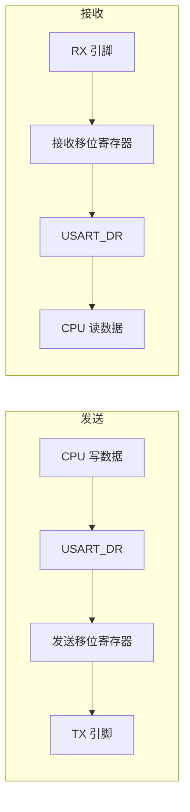

# 08 串口通信：轮询、中断与 DMA

## 本章问题

前面的数据都在芯片内部流动，本章让数据离开芯片：用 USART2 的 `PA2/PA3` 和电脑对话。要解决两件事：一个字节怎么进出芯片，四种收发方式各适合什么场合。

## 学习目标

- 画出一字节从内存到 TX 引脚、再从 RX 回到内存的路径。
- 说清 `TXE`、`TC`、`RXNE`、`IDLE` 的含义。
- 用轮询收发固定 2 字节命令。
- 用中断和 DMA 完成定长收发。
- 用 DMA 加 IDLE 接收不定长数据。

## 1. 串口基础

本章四个实验共用同一条链：输入是 RX 收到的字节，状态是长度、就绪和错误标志，输出是回显或 LED 电平。以 STM32F103C8T6 为例，电脑调试使用 USART2 的 `PA2/PA3`，参数 `115200, 8N1`。四个实验分别建工程。

### 1.1 一个字节怎么走

USART 的发送和接收各有一套移位寄存器，可以同时工作：



发送是“写一次寄存器，硬件按位输出”。接收是“硬件按约定节拍采样，CPU 需要时取走整字节”。

线路空闲时保持高电平。发送方先拉低一拍作为起始位，接收方据此对齐节拍，然后依次采样 8 个数据位（低位先发）、可选校验位和停止位。8N1 的一帧是：

```text
空闲高 → 起始位 0 → 8 个数据位 → 停止位 1 → 空闲高
```

波特率不对时，采样点逐位偏移，读到后面就全错了，现象是乱码。

### 1.2 电平与接线

STM32 的 USART 配置成异步模式后，就是没有时钟线的 TTL UART。3.3 V TTL 可以与 3.3 V 模块直连；5 V TTL 不能直接接 F103 的 `PA3`，因为 `PA2/PA3` 不是 5 V 容忍引脚；RS-232、RS-485 和 USB 都需要额外的收发器或转换芯片。

接线必须交叉并共地：

```text
设备 A TX → 设备 B RX
设备 A RX ← 设备 B TX
设备 A GND — 设备 B GND
```

两个 TX 接在一起会互相顶住，收不到数据还可能损坏引脚。共地只统一参考电位，不会把 5 V 变成 3.3 V。

### 1.3 8N1 与波特率

`115200, 8N1` 表示每秒 115200 个码元、8 个数据位、无校验、1 个停止位。每字节占 10 位：

$$
\frac{115200}{10}=11520\ \text{Byte/s}
$$

一个字节在线上的时间是 $10/115200\approx86.8\ \mu s$，这也是 IDLE 判定所用的整帧时间。

USART 的波特率分频是：

$$
\text{USARTDIV}=\frac{f_{\text{PCLK}}}{16\times\text{baud}}
$$

`PCLK1=36 MHz`、115200 时，USARTDIV 为 19.53125，HAL 生成 `BRR=0x138`。CubeMX 会自动计算，但改过系统时钟后要复核。串口全是乱码而收发字节数正确，通常就是这里没对上。

串口助手的 ASCII 和 HEX 只是显示方式：`H` 的字节是 `0x48`，文本模式显示 `H`，HEX 模式显示 `48`。

### 1.4 引脚与 DMA 映射

| USART | 默认 TX | 默认 RX | 时钟 | 本章用途 |
| --- | --- | --- | --- | --- |
| USART1 | PA9 | PA10 | APB2 | 可作调试口 |
| USART2 | PA2 | PA3 | APB1 | 电脑串口 |
| USART3 | PB10 | PB11 | APB1 | 扩展串口 |

三个 USART 都支持 DMA，请求固定：

| DMA1 通道 | 请求 |
| --- | --- |
| Channel 2 | USART3_TX |
| Channel 3 | USART3_RX |
| Channel 4 | USART1_TX |
| Channel 5 | USART1_RX |
| Channel 6 | USART2_RX |
| Channel 7 | USART2_TX |

同一通道还复用了 SPI1、I2C 等请求，完整映射见第 07 章 2.1 节。

`PB10/PB11` 同时是第 02 章 OLED 的 `I2C2` 引脚，C8T6 没有引出可重映射的 USART3 引脚，所以硬件 I2C2 和 USART3 只能二选一。要同时用 OLED，就改用 `PB8/PB9` 的软件 I2C。

## 2. 四种收发方式

| 方式 | 谁在等 | 适合 | 代价 |
| --- | --- | --- | --- |
| 轮询 | CPU 死等标志 | 上电问候、低频短数据 | 返回前主循环停工 |
| 中断 | 每字节打断一次 | 长度已知的少量字节 | 每字节一次中断开销 |
| DMA 定长 | 谁都不等 | 长度已知的几十上百字节 | 缓冲区和完成回调要自己管 |
| DMA + IDLE | 靠线路停顿判断结束 | 长度未知、发完会停的包 | 停顿不是协议边界 |

轮询用 `HAL_UART_Transmit()` 和 `HAL_UART_Receive()`，内部循环等待 `TXE`、`RXNE`，返回时数据已经在手上。

中断用 `HAL_UART_Receive_IT()` 启动一轮接收后立即返回，每来一个字节进一次中断，收满长度后调用 `HAL_UART_RxCpltCallback()`。长度必须事先写死，回调里只做置标志这类短操作。

DMA 用 `HAL_UART_Receive_DMA()`，每个字节由 DMA 搬进数组，CPU 只在开始和结束时参与。代价是缓冲区所有权要明确：DMA 写的时候 CPU 不能改，发送数组要和接收数组分开，`HAL_UART_Transmit_DMA()` 返回 `HAL_OK` 只表示启动成功，发完要等 `HAL_UART_TxCpltCallback()`。

DMA + IDLE 用 `HAL_UARTEx_ReceiveToIdle_DMA()`。线路在接收过数据后持续空闲一个整帧时间，硬件就判定这一轮结束。第三个参数是缓冲区大小，回调里的 `Size` 才是实际收到的字节数。它要求对端“发一包、停一下”，连续数据流会被拆成多次回调。

选型可以记成：长度已知成块用 DMA，长度未知用 DMA + IDLE，零星几字节才用轮询或中断；背靠背高速流改用 Circular 模式加读指针。

### 2.1 关键状态位

- `TXE`：发送数据寄存器可写，可以装下一个字节；
- `TC`：整帧已经从移位寄存器发完；
- `RXNE`：接收数据寄存器里有可读字节；
- `IDLE`：接收过数据后检测到一段空闲；
- `ORE`：上一字节没取走又收到新字节；`FE` 是帧错误，`NE` 是噪声错误，`PE` 是校验错误。

`TXE` 比 `TC` 早得多。关闭串口或切换方向前要等 `TC`，`HAL_UART_Transmit()` 返回前就在等它。标志的清除顺序由 `HAL_UART_IRQHandler()` 统一处理，不要在应用层另写一套。

### 2.2 USART2 配置

```c
huart2.Init.BaudRate = 115200U;
huart2.Init.WordLength = UART_WORDLENGTH_8B;
huart2.Init.StopBits = UART_STOPBITS_1;
huart2.Init.Parity = UART_PARITY_NONE;
huart2.Init.Mode = UART_MODE_TX_RX;
huart2.Init.HwFlowCtl = UART_HWCONTROL_NONE;
huart2.Init.OverSampling = UART_OVERSAMPLING_16;
```

`HAL_UART_MspInit()` 中，`PA2/TX` 配成 `GPIO_MODE_AF_PP`、高速；`PA3/RX` 配成 `GPIO_MODE_INPUT`，不能设成推挽输出。中断接收要勾 `USART2 global interrupt`：

```c
void USART2_IRQHandler(void)
{
    HAL_UART_IRQHandler(&huart2);
}
```

DMA 接收用 Channel 6、发送用 Channel 7，均为 Byte、外设地址不递增、内存递增、Normal。CubeMX 会在 `usart.c` 的 `HAL_UART_MspInit()` 里生成关联，默认句柄名是 `hdma_usart2_rx`/`hdma_usart2_tx`，不要在 `main.c` 里重写：

```c
/* usart.c：HAL_UART_MspInit() 内，CubeMX 生成 */
__HAL_LINKDMA(huart, hdmarx, hdma_usart2_rx);
__HAL_LINKDMA(huart, hdmatx, hdma_usart2_tx);

/* stm32f1xx_it.c：CubeMX 生成 */
void DMA1_Channel6_IRQHandler(void)
{
    HAL_DMA_IRQHandler(&hdma_usart2_rx);
}

void DMA1_Channel7_IRQHandler(void)
{
    HAL_DMA_IRQHandler(&hdma_usart2_tx);
}
```

CubeMX 中：`Connectivity → USART2` 选 `Asynchronous`，参数填 115200、8 Bits、None、1；需要中断就勾 `USART2 global interrupt`；DMA 页添加 `USART2_RX` 和 `USART2_TX`，模式 `Normal`、宽度 `Byte`、只勾 `Memory` 递增。DMA 必须先初始化并关联到 UART 句柄；关联缺失时 `HAL_UART_Receive_DMA()` 会解引用空的 `hdmarx` 并进入 HardFault，而不是返回一个可处理的错误值。

四个工程的差别：

| 工程 | NVIC | DMA |
| --- | --- | --- |
| `01_UART2_Polling` | 无 | 无 |
| `02_UART2_IT` | `USART2_IRQn` | 无 |
| `03_UART2_DMA` | `USART2_IRQn` + DMA 通道 | RX、TX |
| `04_UART2_ReceiveToIdle` | `USART2_IRQn` + RX DMA | RX |

## 3. 实验一：轮询收发

目标：发一行问候，收 2 字节命令，控制 LED 并回显。

接线：`PA2 → USB 转 TTL 的 RX`，`PA3 → 模块的 TX`，两边共地。`PB12`、`PB13`、`PB14` 各接一只 LED（串约 1 kΩ 电阻）到地，高电平点亮。

命令是 `R1/G1/B1` 开灯，`R0/G0/B0` 关灯：

```c
static void LED_ApplyAsciiCommand(const uint8_t command[2])
{
    GPIO_PinState state;

    if (command[1] == (uint8_t)'0')
    {
        state = GPIO_PIN_RESET;
    }
    else if (command[1] == (uint8_t)'1')
    {
        state = GPIO_PIN_SET;
    }
    else
    {
        return;
    }

    switch (command[0])
    {
        case (uint8_t)'R': HAL_GPIO_WritePin(GPIOB, GPIO_PIN_12, state); break;
        case (uint8_t)'G': HAL_GPIO_WritePin(GPIOB, GPIO_PIN_13, state); break;
        case (uint8_t)'B': HAL_GPIO_WritePin(GPIOB, GPIO_PIN_14, state); break;
        default: break;
    }
}
```

主循环：

```c
static const uint8_t message[] = "Hello World\r\n";
static uint8_t rx_polling[2];

while (1)
{
    if (HAL_UART_Transmit(&huart2, message,
                          (uint16_t)(sizeof(message) - 1U), 100U) != HAL_OK)
    {
        Error_Handler();
    }

    if (HAL_UART_Receive(&huart2, rx_polling,
                         (uint16_t)sizeof(rx_polling), HAL_MAX_DELAY) == HAL_OK)
    {
        LED_ApplyAsciiCommand(rx_polling);
        if (HAL_UART_Transmit(&huart2, rx_polling,
                              (uint16_t)sizeof(rx_polling), 100U) != HAL_OK)
        {
            Error_Handler();
        }
    }

    HAL_Delay(1000U);
}
```

`sizeof(message) - 1U` 去掉结尾的 `'\0'`，实际发 13 字节。接收函数返回前主循环停在那里。只发 1 个字节时程序等第 2 个字节，是定长接收的正常表现。

## 4. 实验二：中断定长接收

在实验一基础上勾选 `USART2 global interrupt`。

```c
static uint8_t rx_it_buf[2];
static volatile uint8_t rx_it_ready = 0U;
static volatile uint8_t uart_error = 0U;

static void UART2_StartReceive(void)
{
    if (HAL_UART_Receive_IT(&huart2, rx_it_buf,
                            (uint16_t)sizeof(rx_it_buf)) != HAL_OK)
    {
        Error_Handler();
    }
}

void HAL_UART_RxCpltCallback(UART_HandleTypeDef *huart)
{
    if (huart->Instance == USART2)
    {
        rx_it_ready = 1U;
    }
}

void HAL_UART_ErrorCallback(UART_HandleTypeDef *huart)
{
    if (huart->Instance == USART2)
    {
        uart_error = 1U;
    }
}
```

主循环按“处理完成 → 清状态 → 重新启动”运行：

```c
UART2_StartReceive();

while (1)
{
    if (uart_error != 0U)
    {
        uart_error = 0U;
        HAL_UART_AbortReceive(&huart2);
        UART2_StartReceive();
    }

    if (rx_it_ready != 0U)
    {
        LED_ApplyAsciiCommand(rx_it_buf);
        HAL_UART_Transmit(&huart2, rx_it_buf,
                          (uint16_t)sizeof(rx_it_buf), 100U);

        rx_it_ready = 0U;
        UART2_StartReceive();
    }
}
```

不要在主循环顶部无条件反复启动，上一轮没结束时通常返回 `HAL_BUSY`。错误恢复放在主循环，因为错误回调还在中断上下文，直接重启容易再次出错。

定长接收收不满就不回调。数组长 2 而一次发 5 字节，多出的字节可能在重启窗口里丢失或触发 `ORE`。

## 5. 实验三：定长 DMA 收发

在实验二基础上添加 `USART2_RX` 和 `USART2_TX`，并勾选两个 DMA 通道中断。

```c
static uint8_t rx_dma_fixed[2];
static uint8_t tx_dma_fixed[2];
static volatile uint8_t rx_dma_ready = 0U;
static volatile uint8_t tx_dma_busy = 0U;

static void UART2_StartReceiveDMA(void)
{
    if (HAL_UART_Receive_DMA(&huart2, rx_dma_fixed,
                             (uint16_t)sizeof(rx_dma_fixed)) != HAL_OK)
    {
        Error_Handler();
    }
}

void HAL_UART_RxCpltCallback(UART_HandleTypeDef *huart)
{
    if (huart->Instance == USART2) rx_dma_ready = 1U;
}

void HAL_UART_TxCpltCallback(UART_HandleTypeDef *huart)
{
    if (huart->Instance == USART2) tx_dma_busy = 0U;
}
```

主循环：

```c
UART2_StartReceiveDMA();

while (1)
{
    if (rx_dma_ready != 0U)
    {
        LED_ApplyAsciiCommand(rx_dma_fixed);

        if (tx_dma_busy == 0U)
        {
            tx_dma_fixed[0] = rx_dma_fixed[0];
            tx_dma_fixed[1] = rx_dma_fixed[1];
            tx_dma_busy = 1U;

            if (HAL_UART_Transmit_DMA(&huart2, tx_dma_fixed,
                                      (uint16_t)sizeof(tx_dma_fixed)) != HAL_OK)
            {
                tx_dma_busy = 0U;
            }
        }

        rx_dma_ready = 0U;
        UART2_StartReceiveDMA();
    }
}
```

`tx_dma_fixed` 在发送完成回调之前必须保持不变。`tx_dma_busy` 挡住重入，上一轮没发完就不再启动。`HAL_UART_Receive_DMA(&huart2, buffer, 64U)` 的意思是“收满 64 个元素”，不是“最多收 64 字节并报告实际长度”。

## 6. 实验四：DMA + IDLE 接收不定长数据

在实验二基础上添加 `USART2_RX`（Channel 6、Normal、Byte、内存递增），勾选 `USART2` 和 `DMA1 Channel6` 中断。

### 6.1 三个事件

- `HT`：缓冲区前半搬完，DMA 还在搬后半；
- `TC`：约定长度搬完，Normal 模式结束本轮；
- `IDLE`：接收过数据后，线路空闲超过一个整帧。

IDLE 给的是时间边界，不是协议包头。115200、8N1 下窗口约 86.8 µs，包内偶发停顿也可能触发。`HAL_UARTEx_ReceiveToIdle_DMA()` 的第三个参数是缓冲区大小，回调的 `Size` 才是实际长度。可以查询事件类型：

```c
HAL_UART_RxEventTypeTypeDef event_type;
event_type = HAL_UARTEx_GetRxEventType(huart);
```

只处理 IDLE/TC 时，启动后关闭半传输中断：

```c
__HAL_DMA_DISABLE_IT(huart2.hdmarx, DMA_IT_HT);
```

Normal 模式的 `Size` 可以直接作为本轮长度；Circular 模式要自己维护读写位置和回绕。

### 6.2 代码

```c
#define UART2_RX_BUFFER_SIZE 64U

static uint8_t uart2_rx_buffer[UART2_RX_BUFFER_SIZE];
static volatile uint16_t uart2_rx_length = 0U;
static volatile uint8_t uart2_rx_ready = 0U;
static volatile uint8_t uart_error = 0U;

static HAL_StatusTypeDef UART2_StartReceiveToIdle(void)
{
    HAL_StatusTypeDef status;

    status = HAL_UARTEx_ReceiveToIdle_DMA(&huart2,
                                          uart2_rx_buffer,
                                          (uint16_t)sizeof(uart2_rx_buffer));
    if (status == HAL_OK)
    {
        __HAL_DMA_DISABLE_IT(huart2.hdmarx, DMA_IT_HT);
    }
    return status;
}

void HAL_UARTEx_RxEventCallback(UART_HandleTypeDef *huart, uint16_t Size)
{
    if ((huart->Instance == USART2) &&
        (Size > 0U) &&
        (Size <= (uint16_t)sizeof(uart2_rx_buffer)) &&
        (uart2_rx_ready == 0U))
    {
        uart2_rx_length = Size;
        uart2_rx_ready = 1U;
    }
}

void HAL_UART_ErrorCallback(UART_HandleTypeDef *huart)
{
    if (huart->Instance == USART2) uart_error = 1U;
}

static void UART2_RecoverFromRxError(void)
{
    uart2_rx_length = 0U;
    uart2_rx_ready = 0U;

    if (HAL_UART_AbortReceive(&huart2) != HAL_OK)
    {
        (void)HAL_UART_DMAStop(&huart2);
    }

    if (UART2_StartReceiveToIdle() != HAL_OK)
    {
        Error_Handler();
    }
}
```

主循环：

```c
while (1)
{
    if (uart_error != 0U)
    {
        uart_error = 0U;
        UART2_RecoverFromRxError();
    }

    if (uart2_rx_ready != 0U)
    {
        uint16_t length = uart2_rx_length;

        if (length > 0U)
        {
            HAL_UART_Transmit(&huart2, uart2_rx_buffer, length, 100U);
        }

        uart2_rx_length = 0U;
        uart2_rx_ready = 0U;

        if (UART2_StartReceiveToIdle() != HAL_OK)
        {
            Error_Handler();
        }
    }
}
```

缓冲区所有权顺序是：DMA 写入 → 回调记录长度 → 主循环读取 → 清状态 → 重新启动。回调里的 `uart2_rx_ready == 0U` 防止上一批没取走时被新数据覆盖。错误恢复由主循环调用，因为中断里做中止和重启会忙等，还可能反复出错。

现象：发 1、5、13 字节都能回显，回显长度等于 `Size`。发满 64 字节时回调一次并报告 `TC`。只收到 5 字节却没有回调，先检查 `USART2 global interrupt` 是否打开，IDLE 需要它。

## 7. 驱动库写法

`E:\ProjectStm\驱动库\SERIAL` 封装了日常调试最常用的两件事：发一行文本、收一个字节。

```c
void Serial_Init(void);
void Serial_SendByte(uint8_t Byte);
void Serial_SendArray(uint8_t *Array, uint16_t Length);
void Serial_SendString(char *String);
void Serial_SendNumber(uint32_t Number, uint8_t Length);
void Serial_Printf(char *format, ...);

uint8_t Serial_GetRxFlag(void);
uint8_t Serial_GetRxData(void);
```

把 `serial.c`、`serial.h` 复制到 `User/Drivers/SERIAL/`，按 [[00 从零建立HAL工程]] 第 5 节登记。

默认绑定 `USART1`（`PA9/PA10`），本教程改成：

```c
#define SERIAL_HANDLE     huart2
#define SERIAL_INSTANCE   USART2
```

同时要在 CubeMX 中勾选 `USART2 global interrupt`，因为 `Serial_Init()` 内部调用的是 `HAL_UART_Receive_IT()`。

```c
Serial_Init();

uint32_t last_print = HAL_GetTick();
while (1)
{
    if ((uint32_t)(HAL_GetTick() - last_print) >= 1000U)
    {
        last_print = HAL_GetTick();
        Serial_Printf("tick=%u\r\n", (unsigned int)last_print);
    }
    if (Serial_GetRxFlag() != 0U)
    {
        Serial_SendByte(Serial_GetRxData());
    }
}
```

这个封装只覆盖单字节中断接收和阻塞发送，做不到定长接收、IDLE 判帧和 DMA。`Serial_Printf()` 内部缓冲区 100 字节，超长会截断。`serial.c` 定义了 `HAL_UART_RxCpltCallback()`，工程里已有同名回调时会报重复定义，需要二选一或合并。

倒立摆沿用 `SERIAL` 驱动的默认配置：`USART1`、`PA9/PA10`、9600 8N1；本章的 `USART2/PA2/PA3` 只是为了接电脑调试，改回宏即可，见 [[STM32倒立摆/03 基础驱动：CubeMX与HAL库实现#1.5 与入门教程共用驱动]]。

上一篇：[[07 DMA：数据搬运与 ADC 多通道采集]] ｜ 下一篇：[[09 MPU6050：软硬件 I2C 读写六轴数据]]
