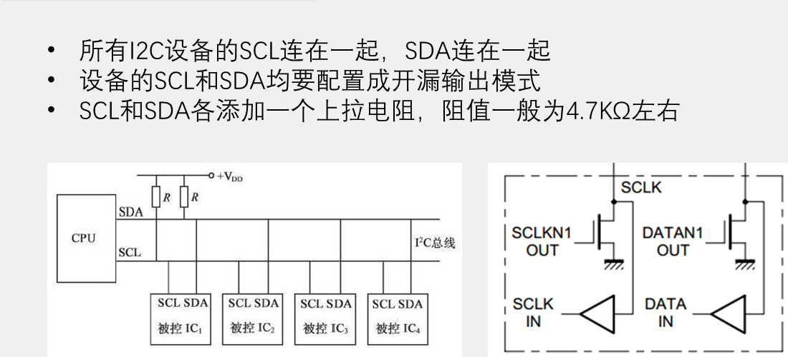
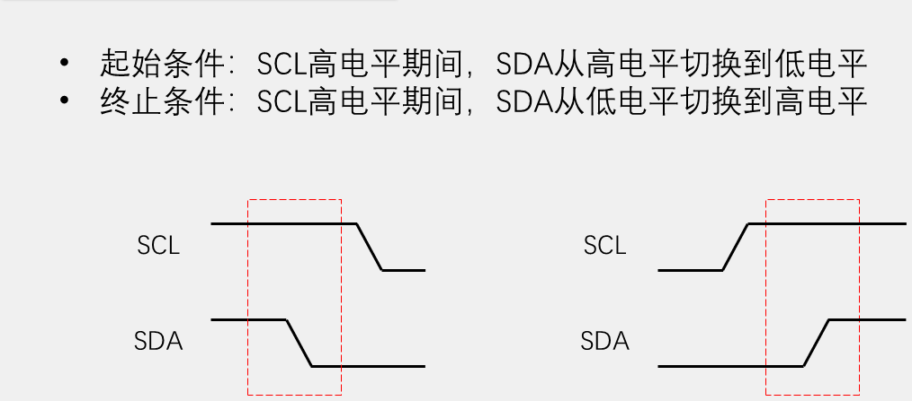
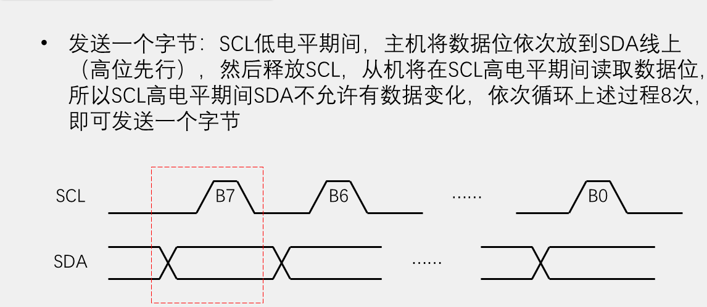
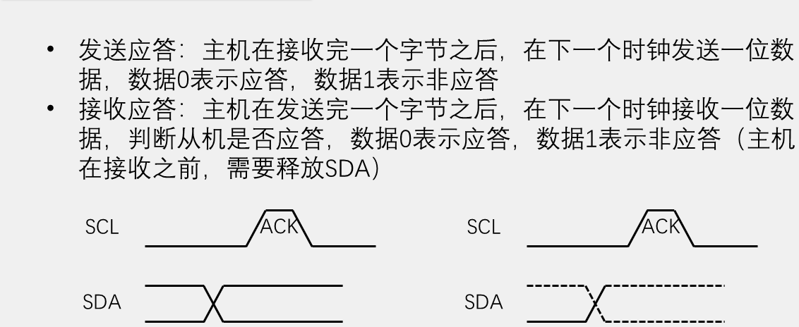
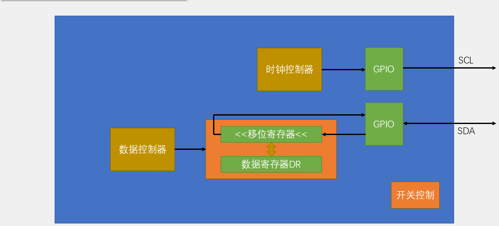

# 09 MPU6050：软硬件 I2C 读写六轴数据

## 本章问题

第 02 章点 OLED 用的是现成驱动，START、字节、应答都由别人完成。本章把这套时序自己写出来，再用它读 MPU6050 的六轴数据，最后换成硬件 I2C 外设做同一件事。

## 学习目标

- 说清开漏、上拉与线与逻辑，知道 SDA 为什么只能在 SCL 低电平期间改变。
- 用 GPIO 逐位实现 START、STOP、收发字节和第 9 拍应答。
- 用软件、硬件两种 I2C 读回 `WHO_AM_I`，确认链路通了。
- 一次读回 14 字节，拆成六轴并按量程换算成 g 和 °/s。

## 1. I2C 的电气与时序

一句话记住：**SCL 提供节拍，SDA 在节拍之间准备数据，并在节拍上保持稳定。**

### 1.1 开漏、上拉与线与

`SCL`、`SDA` 都是开漏输出：写 `0` 时主动拉低，写 `1` 时松手变成高阻，高电平由上拉电阻恢复。

于是只要有一个设备拉低，线就是低；所有设备都松手，线才为高。这就是线与逻辑，也是第 9 拍能工作的前提：主机发完 8 位后松手，从机才有机会拉低 SDA 表示 ACK。

SCL 同样是开漏线。从机来不及处理时可以继续拉低 SCL，叫时钟拉伸；主机不能只看"我已经写了高"，而要等引脚真的变高。



> 四个器件的 SCL 接在一起、SDA 接在一起，两条线各挂一个上拉到 `+VDD` 的电阻。

CubeMX 里对应三个选项：`GPIO Mode` 选 `Output Open Drain`；`Output Level` 选 `High`，让上电即释放总线；`Pull-up/Pull-down` 选 `No pull`，外部上拉由模块板载或外接电阻提供。

地址由器件自己决定，与上拉无关：SSD1306 用 `0x3C/0x3D`，MPU6050 由 `AD0` 决定 `0x68/0x69`。

### 1.2 START、STOP 与一位数据

普通数据位只有一条规则：

- SCL 为低时，发送方改变 SDA；
- SCL 为高时，接收方采样 SDA，发送方保持稳定。

只有 START 和 STOP 允许 SDA 在 SCL 高电平期间变化：高电平期间 SDA 由高变低是 START，由低变高是 STOP。平时不动，这两下跳变才不会被误认成数据。



### 1.3 一个字节与第 9 拍

每字节 8 位，最高位先发。8 个数据时钟后还有第 9 个应答时钟：接收方拉低 SDA 为 `ACK=0`，不拉、保持高为 `NACK=1`。

主机在第 9 拍之前必须先释放 SDA：松手后控制权暂时交给从机，从机拉低就是 ACK，不拉则上拉把线顶回高。主机若还按住 SDA，应答根本发不出来。

以写地址字节 `0xD0`（`1101 0000`）为例：

| 时钟 | 1 | 2 | 3 | 4 | 5 | 6 | 7 | 8 | 9（应答） |
| --- | --- | --- | --- | --- | --- | --- | --- | --- | --- |
| 位 | D7=1 | D6=1 | D5=0 | D4=1 | D3=0 | D2=0 | D1=0 | D0=0 | 从机拉低=ACK |





### 1.4 软件与硬件 I2C 的分工

硬件外设把整份时序固化进电路：START/STOP 自动生成、应答自动收发、时钟拉伸自动等待，CPU 只把字节交给它。`HAL_I2C_Master_Transmit(&hi2c2, ...)` 交出去的就是一整笔事务。

软件 I2C 是 CPU 逐位扮演外设：任意引脚可用、每一步都看得见，但应答和时钟拉伸都得自己实现。



> 上半是时钟控制器，按配置数出 SCL 高低电平；下半是数据控制器，移位寄存器逐位收发，旁边的数据寄存器 `DR` 是 CPU 交接字节的地方。

## 2. 从零写软件 I2C

### 2.1 控制两根线

这一层还没有时序，只要两条线能被拉低或放开，空闲时都为高。

```c
#define MYI2C_PORT        GPIOB
#define MYI2C_SCL_PIN     GPIO_PIN_10
#define MYI2C_SDA_PIN     GPIO_PIN_11

static void MyI2C_W_SCL(uint8_t bit)
{
    HAL_GPIO_WritePin(MYI2C_PORT, MYI2C_SCL_PIN,
                      bit ? GPIO_PIN_SET : GPIO_PIN_RESET);
}

static void MyI2C_W_SDA(uint8_t bit)
{
    HAL_GPIO_WritePin(MYI2C_PORT, MYI2C_SDA_PIN,
                      bit ? GPIO_PIN_SET : GPIO_PIN_RESET);
}

void MyI2C_Init(void)
{
    MyI2C_W_SDA(1U);
    MyI2C_W_SCL(1U);
}
```

引脚模式由 CubeMX 配好，驱动只负责把线释放为高。

### 2.2 START 和 STOP

SCL 高电平期间，SDA 由高落低是 START，由低抬升是 STOP。

```c
void MyI2C_Start(void)
{
    MyI2C_W_SDA(1U);   /* 先保证 SDA 为高 */
    MyI2C_W_SCL(1U);
    MyI2C_W_SDA(0U);   /* SCL 高时 SDA 高 -> 低：START */
    MyI2C_W_SCL(0U);   /* 拉低 SCL，为第一位腾出换数据的间隙 */
}

void MyI2C_Stop(void)
{
    MyI2C_W_SDA(0U);
    MyI2C_W_SCL(1U);
    MyI2C_W_SDA(1U);   /* SCL 高时 SDA 低 -> 高：STOP */
}
```

`Start()` 结尾拉低 SCL，是为了占住总线并立刻摆第一位；`Stop()` 结尾两条线都回到高，总线恢复空闲。

### 2.3 发送一个字节

8 个 SCL 方波，SDA 在 SCL 低电平期间换位，在高电平期间保持不动。

```c
void MyI2C_SendByte(uint8_t byte)
{
    uint8_t i;

    for (i = 0U; i < 8U; i++)
    {
        MyI2C_W_SDA((byte & (0x80U >> i)) != 0U);
        MyI2C_W_SCL(1U);
        MyI2C_W_SCL(0U);
    }
}
```

- `0x80U >> i` 从 D7 取到 D0，实现高位先发；
- 进入循环时 SCL 已经是低电平，每轮又以低电平结束，所以每位只需 3 次 GPIO 操作。

### 2.4 加一个延时

翻转太快会把 SCL 顶到 400 kHz 上限之外，在每次电平操作后插一个空循环：

```c
#ifndef MYI2C_DELAY_LOOPS
#define MYI2C_DELAY_LOOPS 40U
#endif

static void MyI2C_Delay(void)
{
    volatile uint32_t i;

    for (i = 0U; i < MYI2C_DELAY_LOOPS; i++)
    {
        __NOP();
    }
}
```

`volatile` 不能省，否则优化器会把空循环整个删掉。SCL 频率取决于主频、HAL 函数开销和优化等级，只能实测：改主频或改循环数后都要重新量一次周期。

### 2.5 读取一个字节

方向反过来：主机先松手，从机在 SCL 低电平期间摆数据，主机在 SCL 高电平期间采样。

```c
static uint8_t MyI2C_R_SDA(void)
{
    uint8_t bit = (HAL_GPIO_ReadPin(MYI2C_PORT, MYI2C_SDA_PIN)
                   == GPIO_PIN_SET) ? 1U : 0U;
    MyI2C_Delay();
    return bit;
}

uint8_t MyI2C_ReceiveByte(void)
{
    uint8_t byte = 0U;
    uint8_t i;

    MyI2C_W_SDA(1U);  /* 读周期必须释放 SDA */
    for (i = 0U; i < 8U; i++)
    {
        MyI2C_W_SCL(1U);
        if (MyI2C_R_SDA() != 0U)
        {
            byte |= (uint8_t)(0x80U >> i);
        }
        MyI2C_W_SCL(0U);
    }
    return byte;
}
```

- `MyI2C_W_SDA(1U)` 必须在循环外：写 1 只是松手，真正驱动线的是从机；
- 不必把引脚切成输入：F1 的 `IDR` 反映引脚实际电压，与配置成输入还是输出无关。

### 2.6 两个方向的应答

主机发完字节，松手让从机应答；主机读完字节，自己拉不拉表示还要不要继续。

```c
uint8_t MyI2C_ReceiveAck(void)
{
    uint8_t ack_bit;

    MyI2C_W_SDA(1U);   /* 把第 9 拍让给从机 */
    MyI2C_W_SCL(1U);
    ack_bit = MyI2C_R_SDA();
    MyI2C_W_SCL(0U);
    return ack_bit;
}

void MyI2C_SendAck(uint8_t ack_bit)
{
    MyI2C_W_SDA(ack_bit);  /* 0：还要继续读 */
    MyI2C_W_SCL(1U);
    MyI2C_W_SCL(0U);
}
```

返回值约定：`0` 为 ACK，`1` 为 NACK。

### 2.7 完整底层

```c
#ifndef __MY_I2C_H
#define __MY_I2C_H

#include "main.h"

#define MYI2C_PORT        GPIOB
#define MYI2C_SCL_PIN     GPIO_PIN_10
#define MYI2C_SDA_PIN     GPIO_PIN_11

#ifndef MYI2C_DELAY_LOOPS
#define MYI2C_DELAY_LOOPS 40U
#endif

void MyI2C_Init(void);
void MyI2C_Start(void);
void MyI2C_Stop(void);
void MyI2C_SendByte(uint8_t byte);
uint8_t MyI2C_ReceiveByte(void);
void MyI2C_SendAck(uint8_t ack_bit);
uint8_t MyI2C_ReceiveAck(void);

#endif
```

```c
#include "MyI2C.h"

static void MyI2C_Delay(void)
{
    volatile uint32_t i;

    for (i = 0U; i < MYI2C_DELAY_LOOPS; i++)
    {
        __NOP();
    }
}

static void MyI2C_W_SCL(uint8_t bit)
{
    HAL_GPIO_WritePin(MYI2C_PORT, MYI2C_SCL_PIN,
                      bit ? GPIO_PIN_SET : GPIO_PIN_RESET);
    MyI2C_Delay();
}

static void MyI2C_W_SDA(uint8_t bit)
{
    HAL_GPIO_WritePin(MYI2C_PORT, MYI2C_SDA_PIN,
                      bit ? GPIO_PIN_SET : GPIO_PIN_RESET);
    MyI2C_Delay();
}

static uint8_t MyI2C_R_SDA(void)
{
    uint8_t bit = (HAL_GPIO_ReadPin(MYI2C_PORT, MYI2C_SDA_PIN)
                   == GPIO_PIN_SET) ? 1U : 0U;
    MyI2C_Delay();
    return bit;
}

void MyI2C_Init(void)
{
    MyI2C_W_SDA(1U);
    MyI2C_W_SCL(1U);
}

void MyI2C_Start(void)
{
    MyI2C_W_SDA(1U);
    MyI2C_W_SCL(1U);
    MyI2C_W_SDA(0U);
    MyI2C_W_SCL(0U);
}

void MyI2C_Stop(void)
{
    MyI2C_W_SDA(0U);
    MyI2C_W_SCL(1U);
    MyI2C_W_SDA(1U);
}

void MyI2C_SendByte(uint8_t byte)
{
    uint8_t i;

    for (i = 0U; i < 8U; i++)
    {
        MyI2C_W_SDA((byte & (0x80U >> i)) != 0U);
        MyI2C_W_SCL(1U);
        MyI2C_W_SCL(0U);
    }
}

uint8_t MyI2C_ReceiveByte(void)
{
    uint8_t byte = 0U;
    uint8_t i;

    MyI2C_W_SDA(1U);  /* 读周期必须释放 SDA */
    for (i = 0U; i < 8U; i++)
    {
        MyI2C_W_SCL(1U);
        if (MyI2C_R_SDA() != 0U)
        {
            byte |= (uint8_t)(0x80U >> i);
        }
        MyI2C_W_SCL(0U);
    }
    return byte;
}

void MyI2C_SendAck(uint8_t ack_bit)
{
    MyI2C_W_SDA(ack_bit);
    MyI2C_W_SCL(1U);
    MyI2C_W_SCL(0U);
}

uint8_t MyI2C_ReceiveAck(void)
{
    uint8_t ack_bit;

    MyI2C_W_SDA(1U);
    MyI2C_W_SCL(1U);
    ack_bit = MyI2C_R_SDA();
    MyI2C_W_SCL(0U);
    return ack_bit;
}
```

这套底层适用于短线、单主机的总线。它没有实现时钟拉伸检测、多主机仲裁和超时恢复，不能当作通用 I2C 库。

与第 02 章的软件 I2C 相比多了两样：**接收与应答**（OLED 只写不读）、**逐位延时**（保证速率不超限）。

这一份与 `E:\ProjectStm\驱动库\MPU6050（软件IIC）\MyI2C.c` 同源，驱动库里的 `MPU6050.c` 直接调用这组函数，不要再另写一套。硬件版则换用 `MPU6050（硬件iic）\mpu6050.c`，两版**不要同时编进同一个工程**：同名函数会重复定义。

新建 `MyI2C.c` 后要按 [[00 从零建立HAL工程]] 第 5 节在根 `CMakeLists.txt` 登记：`User/Drivers/MPU6050/MPU6050.c`、`MyI2C.c` 加进 `target_sources`，目录加进 `target_include_directories`，否则链接报 `undefined reference`。

## 3. 7 位地址与线上地址字节

线上第一个字节由 7 位从机地址和 1 位读写方向组成：

$$
\text{AddressByte}=(\text{Address}_7\ll 1)\;|\;\text{R/W}
$$

MPU6050 在 `AD0=0` 时：

| 含义 | 数值 |
| --- | ---: |
| 7 位从机地址 | `0x68` |
| 写地址字节 | `0xD0` |
| 读地址字节 | `0xD1` |

规则与第 02 章 SSD1306（`0x3C` → `0x78`）相同。驱动里把三个概念分开：

```c
#define MPU6050_ADDR_7BIT  0x68U
#define MPU6050_ADDR_HAL   (MPU6050_ADDR_7BIT << 1)               /* 给 HAL 用 */
#define MPU6050_ADDR_WRITE (MPU6050_ADDR_7BIT << 1)               /* 线上写 0xD0 */
#define MPU6050_ADDR_READ  ((MPU6050_ADDR_7BIT << 1) | 0x01U)     /* 线上读 0xD1 */
```

| 名称 | 数值 | 用在哪里 |
| --- | ---: | --- |
| 7 位设备地址 | `0x68` | 手册、逻辑分析仪 |
| 线上地址字节 | `0xD0` / `0xD1` | 软件版自己拼、直接发送 |
| HAL 地址参数 | `0xD0` | 传给 `HAL_I2C_Mem_Read()`，方向位由 HAL 填 |

软件版和硬件版都传 `0xD0`，含义不同：软件版是自己拼好发出去的，硬件版交给 HAL 处理方向位。

依据在本地 HAL 源码里：`stm32f1xx_hal_i2c.c` 的 `DevAddress` 注释要求调用前左移。把 `0x68` 直接传进去，HAL 会当成线上字节用，实际地址变成 `0x34`，器件永不应答。换系列或升级 HAL 后，以本地头文件和源码注释为准。

## 4. MPU6050：寄存器与数据格式

MPU6050 里是一只三轴加速度计和一只三轴陀螺仪，共六轴。

- **加速度计测比力**，静止时表现为重力分量：平放时大致竖直的轴接近 ±1 g，另两轴接近 0。
- **陀螺仪测角速度**，单位 °/s，读数是瞬时转速，角度要对它积分。静止时应接近 0，只剩零偏。

六个量各经过一次 ADC，得到 16 位有符号整数放进寄存器。读回的是"原始码"，刻度由量程决定；每个量 16 位而 I2C 一字节只有 8 位，所以高低字节分处两个相邻寄存器。

### 4.1 寄存器与本章取值

```c
#define MPU6050_SMPLRT_DIV      0x19U
#define MPU6050_CONFIG          0x1AU
#define MPU6050_GYRO_CONFIG     0x1BU
#define MPU6050_ACCEL_CONFIG    0x1CU
#define MPU6050_ACCEL_XOUT_H    0x3BU
#define MPU6050_GYRO_XOUT_H     0x43U
#define MPU6050_PWR_MGMT_1      0x6BU
#define MPU6050_PWR_MGMT_2      0x6CU
#define MPU6050_WHO_AM_I        0x75U

#define MPU6050_PWR_MGMT_1_VALUE  0x01U
#define MPU6050_PWR_MGMT_2_VALUE  0x00U
#define MPU6050_SMPLRT_DIV_VALUE  0x09U
#define MPU6050_CONFIG_VALUE      0x06U
#define MPU6050_GYRO_FS_2000DPS   0x18U
#define MPU6050_ACCEL_FS_16G      0x18U

#define MPU6050_ACCEL_LSB_PER_G   2048.0f
#define MPU6050_GYRO_LSB_PER_DPS  16.4f
#define MPU6050_WHO_AM_I_VALUE    0x68U
```

| 寄存器 | 地址 | 取值 | 作用 |
| --- | --- | --- | --- |
| `PWR_MGMT_1` | `0x6B` | `0x01` | 解除睡眠，选 X 轴陀螺仪 PLL 作时钟 |
| `PWR_MGMT_2` | `0x6C` | `0x00` | 使能六轴 |
| `SMPLRT_DIV` | `0x19` | `0x09` | 与滤波器配合，采样率约 100 Hz |
| `CONFIG` | `0x1A` | `0x06` | 数字低通滤波 `DLPF_CFG=6` |
| `GYRO_CONFIG` | `0x1B` | `0x18` | ±2000 °/s，16.4 LSB/(°/s) |
| `ACCEL_CONFIG` | `0x1C` | `0x18` | ±16 g，2048 LSB/g |
| `ACCEL_XOUT_H` | `0x3B` | 只读 | 14 字节数据起点 |
| `GYRO_XOUT_H` | `0x43` | 只读 | 陀螺仪数据起点，缓冲区第 8 字节 |
| `WHO_AM_I` | `0x75` | 读回 `0x68` | 出厂身份编号 |

`SMPLRT_DIV` 是分频器，值越大刷新越慢；`CONFIG` 里的 `DLPF_CFG` 越强，数值越平滑但响应越迟钝。改采样率要两者一起看。

注意区分两种地址：设备地址 `0x68` 决定"总线上找谁"，寄存器地址 `0x75` 决定"读它内部哪一格"。

### 4.2 初始化顺序

```text
MyI2C_Init()（仅软件版）
-> 读 WHO_AM_I，必须为 0x68
-> 写 PWR_MGMT_1 = 0x01
-> 写 PWR_MGMT_2 = 0x00
-> 写 SMPLRT_DIV = 0x09
-> 写 CONFIG = 0x06
-> 写 GYRO_CONFIG = 0x18
-> 写 ACCEL_CONFIG = 0x18
```

`WHO_AM_I` 通过，说明供电、接线、地址、时序四件事都通了。它不通过时，后面六个配置写入全是无效操作，还会把总线问题和配置问题搅在一起。

配置必须从 `PWR_MGMT_1` 开始：芯片上电默认休眠，不解除睡眠，测量值不会更新。库驱动按上表顺序把六个寄存器连着写完，中间不加延时——这几次都是配置写入，不依赖 PLL 已经稳定。

### 4.3 连续读 14 字节与字节序

从 `ACCEL_XOUT_H(0x3B)` 连续读 14 字节，正好覆盖六轴加温度：

| 偏移 | 数据 |
| ---: | --- |
| 0、1 | Accel X 高、低 |
| 2、3 | Accel Y 高、低 |
| 4、5 | Accel Z 高、低 |
| 6、7 | 温度高、低，本章跳过 |
| 8、9 | Gyro X 高、低 |
| 10、11 | Gyro Y 高、低 |
| 12、13 | Gyro Z 高、低 |

温度换算为 °C = 原始值 / 340 + 36.53，本章不实现。

六个轴并不连续：加速度占 `0x3B~0x40`，中间隔着温度 `0x41/0x42`，角速度从 `0x43` 才开始。"只读 12 字节"用一次连续读取做不到，所以一次读满 14 字节、在软件里丢掉温度两字节。

每个 16 位数据高字节在前、低字节在后，按补码解释。先看拼接：

```c
uint8_t high;
uint8_t low;

if ((MPU6050_ReadRegs(MPU6050_ACCEL_XOUT_H, &high, 1U) == HAL_OK) &&
    (MPU6050_ReadRegs(MPU6050_ACCEL_XOUT_H + 1U, &low, 1U) == HAL_OK))
{
    int16_t accel_x = (int16_t)(((uint16_t)high << 8) | (uint16_t)low);
}
```

- 两次独立事务只用于核对字节顺序，实际采样要用一次连续读取（5.5 节），否则高低字节可能来自不同时刻；
- `<< 8` 把高字节移到 bit15~bit8，`|` 把低字节放进 bit7~bit0；
- 必须存 `int16_t`：静止约 +2048 即 `0x0800`，翻转后约 -2048 即 `0xF800`；若存进 `uint16_t`，`0xF800` 会变成 63488 的大正数。

驱动把这段封成 `MPU6050_BE16()`，`BE` 指大端布局（高字节在前），描述的是数据格式，不是 CPU 字节序。

### 4.4 量程与灵敏度

| 加速度量程 | 灵敏度 | 陀螺仪量程 | 灵敏度 |
| --- | ---: | --- | ---: |
| ±2 g | 16384 LSB/g | ±250 °/s | 131 LSB/(°/s) |
| ±4 g | 8192 LSB/g | ±500 °/s | 65.5 LSB/(°/s) |
| ±8 g | 4096 LSB/g | ±1000 °/s | 32.8 LSB/(°/s) |
| ±16 g | 2048 LSB/g | ±2000 °/s | 16.4 LSB/(°/s) |

本章写 `0x18`，于是：

```c
accel_g  = accel_raw / 2048.0f;
gyro_dps = gyro_raw / 16.4f;
```

量程是一次测量能表示的最大物理量。量程越小，同样的 16 位铺在更窄的范围上，分辨率越高，但超限会削平。选择原则：**让预期的最大加速度、角速度落在量程内，尽量用小量程换分辨率。**

灵敏度可以自己算：16 位有符号数共 65536 级，均匀铺满量程全程。

- 加速度 ±2 g 全程 4 g：$65536/4=16384$；±16 g 全程 32 g：$65536/32=2048$；
- 陀螺仪 ±250 °/s 全程 500 °/s：$65536/500\approx131$；±2000 °/s 全程 4000 °/s：$65536/4000\approx16.4$。

改量程时换算常量必须跟着改，最大档与最小档的灵敏度正好差 8 倍，屏幕上就会出现"数据差约 8 倍"。

心算两个例子：加速度原始值 2048 即 $2048/2048=1.0$ g；陀螺仪原始值 820 即 $820/16.4=50$ °/s。记住"2048 LSB ≈ 1 g、16.4 LSB ≈ 1 °/s"即可估读。

**先确认原始值和 `WHO_AM_I`，再看物理量**，避免把接线问题和换算问题混在一起。

## 5. 用软件 I2C 读写 MPU6050

### 5.1 接线与 GPIO 配置

OLED 走 PB8/PB9（软件 I2C），MPU6050 走 PB10/PB11。两组总线只是为了切换软硬件实现时显示链路保持独立，两个器件地址不同，本来也可以挂在同一条 I2C 上。

| 模块 | 信号 | STM32 引脚 | 配置与用途 |
| --- | --- | --- | --- |
| OLED | SCL | PB8 | `Output Open Drain`，软件 I2C |
| OLED | SDA | PB9 | `Output Open Drain`，软件 I2C |
| MPU6050 | SCL | PB10 | 软件版开漏 GPIO；硬件版 `I2C2_SCL` |
| MPU6050 | SDA | PB11 | 软件版开漏 GPIO；硬件版 `I2C2_SDA` |
| 两模块 | VCC | 3.3 V | 先确认模块规格，不能把 3.3 V 信号上拉到 5 V |
| 两模块 | GND | GND | 必须共地 |

从本章起，`PB10/PB11` 归 MPU6050，OLED 固定回到软件 I2C 的 `PB8/PB9`；第 10 章的 SPI 用 `PA4~PA7`，与这两组 I2C 引脚不冲突。

上电前检查：

1. PB10 接 SCL、PB11 接 SDA，不要与 PB8/PB9 接混；
2. SCL、SDA 必须有到 3.3 V 的上拉，模块自带或外接。断电时量 SDA/SCL 对 VDD 的阻值，不要量对地；并联模块会影响读数，不能机械要求 4.7 kΩ；
3. 软件版把 PB8~PB11 配为 `Output Open Drain`、初始电平 `High`；
4. 硬件版把 PB10/PB11 配为 I2C2 复用开漏，不要再用普通 GPIO 初始化覆盖；
5. `AD0=0` 时地址 `0x68`，本章用 `0x68`；
6. `INT` 不接，`XDA/XCL` 不用。

CubeMX 里选 `GPIO_Output` 后逐脚确认四项：`GPIO output level` 为 `High`、`GPIO Mode` 为 `Output Open Drain`、`Pull-up/Pull-down` 为 `No pull`、`Maximum output speed` 为 `High`。

两处容易填错：`GPIO Mode` 留成默认 `Output Push Pull` 时，写 1 是强推高电平，从机拉低会形成直通电流；`GPIO output level` 填 `Low`，总线一上电就被拉住，第一个 START 无法形成。

生成代码后对照 `MX_GPIO_Init()`，四只脚应为 `GPIO_MODE_OUTPUT_OD`，且初始化前先写 `GPIO_PIN_SET`。

**预期现象**：上电后用万用表量 PB10、PB11，都接近 3.3 V。哪根线不是高电平，问题就在那根线的上拉或接线上，先别往下写代码。

### 5.2 写一个寄存器

```text
START -> 0xD0 -> ACK -> 寄存器地址 -> ACK -> 数据 -> ACK -> STOP
```

```c
HAL_StatusTypeDef MPU6050_WriteReg(uint8_t reg, uint8_t value)
{
    MyI2C_Start();
    MyI2C_SendByte(MPU6050_ADDR_WRITE);
    if (MyI2C_ReceiveAck() != 0U)
    {
        goto nack;
    }

    MyI2C_SendByte(reg);
    if (MyI2C_ReceiveAck() != 0U)
    {
        goto nack;
    }

    MyI2C_SendByte(value);
    if (MyI2C_ReceiveAck() != 0U)
    {
        goto nack;
    }

    MyI2C_Stop();
    return HAL_OK;

nack:
    MyI2C_Stop();
    return HAL_ERROR;
}
```

四个要点：

1. 每个字节后都要读一次 ACK，三个字节就是三次检查；
2. 中途失败也要发 STOP。否则总线停在 SCL 低电平，下一笔事务的 START 形成不了；
3. 用 `goto` 跳到统一收尾，避免三个分支各写一遍；
4. 返回 `HAL_StatusTypeDef`，与硬件版一致，上层不用写两套判断。

**预期现象**：逻辑分析仪上是一串"地址、寄存器、数据"加三次 ACK。第一个字节后就没有 ACK，说明接线或地址还没通。

### 5.3 读寄存器：地址指针与重复起始

MPU6050 内部是一排按地址编号的存储格。主机要访问哪一格，得先在写方向上把格号送进去，芯片锁存到内部地址指针；随后的读操作从指针处取数，每读一字节指针自动加一。

所以"读寄存器"永远两段：**先写地址，再换方向读**。换方向不能 STOP 再 START，必须用重复起始（Repeated Start），否则会释放总线。

```text
START
-> 0xD0 -> ACK
-> 0x75 -> ACK
-> REPEATED START
-> 0xD1 -> ACK
<- 0x68
-> NACK
-> STOP
```

```c
HAL_StatusTypeDef MPU6050_ReadRegs(uint8_t reg, uint8_t *data, uint16_t length)
{
    uint16_t i;

    if ((data == NULL) || (length == 0U))
    {
        return HAL_ERROR;
    }

    MyI2C_Start();
    MyI2C_SendByte(MPU6050_ADDR_WRITE);
    if (MyI2C_ReceiveAck() != 0U)
    {
        goto nack;
    }

    MyI2C_SendByte(reg);
    if (MyI2C_ReceiveAck() != 0U)
    {
        goto nack;
    }

    MyI2C_Start();  /* 重复起始，不先发 STOP */
    MyI2C_SendByte(MPU6050_ADDR_READ);
    if (MyI2C_ReceiveAck() != 0U)
    {
        goto nack;
    }

    for (i = 0U; i < length; i++)
    {
        data[i] = MyI2C_ReceiveByte();
        MyI2C_SendAck((i + 1U == length) ? 1U : 0U);
    }

    MyI2C_Stop();
    return HAL_OK;

nack:
    MyI2C_Stop();
    return HAL_ERROR;
}
```

与写相比只有三处不同：

| | 写 | 读 |
| --- | --- | --- |
| 地址字节 | 发 `0xD0` | 先 `0xD0`，换方向后 `0xD1` |
| 中间动作 | 直接发数据 | 再来一次 `MyI2C_Start()` |
| 每字节之后 | `ReceiveAck()` | `SendAck()` |

前 N-1 个字节后发 ACK，请从机继续；最后一个字节后发 NACK，通知从机结束，再由主机 STOP。这里的 NACK 是正常收尾，不是错误。

这套组合事务是 MPU6050 手册的规定时序。不要据此推断 STOP 会把内部指针复位到 `0x00`，指针行为要按具体器件手册判断。

### 5.4 最短闭环：读 WHO_AM_I

只读身份寄存器，什么都不配置：

```c
/* USER CODE BEGIN PV */
static uint8_t mpu_id;
/* USER CODE END PV */

/* USER CODE BEGIN 2 */
MyI2C_Init();
OLED_Init();

if (MPU6050_ReadDeviceID(&mpu_id) == HAL_OK)
{
    OLED_ShowString(0, 0, "ID:", OLED_8X16);
    OLED_ShowHexNum(0, 24, mpu_id, 2U, OLED_8X16);
    OLED_Update();
}
else
{
    OLED_ShowString(0, 0, "READ ERR", OLED_8X16);
    OLED_Update();
}
/* USER CODE END 2 */
```

`MPU6050_ReadDeviceID()` 只是 `MPU6050_ReadRegs()` 的一层包装：

```c
HAL_StatusTypeDef MPU6050_ReadDeviceID(uint8_t *id)
{
    return MPU6050_ReadRegs(MPU6050_WHO_AM_I, id, 1U);
}
```

编译、下载、复位，盯住屏幕第一行。**预期现象**：显示 `ID:68`，逻辑分析仪上是完整一笔事务：

```text
START -> 0xD0/W -> ACK -> 0x75 -> ACK
-> REPEATED START -> 0xD1/R -> ACK -> 0x68 -> NACK -> STOP
```

这一笔走通，说明供电、接线、地址、时序四件事都通了，可以保留在 `USER CODE` 里当开机自检。

- 停在 `READ ERR`：最短闭环没通过，不要往下写配置寄存器，回 5.1 查供电与接线；
- 显示别的十六进制值：时序通了但内容不对，核对地址字节（第 3 节）与重复起始（5.3 节）。

### 5.5 连续读 14 字节

```text
START -> 0xD0 -> ACK -> 0x3B -> ACK -> REPEATED START
-> 0xD1 -> ACK -> byte[0..13] -> NACK -> STOP
```

```c
uint8_t buffer[MPU6050_DATA_LENGTH];

/* 驱动库没有单独的 ReadRaw，GetData() 内部就是这么读的 */
HAL_StatusTypeDef status =
    MPU6050_ReadRegs(MPU6050_ACCEL_XOUT_H, buffer, MPU6050_DATA_LENGTH);
```

`0x3B` 之后 14 个字节正好是六轴加温度，偏移见 4.3 节。这里的 `buffer` 由调用者提供，`MPU6050_GetData()` 已经把它和结构体解析包好了。

一次读完有两个原因：

1. 开销：单读一笔事务 6 个字节，14 个寄存器就是 14 笔；连续读只有 1 笔；
2. 一致性：14 字节在总线上连续传输，间隔只有几十个时钟；分开读时六轴可能来自相差几十毫秒的不同时刻，转动时对不上。

**预期现象**：六列数值同时刷新，绕哪个轴转，对应陀螺仪列变化最明显。单轴旋转时各列变化对不上，多半是没用连续读取。

## 6. 硬件 I2C：把整个事务交给外设

时序没有消失，只是被外设接管了。数据结构、初始化顺序、身份检查和 14 字节解析与软件版完全一致，这一节只列差异。

### 6.1 CubeMX 配置

保留 PB8/PB9 的软件 I2C OLED，另配 I2C2：

1. `Connectivity -> I2C2`，`Mode` 选 `I2C`。芯片图上 PB10/PB11 自动变绿并标注 `I2C2_SCL/SDA`，核对方向与实际接线。**忘记选 Mode 时 CubeMX 不生成 I2C2 代码，编译能过，但初始化必然失败**；
2. `Parameter Settings`：

| 字段 | 取值 | 填错的后果 |
| --- | --- | --- |
| I2C Speed Mode / Clock Speed | Standard / `100000` | 超过 `100000` 会切快速模式并要求配 Duty Cycle，初学先用 100 kHz |
| Duty Cycle | `I2C_DUTYCYCLE_2` | 仅快速模式有效 |
| Own Address1 | `0` | 本芯片只当主机 |
| Addressing Mode | 7 bit | 保持默认 |
| Dual Address / General Call / No Stretch | Disable | 保持默认 |

3. 时钟树保持 72 MHz。I2C2 在 APB1（36 MHz）上，HAL 按 PCLK1 分频产生 SCL，改了主频要复核；
4. PB8/PB9 保持开漏不动；**PB10/PB11 不要配成普通 GPIO，也不要用 `HAL_GPIO_Init()` 重新初始化**，那会覆盖 MspInit 配好的复用开漏；
5. 生成后检查三处：`Core/Src/i2c.c` 有 `hi2c2` 和 `MX_I2C2_Init()`；`HAL_I2C_MspInit()` 把 PB10/PB11 配成 `GPIO_MODE_AF_OD` 并开时钟；`stm32f1xx_hal_conf.h` 里 `HAL_I2C_MODULE_ENABLED` 已启用。

```c
extern I2C_HandleTypeDef hi2c2;
void MX_I2C2_Init(void);
```

`hi2c2` 由 CubeMX 生成，不要在 `main.c` 里重复定义。

### 6.2 Mem 读写：只换这一层

软件版从 `MyI2C_Start()` 到 `MyI2C_Stop()` 的一整段，硬件版收进两个函数：

```c
static I2C_HandleTypeDef *g_mpu_i2c = NULL;

HAL_StatusTypeDef MPU6050_WriteReg(uint8_t reg, uint8_t value)
{
    if (g_mpu_i2c == NULL)
    {
        return HAL_ERROR;
    }

    return HAL_I2C_Mem_Write(g_mpu_i2c,
                             MPU6050_ADDR_HAL,
                             reg,
                             I2C_MEMADD_SIZE_8BIT,
                             &value,
                             1U,
                             MPU6050_TIMEOUT_MS);
}

HAL_StatusTypeDef MPU6050_ReadRegs(uint8_t reg, uint8_t *data, uint16_t length)
{
    if ((g_mpu_i2c == NULL) || (data == NULL) || (length == 0U))
    {
        return HAL_ERROR;
    }

    return HAL_I2C_Mem_Read(g_mpu_i2c,
                            MPU6050_ADDR_HAL,
                            reg,
                            I2C_MEMADD_SIZE_8BIT,
                            data,
                            length,
                            MPU6050_TIMEOUT_MS);
}
```

`Mem` 表示 HAL 已封装寄存器寻址：`reg` 是内部寄存器地址，`I2C_MEMADD_SIZE_8BIT` 声明它是 8 位宽，`MPU6050_TIMEOUT_MS` 是超时 `100U`。HAL 配合外设完成 START、地址、寄存器号、重复起始、读地址、数据和末字节 NACK 与 STOP。

要点三条：

- 本课程 F1 HAL 的设备地址参数要求先左移，传 `0xD0`（`0x68 << 1`）。不要与 7 位地址混用；
- `HAL_I2C_Mem_Write()` 的 `pData` 是缓冲区地址，所以传 `&value`；
- `HAL_I2C_IsDeviceReady()` 的第三个参数 `3U` 是探测次数，连发 3 次都无应答才判定离线，用来容忍毛刺。它对应软件版的 `ReceiveAck()`，只查地址应答，不读寄存器。

### 6.3 初始化与主程序差异

硬件版不调用 `MyI2C_Init()`，而是在 `MPU6050_Init()` 开头保存句柄并检查应答：

```c
if (hi2c == NULL)
{
    return HAL_ERROR;
}
g_mpu_i2c = hi2c;

if (HAL_I2C_IsDeviceReady(g_mpu_i2c,
                          MPU6050_ADDR_HAL,
                          3U,
                          MPU6050_TIMEOUT_MS) != HAL_OK)
{
    return HAL_ERROR;
}
```

通过后执行同一套 `WHO_AM_I` 检查和六个配置写入，再往下共用显示代码。`IsDeviceReady()` 通过不代表 `WHO_AM_I` 正确，**两步各查各的问题**。

`MPU6050_Init()` 带一个 `I2C_HandleTypeDef *` 参数，软件版传 `NULL`，只为软硬件共用同一份上层代码。

换成硬件版时，`CMakeLists.txt` 里登记 `mpu6050.c`，同时去掉 `MPU6050.c` 和 `MyI2C.c`；头文件也从 `MPU6050.h` 换成 `mpu6050.h`。

主程序改动只有三处：

```c
#include "i2c.h"        /* 声明 hi2c2 */
#include "mpu6050.h"    /* 硬件版驱动（软件版是 MPU6050.h） */
#include "OLED.h"

/* MPU6050_Test() 内部把 MPU6050_Init(NULL) 换成 MPU6050_Init(&hi2c2) */
```

`main.c` 里 `MX_I2C2_Init()` 由 CubeMX 自动调用，用户区只需：

```c
/* USER CODE BEGIN 2 */
HAL_Delay(20U);      /* 模块上电稳定时间，非协议要求 */
MPU6050_Test();
/* USER CODE END 2 */
```

初始化顺序变成：

```text
MX_GPIO_Init()
-> MX_I2C2_Init()
-> MPU6050_Test()：OLED_Init() -> MPU6050_Init(&hi2c2) -> 身份检查 -> 显示主循环
```

**预期现象**：仍显示 `ID:68` 和相同布局的六轴数据；相同姿态下两版的符号、量级和变化趋势一致，瞬时值不必逐位相同。对不上时先查 6.1 的引脚复用与时钟配置。

## 7. 共用上层：接口、显示与代码

### 7.1 数据结构与函数签名

```c
#define MPU6050_DATA_LENGTH 14U
#define MPU6050_TIMEOUT_MS  100U

typedef struct
{
    int16_t AccX;
    int16_t AccY;
    int16_t AccZ;
    int16_t GyroX;
    int16_t GyroY;
    int16_t GyroZ;
} MPU6050_Data;

HAL_StatusTypeDef MPU6050_Init(I2C_HandleTypeDef *hi2c);
HAL_StatusTypeDef MPU6050_WriteReg(uint8_t reg, uint8_t value);
HAL_StatusTypeDef MPU6050_ReadRegs(uint8_t reg, uint8_t *data, uint16_t length);
HAL_StatusTypeDef MPU6050_ReadDeviceID(uint8_t *id);
HAL_StatusTypeDef MPU6050_GetData(MPU6050_Data *data);
float MPU6050_AccelToG(int16_t raw);
float MPU6050_GyroToDps(int16_t raw);
```

这就是 `E:\ProjectStm\驱动库\MPU6050（软件IIC）\MPU6050.h` 与 `MPU6050（硬件iic）\mpu6050.h` 的实际接口，两版函数名、结构体和返回值完全一致。

切换两版时上层只动三四行：头文件名、`MPU6050_Init()` 的实参、是否初始化 I2C2、硬件版多一句 `#include "i2c.h"`。

> [!warning]
> 两个头文件仅靠大小写区分（`MPU6050.h` 与 `mpu6050.h`）。Windows 文件系统不区分大小写，放进同一目录会互相覆盖。当前约定是分属各自子工程；若以后合并维护，建议改成 `MPU6050_Soft.h` / `MPU6050_Hw.h`。

### 7.2 初始化与 14 字节解析

```c
HAL_StatusTypeDef MPU6050_Init(I2C_HandleTypeDef *hi2c)
{
    uint8_t id;

    (void)hi2c;              /* 软件版不使用句柄 */
    MyI2C_Init();

    if (MPU6050_ReadDeviceID(&id) != HAL_OK)
    {
        return HAL_ERROR;
    }
    if (id != MPU6050_WHO_AM_I_VALUE)
    {
        return HAL_ERROR;
    }

    if (MPU6050_WriteReg(MPU6050_PWR_MGMT_1,
                         MPU6050_PWR_MGMT_1_VALUE) != HAL_OK)
    {
        return HAL_ERROR;
    }

    if (MPU6050_WriteReg(MPU6050_PWR_MGMT_2,
                         MPU6050_PWR_MGMT_2_VALUE) != HAL_OK)
    {
        return HAL_ERROR;
    }
    if (MPU6050_WriteReg(MPU6050_SMPLRT_DIV,
                         MPU6050_SMPLRT_DIV_VALUE) != HAL_OK)
    {
        return HAL_ERROR;
    }
    if (MPU6050_WriteReg(MPU6050_CONFIG,
                         MPU6050_CONFIG_VALUE) != HAL_OK)
    {
        return HAL_ERROR;
    }
    if (MPU6050_WriteReg(MPU6050_GYRO_CONFIG,
                         MPU6050_GYRO_FS_2000DPS) != HAL_OK)
    {
        return HAL_ERROR;
    }

    return MPU6050_WriteReg(MPU6050_ACCEL_CONFIG, MPU6050_ACCEL_FS_16G);
}

static int16_t MPU6050_BE16(const uint8_t *p)
{
    return (int16_t)(((uint16_t)p[0] << 8) | (uint16_t)p[1]);
}

HAL_StatusTypeDef MPU6050_GetData(MPU6050_Data *data)
{
    uint8_t buffer[MPU6050_DATA_LENGTH];
    HAL_StatusTypeDef status;

    if (data == NULL)
    {
        return HAL_ERROR;
    }

    status = MPU6050_ReadRegs(MPU6050_ACCEL_XOUT_H, buffer, MPU6050_DATA_LENGTH);
    if (status != HAL_OK)
    {
        return status;
    }

    data->AccX  = MPU6050_BE16(&buffer[0]);
    data->AccY  = MPU6050_BE16(&buffer[2]);
    data->AccZ  = MPU6050_BE16(&buffer[4]);
    data->GyroX = MPU6050_BE16(&buffer[8]);
    data->GyroY = MPU6050_BE16(&buffer[10]);
    data->GyroZ = MPU6050_BE16(&buffer[12]);

    return HAL_OK;
}
```

三条说明：

- `MPU6050_Init()` 先验身份、不匹配立刻返回，再按顺序写六个配置寄存器，任何一步失败都返回 `HAL_ERROR`；
- `MPU6050_GetData()` 一次读满 14 字节，`buffer[6]`、`buffer[7]` 是温度，本章丢弃；
- `MPU6050_BE16()` 就是 4.3 节的左移拼接，下标与偏移表一一对应。

可以自己验证：临时去掉 `MPU6050_BE16()` 里的 `<< 8`，静止时加速度读数会从约 2048 掉到个位数，这正是高字节没左移造成的 256 倍偏差。看完移回去。

### 7.3 显示与现象

显示和测试逻辑放在 `User/Src/app_mpu6050.c`，按 [[00 从零建立HAL工程]] 第 5 节在 `CMakeLists.txt` 登记。`main.c` 的 `USER CODE BEGIN PV` 里补一行 `void MPU6050_Test(void);`，`USER CODE BEGIN 2` 里只写一行 `MPU6050_Test();`。

```c
#include "MPU6050.h"
#include "OLED.h"

/* 128x64：六轴用 6X8 字体，左右各占 64 像素。
 * 标签宽 12，符号 + 5 位数字宽 36；数值从 X=12/76 开始。
 * Y=0/16/32 显示六轴，Y=48 显示身份或读取错误。 */
void MPU6050_Test(void)
{
    uint8_t device_id = 0U;
    MPU6050_Data data = {0};

    OLED_Init();

    if ((MPU6050_Init(NULL) != HAL_OK) ||
        (MPU6050_ReadDeviceID(&device_id) != HAL_OK))
    {
        OLED_ShowString(0, 0, "MPU6050 ID ERR", OLED_8X16);
        OLED_Update();
        while (1)
        {
            HAL_Delay(100U);
        }
    }

    OLED_ShowString(0,  0, "AX", OLED_6X8);
    OLED_ShowString(64, 0, "GX", OLED_6X8);
    OLED_ShowString(0, 16, "AY", OLED_6X8);
    OLED_ShowString(64, 16, "GY", OLED_6X8);
    OLED_ShowString(0, 32, "AZ", OLED_6X8);
    OLED_ShowString(64, 32, "GZ", OLED_6X8);
    OLED_ShowString(0, 48, "ID:", OLED_8X16);
    OLED_ShowHexNum(48, 48, device_id, 2U, OLED_8X16);
    OLED_Update();

    while (1)
    {
        if (MPU6050_GetData(&data) == HAL_OK)
        {
            OLED_ShowSignedNum(12, 0, data.AccX,  5U, OLED_6X8);
            OLED_ShowSignedNum(76, 0, data.GyroX, 5U, OLED_6X8);
            OLED_ShowSignedNum(12, 16, data.AccY,  5U, OLED_6X8);
            OLED_ShowSignedNum(76, 16, data.GyroY, 5U, OLED_6X8);
            OLED_ShowSignedNum(12, 32, data.AccZ,  5U, OLED_6X8);
            OLED_ShowSignedNum(76, 32, data.GyroZ, 5U, OLED_6X8);
            OLED_UpdateArea(0, 0, 128, 48);
            /* 清除上一轮错误提示，恢复身份行。 */
            OLED_ClearArea(0, 48, 128, 16);
            OLED_ShowString(0, 48, "ID:", OLED_8X16);
            OLED_ShowHexNum(48, 48, device_id, 2U, OLED_8X16);
            OLED_UpdateArea(0, 48, 128, 16);
        }
        else
        {
            OLED_ClearArea(0, 48, 128, 16);
            OLED_ShowString(0, 48, "READ ERR", OLED_8X16);
            OLED_UpdateArea(0, 48, 128, 16);
        }
        HAL_Delay(100U);
    }
}
```

程序先初始化并显示 `WHO_AM_I`，失败则停机；之后每 100 ms 刷新六轴。`OLED_6X8` 的"符号 + 5 位数字"占 36 像素，加上 12 像素标签共 48 像素，能放进各自 64 像素的区域且不覆盖旧数字。第四行单独刷新，失败显示 `READ ERR`，下次成功清除提示并恢复 `ID:`。

**预期现象**：

- 第四行稳定显示 `ID:68`；
- 水平静止时，一个加速度轴绝对值接近 `2048 LSB`，约合 1 g；
- 静止时三个陀螺仪轴接近 0，允许存在零偏；
- 绕单轴旋转时，对应陀螺仪轴变化明显；
- 翻转模块时，对应加速度轴符号改变。

操作步骤：接好线、编译下载并复位。先静置看 `ID:68` 和加速度列，再绕单轴转 1 秒、松手静置 1 秒，观察对应陀螺仪列先离开 0 再回到 0；最后翻转 180°，确认加速度列符号改变。

现象不符时按层排查：显示 `READ ERR` 查接线、地址与重复起始（5.1、5.3）；数值有了但基线、符号或趋势不对，查字节拼接与量程换算（4.3、4.4），**先原始值后物理量**。

MPU6050 不在倒立摆基础版的外设清单里；若后续要做姿态反馈，本章的 I2C 读写、寄存器配置和量程换算可以直接复用。倒立摆目前只完成到基础驱动：电位器 RP1~RP4 用 ADC2 轮询，角度传感器的 ADC1 DMA 采样链路尚未配置，完整闭环也还没落地，见 [[STM32倒立摆/00 项目背景与技术#3. 硬件]]。

上一篇：[[08 串口通信：轮询、中断与 DMA]] ｜ 下一篇：[[10 SPI：SPI 时序与 W25Q64 读写]]
