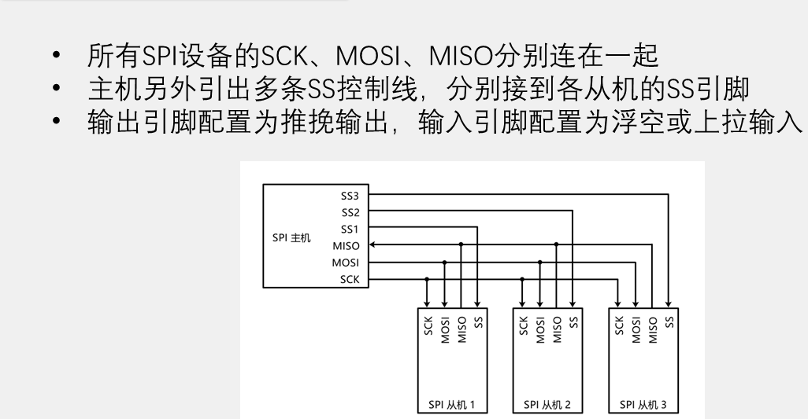
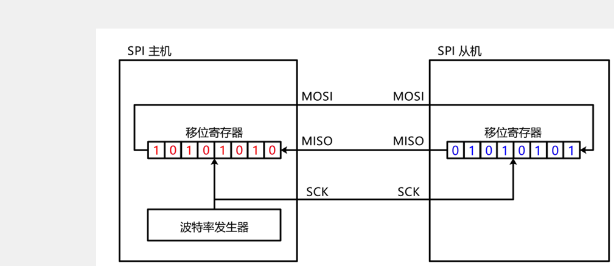
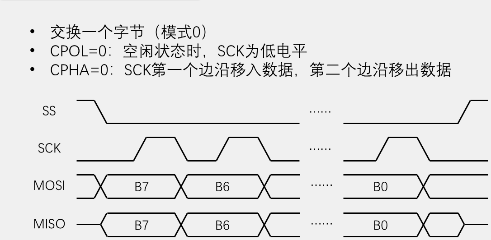
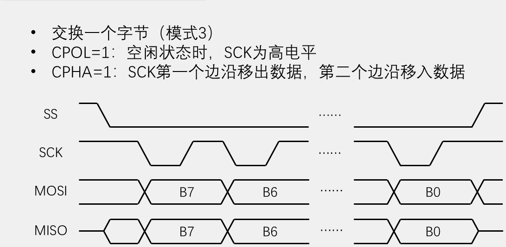

# 10 SPI：SPI 时序与 W25Q64 读写

## 本章问题

第 09 章用两根线解决了多从机寻址：地址字节点名、每字节等应答，代价是每字节 9 个时钟。本章换 SPI——四根线换回速度，寻址交给一根独立的片选线。要回答的是：怎样用软件 SPI 和硬件 SPI 可靠地读取、擦除、写入并回读一颗 W25Q64？

练手对象是一颗 8 MB 的 NOR Flash：页编程、扇区擦除、写使能、忙状态一应俱全，正好把时序、片选和事务边界全逼出来。本章按软件 SPI → 硬件外设 → 库驱动三步推进。

## 学习目标

- 用四根信号线解释一次 SPI 字节交换。
- 按模式 0 实现 `MySPI` 软件收发。
- 用 W25Q64 命令完成读 ID、擦除、编程和回读。
- 把同一份 Flash 驱动从软件 SPI 换到硬件 SPI1。
- 按现象判断问题出在物理层、配置层还是逻辑层。

## 1. SPI 四线、片选与模式

SPI 是主机提供时钟的同步全双工总线。I2C 靠地址字节点名，SPI 靠一根片选线点名。

| 信号 | 方向 | 作用 |
| --- | --- | --- |
| `SCK` | 输出 | 主机产生串行时钟 |
| `MOSI` | 输出 | 主机发送、从机接收 |
| `MISO` | 输入 | 从机发送、主机接收 |
| `CS/SS` | 输出 | 低电平选中当前从机 |

一主多从时，`SCK`、`MOSI`、`MISO` 共用，每个从机各占一根独立 `CS`：



> `SS` 必须一条一机地从主机单独引出，这就是 SPI 为一主多从付出的引脚代价。主机侧 `SCK`、`MOSI`、`CS` 配推挽输出，`MISO` 配浮空或上拉输入；从机侧 `MISO` 是推挽输出（开漏时外接上拉），不能配成输入。

### 1.1 收发是"交换"

主机和从机各有一个 8 位移位寄存器，`MOSI` 和 `MISO` 把它们首尾接成一个环。每个 `SCK` 周期完成一位：一个边沿采样、另一个边沿换位；8 个时钟周期（8 个采样沿）之后，两个寄存器的内容正好对调——所以 SPI 的基本操作不是"发"也不是"收"，而是交换：

```c
uint8_t MySPI_SwapByte(uint8_t byte_send);
```



只发送时可以忽略返回值；只接收时仍要发一个占位字节（如 `0xFF`）。原因很直接：时钟只能由主机产生，主机不发字节就敲不出 8 个拍子，从机手里有数据也递不出来。

与 I2C 的每字节成本对比：

| 每字节成本 | I2C | SPI |
| --- | ---: | ---: |
| 时钟数 | 9 个（8 位 + ACK） | 8 个，无应答位 |
| 寻址开销 | 每次事务多发 1 个地址字节 | 由 `CS` 承担，不占时钟 |
| 事务边界 | 还要 START、STOP | `CS` 拉高即结束 |

I2C 在 F103 上规范上限 400 kHz，本章硬件 SPI 配到 18 MHz，相差约 45 倍。代价是每个从机多占一根 `CS`。

### 1.2 CS 划分事务

```text
CS = 1
CS = 0 -> 命令 -> 24 位地址 -> 数据/占位字节
CS = 1
```

W25Q64 的命令、地址和数据必须处在同一次 `CS = 0` 事务中。在命令和地址之间抬高 `CS`，这条命令会被当成不完整或已结束的指令。

`CS` 为高时从机 `MISO` 变高阻，别的器件不会把数据塞进来，所以一次事务只管一个器件。

### 1.3 四种模式

`CPOL` 决定 `SCK` 的空闲电平，`CPHA` 决定在第几个边沿采样。主机和从机必须约定同一组，否则采样时点整体错位，读到的多半是残留值或全 `0xFF`。

| 模式 | CPOL | CPHA | 空闲电平 | 采样沿 | W25Q64 |
| --- | ---: | ---: | --- | --- | --- |
| Mode 0 | 0 | 0 | 低 | 第一个边沿，上升沿 | 本章使用 |
| Mode 1 | 0 | 1 | 低 | 第二个边沿，下降沿 | — |
| Mode 2 | 1 | 0 | 高 | 第一个边沿，下降沿 | — |
| Mode 3 | 1 | 1 | 高 | 第二个边沿，上升沿 | 支持，本章不用 |

读表两步：先由 `CPOL` 定出空闲电平，从而知道"第一个边沿"是升还是降；`CPHA = 0` 在第一个边沿采样，`CPHA = 1` 在第二个边沿采样，另一个边沿就是换数据的时刻。





> 模式 0 下 `SCK` 空闲为低，`MOSI` 先摆好 `B7`，上升沿采样、下降沿换位。模式 3 的采样与输出边沿整体对调，两图对照着看不必背。

模式 0 的动作顺序就是软件 SPI 的写法：

```text
1. SCK 保持低电平
2. 把当前发送位放到 MOSI
3. SCK 拉高，读取 MISO
4. SCK 拉低
5. 重复 8 次
```

反过来读：数据只能在 `SCK` 落到低电平之后改变，绝不能在 `SCK` 为高的窗口里动 `MOSI`，否则从机在上升沿可能采到跳变中的电平。

## 2. 接线与 W25Q64 结构

### 2.1 接线

| W25Q64 模块 | STM32F103 | 方向 |
| --- | --- | --- |
| `CS` | `PA4` | STM32 输出，低有效 |
| `CLK` | `PA5` | STM32 输出 |
| `DO` | `PA6 / SPI1_MISO` | STM32 输入 |
| `DI` | `PA7 / SPI1_MOSI` | STM32 输出 |
| `VCC` | `3.3V` | 电源 |
| `GND` | `GND` | 必须共地 |

W25Q64 的 `DI` 接主机 `MOSI`，`DO` 接主机 `MISO`。三个工程的 `PA4~PA7` 分配完全一致，切换工程不用改线。

OLED 复用 [[02 OLED 调试：I2C 显示数据流]] 的软件 I2C 驱动，占 `PB8/PB9`，与 SPI 四根线没有重叠。

> [!warning]
> `CS` 上电后必须保持高电平；W25Q64 必须用 3.3 V 并与 STM32 共地。

漏掉共地的症状很有迷惑性：ID 可能读出 `0x00`，代码怎么改都不对。先查线，再查代码。

### 2.2 容量、页与扇区

W25Q64 是 64 Mbit 的 NOR Flash：

$$
64\ \text{Mbit} \div 8 = 8\ \text{MB} = 0x00800000\ \text{B}
$$

| 项目 | 数值 |
| --- | ---: |
| 总容量 | 8 MB |
| 页 Page | 256 B |
| 扇区 Sector | 4 KB = 4096 B |
| 块 Block | 32 KB / 64 KB |
| 地址 | 24 位，`0x000000`~`0x7FFFFF` |

24 位地址按高、中、低字节发送：

```c
MySPI_SwapByte((uint8_t)(address >> 16));
MySPI_SwapByte((uint8_t)(address >> 8));
MySPI_SwapByte((uint8_t)address);
```

地址顺序是初学者最高频的错误之一，第 6 节的事务表把它固定成"高/中/低"。

三条边界约束后面会反复用到：

- 页编程要求数据不跨页：页内偏移加写入长度不超过 256；
- 扇区擦除的最小单位是 4 KB，本章接口要求地址按 `0x1000` 对齐；
- 擦除后整片读回 `0xFF`，因为擦除把位统一恢复成 1，写入只能在 1 的位置凿出 0。

`/WP` 参与写保护，效果取决于状态寄存器；`/HOLD` 用于暂停通信。常见模块已把它们上拉，本实验保持高电平。

## 3. Flash 规则与命令

三条绕不开的规则：

1. **编程只能把 1 改成 0**，不能任意覆盖旧数据；
2. **擦除按扇区、写入按页**：本章页编程一次最多 256 B 且拒绝跨页，擦除最小 4 KB，没有"擦一个字节"；
3. **要把 0 变回 1，先擦除所在扇区**；已擦区域可直接编程，只涉及 1→0 的操作不必先擦。

本章用到的命令：

| 命令 | 编码 | 作用 | 用在哪一步 |
| --- | --- | --- | --- |
| 写使能 | `0x06` | 置位 `WEL`，给后续擦写开闸 | 页编程、扇区擦除之前 |
| 读状态寄存器 1 | `0x05` | 读 `BUSY`（bit 0）与 `WEL`（bit 1） | 每次擦写后轮询 |
| 页编程 | `0x02` | 按 24 位地址写入，最多一页 | 写入 `01 02 03 04` |
| 扇区擦除 | `0x20` | 擦掉地址所在 4 KB 扇区 | 擦除 0 号扇区 |
| 读数据 | `0x03` | 按地址连续读，可跨页 | 擦除验证与回读 |
| 读 JEDEC ID | `0x9F` | 返回 `EF 40 17` | 初始化后第一步 |
| 释放掉电 | `0xAB` | 唤醒芯片 | `W25Q64_Init()` |
| 占位字节 | `0xFF` | 只为换回时钟 | 所有"只发不收"处 |

完整宏表（含块擦除 `0x52/0xD8`、整片擦除 `0xC7`、四线快读等）在 `W25Q64_Ins.h` 里，本章测试没有用到。测试要能编译，这个头文件至少要有下面 8 个宏：

```c
/* W25Q64_Ins.h：本章用到的命令编码 */
#define W25Q64_CMD_JEDEC_ID                      0x9FU
#define W25Q64_WRITE_ENABLE                      0x06U
#define W25Q64_READ_STATUS_REGISTER_1            0x05U
#define W25Q64_PAGE_PROGRAM                      0x02U
#define W25Q64_SECTOR_ERASE_4KB                  0x20U
#define W25Q64_READ_DATA                         0x03U
#define W25Q64_RELEASE_POWER_DOWN_HPM_DEVICE_ID  0xABU
#define W25Q64_DUMMY_BYTE                        0xFFU
```

> [!warning]
> `0x06` 必须独占一次 `CS` 事务：`MySPI_Start()` → `0x06` → `MySPI_Stop()`。地址要留到下一笔 `0x02` 或 `0x20` 事务的开头发。
>
> 原因：芯片先解码命令，再按该命令解释后续字节。`0x02/0x20/0x03` 带 24 位地址，`0x05/0x9F` 不带。写使能的锁存需要结束这笔事务，把 `0x02` 接在同一次 `CS=0` 里不会启动页编程。

改一个字节的完整顺序：

```text
CS↓ 0x06 CS↑  ->  CS↓ 0x05 读回 WEL=1 CS↑
-> 需要清空时：CS↓ 0x20 + 地址 CS↑ -> 0x05 轮询 BUSY=0
-> 需要写入时：CS↓ 0x02 + 地址 + 数据 CS↑ -> 0x05 轮询 BUSY=0
```

两处岔路：写使能没成功就往下走，擦除或编程会被芯片直接忽略，表现为"函数返回了但数据没变"；`BUSY` 还亮着时发新命令，芯片不接受，典型症状是写入后读回仍是旧值。

写使能每次都要重走一遍，不假设上一次的 `WEL` 还在（复位后 `WEL` 为 0）。读状态时只发一次 `0x05`，随后 `CS` 保持低、连续发 `0xFF` 直到 bit 0 清零。

擦除比写入慢，两个驱动都用"轮询 `BUSY` 加超时"，不用 `HAL_Delay()` 死等：模块没焊好或 `CS` 被打断时 `BUSY` 可能永不归零，死等的 `while` 会把主循环锁死。教学版超时 10 s（`W25Q64_BUSY_TIMEOUT_MS`），正常几百毫秒就返回。

## 4. 软件 SPI

不启用 SPI 外设，只把四个引脚配成普通 GPIO，用 CPU 翻电平实现 1.3 节那五步。

### 4.1 引脚配置

| 引脚 | 功能 | CubeMX 配置 | 初始电平 |
| --- | --- | --- | --- |
| `PA4` | `CS` | 推挽输出 | 高 |
| `PA5` | `SCK` | 推挽输出 | 低 |
| `PA6` | `MISO` | 输入，`No pull-up and no pull-down` | - |
| `PA7` | `MOSI` | 推挽输出 | 低 |

1. 芯片图上 `PA4`、`PA5`、`PA7` 选 `GPIO_Output`，`PA6` 选 `GPIO_Input`；
2. `System Core -> GPIO` 里逐脚核对：`PA4` 初始 `High`；`PA5`、`PA7` 初始 `Low`（`SCK` 空闲为低正是模式 0）；`PA6` 无上下拉（W25Q64 的 `DO` 是推挽输出，不依赖内部上拉）；三个输出脚速度为 `High`，边沿够陡才留得住建立时间；
3. 点 `GENERATE CODE`，初始化出现在 `MX_GPIO_Init()` 里。

顺序不能颠倒：先 `MX_GPIO_Init()`，再 `W25Q64_Init()`。

`PA4` 初始为 `Low` 时，芯片一上电就被选中，总线毛刺可能被当成命令；`PA5` 初始为 `High` 只影响上电到 `MySPI_Init()` 之间的短暂窗口，`MySPI_Init()` 会把它拉低。正式测试前真正要保证的是先调用 `MySPI_Init()`，读 ID 失败不要归因于这个初值。

### 4.2 MySPI 实现

软件版和硬件版共用同一组接口，所以 `W25Q64.c` 一行都不用改：

```c
// MySPI.h
#ifndef INC_MYSPI_H_
#define INC_MYSPI_H_

#include "main.h"
#include <stdint.h>

void MySPI_Init(void);
void MySPI_Start(void);
void MySPI_Stop(void);
uint8_t MySPI_SwapByte(uint8_t byte_send);
HAL_StatusTypeDef MySPI_GetStatus(void);
void MySPI_ClearStatus(void);

#endif
```

```c
// MySPI.c：软件 SPI
#include "MySPI.h"
#include "gpio.h"

static HAL_StatusTypeDef g_spi_status;

static void MySPI_W_SS(uint8_t value)
{
    HAL_GPIO_WritePin(GPIOA, GPIO_PIN_4, value ? GPIO_PIN_SET : GPIO_PIN_RESET);
}

static void MySPI_W_SCK(uint8_t value)
{
    HAL_GPIO_WritePin(GPIOA, GPIO_PIN_5, value ? GPIO_PIN_SET : GPIO_PIN_RESET);
}

static void MySPI_W_MOSI(uint8_t value)
{
    HAL_GPIO_WritePin(GPIOA, GPIO_PIN_7, value ? GPIO_PIN_SET : GPIO_PIN_RESET);
}

static uint8_t MySPI_R_MISO(void)
{
    return (HAL_GPIO_ReadPin(GPIOA, GPIO_PIN_6) == GPIO_PIN_SET) ? 1U : 0U;
}

void MySPI_Init(void)
{
    g_spi_status = HAL_OK;
    MySPI_W_SS(1U);
    MySPI_W_SCK(0U);
    MySPI_W_MOSI(0U);
}

void MySPI_Start(void)
{
    MySPI_W_SS(0U);
}

void MySPI_Stop(void)
{
    MySPI_W_SS(1U);
}

uint8_t MySPI_SwapByte(uint8_t byte_send)
{
    uint8_t i;
    uint8_t byte_receive = 0U;

    for (i = 0U; i < 8U; ++i)
    {
        MySPI_W_MOSI((byte_send & (0x80U >> i)) != 0U);
        MySPI_W_SCK(1U);
        if (MySPI_R_MISO() != 0U)
        {
            byte_receive |= (uint8_t)(0x80U >> i);
        }
        MySPI_W_SCK(0U);
    }
    return byte_receive;
}

HAL_StatusTypeDef MySPI_GetStatus(void)
{
    return g_spi_status;
}

void MySPI_ClearStatus(void)
{
    g_spi_status = HAL_OK;
}
```

软件 GPIO 不会产生 HAL SPI 错误，所以 `MySPI_GetStatus()` 始终返回 `HAL_OK`；硬件版保留这两个接口，用来向上层传播 `HAL_ERROR` 或 `HAL_TIMEOUT`。

### 4.3 一位是怎么走完的

以 `MySPI_SwapByte(0xAA)`（`1010 1010`）为例：

1. `i = 0`，掩码 `0x80U >> 0` 为 `0x80`，与 `0xAA` 非零，把 `MOSI` 置高——最高位先出门，这就是 MSB 先发；
2. `SCK` 拉高，模式 0 的上升沿：从机采样 `MOSI` 收走 bit 7，主机在同一沿读 `MISO`，为高则 `byte_receive |= 0x80`；
3. `SCK` 拉低，下降沿是输出沿，一位结束；
4. `i = 1`，掩码变成 `0x40`，如此往复 8 次。

要点：先摆数据后采样，对应 `CPHA = 0`；上升沿上主机读、从机采，两边同时动作，这就是"交换"；`0x80U >> i` 从 bit 7 逐位取到 bit 0。

代码里没有显式延时，靠三条事实：`HAL_GPIO_WritePin()` 内部只写一次 `BSRR`，几条指令后电平已确定；`MySPI_R_MISO()` 在 `SCK` 拉高之后才读 `IDR`；输出脚速度配成 `High`，边沿够陡。面包板长线不稳时，降 `SCK` 速率或插一个短延时，不要去改采样边沿。

硬件版必须与这套时序一致：`SCK` 空闲为低对应 `SPI_POLARITY_LOW`，上升沿采样对应 `SPI_PHASE_1EDGE`，MSB 先发对应 `SPI_FIRSTBIT_MSB`。这三项填对，`W25Q64.c` 才能原样搬过去。

## 5. W25Q64 驱动

驱动由五件事组成：读 ID 确认型号、读数据回读、页写落盘、扇区擦清空、写使能开闸，外加一个只负责唤醒的 `W25Q64_Init()`。返回值统一：`0` 表示完成，非 `0` 表示参数错误、SPI 错误、超时或操作失败。

```c
// W25Q64.h
#ifndef INC_W25Q64_H_
#define INC_W25Q64_H_

#include <stdint.h>

#define W25Q64_TOTAL_SIZE       0x00800000UL
#define W25Q64_PAGE_SIZE        256UL
#define W25Q64_SECTOR_SIZE      4096UL
#define W25Q64_JEDEC_ID         0xEF4017UL

void W25Q64_Init(void);
uint8_t W25Q64_ReadID(uint8_t *manufacturer_id, uint16_t *device_id);
uint8_t W25Q64_PageProgram(uint32_t address, const uint8_t *data, uint16_t count);
uint8_t W25Q64_SectorErase(uint32_t address);
uint8_t W25Q64_ReadData(uint32_t address, uint8_t *data, uint32_t count);

#endif
```

```c
// W25Q64.c：软件 SPI 与硬件 SPI 共用
#include "W25Q64.h"
#include "W25Q64_Ins.h"
#include "MySPI.h"

#define W25Q64_BUSY_TIMEOUT_MS 10000UL

static uint8_t W25Q64_ValidRange(uint32_t address, uint32_t count)
{
    return (uint8_t)((count != 0U) &&
                     (address < W25Q64_TOTAL_SIZE) &&
                     (count <= (W25Q64_TOTAL_SIZE - address)));
}

static uint8_t W25Q64_SPI_OK(void)
{
    return (uint8_t)(MySPI_GetStatus() == HAL_OK);
}

static uint8_t W25Q64_WaitBusy(void)
{
    uint32_t start = HAL_GetTick();
    uint8_t status;

    MySPI_Start();
    MySPI_SwapByte(W25Q64_READ_STATUS_REGISTER_1);
    for (;;)
    {
        status = MySPI_SwapByte(W25Q64_DUMMY_BYTE);
        if (!W25Q64_SPI_OK())
        {
            MySPI_Stop();
            return 1U;
        }
        if ((status & 0x01U) == 0U)
        {
            MySPI_Stop();
            return 0U;
        }
        if ((HAL_GetTick() - start) >= W25Q64_BUSY_TIMEOUT_MS)
        {
            MySPI_Stop();
            return 1U;
        }
    }
}

static uint8_t W25Q64_WriteEnable(void)
{
    uint8_t status;

    if (W25Q64_WaitBusy() != 0U)
    {
        return 1U;
    }

    MySPI_Start();
    MySPI_SwapByte(W25Q64_WRITE_ENABLE);
    MySPI_Stop();
    if (!W25Q64_SPI_OK())
    {
        return 1U;
    }

    MySPI_Start();
    MySPI_SwapByte(W25Q64_READ_STATUS_REGISTER_1);
    status = MySPI_SwapByte(W25Q64_DUMMY_BYTE);
    MySPI_Stop();
    if (!W25Q64_SPI_OK())
    {
        return 1U;
    }
    return (uint8_t)((status & 0x02U) == 0U);
}

void W25Q64_Init(void)
{
    MySPI_ClearStatus();
    MySPI_Init();

    MySPI_Start();
    MySPI_SwapByte(W25Q64_RELEASE_POWER_DOWN_HPM_DEVICE_ID);
    MySPI_Stop();
    HAL_Delay(1U);
}

uint8_t W25Q64_ReadID(uint8_t *manufacturer_id, uint16_t *device_id)
{
    if ((manufacturer_id == 0) || (device_id == 0))
    {
        return 1U;
    }

    MySPI_ClearStatus();
    MySPI_Start();
    MySPI_SwapByte(W25Q64_CMD_JEDEC_ID);
    *manufacturer_id = MySPI_SwapByte(W25Q64_DUMMY_BYTE);
    *device_id = (uint16_t)MySPI_SwapByte(W25Q64_DUMMY_BYTE) << 8;
    *device_id |= MySPI_SwapByte(W25Q64_DUMMY_BYTE);
    MySPI_Stop();
    return (uint8_t)!W25Q64_SPI_OK();
}

uint8_t W25Q64_PageProgram(uint32_t address, const uint8_t *data, uint16_t count)
{
    uint16_t i;

    if ((data == 0) || !W25Q64_ValidRange(address, count) ||
        (((address % W25Q64_PAGE_SIZE) + count) > W25Q64_PAGE_SIZE))
    {
        return 1U;
    }

    MySPI_ClearStatus();
    if (W25Q64_WriteEnable() != 0U)
    {
        return 1U;
    }

    MySPI_Start();
    MySPI_SwapByte(W25Q64_PAGE_PROGRAM);
    MySPI_SwapByte((uint8_t)(address >> 16));
    MySPI_SwapByte((uint8_t)(address >> 8));
    MySPI_SwapByte((uint8_t)address);
    for (i = 0U; i < count; ++i)
    {
        MySPI_SwapByte(data[i]);
    }
    MySPI_Stop();
    if (!W25Q64_SPI_OK())
    {
        return 1U;
    }
    return W25Q64_WaitBusy();
}

uint8_t W25Q64_SectorErase(uint32_t address)
{
    if ((address >= W25Q64_TOTAL_SIZE) ||
        ((address % W25Q64_SECTOR_SIZE) != 0U))
    {
        return 1U;
    }

    MySPI_ClearStatus();
    if (W25Q64_WriteEnable() != 0U)
    {
        return 1U;
    }

    MySPI_Start();
    MySPI_SwapByte(W25Q64_SECTOR_ERASE_4KB);
    MySPI_SwapByte((uint8_t)(address >> 16));
    MySPI_SwapByte((uint8_t)(address >> 8));
    MySPI_SwapByte((uint8_t)address);
    MySPI_Stop();
    if (!W25Q64_SPI_OK())
    {
        return 1U;
    }
    return W25Q64_WaitBusy();
}

uint8_t W25Q64_ReadData(uint32_t address, uint8_t *data, uint32_t count)
{
    uint32_t i;

    if ((data == 0) || !W25Q64_ValidRange(address, count))
    {
        return 1U;
    }

    MySPI_ClearStatus();
    if (W25Q64_WaitBusy() != 0U)
    {
        return 1U;
    }

    MySPI_Start();
    MySPI_SwapByte(W25Q64_READ_DATA);
    MySPI_SwapByte((uint8_t)(address >> 16));
    MySPI_SwapByte((uint8_t)(address >> 8));
    MySPI_SwapByte((uint8_t)address);
    for (i = 0U; i < count; ++i)
    {
        data[i] = MySPI_SwapByte(W25Q64_DUMMY_BYTE);
    }
    MySPI_Stop();
    return (uint8_t)!W25Q64_SPI_OK();
}
```

按五件事各看一眼：

- **读 ID**：发一次 `0x9F`，连发 3 个占位字节换回 `0xEF`、`0x4017`。它放在任何擦写之前，型号不对就停；
- **读数据**：先等忙，再发 `0x03` 加地址，之后每收一字节发一个 `0xFF`。读不需要写使能，但开始前要确认不在忙；
- **页写**：先写使能，再发 `0x02`、地址、数据，收尾等忙。范围判断用 `W25Q64_TOTAL_SIZE - address` 比较，避免 `address + count` 回绕；`(address % 256) + count > 256` 拦下跨页请求；
- **扇区擦除**：发 `0x20` 加地址并等忙。入口检查地址是否按 4 KB 对齐，这是教学接口的约束，芯片本身会忽略扇区内偏移；
- **写使能与等忙**：顺序是等忙 → 发 `0x06` → 抬 `CS` → 读状态确认 `WEL = 1`；等忙只发一次 `0x05`，随后 `CS` 保持低连续发 `0xFF` 轮询 bit 0，超时报错。

页编程不会自动擦除，跨页要调用者自己拆。驱动拒绝跨页是有意的：它把"一页 256 B"这条硬件约束显式暴露出来。

## 6. 必须保持的事务时序

| 操作 | 命令事务 | 后续处理 |
| --- | --- | --- |
| 读 JEDEC ID | `CS↓ -> 0x9F -> 0xFF x3 -> CS↑` | 得到 `EF 40 17` |
| 读数据 | `CS↓ -> 0x03 -> 地址高/中/低 -> 0xFF... -> CS↑` | 每个 `0xFF` 换回 1 B |
| 写使能 | `CS↓ -> 0x06 -> CS↑` | 另起事务读 `0x05`，确认 `WEL = 1` |
| 页编程 | 先写使能；`CS↓ -> 0x02 -> 地址 -> 本页数据 -> CS↑` | 发 `0x05`，等 `BUSY = 0` |
| 扇区擦除 | 先写使能；`CS↓ -> 0x20 -> 地址 -> CS↑` | 发 `0x05`，等 `BUSY = 0` |

命令、地址、数据必须待在同一次 `CS = 0` 里，`CS` 抬起就是句号。后续字节的含义由命令决定，并非一律是地址。

## 7. 硬件 SPI1

接口不变、实现换掉：`MySPI.h` 的六个函数一个不动，`W25Q64.c` 也不动，只替换 `MySPI.c`。`CS` 始终由软件控制 `PA4`。

### 7.1 CubeMX 配置

| 项目 | 设置 |
| --- | --- |
| 外设 / Mode | `SPI1`，`Full-Duplex Master` |
| Direction | `2 Lines` |
| Hardware NSS | `Disable`（软件 NSS） |
| Data Size | `8 Bits` |
| First Bit | `MSB First` |
| Clock Polarity | `Low` |
| Clock Phase | `1 Edge` |
| Baud Rate Prescaler | `4` |
| CRC | `Disabled` |
| `PA4` | 普通 GPIO 推挽输出，初始高 |
| `PA5/PA6/PA7` | `SPI1_SCK/MISO/MOSI` |

`CPOL = 0`、`CPHA = 0` 就是模式 0，与软件版逐位时序一一对应。位置在 `Connectivity -> SPI1`，先在 Mode 列选 `Full-Duplex Master`，下方 `Parameter Settings` 才会展开。

SPI1 挂在 APB2（72 MHz），4 分频后：

$$
f_{SCK} = \frac{72\ \text{MHz}}{4} = 18\ \text{MHz}
$$

分频越小 `SCK` 越快，但边沿越陡，面包板长线的分布电容会让波形变差。首次调试先用 64 或 128 跑通，再逐步降分频，每次都要重新生成、编译、下载。

`Hardware NSS Signal` 必须选 `Disable`：W25Q64 要求"命令 + 地址 + 数据"处在同一次 `CS = 0` 事务里，边界必须由软件精确控制，而硬件 NSS 做不出"发完一整帧再抬片选"。所以 `CS` 交还 GPIO 手动控制。

初始化顺序不能颠倒：

```c
HAL_Init();
SystemClock_Config();
MX_GPIO_Init();
MX_SPI1_Init();
W25Q64_Init();
```

`MX_SPI1_Init()` 必须先于第一次 SPI 交换。顺序颠倒时 `g_spi_status` 被记为非 `HAL_OK`，`W25Q64_ReadID()` 报错，测试停在 ID 检查。

### 7.2 硬件版 MySPI.c

```c
// MySPI.c：硬件 SPI1
#include "MySPI.h"
#include "spi.h"

static HAL_StatusTypeDef g_spi_status;

void MySPI_Init(void)
{
    g_spi_status = HAL_OK;
    HAL_GPIO_WritePin(GPIOA, GPIO_PIN_4, GPIO_PIN_SET);
}

void MySPI_Start(void)
{
    HAL_GPIO_WritePin(GPIOA, GPIO_PIN_4, GPIO_PIN_RESET);
}

void MySPI_Stop(void)
{
    HAL_GPIO_WritePin(GPIOA, GPIO_PIN_4, GPIO_PIN_SET);
}

uint8_t MySPI_SwapByte(uint8_t byte_send)
{
    uint8_t byte_receive = 0U;
    HAL_StatusTypeDef status;

    status = HAL_SPI_TransmitReceive(&hspi1,
                                      &byte_send,
                                      &byte_receive,
                                      1U,
                                      100U);
    if (status != HAL_OK)
    {
        g_spi_status = status;
        byte_receive = 0U;
    }

    return byte_receive;
}

HAL_StatusTypeDef MySPI_GetStatus(void)
{
    return g_spi_status;
}

void MySPI_ClearStatus(void)
{
    g_spi_status = HAL_OK;
}
```

`HAL_SPI_TransmitReceive()` 一次调用就是 4.3 节那个 8 次循环的外设版本：外设按 `CLKPolarity`/`CLKPhase`/`FirstBit` 自己敲 8 个 `SCK`，收发同时完成。最后一个参数 `100U` 是毫秒超时，返回 `HAL_TIMEOUT` 时同样记进 `g_spi_status`。

| 对比点 | 软件 SPI | 硬件 SPI1 |
| --- | --- | --- |
| 外设初始化 | `MX_GPIO_Init()` | 再加 `MX_SPI1_Init()` |
| 字节交换 | CPU 循环 8 次翻转 GPIO | `HAL_SPI_TransmitReceive(..., 1U, 100U)` |
| 错误状态 | 恒为 `HAL_OK` | 保存并返回 HAL 错误或超时 |
| `CS` 控制 | `PA4` GPIO | 仍为 `PA4` GPIO |

三个 HAL 接口对应三种需要：`HAL_SPI_TransmitReceive()` 收发同时进行；`HAL_SPI_Transmit()` 只往外发，用于命令、地址和待写数据；`HAL_SPI_Receive()` 只往回收，用于读状态。原型都在 `stm32f1xx_hal_spi.h`，最后一个参数都是毫秒超时。

### 7.3 库版驱动差在哪

第三个工程配置与硬件版相同，换成句柄版驱动（`E:\ProjectStm\驱动库\W25Q64`，工程内复制为 `User/Drivers/W25Q64_Library/`），从"写死资源"变成"参数注入"：

```c
W25Q64_Handle flash = {0};
uint8_t write_data[4] = {0x01U, 0x02U, 0x03U, 0x04U};
uint8_t read_data[4];

if (W25Q64_Init(&flash, &hspi1, GPIOA, GPIO_PIN_4) != HAL_OK)
{
    /* 供电、片选或 JEDEC ID 不对，后面不要继续 */
}

/* 写之前自己先擦：W25Q64_Write() 只做页编程，不会自动擦除 */
W25Q64_EraseSector(&flash, 0x000000U);
W25Q64_Write(&flash, 0x000000U, write_data, 4U);
W25Q64_Read(&flash, 0x000000U, read_data, 4U);
```

`W25Q64_Handle` 里装着 `hspi`、`cs_port`、`cs_pin`、`ready`，换外设或换片选脚只改初始化参数。`W25Q64_Write()` 只负责页编程：已擦区域可以直接写，要把某位从 0 恢复成 1 必须先擦扇区；写失败后 `ready` 会被清 0，可用 `W25Q64_IsReady()` 复查。

| 能力 | 教学版 | 句柄版 |
| --- | --- | --- |
| 返回值 | `uint8_t`，`0` 成功 | `HAL_StatusTypeDef` |
| 初始化 | 只做释放掉电 | 再读 JEDEC ID 核对，不符返回 `HAL_ERROR` |
| 读 ID | 厂商、器件两个出参 | 直接返回 32 位 `0xEF4017` |
| 跨页写入 | 拒绝并返回错误 | 自动按页拆成多次页编程 |
| 擦除对齐 | 要求地址已对齐 | 自动向下对齐到 4 KB |
| 擦除粒度 | 只有 4 KB 扇区 | 另有 32/64 KB 块、整片、范围擦除 |
| 长度限制 | 受参数类型约束 | 单次读超过 `0xFFFF` B 自动分块 |
| 就绪标志 | 无 | `W25Q64_IsReady()` 读 `ready` |

库版跨页拆分的核心循环：

```c
while (remain > 0U)
{
    uint32_t page_left = W25Q64_PAGE_SIZE - (address % W25Q64_PAGE_SIZE);
    uint16_t chunk = (remain < page_left) ? (uint16_t)remain
                                          : (uint16_t)page_left;

    ret = W25Q64_PageProgram(flash, address, buffer, chunk);
    if (ret != HAL_OK)
    {
        return ret;
    }

    address += chunk;
    buffer  += chunk;
    remain  -= chunk;
}
```

两边对 Flash 的操作规则完全一致——一页 `0x02` 编程绝不跨页，这是芯片的约束。差别只在**谁来保证这条约束被满足**：教学版把判断交给你，让你看见约束；库版把它藏进 `W25Q64_Write()`，代价是这条规则在调用点不可见。调试时发现"数据只写进去一半"，就要想到它。

库版擦除对齐用一句取余：传 `0x001800` 擦掉的是 `0x001000` 那一整个扇区，不是从 `0x001800` 往后。

`03` 工程的登记与调用：在 `CMakeLists.txt` 里登记 `w25q64.c`、`OLED.c`、`OLED_Data.c`、`app_w25q64_library_test.c`；`main.c` 的 `USER CODE BEGIN Includes` 放 `#include "spi.h"`，`USER CODE BEGIN PV` 声明 `void W25Q64_Library_Test(void);`，`USER CODE BEGIN 2` 在 `MX_SPI1_Init()` 之后调用 `W25Q64_Library_Test()`。库版初始化内部要读 ID，型号不对时直接停在 `INIT ERR`，走不到后面的 `ID CHECK`。

## 8. 最小完整实验

### 8.1 目标与接线

用 `01_SoftSPI_GPIO` 完整跑一遍"读 ID → 铺全零并回读 → 擦除 → 验证擦除 → 写入 → 回读比较"，屏幕给出 `PASS`。`02` 复用这条流程，`03` 用库版测试。

> [!warning]
> 本实验会擦除 `0x000000~0x000FFF`。确认该区域没有有效数据后再运行。

按 2.1 节接 `PA4~PA7` 与 OLED 的 `PB8/PB9`，确认 `CS` 确实落在 `PA4`。测试程序放在 `User/Src/app_w25q64_test.c`，`01`、`02` 共用。驱动和测试文件按第 00 章第 5 节登记：`W25Q64.c`、`MySPI.c`、`app_w25q64_test.c`，OLED 的 `OLED.c`、`OLED_Data.c` 沿用第 02 章。

`main.c` 的 `USER CODE BEGIN 2` 只写一行 `W25Q64_Test();`：软件版放在 `MX_GPIO_Init()` 之后，硬件版放在 `MX_SPI1_Init()` 之后。`USER CODE BEGIN PV` 里补一行 `void W25Q64_Test(void);` 作为声明。测试程序内部先 `OLED_Init()` 再 `W25Q64_Init()`，出问题时屏幕还能显示信息。

### 8.2 测试程序

```c
#include "main.h"
#include "W25Q64.h"
#include "OLED.h"

/* 把 4 个字节按十六进制打成 8 个字符，横向每 24 像素放两个字节 */
static void W25Q64_ShowData(int16_t Y, const char *label, const uint8_t *data)
{
    /* OLED_ShowString() 的形参没有加 const，这里强转只为消警告 */
    OLED_ShowString(0, Y,  (char *)label, OLED_8X16);
    OLED_ShowHexNum(24, Y, data[0], 2U, OLED_8X16);
    OLED_ShowHexNum(48, Y, data[1], 2U, OLED_8X16);
    OLED_ShowHexNum(72, Y, data[2], 2U, OLED_8X16);
    OLED_ShowHexNum(96, Y, data[3], 2U, OLED_8X16);
}

/* 统一的错误停机：显示一行提示并停在这里，方便用调试器定位 */
static void W25Q64_Fail(int16_t Y, const char *message)
{
    OLED_ShowString(0, Y, (char *)message, OLED_8X16);
    OLED_Update();
    while (1) { HAL_Delay(100U); }
}

void W25Q64_Test(void)
{
    static const uint8_t dirty_data[4] = {0x00U, 0x00U, 0x00U, 0x00U};
    static const uint8_t write_data[4] = {0x01U, 0x02U, 0x03U, 0x04U};
    uint8_t read_data[4] = {0U};
    uint8_t erased_data[4] = {0U};
    uint8_t manufacturer_id = 0U;
    uint16_t device_id = 0U;
    uint8_t i;
    uint8_t erase_ok = 1U;
    uint8_t pass = 1U;

    OLED_Init();
    OLED_ShowString(0, 0, "ID:", OLED_8X16);
    OLED_Update();

    W25Q64_Init();
    if (W25Q64_ReadID(&manufacturer_id, &device_id) != 0U)
    {
        W25Q64_Fail(16, "ID API ERR");
    }
    OLED_ShowHexNum(24, 0, manufacturer_id, 2U, OLED_8X16);
    OLED_ShowString(0, 16, "DID:", OLED_8X16);
    OLED_ShowHexNum(24, 16, device_id, 4U, OLED_8X16);
    OLED_Update();

    if ((manufacturer_id != 0xEFU) || (device_id != 0x4017U))
    {
        W25Q64_Fail(16, "ID CHECK    ");
    }

    /* 全 0 可由任意旧数据经过 1→0 得到，不要求目标区起初为 FF */
    if ((W25Q64_PageProgram(0x000000U, dirty_data, 4U) != 0U) ||
        (W25Q64_ReadData(0x000000U, erased_data, 4U) != 0U))
    {
        W25Q64_Fail(48, "DIRTY ERR   ");
    }
    for (i = 0U; i < 4U; ++i)
    {
        if (erased_data[i] != dirty_data[i])
        {
            W25Q64_Fail(48, "DIRTY ERR   ");
        }
    }

    if ((W25Q64_SectorErase(0x000000U) != 0U) ||
        (W25Q64_ReadData(0x000000U, erased_data, 4U) != 0U))
    {
        W25Q64_Fail(48, "ERASE ERR   ");
    }
    for (i = 0U; i < 4U; ++i)
    {
        if (erased_data[i] != 0xFFU)
        {
            erase_ok = 0U;
        }
    }
    if (erase_ok == 0U)
    {
        W25Q64_Fail(48, "ERASE ERR   ");
    }

    if ((W25Q64_PageProgram(0x000000U, write_data, 4U) != 0U) ||
        (W25Q64_ReadData(0x000000U, read_data, 4U) != 0U))
    {
        W25Q64_Fail(48, "FLASH ERR   ");
    }

    for (i = 0U; i < 4U; ++i)
    {
        if (read_data[i] != write_data[i])
        {
            pass = 0U;
        }
    }
    W25Q64_ShowData(16, "W:", write_data);
    W25Q64_ShowData(32, "R:", read_data);
    OLED_ShowString(0, 48, pass ? "PASS" : "FAIL", OLED_8X16);
    OLED_Update();

    while (1)
    {
        HAL_Delay(200U);
    }
}
```

`OLED_ShowString()` 只改显存、不发送，每次改动后都要跟一句 `OLED_Update()`；出错时先刷新再进死循环，否则提示只画在 RAM 里。`W25Q64_Fail()` 把"画 + 刷 + 停"收在一处，六个失败分支不必各写一遍。

`W25Q64_ReadID()` 返回 `0` 只表示读取流程完成，仍要逐项核对 `0xEF` 与 `0x4017`。

### 8.3 预期现象

先铺全零、再擦除、最后写入，每一步的判断：

| 步骤 | 命令 | 预期 |
| --- | --- | --- |
| 读 ID | `0x9F` | 第 1 行 `ID:EF`，第 2 行 `DID:4017` |
| 铺脏数据 | `0x02` | 回读全为 `00`，否则 `DIRTY ERR` |
| 擦除 | `0x20` | 无报错，`WaitBusy()` 最长 10 s |
| 擦除验证 | `0x03` | 全为 `FF`，否则 `ERASE ERR` |
| 写入 | `0x02` | 无报错 |
| 回读比较 | `0x03` | `PASS`，不一致为 `FAIL` |

ID 核对阶段第二行先显示 `DID:4017`，写入/回读测试随后用 `W:` 覆盖同一行；最终屏幕只保留 `ID`、`W`、`R`、`PASS`。

`01`、`02` 的最终屏幕：

```text
ID:EF
W:01 02 03 04
R:01 02 03 04
PASS
```

`03` 因为返回 32 位 ID，第一行是 `ID:EF4017`，其余相同。

ID 正确只说明接线、模式 0、字节交换这条基础链路通了。`PASS` 只核对最终的 `W`/`R`，证明写使能、页编程、`BUSY` 等待和读取可用；擦除由前面独立的 `ERASE` 分支判定。

为什么先铺全零？新出厂芯片本来就是全 `0xFF`，直接擦除再读 `FF` 什么也证明不了。`00 00 00 00` 可以由任意旧数据经 1→0 得到；先确认全零、再读到全 `FF`，才能证明这些位置真的经历过擦除。若直接铺 `01 02 03 04`，旧数据含零位时可能要求 0→1，在擦除前就误报失败。

现象不符时按层定位：

- `ID API ERR` / `ID CHECK`，或 ID 全 `FF`、全 `00`：查供电、共地、`CS`、`DI/DO`、`MISO` 和采样边沿；
- `DIRTY ERR`：未能编程并回读全零，查写使能、保护状态与读写链路；
- `ERASE ERR`：擦除 API 失败或回读未变 `FF`，查 `0x20`、写保护与等忙流程；
- `FAIL`：擦除已通过，但目标数据的编程或回读不一致；
- `03` 的 `INIT ERR`：库版初始化中的 ID 核对失败。

SPI 的 `PA4~PA7` 与倒立摆的 `RP3/RP4`（`PA4/PA5`）和编码器 A/B（`PA6/PA7`）重叠：本章是独立外设实验，不能把四个引脚直接并入倒立摆工程；若要同时使用，需要重新分配 SPI 引脚或分时复用，引脚总表见 [[STM32倒立摆/03 基础驱动：CubeMX与HAL库实现#1.4 本工程的引脚与外设总表]]。

上一篇：[[09 MPU6050：软硬件 I2C 读写六轴数据]]
