# 01 PID原理

## 学习目标

- 区分开环控制与反馈控制。
- 解释 PID 三项分别利用的误差信息。
- 判断纯比例控制的稳态误差来源。
- 根据波形分析参数变化的影响。

## 1. PID 简介

PID 是比例（Proportional）、积分（Integral）、微分（Derivative）控制的简称。它根据目标值与测量值的偏差调整输出，使被控量在扰动下仍能接近目标。

本课程统一规定：

$$
error(t)=target(t)-actual(t)
$$

其中 $t$ 为时间，$target$ 是目标值，$actual$ 是测量得到的实际值，$out$ 是施加给执行器的控制量。以电机控速为例：目标是转速，编码器提供速度反馈，控制器改变 PWM 占空比以调节电机。

控制目标不是让误差在所有时刻都严格为零，而是兼顾**响应速度、跟踪精度与稳定性**。目标突变或负载变化时，通常需要一个恢复过程。PID 可以不依赖精确模型进行调参，但仍受执行器能力、测量噪声、延迟及对象动态特性限制，并非任何对象都能靠调三个参数解决。

## 2. 开环与闭环

### 2.1 开环

开环控制只向被控对象发出指令，不利用实际输出修正指令。

图中信号单向传递，没有实际值返回控制器。电机接受固定占空比后会转动，但负载或电源电压改变时，控制器不知道转速已经变化。

开环并非只能控制“大概趋势”：在模型准确、扰动较小的条件下也能达到一定精度；其局限是**不能根据实际偏差主动纠正未知扰动**。

### 2.2 闭环

闭环控制测量实际值，将它与目标值比较，再根据偏差调整输出。

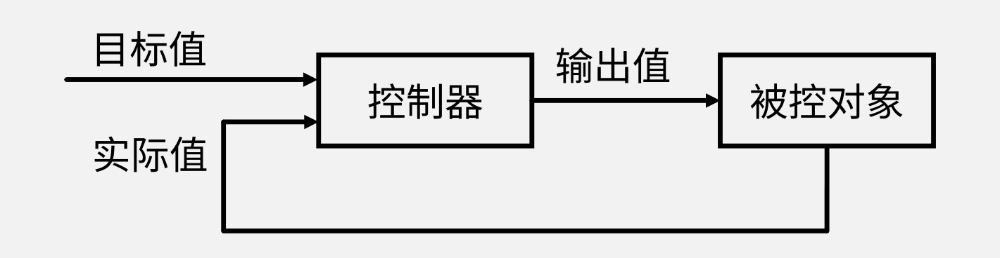

图中的反馈线将实际值送回比较节点。电机控速时，编码器测到速度下降，控制器便可增加驱动量；速度高于目标时则减小驱动量。

| 比较项 | 开环 | 闭环 |
| --- | --- | --- |
| 是否使用实际值修正输出 | 否 | 是 |
| 主要依赖 | 指令与对象的已知关系 | 反馈测量与控制律 |
| 扰动抑制 | 不主动纠偏 | 可在带宽与输出能力范围内纠偏 |
| 代价 | 结构简单 | 需要传感器，参数不当可能振荡 |

闭环不是精度和稳定性的自动保证。反馈符号接反会把误差越推越大，延迟过大或参数过强也可能使系统失稳。

### 2.3 闭环里的四个量

本章围绕目标值、实际值、误差与输出值分析控制过程。不同任务中，这些量的物理含义并不相同：

| 控制任务 | 目标值 | 实际值来源 | 输出值 |
| --- | --- | --- | --- |
| 电机定速 | 期望转速 | 编码器计数换算 | 带方向的 PWM 指令 |
| 锅炉定温 | 期望温度 | 温度传感器 | 加热功率或燃料供给量 |
| 电机定位置 | 期望位置 | 编码器累计计数 | 带方向的驱动量 |
| 倒立摆平衡 | 期望摆杆角度 | 角度传感器 | 电机驱动量，或内环所需目标量 |

带符号的 PWM 指令不意味着实际占空比为负：符号由方向引脚实现，绝对值对应占空比。

### 2.4 为什么电机控速一定要闭环

左右电机接受相同占空比，小车仍可能偏转，因为电机参数、摩擦与负载不可能完全一致。若要求两侧速度在负载变化后仍跟随同一目标，就需要分别测量并反馈调节。

速度闭环能减小两侧速度偏差，但不等于自动保证车身轨迹绝对笔直；轮径差、打滑与地面条件仍会影响走向。本课程先解决电机速度跟踪，不把它等同于完整的车辆轨迹控制。

## 3. PID 公式与系统框图

### 3.1 先把名字定下来

| 程序用名 | 含义 |
| --- | --- |
| `target` | 目标值 |
| `actual` | 实际值 |
| `error` | 目标值减实际值 |
| `out` | 控制器输出 |

目标值与实际值必须使用同一单位。例如实际量是“每 10 ms 的编码器计数”，目标也必须使用该单位，不能直接填入转/秒。具体换算见 [[02 PID离散化与程序实现]]。

### 3.2 两个公式

常见的标准形式为：

$$
out(t)=K_p\left(error(t)+\frac{1}{T_i}\int_0^t error(\tau)\,d\tau+T_d\frac{d\,error(t)}{dt}\right)
$$

$K_p$ 为比例系数，$T_i$ 为积分时间常数，$T_d$ 为微分时间常数，后两者单位均为时间。积分中的 $\tau$ 是时间变量，避免与积分上限 $t$ 混淆。

本课程程序采用并联形式：

$$
out(t)=K_p\,error(t)+K_i\int_0^t error(\tau)\,d\tau+K_d\frac{d\,error(t)}{dt}
$$

在 $K_p\ne0$、$T_i>0$ 时，两种参数写法的对应关系是：

$$
K_i=\frac{K_p}{T_i},\qquad K_d=K_pT_d
$$

并联形式可以分别设置三项权重，但三项经过同一个被控对象作用，**响应效果并不互相独立**。当实际值单位为 $Y$、输出单位为 $U$、时间以秒计时，三个系数单位分别是 $U/Y$、$U/(Y\cdot\mathrm{s})$、$U\cdot\mathrm{s}/Y$。不同单位下的参数不能直接照搬；程序若将采样周期并入系数，改变周期时还须换算离散系数，见第 02 篇。

上述积分式按零初始积分状态书写；若控制器带初始偏置或保留历史积分，须另计该初始输出。

### 3.3 框图：三条支路各算什么

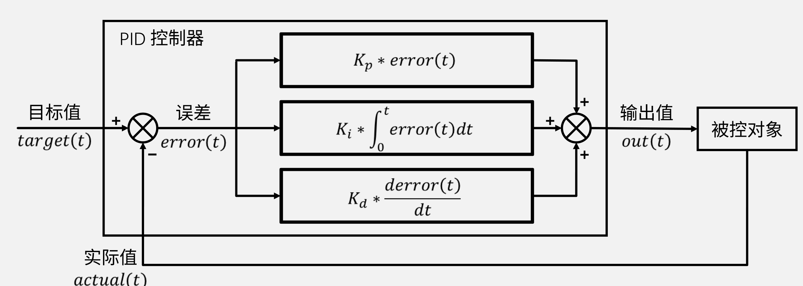

从左向右读图：目标减实际得到误差；三条支路分别计算当前误差、历史积分与变化率；支路输出相加得到控制量。三项可概括为：**P 看现在，I 记过去，D 看变化趋势**。

电机中，PWM 是电压与驱动能力的调节指令，不是直接测得的力矩或速度；实际响应还取决于反电动势、负载和供电。

### 3.4 这个公式是怎么来的

PID 是一种控制器结构，不是描述自然界的物理定律。三项分别处理当前偏差、持续偏差与过快变化，再通过参数选择取得合适的闭环响应。它既可用实验整定，也可结合数学模型分析稳定性；“经验调参”不意味着不存在可解释的原理。

## 4. 比例项 P

### 4.1 只有比例项时

$$
out(t)=K_p\,error(t)
$$

比例项只取决于当前误差，不保存历史。误差为零时，**本式中不含偏置的 P 项**输出为零；误差越大，指令幅值越大。

### 4.2 极性与 $K_p$ 的作用

采用 $error=target-actual$ 并令 $K_p>0$，还必须满足一个方向前提：**正输出应使反馈实际值增大**。此时实际值偏低会得到正输出，形成纠偏方向；若电机接线或编码器符号相反，误差相减本身并不能保证负反馈。

闭环前先用较小正向 PWM 核对编码器增量是否为正。方向不一致时，只调整电机方向或反馈符号中的一处，不能两处同时反转。

本例取误差为 10，各比例系数给出的输出为：

| $K_p$ | P 项输出 |
| --- | --- |
| 0.1 | 1 |
| 1 | 10 |
| 10 | 100 |

在本课程电机实验中，增大 $K_p$ 通常会加快响应、减小稳态误差，但也会增强振荡。是否超调以及多大参数会失稳，还取决于惯性、采样延迟与输出限幅，不能由 $K_p$ 单独决定。

### 4.3 实测波形：$K_p$ 加大的四个阶段

以下保留课程波形，红线为目标值、紫线为实际值，**不是本次 HAL 工程的实测结果**。图中数值依赖原实验的单位与采样周期，不宜直接当作通用参数。

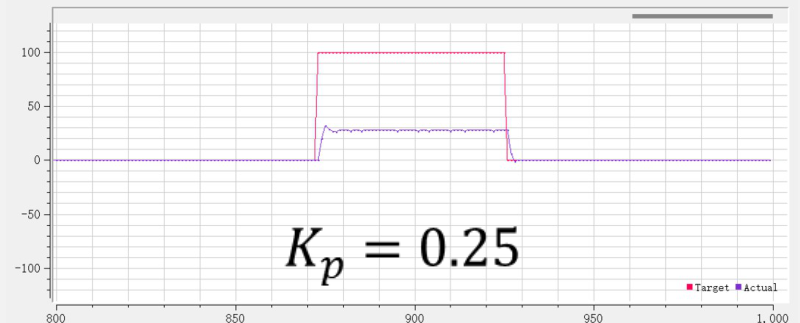

$K_p=0.25$：目标升到 100，实际值最后约为 30，稳态偏差明显。

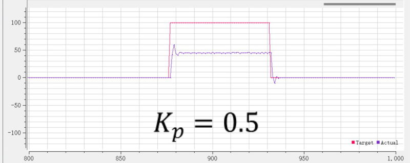

$K_p=0.5$：实际值稳定水平提高，偏差减小。

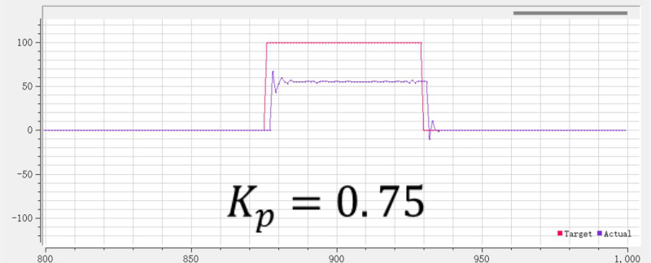

$K_p=0.75$：启动段更陡，接近稳态前的波动也更明显。

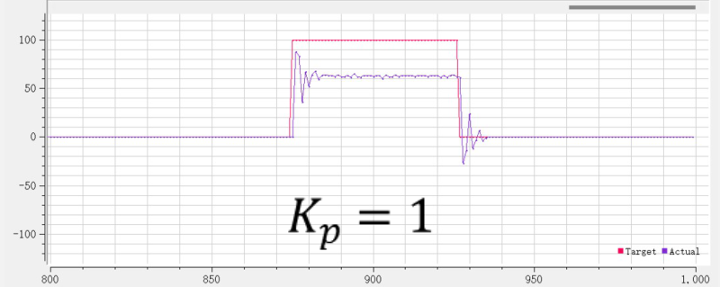

$K_p=1$：启动与停止时出现明显振铃，稳态值仍低于目标。注意其峰值没有超过目标 100，不能把“超过最终稳态值”误读成“越过目标值”。

四图说明：该实验中提高比例增益能减小静差，但会增加瞬态波动。继续增益并不是消除静差的无代价办法。

### 4.4 稳态误差是怎么产生的

稳态误差是恒定目标下、系统稳定后仍留下的偏差。若稳态运行需要控制量 $out_{\mathrm{ss}}$，而控制器只有无偏置的 P 项，则：

$$
K_p\,error_{\mathrm{ss}}=out_{\mathrm{ss}},\qquad
error_{\mathrm{ss}}=\frac{out_{\mathrm{ss}}}{K_p}
$$

$\mathrm{ss}$ 表示稳态，$K_p>0$。维持目标状态若需要非零输出，零误差就不能成为这种控制器的平衡状态。电机维持非零转速需要持续提供能量；若误差恰为零，P 项也为零，电机将因损耗或负载减速，直到剩余误差产生的输出足以维持运行。

用一个可计算的简化模型说明。本例设电机静态关系为 $actual=G\,out$，$G>0$ 是速度对驱动指令的静态增益，忽略饱和与死区，目标为常数 $r$。代入 $out=K_p(r-actual)$ 得：

$$
actual=GK_p(r-actual)
\quad\Rightarrow\quad
actual=\frac{GK_p}{1+GK_p}r,
\qquad error_{\mathrm{ss}}=\frac{r}{1+GK_p}
$$

取 $G=2$、$K_p=0.5$、$r=100$，得实际值 50、误差 50、输出 25；代回 $actual=2\times25=50$，关系一致。这个例子解释了有限比例增益下的静差，但不能用静态模型判断瞬态是否振荡。

### 4.5 判断稳态误差：有没有，往哪边

对本章的**恒定目标、稳定闭环、无偏置纯 P 控制**，可问：维持目标状态是否需要非零输出？若需要，纯 P 就必须留下误差来产生该输出。

| 任务 | 维持目标的要求 | 纯 P 的典型表现 |
| --- | --- | --- |
| 电机非零定速 | 克服损耗与负载，持续驱动 | 存在静差 |
| 温度高于环境的定温 | 持续补偿散热 | 存在静差 |
| 无外力的电机定位置 | 静止位置可能不需驱动 | 理想情况下可无静差 |
| 带重力或外力的位置保持 | 需要保持力矩 | 可能存在静差 |

“零输入时是否偏离目标”是上述判断的直觉版本，不是所有控制系统的通用判据。前馈、输出偏置、摩擦死区或运动目标都会改变分析条件。

按本文误差定义，$error_{\mathrm{ss}}>0$ 表示实际值低于目标；负转速、外部助力等情况下也可能出现负误差，不能断言实际值永远小于目标。

### 4.6 一个绕不开的疑问：P 项为什么不能在上次输出上累加

若写成 `out += K * error`，只要误差持续存在，输出就会继续改变；误差归零后，已积累的输出仍被保留。这不是纯比例控制，而是离散积分控制的结构。

累加可以提供维持目标所需的非零输出，但能否稳定消除偏差，还取决于参数和执行器能力。这个区别正是引入 I 项的原因。

## 5. 积分项 I

### 5.1 PI 的输出值

PI 控制把 P 与 I 相加：

$$
out(t)=K_p\,error(t)+K_i\int_0^t error(\tau)\,d\tau
$$

积分表示带符号的误差面积。数字程序用“误差乘时间间隔后累加”近似；若只写 `sum += error`，则时间间隔应已并入积分系数，第 02 篇将详细推导。

### 5.2 积分项在做什么

令积分项输出为 $I(t)$，则：

$$
\frac{dI}{dt}=K_i\,error(t)
$$

当 $K_i>0$ 时，正误差使 $I$ 增大，负误差使 $I$ 减小，零误差只让 $I$ **停止变化**，不会把它清零。

本例取 $K_i=2$，初始 $I=0$：误差保持 3 持续 0.5 s，积分输出增加 $2\times3\times0.5=3$；随后误差为零，输出仍为 3；再保持误差 $-1$ 持续 1 s，输出降为 $3-2\times1\times1=1$。正负面积可以抵消，这与只看当前误差的 P 项不同。

### 5.3 积分项用来消除稳态误差

在**闭环稳定、恒定目标可达、执行器未持续饱和、积分未被冻结**的前提下，I 项能够消除恒定稳态误差。

理由是：若稳态仍存在非零恒定误差，$dI/dt=K_i\,error$ 就不为零，积分输出还会持续改变，与“已经稳定”矛盾。因此在上述前提下，最终误差应为零；此时 P 项可为零，I 项保留所需的维持输出。

实际值第一次到达目标的一瞬间，积分输出不一定刚好等于维持输出，因而仍可能继续加速并超调。若目标超过电机能力，积分也不能凭空提供额外电压或力矩。

### 5.4 积分项的代价：滞后

积分保存历史，使输出不能只随当前误差立即改变。例如正转积累了较大正输出后突然要求反转，负误差要先抵消原有积分，才可能建立足够的反向输出。

过强的积分容易造成超调、振荡。执行器已经达到输出上限而误差仍在累加时，还会出现**积分饱和**：即使后来误差反向，控制器也可能长时间维持过大的输出。只限制最终 PWM，不等于限制了内部积分。

P 项不积累历史，但其输出同样可能超出执行器范围。PI 的分工是 P 提供及时响应，I 修正持续偏差；增大 $K_i$ 通常使静差修正更快，却可能降低稳定裕度，不宜简单理解为“越大越好”或“越大必然越慢”。

### 5.5 实测波形：六组参数

以下仍为课程电机控速波形。每组只说明该平台、该采样周期下的表现；看启动段、稳态和停止段，不只比较上升有多快。

**（1）$K_p=0,\ K_i=0.05$：纯积分。** 实际值缓慢接近目标，归零时也有长尾；图中最终偏差很小，但这不说明任意对象用纯 I 都稳定。

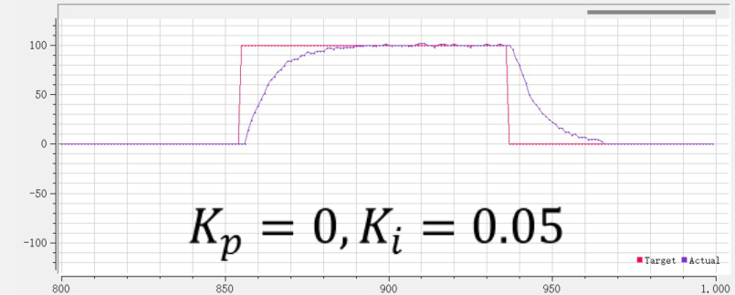

**（2）$K_p=0.25,\ K_i=0.05$：加入比例。** 前段响应变快，后段仍缓慢贴近目标。P 与 I 始终共同作用，不是先关闭 I、再切换成 I。

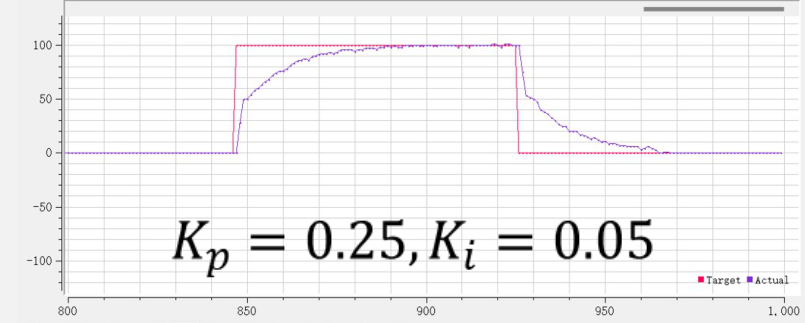

**（3）$K_p=0.25,\ K_i=0.2$：加快偏差修正。** 相比上一组，上升与回零更快，稳态能贴近目标，是这组波形中较均衡的参数。

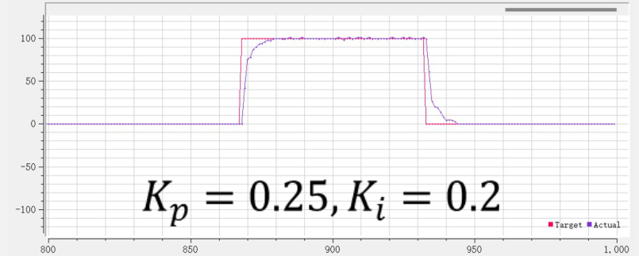

**（4）$K_p=0.5,\ K_i=0.2$：提高比例。** 启动与停止时的波动增大，说明更强比例作用并未带来同等平滑的响应。

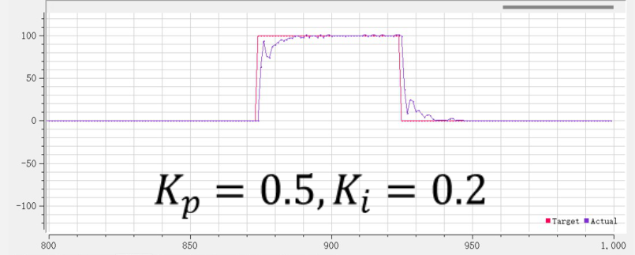

**（5）$K_p=0.25,\ K_i=0.5$：积分过强。** 实际值越过目标后才回落；负误差使正向积分输出减小，并不代表它立即变成负向驱动。

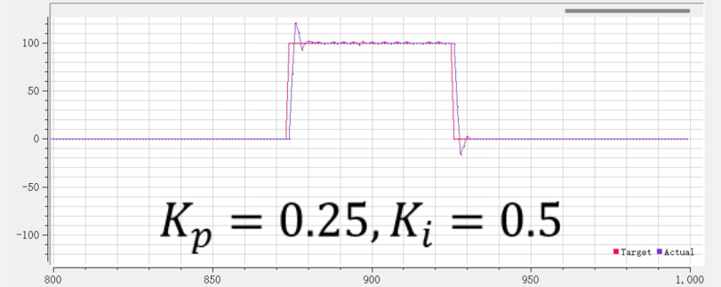

**（6）$K_p=0.5,\ K_i=0.5$：两项共同增强。** 响应很快，但启动超调与停止时的反向摆动更突出。

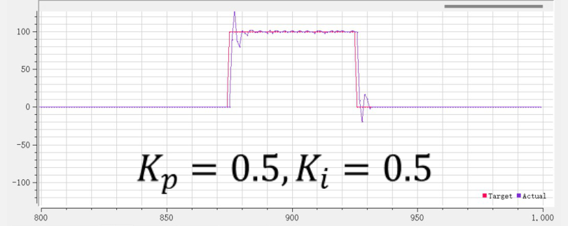

这些对比支持逐项改变参数、同时观察目标跟踪与输出的做法；仅看实际值曲线，不能把所有振荡都唯一归因于某一个参数。

## 6. 微分项 D

### 6.1 完整 PID 公式

$$
out(t)=K_p\,error(t)+K_i\int_0^t error(\tau)\,d\tau+K_d\frac{d\,error(t)}{dt}
$$

D 项是最后一项，可配合 P 构成 PD，也可配合 PI 构成 PID；通常不单独用它消除恒定偏差。

### 6.2 D 项看的是斜率，不是误差

当 $K_d>0$ 时，D 项与**误差变化率同号**：误差增加时为正，误差减小时为负，误差恒定时为零，不论这个恒定误差有多大。

若目标固定，则：

$$
\frac{d\,error}{dt}=-\frac{d\,actual}{dt}
\quad\Rightarrow\quad
D(t)=-K_d\frac{d\,actual}{dt}
$$

在方向约定正确的条件下，它才表现为阻碍实际值过快变化的作用。例如实际值还低于目标、但正快速上升，P 项为正，D 项可以为负，提前减小总驱动量。

### 6.3 D 项的真正价值：预测和阻尼

D 项利用当前变化率反映短时间趋势，并不是知道未来值。它能在实际值尚未越过目标前减小驱动，给适合的系统增加阻尼。

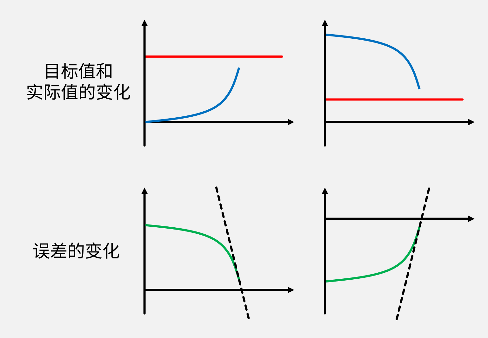

图中左列实际值快速上升，误差下降，D 项为负；右列实际值快速下降，误差上升，D 项为正。两列都说明：**误差接近零时，若实际值仍有较大变化速度，仅靠当前误差决定输出可能来不及减速**。

本例固定目标，取 $K_p=2$、$K_d=0.5$、当前误差为 1、实际值变化率为 6 单位/秒，忽略 I 项，则 $P=2$、$D=-3$，总输出为 $-1$。虽然尚未到目标，控制器已给出反向指令，以减缓接近速度；是否足以避免超调，仍由对象动态决定。

### 6.4 $K_d$ 过大的副作用

微分对快速变化敏感，也会放大测量噪声。离散实现中，同样的测量跳动除以较小采样周期，会得到较大的变化率估计；$K_d$ 过大时容易出现输出抖动或响应迟缓，不是必然表现为“卡顿”。

若目标发生阶跃，对误差求微分还会产生很大的瞬时输出，称为**微分冲击**。工程上常改为对测量值求微分，并配合低通滤波；本章先理解其原因，后续实现不能把理想微分当成无噪声的测量。

### 6.5 实测波形：倒立摆位置环的 $K_d$

课程位置环波形中，红线为固定目标 0，紫线为实际位置。保持其余配置不变，比较三个 $K_d$ 区段：

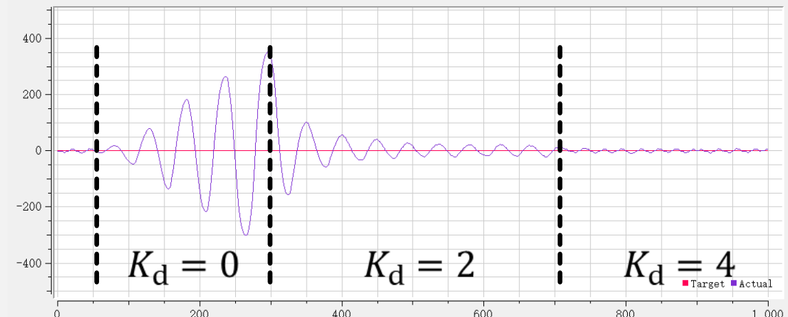

- $K_d=0$：振幅逐渐扩大，当前参数组合缺少足够阻尼。
- $K_d=2$：大幅振荡衰减，但仍有小幅波动。
- $K_d=4$：实际位置在目标附近的波动进一步减小。

此图说明 D 项在该位置环中改善了阻尼，不说明所有系统只要增加 $K_d$ 都会更稳定；参数仍与位置单位、采样周期和内环配置有关。

### 6.6 三项怎么取舍

| 任务特征 | 常用起点 | 选择理由 |
| --- | --- | --- |
| 电机定速，持续驱动才能维持转速 | PI | P 响应，I 消除静差；测速噪声较大时先不加 D |
| 惯性明显、需要位置阻尼 | PD | P 纠偏，D 减缓接近目标时的运动 |
| PD 后仍有持续偏差 | 在稳定基础上少量加入 I | 补偿外力或维持力矩，注意饱和与超调 |

这些是选型起点，不是按任务名称套公式。倒立摆本身不稳定、且存在耦合，不能仅凭“用了 PD”就认定可保持倒立。当前先掌握单环原理，再通过 [[02 PID离散化与程序实现]] 与 [[03 基础驱动：CubeMX与HAL库实现]] 建立可观测的电机反馈链路。

---

上一篇：[[00 项目背景与技术]] ｜ 下一篇：[[02 PID离散化与程序实现]]
