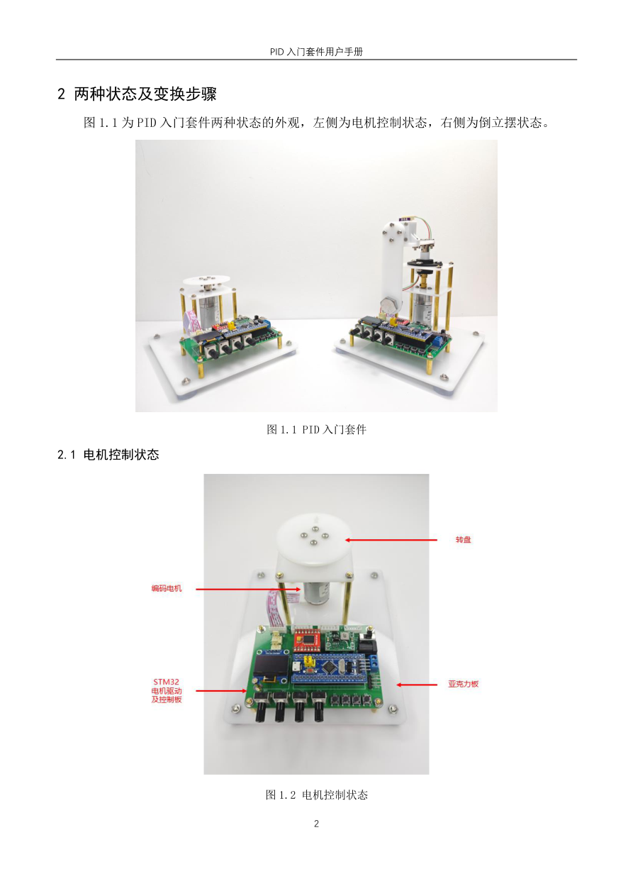
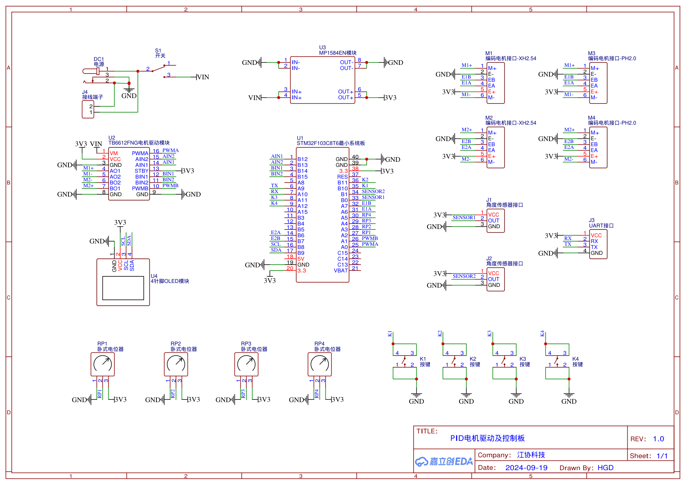

# 01 实验平台与资料使用

## 学习目标

- 对照原理图连接供电与调试接口。
- 打开独立实验的 Keil 工程。
- 用基准程序区分硬件问题与程序问题。

## 一、同一套硬件的两种用途

左侧形态用转盘观察速度和位置；右侧形态增加横杆、摆杆和角度传感器。两种形态都由同一个编码电机驱动。电机编码器测量电机轴的运动，摆杆传感器测量摆杆相对横杆的角度，两者不是重复的反馈信号。

平台使用 STM32F103C8T6、标准外设库、TB6612FNG 电机驱动模块、MP1584EN 降压模块及 12 V 编码减速电机。STM32 输出逻辑信号，驱动模块提供电机所需电流；不能把电机直接接到 GPIO 上。电机与控制芯片的电源电压不同，但信号必须有共同参考地。

## 二、接线与资源分配

先沿图中 `PWMA`、`AIN1/AIN2` 找到执行通道，再沿 `E1A/E1B` 找到反馈通道。这样可以看出“能让电机转”与“能测到电机转”是两条独立电路。

| 功能 | 引脚或外设 | 本课用途 |
| --- | --- | --- |
| OLED | PB8/PB9，软件 I²C | SCL/SDA；显存更新后调用 `OLED_Update()` |
| 板载 LED | PC13 | 低电平点亮 |
| K1～K4 | PB10、PB11、PA11、PA12 | 上拉输入，按下接地 |
| 周期调度 | TIM1 | 1 ms 更新中断 |
| 电机 PWM | PA0，TIM2_CH1 | 20 kHz PWM |
| 电机方向 | PB12、PB13 | 控制驱动桥方向 |
| 编码器 A/B | PA6、PA7，TIM3 | 正交编码器接口 |
| RP1～RP4 | PA2～PA5，ADC2 通道 2～5 | 调目标及 PID 参数 |
| 角度传感器 G1 | PB0，ADC1 通道 8 | 倒立摆反馈 |
| 角度传感器 G2 | PB1，ADC1 通道 9 | 备用接口，程序需同步修改 |
| USART1 | PA9 TX、PA10 RX | 波形数据，9600 bit/s、8N1 |

板上同一路电机的不同规格插座是并联的，不是四个独立电机通道。课程程序控制第一路；把电机插到第二路而不修改程序，通常表现为屏幕和 PWM 数据都在变化，电机却不动。

连接前断电，核对电源模块和驱动模块方向。按套件手册使用配套 12 V 电源；外部电源已经供电时，ST-LINK 和 USB 串口模块不要再把 3.3 V 正电源并接到板上。ST-LINK 接 SWDIO、SWCLK、GND；串口模块 RX 接板 TX，模块 TX 接板 RX，GND 共地。只观察输出时板 TX→模块 RX 与共地即可。模块应使用与 STM32 匹配的 3.3 V 逻辑电平。

新版使用手册给出的配套适配器为 12 V/1 A，并带过流与隔离保护。非必要时不要换成电池或更大功率电源；使用可调电源时先断开负载设置 12 V，并把电流上限设为不超过 1 A。板上的 DC 插座与接线端子为并联供电入口，同一时刻只接一种。上电前至少检查：

- 电源极性与模块插接方向正确，板上没有金属屑或松散导线；
- 电机驱动模块不能插反或错位，手册要求优先使用板载大电容型号标识以 `V` 结尾的配套版本；
- 电机和摆杆的活动范围内没有手、线缆与易碎物，夹具下方垫木块保护底板；
- 先关板上开关再插拔电机、驱动模块、传感器和调试线。

配套电源的保护只能降低事故后果，不能代替接线检查。调试程序可能瞬间给出满 PWM，夹紧装置和可快速断开电机电源仍是必要措施。

倒立摆调试时用木块垫住底板，再夹紧桌面；不能靠加大夹力直接压弯亚克力板。先给摆动留出空间，再接通电机电源。

## 三、建立可重复的工程环境

1. 解压课程资料，在自己的实验目录复制一份将要修改的工程，保留原始程序作为对照。
2. 用 Keil uVision5 打开 `Project.uvprojx`，核对目标器件为 STM32F103C8T6。沿用课程工程的启动文件、标准库和时钟配置。
3. 在 Debug 中选择实际使用的 ST-LINK，接口选 SW；确认工具能识别芯片，再编译和下载。
4. 检查构建输出，先解决报错，警告按具体内容判断。`undefined symbol` 应查文件是否加入工程；找不到头文件应查 include path，而不是复制同名头文件到所有目录。
5. 下载后复位，确认实际运行的是本次工程。屏幕标题、输出字段和按键行为可作为版本辨识。

课程 OLED 是带显存的版本，不能直接替换成入门课旧 OLED 模块。中文字符要预先取模并放入 `OLED_Data.c` 对应字库；课程工程配置了 ARMCC 选项 `--no-multibyte-chars`。它是特定编译器选项，不应未经检查直接套进 ARMClang。先用纯英文和数字验证显示链路，再处理中文字模与源文件编码。

## 四、先用已知正常的程序验机

工程 00 的综合测试可以检查按键、旋钮、电机、编码器和倒立摆。按配套使用手册操作；手册中的倒立摆入口顺序是 K4→K3→K4→K1，适用于对应综合程序菜单。工程 15/16 则用 K1 直接启停，不能混淆。

验机时逐项观察：旋钮对应数据变化；按键只产生预期操作；小正 PWM 与小负 PWM 对应相反方向；编码器随运动改变且符号匹配；角度传感器在直立附近连续变化。全部通过后再进入自己的 PID 程序。

| 现象 | 优先检查 | 判断依据 |
| --- | --- | --- |
| OLED 正常，电机完全不动 | 12 V、电源开关、插座通道、驱动模块方向 | 逻辑供电正常不代表电机供电正常 |
| 电机能转，编码器始终为 0 | 编码器线、PA6/PA7、TIM3 初始化 | 输出链路与反馈链路分开排查 |
| 自写程序失败，基准程序正常 | 初始化、中断周期、符号和变量更新 | 同一硬件可工作，优先比较代码 |
| 两种程序都明显抖动或传动打滑 | 顶丝、轴切面、连接器、结构刚度 | 算法不能补偿严重机械松动 |
| 下载成功但屏幕像旧程序 | 复位、目标工程、下载配置 | “编译成功”不等于已在板上运行 |

基准程序失败也不能单凭一次现象断言硬件损坏；中心角度、固件版本和装配方向仍需核对。把“输入读得对、输出做得对、闭环方向对”逐层确认，能显著减少盲目调参。

## 五、平台验收记录

第一次验机不要只写“正常”，至少留下下面这些可复用数据：

| 项目 | 记录内容 | 通过条件 |
| --- | --- | --- |
| 供电 | 输入电压、限流值、3.3 V 实测 | 电压稳定，无异常发热或气味 |
| 下载 | 工程名、编译时间、芯片识别 | 下载后复位，屏幕/按键行为与当前工程一致 |
| 电机 | 正负 PWM 各 10、20 时的方向 | 能停、能双向运动，无异常卡滞 |
| 编码器 | 手转及正 PWM 时计数符号 | 静止近 0，正反方向符号相反 |
| 旋钮 | RP1～RP4 的最小/最大码 | 通道不串扰，范围接近 0～4095 |
| 角度 | 下垂盲区、直立中心、增大方向 | 直立附近连续，不位于盲区 |
| 串口 | 端口、波特率、列数 | 9600 8N1 下帧完整、列顺序正确 |

这张记录是后续调参的硬件基线。同一份程序突然变差时，先与基线比较，再决定是否改 PID。
