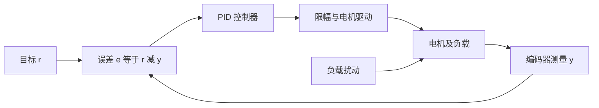
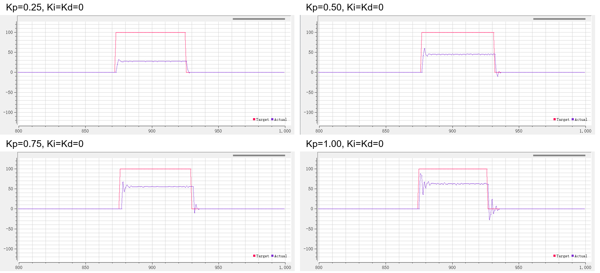
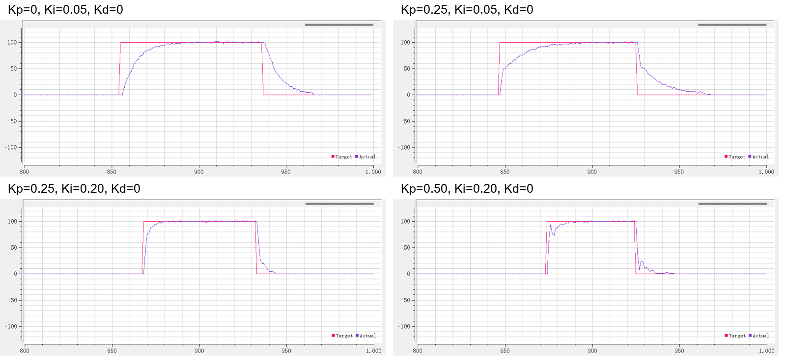

# 02 PID基本原理

## 学习目标

- 画出目标、反馈与执行器之间的闭环。
- 解释比例、积分和微分的作用。
- 用响应曲线判断参数调整方向。

## 一、为什么只给 PWM 还不够

给电机 30% PWM，电机会转起来，但负载加重、电源变化或摩擦改变后，转速会变化。这是开环：控制器输出一个命令，却不知道命令是否达到了目的。

闭环先测量真实转速，再比较目标与实际。如果速度不足就增大驱动，过快就减小驱动。闭环并不消除执行器的能力限制；电机已经满输出时，再大的误差也不能让驱动超过电源和电机的能力。

这里 $r$ 是目标值，$y$ 是测量值，$e=r-y$ 是误差，$u$ 是控制输出。负反馈要求输出引起的变化能减小误差。例如速度太低时正输出应使测量速度增大；若编码器方向反了，正输出反而读到更负的速度，控制器就会越加力误差越大。

水温控制也有同样结构：设定温度、温度计、加热器分别对应目标、测量和执行器。不同对象的惯性、延迟与输出限制不同，因此 PID 的公式能复用，参数不能照搬。

课程用差速小车说明开环的局限：左右电机给相同 PWM，不代表两轮转速相同。电机差异、轮轴摩擦和左右负载都会让小车跑偏。分别用编码器测量两轮转速，并让两个速度环跟踪同一目标，才能针对这些差异调整各自的 PWM。即使轮速相同，仍需轮径相近、接地正常且没有明显打滑；速度闭环本身不能保证小车在任意地面始终沿全局直线运动。

## 二、P：根据当前偏差决定力度

比例项为

$$
u_P(t)=K_P e(t).
$$

偏得越远，纠正越强；目标附近则减小动作。以速度控制为例，本例取目标 100、实测 80、$K_P=0.3$，则 $e=20$，比例输出为 $6$。若误差减为 5，输出降为 1.5。

这既是 P 的优点，也是产生稳态误差的原因。假定某工况维持转动需要输出 $u_{\mathrm{hold}}=12$，只有 P 项且 $K_P=0.3$，平衡时需要

$$
e_{\mathrm{ss}}=\frac{u_{\mathrm{hold}}}{K_P}=40.
$$

误差若完全消失，P 输出也消失，便不能维持这一工况。这个例子说明“需要持续非零输出的对象”为什么可能留误差，并不是所有比例控制都必然有相同的稳态误差。电机位置静止时也可能因为静摩擦而在一段误差范围内不动，成因与维持转速所需驱动不同。

加大 $K_P$ 通常能加快响应、减小偏差，但对象有惯性和延迟，纠正动作不会立即反映在测量上。加力过猛后到达目标仍有运动趋势，就会超过目标；继续反向纠正又可能造成振荡。因此“越快越好”不能等同于“参数越大越好”。

### 课程波形：逐步增大比例增益

图取自课程课件第 10 页，按字幕中的增益标注重排；红色为目标，紫色为实际值。仅裁去软件设置区域，保留坐标轴和图例。这是课程原始演示，不是本次硬件测量；横轴为 SerialPlot 样本序号，不能直接当成秒。图中的 `Kp` 是课程离散代码参数。

保持 `Ki=Kd=0`，目标由 0 跳到 100，再回到 0。`Kp=0.25` 时实际值只稳定在约 30，留下约 70 的误差；增至 0.5 后约为 45。继续增至 0.75 和 1，最终速度更接近目标，但仍低于 100，起步和停车时的振荡则更明显。这里的瞬态峰值主要是超过各自的最终平台，不能把所有曲线都说成“超过了目标 100”。

复现时先按第 04 章确认编码器方向与串口波形，再打开第 05 章的位置式速度工程。保持同一目标阶跃和负载，逐次设置上述 `Kp`，每组都记录稳态值及起停振荡。应比较变化趋势，不要求另一台电机得到完全相同的数值。

## 三、I：把持续偏差变成持续输出

积分项记录过去误差的累积：

$$
u_I(t)=K_I\int_0^t e(\tau)\,d\tau.
$$

只要误差长期保持正值，积分输出就不断增加，直到驱动足够让反馈靠近目标。误差变为零时，积分不会自动消失，而是保留已有值。这解释了积分为何可以在零误差时提供维持转速所需的输出。

本例取连续积分增益 $K_I=2$，误差在 0～0.5 s 保持为 10，则该时段积分输出增加 $2\times10\times0.5=10$。之后误差若为 0，新增积分为 0，已有的 10 保持；若误差变为 -5 并持续 1 s，则减少 $2\times5\times1=10$，回到零。

积分对符号敏感：正负误差面积相互抵消。位置运动开始时积累了大量正误差，到目标后这股驱动力仍存在，往往需要反向误差才能消掉，所以加 I 可能增加超调。只有在无保持负载、最终积分与初始积分相同、没有清零或限幅等条件下，才可用“正负误差面积相等”描述整个过程。

积分消除恒定误差还要求闭环稳定、目标可达、执行器有余量。若断开电机输出而控制器仍在积分，误差不会改善，积分却越来越大，恢复驱动后便容易长时间满输出。这就是后面要处理的积分饱和。

### 课程波形：从纯 I 到 PI

图取自课程课件第 13 页，选取字幕参数明确的四组演示，按从左到右、从上到下阅读；坐标和颜色约定与前图相同，参数为课程离散代码中的 `Kp`、`Ki`、`Kd`。

纯 I 的 `Kp=0、Ki=0.05` 能逐渐消除偏差，但启动和回零都慢，因为输出需要逐拍积累或消退。保持 `Ki=0.05` 加入 `Kp=0.25` 后，目标变化时 P 立即提供一部分输出，随后由 I 补足。再把 `Ki` 增至 0.2，误差积累更快，跟踪过程明显缩短。最后保持 `Ki=0.2`，把 `Kp` 增至 0.5，起停波动更明显，说明更大的 P 并不保证整体响应更好。

复现这四组时保持 `Kd=0`，每组从停机、目标为零且积分已复位的状态开始。对照记录“多久接近目标、稳态是否仍有偏差、停车是否反向波动”三项；若不复位积分，上一组遗留的驱动力会混入下一组结果。参数增大后出现持续振荡，应先减小参数，不要继续增加积分来追求更快响应。

## 四、D：观察变化趋势，增加阻尼

微分项为

$$
u_D(t)=K_D\frac{de(t)}{dt}.
$$

它关注误差变化有多快。目标固定时，$e=r-y$，因此

$$
\frac{de}{dt}=-\frac{dy}{dt}.
$$

对位置控制，位置快速接近目标时，实际位置的变化率就是速度，D 项相当于提前施加与运动方向相反的作用，减小冲过目标的趋势。它不是预知未来，而是依据当前变化趋势做出响应。

本例取采样间隔 0.04 s，误差从 20 降到 12，$K_D=0.02$，差分近似给出 $u_D=0.02(12-20)/0.04=-4$。此时 P 仍可能为正，D 则减小总驱动，使电机提前减速。

如果目标突然改变，而实际值还没来得及变化，误差也会跳变，D 会产生很大的瞬时输出，这叫设定值微分冲击。测量噪声同样会被微分放大。所以 D 并非加得越多越稳定；后续用微分先行处理目标跳变，用不完全微分降低高频噪声。

## 五、三项合起来如何理解

并联形式是

$$
u(t)=K_Pe(t)+K_I\int_0^t e(\tau)\,d\tau+K_D\frac{de(t)}{dt}.
$$

另一种常见写法是

$$
u(t)=K_P\left[e(t)+\frac{1}{T_I}\int_0^t e(\tau)\,d\tau+T_D\frac{de(t)}{dt}\right].
$$

两者对应 $K_I=K_P/T_I$、$K_D=K_PT_D$。因此调大积分时间 $T_I$ 会减弱积分，而调大并联积分增益 $K_I$ 会增强积分，不能只看参数名字就判断方向。

| 控制形式 | 常见适用任务 | 首先观察的问题 |
| --- | --- | --- |
| P | 建立方向与响应直觉 | 是否留偏差，是否振荡 |
| PI | 电机速度跟踪 | 稳态误差与积分恢复时间 |
| PD | 电机位置运动 | 接近目标时是否超调、来回摆 |
| PID | 同时需要保持输出与阻尼 | 积分和微分的副作用是否可控 |

这只是本课程的选型起点。位置环并非禁止积分，速度环也并非禁止微分；应由残余误差、噪声、负载与动态要求决定。

## 六、用曲线调参，而不是只看“转了没有”

对同一目标阶跃，同时观察目标、实际和输出。上升过程反映响应速度；越过目标的最大幅度反映超调；进入并保持在容许范围内所用时间反映调节时间；长期平均偏差反映稳态误差。容许范围必须根据任务定义，例如位置容差按编码器计数给定。

速度实验一般从 P 开始，逐渐增大到反应足够快、又不过分抖动，再加 I 消除偏差。位置实验通常先调 P，再加 D 减少超调，最后才判断是否真的需要 I。每次只改一个参数，保持目标阶跃幅度和负载尽量一致；否则无法判断曲线改善来自哪个改动。

持续满输出但追不上目标，先检查目标可达性；一启动就向错误方向加速，先检查反馈符号；低速最后一点误差不消失，先区分摩擦门槛、量化分辨率和积分不足。它们需要的处理方式不同。
