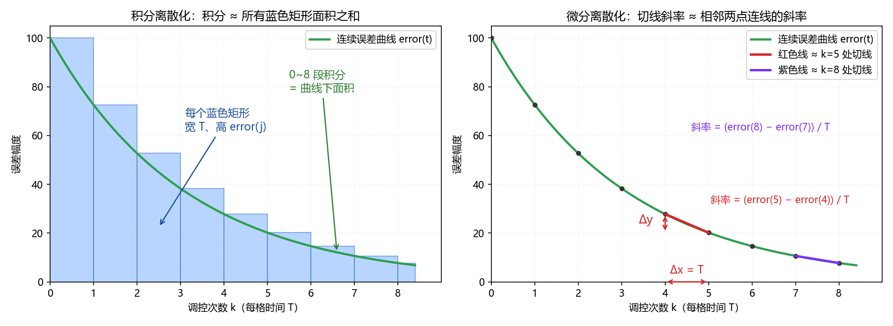

# 02 PID离散化与程序实现

## 学习目标

- 推导连续 PID 的离散公式。
- 区分连续增益与离散增益。
- 说明位置式与增量式的等价条件。
- 选择合适的采样周期与执行方式。
- 在 HAL 用户区接入一种 PID 算法。

## 1. 为什么要把连续 PID 离散化

上一节的连续 PID 控制律是

$$
u(t)=K_{p,c}e(t)+K_{i,c}\int_0^t e(\tau)\,\mathrm{d}\tau+K_{d,c}\frac{\mathrm{d}e(t)}{\mathrm{d}t}
$$

其中 $e(t)=r(t)-y(t)$ 是目标值减实际值，$u(t)$ 是控制输出，下标 $c$ 表示连续增益。连续公式说明三项的物理作用；单片机只能在采样时刻计算，因此要把积分、微分换成有限次加减乘除。

设调控周期为 $T$，在 $t=kT$ 采样并更新输出，两次更新之间保持上一次输出。离散化不是简单地把 $t$ 改成 $k$，还必须明确积分近似、差分方式和初始状态。

## 2. 连续 PID 的离散化

### 2.1 记号约定

| 记号 | 含义 |
| --- | --- |
| $T$ | 固定采样周期；代入秒制连续增益时用秒 |
| $e(k)=e(kT)$ | 第 $k$ 次采样的误差 |
| $e(0)$ | $t=0$ 的初始观测，不累计一个周期的积分 |
| $I_0=0$ | 初始误差积分为零 |
| $k=1,2,\dots$ | 从第一个完整采样周期结束时开始更新 |

本节统一采用**右矩形积分**：区间 $((j-1)T,jT]$ 宽为 $T$，高取右端点误差 $e(j)$。因此到 $t=kT$ 时共有 $k$ 个矩形，而不是 $k+1$ 个。

### 2.2 三项各自的离散结果

**比例项：直接使用当前误差。**

$$
P_k=K_{p,c}e(k)
$$

**积分项：把曲线下的面积近似成矩形面积之和。**

$$
I_k=I_{k-1}+Te(k)=T\sum_{j=1}^{k}e(j),\qquad I_0=0
$$

例如 $k=1$ 时只有区间 $(0,T]$，故 $I_1=Te(1)$；不能再加 $Te(0)$，否则在初始时刻就凭空多累计了一个周期。$\sum_{j=1}^{k}e(j)$ 表示把第 1 次到第 $k$ 次误差相加，程序只需保存累加值，不必保存整个数组。

**微分项：用相邻两点连线的斜率近似当前导数。**

$$
\left.\frac{\mathrm{d}e}{\mathrm{d}t}\right|_{t=kT}\approx\frac{e(k)-e(k-1)}{T}
$$

横坐标差是 $T$，纵坐标差是 $e(k)-e(k-1)$，所以必须除以 $T$。误差下降时差分为负，符合曲线向下倾斜的方向。

合起来，从 $k=1$ 起得到

$$
u(k)=K_{p,c}e(k)+K_{i,c}T\sum_{j=1}^{k}e(j)+\frac{K_{d,c}}{T}\bigl[e(k)-e(k-1)\bigr]
$$



读图重点是“积分累加面积、微分计算斜率”。**原图左侧使用左端点矩形**，只用于说明面积近似；本节公式与代码统一使用右矩形，第 $j$ 段取 $e(j)$，从 $j=1$ 加到 $k$。右图的相邻点后向差分与正文一致，图中 `error` 就是这里的 $e$。在误差足够平滑时缩短 $T$ 可减小近似误差，但噪声、量化与运算时延会限制实际收益。

### 2.3 把 $T$ 并进系数：程序里真正用的公式

固定 $T$ 后，定义程序使用的**离散增益**：

$$
K_p=K_{p,c},\qquad K_i=K_{i,c}T,\qquad K_d=\frac{K_{d,c}}{T}
$$

于是

$$
u(k)=K_pe(k)+K_i\sum_{j=1}^{k}e(j)+K_d\bigl[e(k)-e(k-1)\bigr]
$$

下面公式与代码中的 $K_i,K_d$ 都已包含 $T$。若输出单位为 $U$、误差单位为 $E$，则连续增益的单位分别是 $U/E$、$U/(E\cdot\mathrm{s})$、$U\cdot\mathrm{s}/E$；合并周期后的三个离散增益均按 $U/E$ 使用。

**改变周期时，先保持目标值和测量值的物理单位一致。** 例如误差始终以转/秒表示，从 $T$ 改成 $T'$，保持连续控制律对应的换算是

$$
K_p'=K_p,\qquad K_i'=K_i\frac{T'}{T},\qquad K_d'=K_d\frac{T}{T'}
$$

这只是系数换算，不保证新周期下的闭环性能不变。若误差使用本例的“计数/周期”，改变 $T$ 还会改变误差尺度，**不能只调整 $K_i,K_d$**。同一转速下计数随周期成比例；若目标也同步换算，令 $a=T'/T$，保持同一物理控制律需再把全部增益除以 $a$，即 $K_p'=K_p/a$、$K_i'=K_i$、$K_d'=K_d/a^2$。实际使用时更直接的办法是先把测速统一换成转/秒，再按上式换算离散增益。

## 3. 位置式 PID

位置式（全量式）PID 每次直接算出完整输出：

$$
S_k=S_{k-1}+e(k),\quad S_0=0
$$

$$
u(k)=K_pe(k)+K_iS_k+K_d\bigl[e(k)-e(k-1)\bigr]
$$

$S_k$ 是未乘 $T$ 的误差累加值，真正的误差积分近似为 $TS_k$。程序要记住 $S_k$ 和上次误差。

“位置式”不表示只能控制位置；速度、温度、姿态都可以使用它。它直接给出 PWM 等全量命令，初学时优先选这一版，公式与程序最容易对应。

## 4. 增量式 PID

### 4.1 从位置式推出来

在增益不变时，写出相邻两次的位置式输出：

$$
\begin{aligned}
u(k)&=K_pe(k)+K_i\sum_{j=1}^{k}e(j)+K_d[e(k)-e(k-1)]\\
u(k-1)&=K_pe(k-1)+K_i\sum_{j=1}^{k-1}e(j)+K_d[e(k-1)-e(k-2)]
\end{aligned}
$$

两式相减：

- P 项提出 $K_p$，留下 $e(k)-e(k-1)$。
- I 项的历史求和相消，只剩本次新加入的 $K_ie(k)$。
- D 项相减后为 $K_d[e(k)-2e(k-1)+e(k-2)]$。

因此

$$
\Delta u(k)=K_p[e(k)-e(k-1)]+K_ie(k)+K_d[e(k)-2e(k-1)+e(k-2)]
$$

$$
u(k)=u(k-1)+\Delta u(k)
$$

### 4.2 结果怎么读

增量公式只显式用到最近三次误差，但**完整控制器仍有记忆**：它要保存前两次误差，还要保存输出 $u(k-1)$ 并累加增量。没有误差求和变量，不等于没有状态，也不等于历史影响消失。

为了让首步也符合推导，本节取 $e(-1)=e(0)$，即初始差分为零；再令 $u(0)=K_pe(0)$，与 $S_0=0$ 的位置式保持一致。$e(-1)$ 是初始化约定，不是假装测到了一次额外采样。若随意把增量式输出初始化为 0，而位置式初始比例项不为 0，两者会带着初始偏差运行。

## 5. 位置式与增量式的比较与选择

| 对比 | 位置式 PID | 增量式 PID（控制器内累加） |
| --- | --- | --- |
| 每次直接算出 | 全量 $u(k)$ | 增量 $\Delta u(k)$ |
| 保存的状态 | 误差累加值、上次误差 | 前两次误差、上次全量输出 |
| 送给 PWM | 限幅后的全量 | 累加并限幅后的全量 |
| 入门选择 | 直接、便于观察三项作用 | 便于理解相邻输出的变化 |

二者等价的前提是：**常系数、一致初态、相同误差序列，且没有饱和裁剪等非线性操作**；浮点舍入还可能带来微小数值差异。不能据此宣称任何两段带限幅代码都能互换。

### 5.1 同一误差序列的完整手算

本例自取离散增益 $K_p=2,K_i=0.5,K_d=1$，初始 $e(-1)=e(0)=0$、$S_0=0$、$u(0)=0$。依次输入 $e(1)=2,e(2)=1,e(3)=0$，暂不限幅。

先用位置式逐项计算：

| $k$ | $e(k)$ | $S_k$ | $K_pe(k)$ | $K_iS_k$ | $K_d[e(k)-e(k-1)]$ | $u(k)$ |
| --- | --- | --- | --- | --- | --- | --- |
| 1 | 2 | 2 | 4 | 1 | 2 | 7 |
| 2 | 1 | 3 | 2 | 1.5 | -1 | 2.5 |
| 3 | 0 | 3 | 0 | 1.5 | -1 | 0.5 |

再用同一序列计算增量式：

$$
\begin{aligned}
\Delta u(1)&=2(2-0)+0.5\times2+(2-2\times0+0)=7\\
\Delta u(2)&=2(1-2)+0.5\times1+(1-2\times2+0)=-4.5\\
\Delta u(3)&=2(0-1)+0.5\times0+(0-2\times1+2)=-2
\end{aligned}
$$

累加后 $u(1)=0+7=7$，$u(2)=7-4.5=2.5$，$u(3)=2.5-2=0.5$，与位置式逐次相同。这里比较的是全量输出，不是把 $\Delta u$ 直接当 PWM。

### 5.2 加入限幅后为什么可能不同

取 $K_p=K_d=0,K_i=1$，$u(0)=0$，误差依次为 $[100,100,-1]$，输出限幅为 $[-100,100]$。

| 步骤 | 位置式误差累加值 | 位置式限幅输出 | 增量式：上次限幅输出加本次增量 | 增量式限幅输出 |
| --- | --- | --- | --- | --- |
| 1 | 100 | 100 | $0+100$ | 100 |
| 2 | 200 | 100 | $100+100$ | 100 |
| 3 | 199 | 100 | $100-1$ | 99 |

位置式只裁剪输出，误差累加值仍达到 199；增量式把裁剪后的输出保存下来，第二步多出的 100 已被丢弃。因此分别得到 **$[100,100,100]$ 与 $[100,100,99]$**。若增量式另存未限幅输出，行为又会不同，必须说明保存的究竟是哪一种状态。

若执行机构本身接受增量命令，可以输出 $\Delta u$；本例 TB6612 的 PWM 接口接受全量命令，必须在控制器内累加，不能直接把增量传给 `Motor_SetPWM()`。

## 6. 调控周期 $T$ 与定时方案的 HAL 实现

### 6.1 调控周期定多大

$T$ 要结合对象动态、传感器更新率、测速分辨率、噪声和计算时延选择，不存在“越快越稳定”的通用结论。慢温控通常可比电机速度环采得慢；倒立摆的姿态环也不能直接照搬本例的电机速度环周期。

本例取 $T=10\ \mathrm{ms}$，这是讲解用的速度环周期，不是所有系统的推荐值。周期太短时，编码器每周期计数太少，速度量化更明显；传感器尚未更新时，重复计算也不会带来新观测。周期太长则反馈滞后，可能损害稳定性。实际可用范围与性能均待实测。

本工程定时器时钟若为 $72\ \mathrm{MHz}$，TIM4 取 `PSC=7199`、`ARR=99`，则

$$
T=\frac{(7199+1)(99+1)}{72\times10^6}=0.01\ \mathrm{s}
$$

TIM1 仍保留 `PSC=71`、`ARR=999`，每 $1\ \mathrm{ms}$ 驱动按键；TIM4 单独每 $10\ \mathrm{ms}$ 驱动 PID。这里的 TIM1 是按键节拍，不能误删其初始化或启动。

### 6.2 三种定时方案

**主循环延时：** 每次计算后 `HAL_Delay(10U)` 简单，但实际周期包含计算和其他主循环任务的耗时，并不是精确的 10 ms，不用于本文最终接入。

**定时中断直接计算：** 硬件更新事件按固定节拍产生，**ISR 实际进入和执行时刻仍受中断优先级、关中断区间和其他 ISR 影响**，可能延迟或抖动。只有在采样与 PID 都短小、资源归属明确、最坏响应延迟与执行时间受控时才推荐；PID 路径最坏执行时间必须小于 $T$，还应留出中断与主程序余量。回调中不放 OLED 刷屏、串口阻塞发送或 `HAL_Delay()`。本例在这些条件下采用此方案。

**中断置标志，主循环计算：** TIM4 分支只执行 `g_pid_flag = 1U;`，主循环取走标志后执行。声明和主循环处理可写为：

```c
volatile uint8_t g_pid_flag = 0U;  /* 放 PV 区；仅用于标志方案 */

/* 放主循环内；不是本例最终采用的中断直接计算方案 */
uint8_t due;
uint32_t primask = __get_PRIMASK();
__disable_irq();
due = g_pid_flag;
g_pid_flag = 0U;
__set_PRIMASK(primask);
if (due)
{
    Pid_Control();
}
```

短临界区避免“主循环读到 1 → 中断又置 1 → 主循环清成 0”的读清竞争。`volatile` 使编译器实际访问共享变量，**不使读后清零这样的复合操作变成原子操作**。单比特标志还会把多次节拍合并：主循环来不及处理时会丢拍，测量窗口也不再固定为 10 ms。临界区只解决竞争，不解决丢拍；不要事后快速补算多次 PID 来假装取得了多次真实采样。

## 7. 位置式 PID 的 HAL 实现

本例在 CubeMX 生成骨架的用户区增补代码，不整段替换生成的 `main()`。**§7 与 §8 的算法二选一**，它们共用同一处定时回调和启动代码。

### 7.1 变量定义

保留生成的 `main.h`、`tim.h` 等包含项，在 `USER CODE BEGIN Includes` 加入：

```c
#include "encoder.h"
#include "motor.h"
#include "key.h"
#include "timer.h"
```

在 `USER CODE BEGIN PFP` 声明：

```c
static void Pid_Init(float actual0);
static void Pid_Control(void);
```

在 `USER CODE BEGIN PV` 放变量：

```c
volatile float g_pid_target = 0.0f;  /* 计数/10ms；main按事件修改 */
static volatile float s_actual = 0.0f;  /* ISR写，主循环只读显示 */
static float g_pid_kp = 0.0f;
static float g_pid_ki = 0.0f;       /* 已包含T */
static float g_pid_kd = 0.0f;       /* 已包含1/T */
static float s_out = 0.0f;
static float s_error1 = 0.0f;      /* 上次误差 */
static float s_error_int = 0.0f;   /* S_k，不是已乘T的积分 */

#define PID_OUT_MAX   100.0f
#define PID_OUT_MIN (-100.0f)
```

目标从定义起就是 `volatile`，而不是等到频繁修改时才加。三个增益在启动 TIM4 前设置，运行中不修改，因而此处不需要 `volatile`。这些零值只是安全初值：零目标、零增益不会自动完成闭环调节。

### 7.2 一次调控的完整流程

把以下函数放在 `USER CODE BEGIN 0`。`actual0` 是启动时的初始实际值观测；本例要求电机静止启动，取 `actual0=0`，不把一个零时长的编码器差分冒充速度采样。

```c
static void Pid_Init(float actual0)
{
    s_actual = actual0;
    s_error1 = g_pid_target - actual0;  /* e(0) */
    s_error_int = 0.0f;                /* S_0=0 */
    s_out = g_pid_kp * s_error1;        /* 初始D=0，u(0)=Kp*e(0) */
    if (s_out > PID_OUT_MAX) { s_out = PID_OUT_MAX; }
    if (s_out < PID_OUT_MIN) { s_out = PID_OUT_MIN; }
    Motor_SetPWM((int8_t)s_out);
}

static void Pid_Control(void)
{
    float error;

    s_actual = (float)Encoder_Get();   /* 唯一的周期读取处 */
    error = g_pid_target - s_actual;
    s_error_int += error;             /* 从e(1)开始积分 */
    s_out = g_pid_kp * error
          + g_pid_ki * s_error_int
          + g_pid_kd * (error - s_error1);
    s_error1 = error;

    if (s_out > PID_OUT_MAX) { s_out = PID_OUT_MAX; }
    if (s_out < PID_OUT_MIN) { s_out = PID_OUT_MIN; }
    Motor_SetPWM((int8_t)s_out);
}
```

这条链是：计数增量 → 当前误差 → 累加值与差分 → 全量输出 → 限幅 → PWM。先限幅再转 `int8_t`，避免超出接口范围；转整数还会丢掉小数部分。

初始误差历史被设为真实约定的 $e(0)$，而不是无条件填 0；否则第一步会多出 $K_d[e(0)-0]$ 一类人为冲击。初始化只把初始差分设为零，**运行中目标突然改变仍会使误差微分产生 D 冲击**，本例启动配置先令 $K_d=0$。

**输出限幅不等于抗积分饱和。** 电机堵转时即使 PWM 已到上限，`s_error_int` 仍会累加；误差反向后也可能长时间保持大输出。原版只用于短时、低负载教学观察，持续堵转可能使电机或驱动过热，不能靠输出限幅保证安全。

若要简单约束积分，可把上面的 `s_error_int += error;` 替换成：

```c
s_error_int += error;
if (s_error_int > 200.0f)  { s_error_int = 200.0f; }
if (s_error_int < -200.0f) { s_error_int = -200.0f; }
```

这里的 $\pm200$ 是自取的教学累加值上限；当 $K_i=0.1$ 时，I 项限制在 $\pm20$ 个输出单位。它能限制累积，不是通用最优限值，也不是完整的执行器饱和补偿。加入后已改变控制律，不再直接套用无裁剪时的等价结论。

### 7.3 实际值从哪来：调控周期顺便当测速闸门

必须使用 [[03 基础驱动：CubeMX与HAL库实现]] 的编码器接口：`Encoder_Init()` 只启动 TIM3 编码器接口，`Encoder_Get()` 读取 CNT 后清零，返回上次调用以来的增量。调用方不要额外操作 TIM3 计数器。读与清不是原子操作，窗口内到来的边沿可能丢失；只允许一个周期性调用者。

本章写作时的参考工程 `E:\ProjectStm\PIDproject\01 PID` 采用同一读后清零实现，与 03 一致；`Encoder_Get()` 的契约以 03 为准。

固定每 10 ms 读取一次，`s_actual` 就表示**计数/10ms**，不是转/秒。按本课程采用的 $408\ \mathrm{count/rev}$ 换算：

$$
n_{\mathrm{r/s}}=\frac{\text{actual}}{408\times0.01},\qquad
n_{\mathrm{rpm}}=\frac{60\,\text{actual}}{408\times0.01}
$$

例如 `actual=2` 对应约 $0.490\ \mathrm{r/s}$、$29.4\ \mathrm{rpm}$；408 是本例的计数换算口径，实物每转计数与符号方向仍待实测。`g_pid_target` 也必须用计数/10ms，不能把 30 rpm 直接填成 `30.0f`。

**只有 PID 路径周期性调用 `Encoder_Get()`**。主循环显示速度时复用 `s_actual`，例如先取局部快照 `float actual_display = s_actual;`，再换算或显示；不能为了刷新 OLED 再读一次编码器，否则会切碎 PID 的计数窗口，增量归属就错了。`volatile` 不是锁；本例依赖 STM32F103 上对齐 32 位浮点量的单次访问，不把多个变量的组合读取当成同一时刻快照。

输出端 `Motor_SetPWM()` 接收 $-100\sim100$，正负表示方向，绝对值交给 PWM 比较值。TIM2 的 `ARR=99` 时一个周期 100 个计数，比较值 0～100 对应 0%～100% 占空比。应先确认电机正向输出对应正向测速，才形成负反馈（待实测）。

### 7.4 主程序需要做的

CubeMX 保留 TIM2 PWM、TIM3 编码器和 TIM1 的 1 ms 按键节拍，新增 TIM4 内部时钟、`PSC=7199`、`ARR=99`，打开 `TIM4 global interrupt` 并生成代码。确认生成了 `MX_TIM4_Init()`、`htim4`，以及 `TIM4_IRQHandler()` 调用 `HAL_TIM_IRQHandler(&htim4)` 的链路。原有 `MX_TIM1_Init()` 等初始化调用不删。

在生成代码已完成全部 `MX_*_Init()` 后，于 `USER CODE BEGIN 2` 加入：

```c
Key_Init();
Motor_Init();

/* 仅教学起点，非实测推荐；要求电机静止、空载或低负载 */
g_pid_target = 2.0f;  /* 2 count/10ms，约29.4rpm */
g_pid_kp = 2.0f;
g_pid_ki = 0.1f;
g_pid_kd = 0.0f;

Encoder_Init();      /* 03：启动编码器接口 */
Pid_Init(0.0f);      /* 初始观测为静止，建立e(0)、I_0与u(0) */
__HAL_TIM_CLEAR_FLAG(&htim1, TIM_FLAG_UPDATE);
Timer_Init();        /* 保留TIM1启动：每1ms调用Key_Tick */
__HAL_TIM_CLEAR_FLAG(&htim4, TIM_FLAG_UPDATE);
HAL_TIM_Base_Start_IT(&htim4);  /* 最后启动10ms PID节拍 */
```

`Pid_Init()` 已写入初始比例输出，故调用它也属于开始驱动；应确认接线、机械活动范围与断电手段后再上电。`Encoder_Init()` 到 TIM4 启动之间不放阻塞操作，首个测速窗口仅有少量启动代码带来的偏差，后续按周期采样。

在 `USER CODE BEGIN 4` 只保留**一份**更新回调；已有的 TIM1 按键逻辑合入同一函数，不能再复制一份同名定义：

```c
void HAL_TIM_PeriodElapsedCallback(TIM_HandleTypeDef *htim)
{
    if (htim->Instance == TIM1)
    {
        Key_Tick();        /* 1ms按键节拍 */
    }
    else if (htim->Instance == TIM4)
    {
        Pid_Control();     /* 10ms；§7/§8只选一种实现 */
    }
}
```

主循环只按按键或串口事件修改 `g_pid_target`，**不要每一轮写回固定目标或 0**。显示复用 `s_actual`，不再操作编码器或持续覆写电机 PWM。上述小目标和增益可直接代入运行，但未做实物调参，低 PWM 还可能不足以克服静摩擦，不能保证转动或稳定跟踪。

下载后仅作短时低负载观察：按周期记录目标、实际值和输出，应能看到误差经 PID 改变 PWM 的链路；采样间隔、方向、转速、响应与温升均待实测。零目标不等于紧急停机，历史积分或负向测速仍可能产生输出。

需要停机时，先停止 TIM4 中断控制并确认回调不再写输出，再执行 `Motor_SetPWM(0)`。重新启动不能直接沿用旧积分、输出与误差历史：本例要求电机重新静止后，重新调用 `Encoder_Init()` 并用 `__HAL_TIM_SET_COUNTER(&htim3, 0)` 清零计数，再调用 `Pid_Init(0.0f)`，将 TIM4 计时相位重置后清更新标志再启动；相位重置针对 TIM4，与 TIM3 的计数清零分开。运行中无扰切换与运动中重启不属于本例。

## 8. 增量式 PID 的 HAL 实现

这是**在控制器内累加、对外输出全量**的版本。采用本节时，保留 §7 的包含项、函数声明、目标、实际值、增益和输出限值；把位置式的状态变量替换为：

```c
static float s_out = 0.0f;     /* 保存限幅后的全量输出 */
static float s_error1 = 0.0f;  /* 上次误差 */
static float s_error2 = 0.0f;  /* 上上次误差 */
```

删除位置式的 `s_error_int` 和两个函数定义，换成下面这一组，不要两组同时编译：

```c
static void Pid_Init(float actual0)
{
    s_actual = actual0;
    s_error1 = g_pid_target - actual0;  /* e(0) */
    s_error2 = s_error1;                /* e(-1)=e(0)，初始D=0 */
    s_out = g_pid_kp * s_error1;        /* 与位置式一致的u(0) */
    if (s_out > PID_OUT_MAX) { s_out = PID_OUT_MAX; }
    if (s_out < PID_OUT_MIN) { s_out = PID_OUT_MIN; }
    Motor_SetPWM((int8_t)s_out);
}

static void Pid_Control(void)
{
    float error;
    float delta;

    s_actual = (float)Encoder_Get();
    error = g_pid_target - s_actual;
    delta = g_pid_kp * (error - s_error1)
          + g_pid_ki * error
          + g_pid_kd * (error - 2.0f * s_error1 + s_error2);
    s_error2 = s_error1;  /* 先保存旧值，再推进历史 */
    s_error1 = error;
    s_out += delta;

    if (s_out > PID_OUT_MAX) { s_out = PID_OUT_MAX; }
    if (s_out < PID_OUT_MIN) { s_out = PID_OUT_MIN; }
    Motor_SetPWM((int8_t)s_out);
}
```

仍使用 §7.4 的同一个启动片段和同一份回调。首步历史来自初始化约定，第二步起逐次推进真实误差；输出状态则每步累加并裁剪，正是 §5.2 反例中的增量式行为。

这版没有独立的误差累加变量，但历史作用保存在 `s_out` 中。裁剪该状态会改变控制律，不能宣称它与带隐藏积分累积的位置式始终等价，也不能仅凭“没有积分变量”宣称已经完成抗积分饱和。它同样只作短时低负载教学，持续堵转仍危险，启停边界与待实测事项同 §7。

---

上一篇：[[01 PID原理]] ｜ 下一篇：[[03 基础驱动：CubeMX与HAL库实现]]
