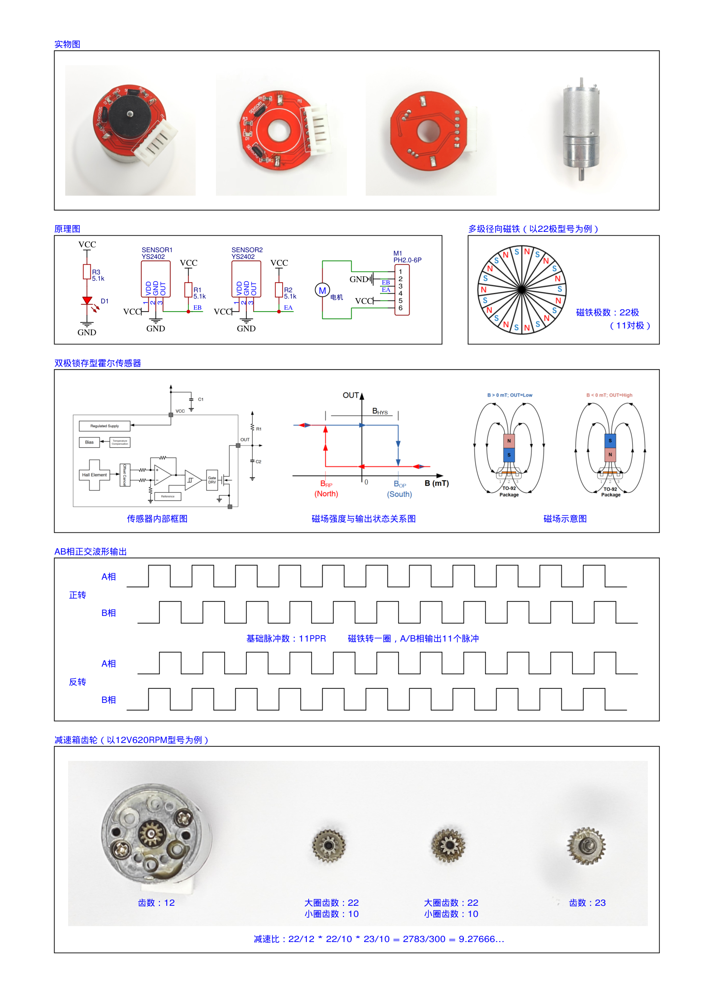

# 04 基础驱动与观测实验

## 学习目标

- 逐项验证显示、按键和旋钮输入。
- 建立 PWM 与编码器方向约定。
- 将编码器计数换算为速度和位置。
- 用 SerialPlot 观察多通道数据。

## 一、从工程 01 逐项运行

工程 `01-基础驱动代码/User/main.c` 保留了七组测试，默认启用最后的串口测试。切换时，先注释当前测试，再解除目标测试的 `main`、全局变量和中断函数注释，保证它们是一套。每组都经历“修改→编译→下载→复位→操作→观察”，通过后再换下一组。

底层移植按“引脚、外设、时钟、接口”四项核对。仅改函数名并不能完成移植。例如角度采样后来使用 ADC1，而四个旋钮使用 ADC2，目的之一就是避免主循环与中断同时修改同一 ADC 的规则通道。

## 二、OLED 与 LED：先确认程序正在运行

OLED 测试初始化 `OLED_Init()`，依次显示字符串、浮点数和格式化整数，最后 `OLED_Update()`。OLED 库先改内存中的显存，只有更新函数才把内容传给屏幕；忘记更新会出现“函数执行了，屏幕却没变”。

源码演示 `OLED_ShowString(0,0,"Hello,世界。",OLED_8X16)`、显示 12.345、以及 `OLED_Printf(...,"Num=%d",666)`。坐标是像素坐标，不是入门旧库的行列号。先确认 ASCII 与数字正常，再看中文是否已有字模。

LED 测试用 `LED_ON()`、`LED_OFF()`、`LED_Turn()` 配合 500 ms 延时。PC13 为低电平点亮。观察到约 0.5 s 亮、0.5 s 灭，说明程序执行和基础时钟大致正常；不能仅凭肉眼闪烁证明 1 ms 控制时序精确。

若屏幕全黑而 LED 正常，优先查 OLED 供电、PB8/PB9、库版本和 `OLED_Update()`；若二者都没有变化，先查下载、复位与供电。

## 三、1 ms 中断与非阻塞按键

TIM1 使用预分频 $72-1$、自动重装 $1000-1$。在定时器时钟 72 MHz 的前提下：

$$
T=\frac{(72)(1000)}{72\times10^6}=1\text{ ms}.
$$

测试程序在中断中让 `i++`，同时调用 `Key_Tick()`；主循环读取 `Key_GetNum()` 并改变 `j`：K1 加 1，K2 减 1，K3 加 10，K4 减 10。观察按键操作时 `i` 仍在增长，就能看到非阻塞结构的意义：按键处理不需要停在循环里等待松手。

`Key_Tick()` 内部每 20 次调用采样一次。它判断“上次有键、这次无键”，因此课程键码是在松开时产生。按住不放并不会持续连加；这不是按键失灵。`Key_GetNum()` 取走键码后清零，同一事件通常只消费一次。

课程 `j` 是 `uint16_t`，从 0 减 1 会显示 65535；若测试有符号加减，应改成适当的有符号类型。这是整数范围现象，不是按键读错。缺少 `Key_Tick()`、调用周期不为 1 ms 或主循环长期阻塞，都可能让按键行为不符合预期。

## 四、旋钮 ADC：把电压变成参数

初始化 `RP_Init()`，逐一显示 `RP_GetValue(1)`～`RP_GetValue(4)`。函数在 ADC2 上切换通道 2、3、4、5，再软件触发一次转换，等待 EOC 后读结果。

操作时每次只转一只旋钮，确认只有对应字段明显变化，范围接近 0～4095。端点轻微偏差和末位抖动不等于故障；字段串位则应核对引脚或调用编号。有效编号仅为 1～4，不要把 0 当第一只旋钮。

把 ADC 码 $a$ 映射到区间 $[L,H]$：

$$
x=L+\frac{a}{4095}(H-L).
$$

例如参数 0～2 用 `a/4095.0*2`；速度目标 -150～150 用 `a/4095.0*300-150`；位置目标 -408～408 用 `a/4095.0*816-408`。必须有浮点运算：若 `a` 为整数而写 `a/4095`，大部分位置都先除成零。

## 五、开环电机：先确认执行方向

选择电机测试，初始化 OLED、按键、电机，最后初始化定时器。K1 让 PWM 加 10，K2 减 10，K3 归零，上下限为 ±100。中断仍每 1 ms 调 `Key_Tick()`。

课程底层入口是 `Motor_SetPWM(int8_t PWM)`：正值和负值设置相反的 PB12/PB13 电平，绝对值写入 TIM2_CH1 比较寄存器。驱动没有替上层完整限幅，因此传参前必须限制范围。

TIM2 的预分频为 $36-1$，周期为 $100-1$，故在 72 MHz 定时器时钟下：

$$
f_{\mathrm{PWM}}=\frac{72\times10^6}{36\times100}=20\text{ kHz}.
$$

`PWM=20` 表示约 20% 占空比，不是 20 rpm。`Out` 是浮点数，传入 `int8_t` 接口时小数会截断，最终执行器命令分辨率约为 1 个百分点。这也是很小 PID 输出未产生动作的一个原因。

从零开始逐步加正输出，记录起转门槛、方向；归零后再试负输出。若方向与后续编码器约定不同，统一修改一处并重新验证。`PWM=0` 表示驱动命令为零；具体是滑行还是制动取决于驱动芯片输入状态，不能仅凭这行代码推导“完全无阻力、无电流”。

## 六、编码器：计数首先是位置增量



看图中的 AB 波形：两相相差约四分之一周期，谁领先谁决定方向。TIM3 使用 TI12 编码器模式，利用两路边沿计数。源码的极性参数为一路 Rising、一路 Falling，用来建立课程方向约定；这里的极性不意味着只数某一种边沿。

磁环有 22 极，即 11 对极，每电机轴转一圈产生 11 个 AB 周期，四倍频后为 44 个计数。减速比为

$$
G=\frac{22}{12}\frac{22}{10}\frac{23}{10}
=\frac{2783}{300}\approx9.2767.
$$

于是输出轴每圈约为

$$
N_{\mathrm{rev}}=44G\approx408.1733.
$$

课程采用 408 作为近似值。单圈观察足够方便，多圈精密定位则应使用更准确的比例并校准机械误差；“每圈固定精确 408 个计数”不是这套齿轮比的严格结论。

测试中每 40 ms 调一次：

```c
Speed = Encoder_Get();
Location += Speed;
```

`Encoder_Get()` 先把 TIM3 的 CNT 读到 `int16_t`，再把 CNT 清零。因此返回值是两次调用之间的有符号计数差。手动转动转盘，静止时 Speed 接近 0、Location 保持；反向转动时两者的变化符号相反。正 PWM 应产生正计数，否则闭环方向有问题。需要反相时改一路极性并复测，不要两路一起反相后以为一定改变方向。

不能在主循环为显示再调用一次 `Encoder_Get()`，否则会提前清掉控制环所需的计数。应统一读取一次，再把结果分给显示、测速和位置累加。

### 换算实例

设 40 ms 内得到 28 个计数，按课程 408 近似：

$$
n=\frac{60\Delta N}{N_{\mathrm{rev}}T_s}
=\frac{60\times28}{408\times0.04}
\approx102.94\text{ rpm}.
$$

一计数约为 $360/408=0.8824^\circ$；40 ms 测速窗口中的一计数约为 3.6765 rpm。窗口改成 20 ms，同样转速只有约 14 个计数；改成 200 ms 则约 140 个计数。窗口短响应快，却更容易出现 0、1 交替的量化；窗口长分辨率好，但反馈更迟。

课程位置变量常用 `int16_t`，累计约 80 圈就接近正端范围，不能视作无限位置。长时间应用宜改用 `int32_t` 并设计位置参考；目标限幅也不保证外力推动时实际位置不会溢出。读 CNT 再清零之间还存在极短的计数窗口，严谨实现可使用自由运行计数器的模差，避免读清之间丢边沿。

## 七、串口与 SerialPlot：观察输入和输出是否对应

工程 01 默认主循环读取四个旋钮，显示到 OLED，并发送：

```c
Serial_Printf("%d,%d,%d,%d\r\n", RP1, RP2, RP3, RP4);
Delay_ms(10);
```

用 USB 串口接收，先在串口工具确认文本为四列数字，再在 SerialPlot 选择正确 COM 口、9600、8N1、无流控，数据格式设为 ASCII，逗号分隔，换行结束一帧。打开四通道观察，每次转一只旋钮应只有一条曲线随之改变。若只有乱码，先查波特率；若所有数挤在一列，查分隔与帧结束设置；若端口打不开，关闭占用同一 COM 口的其他软件。

后续 PID 通常发送 `Target,Actual,Out`，积分和微分实验多一个状态通道。通道顺序必须跟格式串一致。原始输出 `Out` 和速度 `Actual` 单位不同，可以同图看趋势，不能把纵轴大小直接当作同一种物理量。

9600 bit/s 的 8N1 每字节约占 10 bit，40 字节一帧就需约 41.7 ms。浮点格式化和 OLED 也耗时，主循环“延时 10 ms”不等于严格每 10 ms 一帧。SerialPlot 横轴若是样本序号，就不能直接读成毫秒；需要定量响应时间时，应附带时间戳或控制拍计数。

串口发送放主循环，控制放定时中断；不要把整帧阻塞发送搬进 5 ms 或 40 ms 的控制分支。采样周期、控制周期、显示刷新周期和发送周期是四个不同概念。
