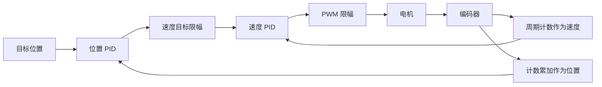

# 09 串级控制与PID封装

## 学习目标

- 搭建位置外环与速度内环。
- 按内环到外环的顺序调参。
- 用外环输出限幅约束内环速度目标。
- 封装独立保存状态的 PID 结构体。

## 一、为什么再加一个速度环

单环位置控制直接根据位置误差给 PWM。最后一点误差产生的输出可能不足以克服摩擦，负载变化也会直接改变运动速度。串级方案让位置环只提出“该以多快速度移动”，由速度环负责让电机实现这一要求。



外环输出是速度目标，内环输出才是 PWM，二者单位不同，不能把两个 PID 的输出直接相加给电机。速度 PI 可以逐渐建立克服摩擦的驱动，因而位置环给出很小的速度请求也可能产生有效运动。但实际仍受计数量化、输出限幅和摩擦影响，不能保证任意小目标都完全无误差。

## 二、工程 12 的数据与时序

工程 `12-双环PID定速定位置控制` 使用 `Inner...` 和 `Outer...` 两组变量。编码器只在内环的 40 ms 分支读取一次：

```c
Speed = Encoder_Get();
Location += Speed;
InnerActual = Speed;
/* 内环 PID -> InnerOut -> Motor_SetPWM */
```

外环同样每 40 ms 执行，以 `Location` 为实际值，结果赋给 `InnerTarget`。两环周期用不同计数器，便于分别修改，但当前工程并没有自动做到“内环比外环快”。

源码先执行内环，再执行外环；两者同一 tick 到期时，内环使用上一拍外环给的目标，本拍新外环目标到下一次 40 ms 内环计算才生效。若改成先外后内会减少这部分延迟，却也改变原来的离散控制时序，应重新验证，不能悄悄换顺序却声称完全复现原实验。

| 量 | 单位 | 课程限制 |
| --- | --- | --- |
| 外环目标/反馈 | 编码器 count | 目标 RP4 映射 ±408 |
| 外环输出/内环目标 | count/40ms | 演示先用 ±150，最终源码 ±20 |
| 内环反馈 | count/40ms | 编码器实测 |
| 内环输出 | PWM 百分点 | ±100 |

最终源码的外环限幅是 ±20，不是讲解初期的 ±150。阅读 PPT、字幕与最后保存的工程时，要区分演示过程和最终状态。

## 三、先调速度内环

1. 在工程副本中暂时禁止外环给 `InnerTarget` 赋值，避免外环覆盖手动目标。
2. 用旋钮设置内环三参数和速度目标，保持与单环速度实验相同的测量窗口。
3. 先 P 后 I，观察正负目标跟踪与短时负载变化。课程得到 `Kp=0.3、Ki=0.3、Kd=0`。
4. 将已经确定的内环参数固定，注释掉主循环对它们的旋钮赋值，再接回外环。

外环尚未动作且目标速度为零时，内环已经会反抗外力引起的转动。它在努力维持零速度，但不能单独保证固定位置；持续外力可能让位置缓慢变化。这能帮助区分“速度为零”和“位置等于指定值”两个任务。

## 四、再调位置外环

用 RP1～RP3 调外环参数，RP4 调 ±408 的位置目标。先使外环 I、D 为零，从小 P 增加，观察位置接近是否足够快；随后加 D 减少超调。课程比较过 P≈0.5、D≈0.5 的较快组合，以及 P=0.3、D=0.4 的较平滑组合，最终源码采用后者，I 为零。

如果 D 太大，临近目标可能先明显停顿，再缓慢靠近；这时单独增加 P 容易再引入超调，需要根据响应速度与平滑度共同取舍。位置已经满足精度时，不必为了“凑齐 PID”再加 I。

验收时先改目标，再加短时扰动，观察位置能否回到目标附近、速度是否减小到零、PWM 是否有合理的驱动和制动过程。串口最终默认输出的是外环目标、外环实际、外环输出；想判断速度内环，需要另外发送其目标/反馈，不能拿外环输出当 PWM。

## 五、“定速定位置”实际限制的是速度目标

把外环输出限制为 ±20，就限制了给速度环的目标，不是给实际速度加了不会越过的硬边界，也不是强制整个行程始终以 20 运动。接近目标时，位置误差变小，外环请求速度自然减小，最终停下；暂态、负载变化和内环误差仍可能让实际速度短时超过这个目标范围。

例如暂只看外环 P=0.3，误差 200 时未限幅输出 60，限幅后请求 20；误差 20 时请求 6，已经进入减速区。按 408 近似，20 count/40ms 约为 73.53 rpm。

因此用户指定的是终点和最大速度，不是同时任意指定每一时刻的位置和速度轨迹。要设计严格的加减速轨迹，还需要轨迹规划，本课程没有实现。

若希望正反速度不同，可以设置 `OutMax=50、OutMin=-10`；下限必须是负数。外环限幅越大，运动可能越快，也越容易使内环饱和或带来超调，仍需观察实际能力。

## 六、工程 13：封装算法，保留状态独立

两个环运算形式相同，但误差、积分和输出不能共用一份历史。结构体把每个控制器的状态放在一起，函数只更新传入的那个实例。

以下与课程封装的核心结构一致：

```c
typedef struct {
    float Target, Actual, Out;
    float Kp, Ki, Kd;
    float Error0, Error1, ErrorInt;
    float OutMax, OutMin;
} PID_t;

void PID_Update(PID_t *p)
{
    p->Error1 = p->Error0;
    p->Error0 = p->Target - p->Actual;
    if (p->Ki != 0) p->ErrorInt += p->Error0;
    else p->ErrorInt = 0;
    p->Out = p->Kp * p->Error0 + p->Ki * p->ErrorInt
           + p->Kd * (p->Error0 - p->Error1);
    if (p->Out > p->OutMax) p->Out = p->OutMax;
    if (p->Out < p->OutMin) p->Out = p->OutMin;
}
```

类型及声明放 `PID.h`，实现放 `PID.c`，主程序包含头文件。传指针是为了让函数直接修改外面的控制器；`PID_Update(Inner)` 传结构体值与 `PID_Update(&Inner)` 传地址不是一回事。

初始化时明确给限幅：

```c
PID_t Inner = {.Kp=0.3, .Ki=0.3, .Kd=0,
               .OutMax=100, .OutMin=-100};
PID_t Outer = {.Kp=0.3, .Ki=0, .Kd=0.4,
               .OutMax=20, .OutMin=-20};
```

未列出的成员按初始化规则为零。若忘记上下限，它们也为零，算法算得再大都会被裁成零。

内环更新变为 `Inner.Actual=Speed; PID_Update(&Inner); Motor_SetPWM(Inner.Out);`；外环变为 `Outer.Actual=Location; PID_Update(&Outer); Inner.Target=Outer.Out;`。采样和输出仍在函数外，算法不会自己读取编码器，也不会自己保证调用周期。

运行工程 13 后，重复工程 12 的正反定位与扰动实验，应得到同类行为。封装的验收重点是行为保持一致、每环状态互不污染，而不是主程序看起来更短。

这个通用函数仍是基础教学版本：没有积分限幅、滤波、积分分离或自动重启初始化。下一章倒立摆直接复用它时，也不会凭空拥有前面演示过的改进功能。
