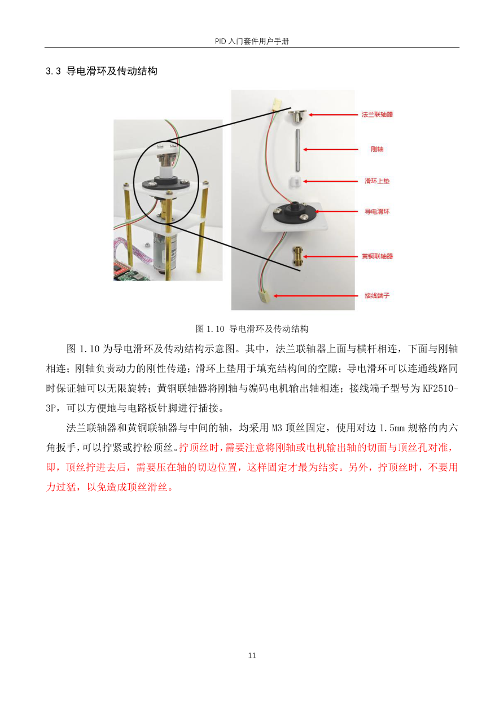
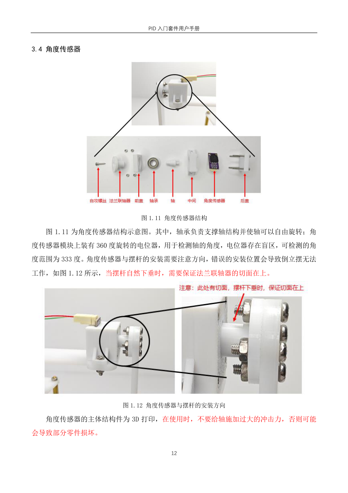

# 10 倒立摆结构与角度采集

## 学习目标

- 识别摆杆、横杆与传动链的作用。
- 正确安装倒立摆及角度传感器。
- 使用 ADC1 采集角度原始码。
- 识别角度盲区与中心零点偏差。

## 一、电机能控制横杆，不能直接控制摆杆

电机通过联轴器和金属轴带动横杆，横杆末端安装可自由转动的摆杆。电机改变横杆运动，使摆杆支点运动，间接影响摆杆角度。摆杆不是直接装在电机轴上的受控转盘，因此上一章的位置控制不能原样套上去。

这套系统有两路反馈：编码器提供横杆位置，电位器式传感器提供摆杆角度；只有一路驱动输出：电机 PWM。先使角度闭环维持倒立，再用外环改变目标角度来约束横杆位置。



观察图中的金属轴：它穿过滑环中心，把下方电机动力传给上方横杆。导电滑环负责旋转时保持传感器线路连通，避免线缠绕；它不是角度测量器件，也不是替代传动轴的动力结构。

课程曾比较柔软的打印传动件与金属轴。弹性变形会让电机动作不能及时传到横杆，增加动态滞后；顶丝松动则引入打滑和间隙。这类机械问题可能表现得像 PID 参数不合适，单靠改增益很难补救。

## 二、从电机形态改装为倒立摆形态

断电后操作：

1. 松开转盘顶丝，取下电机转盘。
2. 拧下四个固定螺母，装上倒立摆所需的四根铜柱。
3. 松开倒立摆底部联轴器顶丝，观察电机轴切面朝向。
4. 将倒立摆装置套入电机轴，滑环引线朝靠近板上角度接口的一侧，避免拉紧线缆。
5. 将对应顶丝对准轴切面后拧紧，再固定四个上部螺母。不同方向顶丝深浅不一定相同，不能只看“都拧进去一样深”。
6. 检查上、下联轴器相关顶丝。新版手册明确需要可靠固定的顶丝共四颗；每颗都应对准对应轴的切面，确认电机带动横杆时没有明显打滑。
7. 将传感器三线接到 G1：3V3、OUT、GND。若接 G2，下一节程序须改为 PB1/ADC1 通道 9。

固定完成后，用木块与夹具将底板夹在桌面。手动轻轻转动横杆和摆杆，确认传感器线无牵拉、摆杆可自由摆动。主轴刚度不足、轴承卡滞和传感器装配摩擦，都会改变后面的调参结果。

两种典型机械故障可以在调参前识别：电机明显转动而横杆只有很小摆幅，优先怀疑顶丝未拧紧；能够起摆但进入直立后横杆大幅抖动并退出，优先检查顶丝是否只压在圆弧面、没有完全对准切面。配套目录中的两段故障视频可用于对照，不要先用更大的 P 或起摆 PWM 掩盖打滑。

## 三、角度传感器为什么有盲区



角度传感器本质上是可旋转电位器。电阻轨道两端接 3.3 V 与 GND，滑动触点输出随位置变化的电压，ADC 将其转换为 0～4095 的码值。轨道并不是完整闭合圆环，触点经过断口时不能提供有效角度，这就是盲区。

手册把有效范围写为约 333°，字幕使用约 333.3°，都应理解为近似范围。按 333.3° 估算，理想量化步距约为

$$
\Delta\theta\approx\frac{333.3^\circ}{4096}\approx0.0814^\circ.
$$

这是分辨率，不是最终精度。电位器非线性、触点噪声、装配偏差、ADC 误差都还存在，也不能把这一有效区间简单当作无盲区的 360° 测量。

摆杆下垂时应让盲区位于下方，倒立中心则处在有效量程中部。图中要求摆杆自然下垂时，法兰联轴器的切面朝上。装错后可能在需要平衡的角度附近遇到断口，软件参数再好也无法可靠控制。

输出端的滤波电容会使进入盲区后的电压暂时保留先前值。课程观察到从一侧进入时靠近 0、另一侧进入时靠近 4095，久置时读数可能向中间漂移。但悬空输入的最终值不保证是 2048，受泄漏、噪声和外围电路影响，不能把“读到中间值”当成已经直立。

## 四、工程 14：配置 ADC1 读取 G1

工程 `14-基础驱动代码-角度传感器` 从工程 01 增加 `Hardware/AD.c`、`AD.h`。与旋钮 ADC2 不同，这里使用 ADC1。

| 配置 | 课程值 | 原因 |
| --- | --- | --- |
| GPIO | PB0，模拟输入 | G1 的 OUT 接 PB0 |
| ADC 通道 | ADC1_Channel_8 | PB0 对应通道 8 |
| ADC 时钟 | PCLK2 六分频，12 MHz | 沿用 72 MHz 时钟前提 |
| 工作模式 | 独立、单通道、单次转换 | 每次调用采一个角度值 |
| 采样时间 | 55.5 ADC 周期 | 沿用课程原配置 |
| 触发 | 软件触发 | `AD_GetValue()` 发起转换 |

初始化流程是开启 ADC1/GPIOB 时钟→设 ADC 时钟→设 PB0 模拟输入→配置规则通道→初始化 ADC→使能→复位校准并等待→开始校准并等待。源码中个别注释仍写 GPIOA，但实际代码使用 GPIOB，应以代码与原理图为准。

读取函数是：

```c
uint16_t AD_GetValue(void)
{
    ADC_SoftwareStartConvCmd(ADC1, ENABLE);
    while (ADC_GetFlagStatus(ADC1, ADC_FLAG_EOC) == RESET);
    return ADC_GetConversionValue(ADC1);
}
```

完成引脚配置后，用以下主函数先测试角度，不启动电机：

```c
int main(void)
{
    OLED_Init();
    AD_Init();
    while (1)
    {
        OLED_Printf(0, 0, OLED_8X16, "AD:%04d", AD_GetValue());
        OLED_Update();
    }
}
```

这里假定课程头文件已经包含，AD 源文件已加入工程。若换 G2，GPIO 改 PB1、ADC1 规则通道改 `ADC_Channel_9`，二者必须成对修改，仅换其中一个会读错。

## 五、完整的角度采集验收

1. 下载工程 14，确认电机不受本测试驱动，OLED 显示连续更新。
2. 缓慢转动摆杆，记录有效区间内 ADC 从接近 0 到接近 4095 的变化方向。课程观察方向下为顺时针增大，实际使用要固定观察视角。
3. 将摆杆扶到近似直立，记录中心附近码值。理想约 2048，装配后常见约 1900～2200，但最终中心需在平衡实验中校准。
4. 将摆杆慢慢转到下垂，确认盲区在这里；分别从两侧进入，观察电容保留和漂移现象。
5. 轻动连接线，确认有效区间内不会出现大跳变；随后检查旋钮 ADC2 是否仍正常。

若全程固定为 0 或 4095，查短接、接反和通道；若全程只在中间附近乱跳，查断线和悬空；若只有某个机械角度跳变，先判断是否是预期盲区。直立附近必须连续、灵敏且不跨断口，才可进入平衡控制。

课程直接用 ADC 原始码参与 PID，所以角度环参数单位是“PWM/ADC 码”等，而不是“PWM/度”。如需显示相对中心的小角度，可在有效区间近似用 $(A-A_c)\times333.3/4095$ 度，符号与实际传感器方向对应；这个线性换算不适用于盲区。

建议把下列数据写在设备记录中，而不是每次重新猜测：G1/G2 接口、顺时针时 ADC 增减方向、下垂盲区两侧码值、手扶直立初值、最终平衡中心值。最后一项必须通过第 11 章动态平衡校准，不能用一次静态读数代替。

## 六、为什么这里没有再套速度内环

倒立摆角度环需要很快纠正倾倒，课程选择 5 ms 周期。若继续在里面套速度环，速度反馈也需足够快，但该编码器在短窗口内计数很少，量化会明显。课程因此让角度环直接输出 PWM，用外位置环改变角度目标。这是这套硬件上的实现取舍，不是所有倒立摆都不能使用速度或电流内环。
