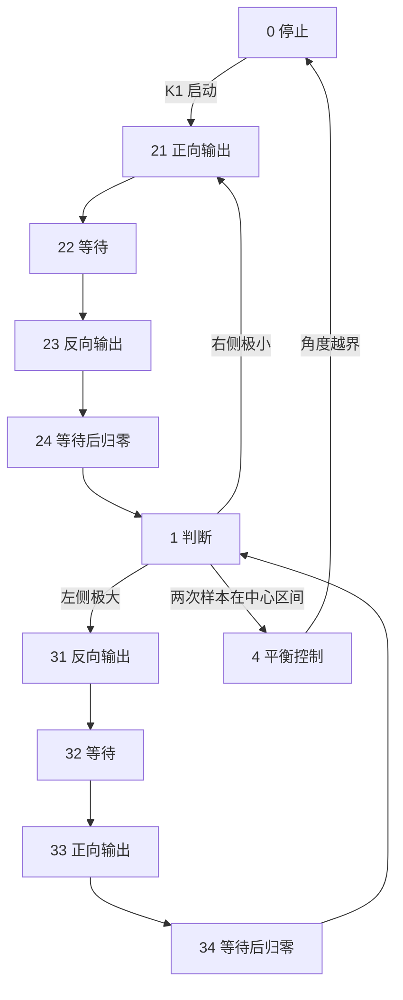

# 12 自动起摆状态机

## 学习目标

- 用连续角度样本判断摆动极值。
- 用非阻塞状态机产生双向短脉冲。
- 从起摆切换到双环平衡控制。
- 验证停机、重启与计时边界。

## 一、自动起摆和直立控制是两个阶段

工程 15 只能在摆杆接近直立时启动平衡。摆杆下垂时，不仅远离平衡工作区，还可能处在传感器盲区，不能简单放大角度误差并期待 PID 把它拉起来。

工程 `16-倒立摆-自动启摆` 在平衡控制前增加摆动阶段：观察摆杆左右摆动，在合适相位让横杆短暂动作，使摆幅逐渐增大；进入中心区间后才交给双环 PID。课程称为共振起摆，实质是按摆动相位施力的经验方案，不是从精确动力学模型推导的能量控制器。

类似荡秋千，施力时机影响是增能还是减能。这里推动的是支点所在的横杆，而不是直接给摆杆自由端一个恒定方向力，因此不能只套“最高点推一下”而忽略实际方向与装置结构。

## 二、区域划分与三点极值检测

设中心角度为 $A_c$，范围为 $R$，定义 $L=A_c-R$、$H=A_c+R$。最终源码使用 $A_c=2010,R=500$，所以中心区间为 $1510<A<2510$。

按课程传感器方向，左侧靠近倒立时角度码增加，右侧靠近倒立时角度码减小。用 `Angle2` 表示最旧样本、`Angle1` 表示中间样本、`Angle0` 表示最新样本，更新顺序是：

```c
Angle2 = Angle1;
Angle1 = Angle0;
Angle0 = Angle;
```

左侧最高点需要三个样本都小于 $L$，且中间样本最大；右侧最高点需要三个样本都大于 $H$，且中间样本最小。

| 顺序：旧→中→新 | 区域 | 结论 |
| --- | --- | --- |
| 900→1100→1000 | 都在左侧 | 中间极大，触发向右短脉冲 |
| 3200→2900→3050 | 都在右侧 | 中间极小，触发向左短脉冲 |
| 100→4090→3900 | 跨两侧 | 不满足同侧条件，不判作极值 |
| 1000→1000→1000 | 左侧但相等 | 严格大小比较不触发 |

极值判断在最新样本到来后才知道中间样本是峰谷，因此天然有检测延迟。课程在判断状态中每 40 ms 采样一次，兼顾噪声和时机；采得过快容易把 ADC 末位抖动当极值，采得过慢则可能错过有效施力相位。

同侧判断能排除典型的 0/4095 跨盲区跳变，但不代表识别了所有传感器故障。长时间停在盲区，电压可能漂到中间，所以不能直接看到约 2010 就认定摆杆直立。

## 三、为什么一次施力要先正再反

课程给横杆的“向左短脉冲”是先输出正 PWM，一小段时间后反向同样一段时间，最后归零；向右则顺序相反。后半段试图减小支点偏移，让下一次摆动仍有合适的支撑位置。

最终参数为 `START_PWM=35`、`START_TIME=100`。它们分别代表命令幅度和计时 tick 数，不是电机转速或精确冲量。电机惯性、负载和摩擦使正反同幅同时间不保证位置精确回到原处，也不能把它当作位置闭环。

| 状态 | 本拍动作 | 下一状态 |
| --- | --- | --- |
| 0 | `Motor_SetPWM(0)` | 等待启动 |
| 1 | 到采样时刻后判断极值或中心区间 | 21、31、4，或继续 1 |
| 21 | 输出 +START_PWM，装载 CountTime | 22 |
| 22 | 每 tick 递减计时 | 归零后转 23 |
| 23 | 输出 -START_PWM，重新装载 CountTime | 24 |
| 24 | 递减计时，到零时输出 0 | 1 |
| 31 | 输出 -START_PWM，装载 CountTime | 32 |
| 32 | 每 tick 递减计时 | 归零后转 33 |
| 33 | 输出 +START_PWM，重新装载 CountTime | 34 |
| 34 | 递减计时，到零时输出 0 | 1 |
| 4 | 5 ms 角度环、50 ms 位置环 | 倒下后转 0 |



所有非零状态下 K1 都请求回到 0，图中为保持清晰没有重复画这些返回边。PPT 初始方案从 0 进入 1，而最终程序从 0 直接进入 21，先摆一下让传感器离开盲区，这是两份材料之间有意的实现变化。

## 四、用状态保存过程，而不是在中断里延时

如果把“正转→延时 100 ms→反转→延时 100 ms”直接放进 1 ms 中断，就会阻塞后续调度。状态机把一段过程拆成多次中断，每次只做当前状态需要的一小步。

以左侧动作链为例，原程序的核心逻辑是：

```c
if (RunState == 21) {
    Motor_SetPWM(START_PWM);
    CountTime = START_TIME;
    RunState = 22;
} else if (RunState == 22) {
    CountTime--;
    if (CountTime == 0) RunState = 23;
} else if (RunState == 23) {
    Motor_SetPWM(-START_PWM);
    CountTime = START_TIME;
    RunState = 24;
} else if (RunState == 24) {
    CountTime--;
    if (CountTime == 0) {
        Motor_SetPWM(0);
        RunState = 1;
    }
}
```

`CountTime` 必须跨中断保存，课程用静态 `uint16_t`。进入等待状态前装载，等待中只递减；若每拍都重新赋 100，就永远等不到零。

必须用互斥的 `if/else if` 或不贯穿的 `switch`。若使用多个独立 `if`，前一分支改了状态，后一分支可能在同一次中断又执行，计时和状态动作就改变了。

### 100 个 tick 与实际脉宽的细微差别

设在 $t=0$ 执行状态 21 并输出正 PWM，接下来 $t=1$～100 ms 执行状态 22，第 100 ms 将状态改为 23；反向输出要到 $t=101$ ms 才执行。因此正脉冲约为 101 ms。反向后状态 24 在 100 次递减结束的同一分支归零，所以反向约为 100 ms。这是状态转移与动作分两拍执行造成的，不影响“约 100 ms”的教学目的，但精确计时不能忽略。

`START_TIME` 不能取零：无符号计数从 0 递减会下溢成 65535，而不是立即结束。通用实现应校验时间大于零，或者明确为零时直接跳过等待。

## 五、按阶段验证，避免整段写完才查错

### 第一步：仅验证两条脉冲链

在工程 15 的副本中建立状态框架，先不执行极值判断。用临时测试按键让状态进入 21，观察横杆先向一侧、再向另一侧短暂动作，最终停在状态 1。再用另一个按键临时进入 31，观察相反动作。

OLED 显示 `RunState` 便于确认最终状态；短暂状态可能因刷新较慢看不到，这是正常现象。需要精确观察时用逻辑分析仪或调试记录，不能要求 OLED 逐个显示 21、22、23、24。

这一阶段重点确认两条链的符号相反、计时结束确实输出零、没有使用阻塞延时。可交替触发模拟课程的人工节奏演示；应小幅、受控操作，夹紧装置。

### 第二步：加入极值检测

状态 1 每到采样时刻更新三点，分别做右侧极小与左侧极大判断，转入 21 或 31。先只观察摆幅是否逐步增加，尚不急着接 PID。若越摆越小，先核对施力方向和相位，再调整力度。

幅度太小可以逐步增加 `START_PWM`，课程经验范围约 30～40；动作持续时间可在约 80～120 ms 试验。这些是本套件参考范围，一次只改一个参数。能摆到中心附近但总冲过去，通常不应继续加大力度。

### 第三步：加入平衡接管

原代码要求最新两次样本都处在中心区间，才转入状态 4：

```c
if (Angle0 > CENTER_ANGLE - CENTER_RANGE &&
    Angle0 < CENTER_ANGLE + CENTER_RANGE &&
    Angle1 > CENTER_ANGLE - CENTER_RANGE &&
    Angle1 < CENTER_ANGLE + CENTER_RANGE)
{
    Location = 0;
    AnglePID.ErrorInt = 0;
    LocationPID.ErrorInt = 0;
    RunState = 4;
}
```

两次确认能减小刚碰边界就接管、下一拍又越界退出的情况，但也增加接管等待。另一种设计是较小区间允许接管、较大区间才退出，形成滞回；它与两样本确认不是完全相同的方法。若摆杆进入时角速度很大，两次位置判断也不保证内环接得住，需要调整起摆能量或进一步考虑速度条件。

### 第四步：恢复最终按键逻辑

删除临时测试按键，让 K1 在停止时转 21、其他状态时转 0。K2/K3 沿用目标位置加减 408、限 ±4080；最终程序的 K4 不再负责右脉冲测试。依次验证静止启动、起摆中停止、平衡后停止、倒下自动停止及再次启动。

## 六、接管时哪些状态必须重新定义

原程序清 `Location`，意味着把起摆成功位置当成新的零点，避免返回很早以前的上电位置。但它没有清 `LocationPID.Target`：如果之前按键已把目标改成 816，重启时实际归零后仍可能追向 816。因此“实际归零后就一定原地保持”只在目标也为零等条件下成立。

清两环积分可以避免此前积累的误差在下一次起摆成功后把摆杆甩倒，但其他历史仍可能残留：`Error0/Error1`、内环目标、上次输出、分频计数器都没有在上述代码中统一重置。重新启动起摆时，`Count0` 和 `Angle0/Angle1/Angle2` 也可能沿用上一次运行的判断进度与样本；若要求每次重启行为一致，应在中断内识别新的启动请求，清判断计数并让三点历史重新收满后再判极值。

若希望每次接管都从当前横杆位置开始保持，可作以下教学改写，放在**同一中断内的接管分支**，取代原接管初始化：

```c
Location = 0;
LocationPID.Target = 0;
LocationPID.Actual = 0;
LocationPID.Error0 = 0;
LocationPID.Error1 = 0;
LocationPID.ErrorInt = 0;
LocationPID.Out = 0;

AnglePID.Target = CENTER_ANGLE;
AnglePID.Actual = Angle;
AnglePID.Error0 = AnglePID.Target - AnglePID.Actual;
AnglePID.Error1 = AnglePID.Error0;
AnglePID.ErrorInt = 0;
AnglePID.Out = 0;
Count1 = 0;
Count2 = 0;
Motor_SetPWM(0);
RunState = 4;
```

这里把历史误差设为当前误差，避免把旧目标/旧角度当成本次的差分起点；重置计时使第一次内环更新发生在明确的 5 ms 边界。若任务要求保留绝对位置目标，就不应直接清目标，而要明确坐标变换和重新捕获策略。这段是确定“重启即原地保持”的教学方案，需要在实际装置上验证接管动态。

## 七、原实现的采样与停机边界

### 判断采样并非全程每 40 ms

`Count0` 和三点历史只在状态 1 更新，执行 21～24 或 31～34 时暂停。因此一次施力之后，历史中可能夹着施力之前的样本，三个样本不一定等间隔。原程序仍可能运行，但不能把全程极值检测严格描述为连续等间隔三点差分。

若需要严格采样，可以在状态机之外每 40 ms 统一更新历史，并仅在状态 1 使用判断；或者回到状态 1 时清历史有效计数，重新收满三点再判断。前者保持时间连续，后者避免陈旧样本却增加等待，两者都应重新验证起摆相位。

### 状态 4 置零后并没有立即离开分支

工程 16 在状态 4 开头发现越界时，只执行 `RunState=0`，本次中断仍可能继续执行下面的角度 PID 并写 PWM；下一次中断进入状态 0 才保证归零。这与工程 15 的“先判断，再根据状态选择运行/停止分支”不同。

若要本拍立即停止，应把运行逻辑放进越界判断的 `else`：

```c
if (!(Angle > CENTER_ANGLE - CENTER_RANGE &&
      Angle < CENTER_ANGLE + CENTER_RANGE))
{
    RunState = 0;
    Motor_SetPWM(0);
}
else
{
    /* 原来的 5 ms 角度环和 50 ms 位置环代码全部放这里 */
}
```

外面的 TIM1 中断标志清除仍需执行，不能为了提前退出而漏清。主循环 K1 停止还受按键 20 ms 采样、主循环显示耗时和下次中断调度影响，不能声称人按下瞬间就硬件断电。

### 中断计算时间要用实测确认

课程报告原装设备中断执行约十几至几十微秒，这是原作者对其环境的观察，不是任意修改后的保证。可以在进入中断时拉高空闲 GPIO、退出前拉低，用示波器或逻辑分析仪测脉宽；也可在入口清更新标志，退出前检查是否又置位，辅助判断是否跨过下一周期。

同一个中断通常不会嵌套自己，但超时会造成挂起、漏掉周期信息或主循环饥饿。OLED、阻塞串口和长延时留在主循环；ADC 校准应在启动阶段完成。ADC1 由角度采样使用，ADC2 由旋钮使用，避免主循环和中断同时抢同一个规则通道配置。

## 八、完整系统的验证与排查

| 操作或现象 | 应观察的链路 | 处理方向 |
| --- | --- | --- |
| 下垂静止后按 K1 | 0→21→脉冲链→1 | 先离开盲区，不直接误认直立 |
| 一直小幅摆不上去 | 极值是否判对、脉冲是否输出 | 先查传感器和方向，再微调幅度/时间 |
| 摆幅越摆越小 | 施力相位与方向 | 排查陈旧样本、极值延迟和符号 |
| 能到中心但马上停机 | 1→4→0 | 查接管角速度、边界与脉冲能量 |
| 第一次成功，第二次失败 | 接管前的积分和历史 | 明确重置策略 |
| 接管后突然转很多圈 | 归零后的目标位置 | 原源码不会同时清目标 |
| 平衡状态倒下 | 角度越界→状态零→PWM零 | 检查是否本拍仍执行 PID |
| 横杆动作与电机明显不同步 | 机械传动 | 查联轴器顶丝与轴切面 |

最终在保持相同安装和参数的条件下，多次验证从静止起摆、正反位置命令、小扰动恢复、各阶段停机与重启。记录实际成功率、稳定时间和位置容差，才能说明这一台装置的性能；讲义给出的参考参数不能替代这些硬件验收结果。

## 九、主循环与中断之间的状态所有权

原工程由主循环写 `RunState` 和位置目标，中断也会写 `RunState`、读取目标并更新 PID。教学环境中通常能运行，但状态转移的所有权并不清晰：主循环刚请求启动时，中断可能正在停机；中断刚因越界置零时，主循环又可能根据按键修改状态。

较稳妥的结构是主循环只发布命令，中断在 1 ms 边界统一消费并改变运行状态：

```c
typedef enum {
    CMD_NONE,
    CMD_TOGGLE_RUN,
    CMD_POS_PLUS,
    CMD_POS_MINUS
} ControlCommand;

volatile ControlCommand PendingCommand;
```

主循环检测按键后只设置 `PendingCommand`；中断先复制并清除命令，再执行启停、目标修改、状态机和输出。实际实现还要规定连续两个命令到来时是覆盖、排队还是拒绝，单个枚举只适合按键频率很低的本课场景。这是工程化改进建议，课程工程并未采用。

### 最终验收矩阵

| 用例 | 操作 | 通过条件 |
| --- | --- | --- |
| 冷启动 | 下垂静止，按 K1 | 先离开盲区，经多次脉冲后进入 4 并保持 |
| 起摆中停止 | 任一 21～34 状态按 K1 | 有界延迟内进入 0，PWM 归零 |
| 接管失败 | 进入中心时速度过大 | 越界后退出，不持续满输出 |
| 平衡中移动 | K2、K3 各一次 | 目标各变 408，移动中不丢失平衡 |
| 平衡中扰动 | 轻推摆杆后松开 | 角度恢复，横杆位置回到允许范围 |
| 重复启动 | 完整停止后再次 K1 | 多次行为一致，无旧积分或目标导致的猛冲 |
| 机械异常 | 轻微松动或打滑征兆 | 先停机检查机械，不通过加参数继续运行 |

至少重复 10 次冷启动，记录成功次数而不是只保留一次成功视频。若失败集中在同一相位或同一方向，应查看三点样本、状态序列和 PWM；若成功率随顶丝重新固定显著变化，应归因于机械链路，而不是继续修改算法。
