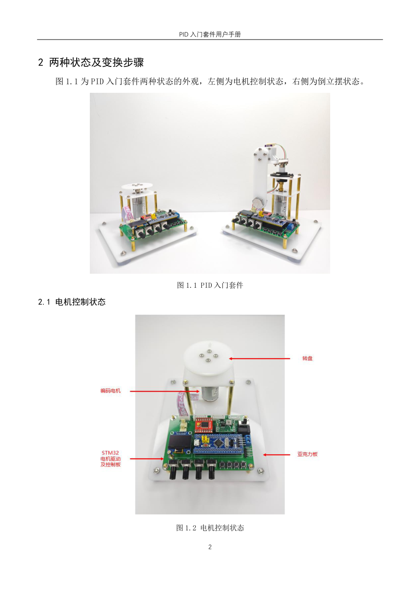
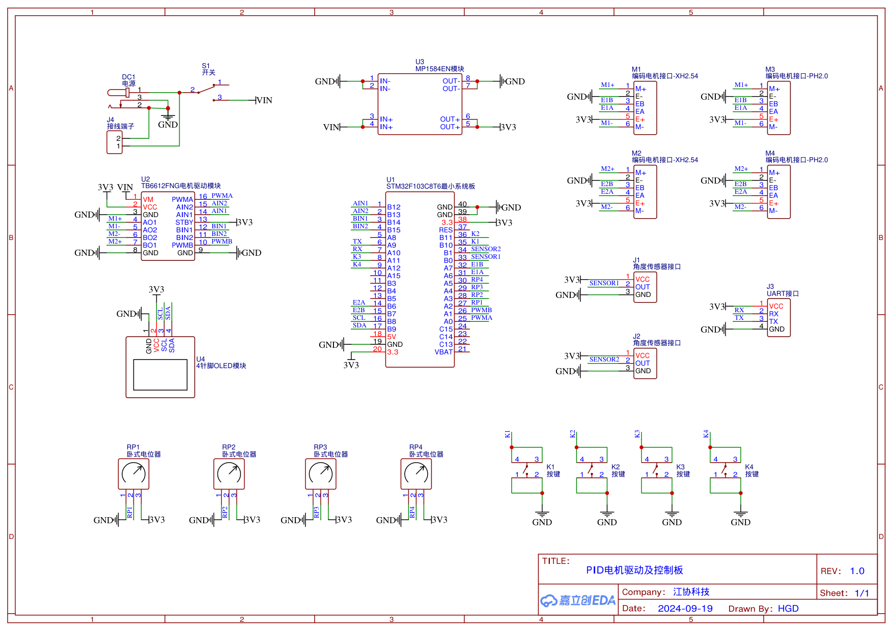

# 01 平台接线与 HAL 工程

> 本章建立硬件和软件基线。首次学习请先完成 [[00 从零复刻HAL工程]]，再回到本章做接线和观测实验。
>
> 课程 `00-PID综合测试程序` 已在实机验证过（见总目录 README 的工程状态），可以作为接线、菜单和观测行为的硬件基准。
>
> 本章对应标准库教程的第 01 章"实验平台与资料使用"；HAL 工程的具体生成步骤已经放在 [[00 从零复刻HAL工程]]。

## 本章问题

怎样把课程套件接到 STM32F103C8T6，并建立一个默认不主动启动闭环的 HAL 工程？首次上电必须先断开电机 VM。

## 1. 平台基线

课程硬件是 STM32F103C8T6 最小系统板、TB6612FNG、12 V 编码减速电机、角度传感器、OLED、旋钮和按键组成的两类机械形态：转盘形态和倒立摆形态。



课程原理图确认了 MCU、TB6612、MP1584、OLED、旋钮、按键和电机接口的连接关系：



> 课程资料的核心板品牌、电机实际顺逆时针和机械限位不能由资料唯一确定，必须现场确认。

## 2. 固定引脚表

| 功能 | 引脚/外设 | HAL 配置 |
|---|---|---|
| OLED SCL/SDA | PB8/PB9 | GPIO 开漏，软件 I²C |
| 电机 PWM | PA0/TIM2_CH1 | 20 kHz PWM |
| 电机方向 | PB12/PB13 | 推挽输出 |
| 编码器 A/B | PA6/PA7/TIM3_CH1/CH2 | TI12，CH1 Rising，CH2 Falling，滤波 15 |
| 角度 G1 | PB0/ADC1_IN8 | 单次、软件触发、55.5 cycles |
| 旋钮 RP1～4 | PA2～PA5/ADC2_IN2～5 | 逐通道单次、55.5 cycles |
| 按键 K1～4 | PB10、PB11、PA11、PA12 | 上拉输入、低有效 |
| LED | PC13 | 低电平点亮 |
| 控制节拍 | TIM1 | 1 ms 更新中断 |
| 串口 | PA9/PA10/USART1 | 9600、8N1、无流控 |

00 V1.0/V1.1 还配置了 B 路电机（PA1、PB14、PB15）和 B 路编码器（PB6/PB7、TIM4），并读取 PB1/ADC1_IN9 的第二路角度（课程参考：引脚以 00 工程 `Hardware/Motor.c`、`Encoder.c` 为准）。

本 HAL 教学工程只实现课程倒立摆主链路的 A 路和 PB0/ADC1_IN8 的 G1。B 路和 PB1 不是本教程的必做项。

## 3. 电源和机械安全

### 3.1 第一次上电顺序

1. 断电检查 USB-TTL、ST-LINK、电机驱动和传感器线序。
2. 只给 STM32 逻辑部分上电，确认 3.3 V 正常。
3. 接入 ST-LINK，保持电机电源断开，完成一次下载和复位。
4. 接入 OLED、按键和旋钮，确认观察模式不驱动电机。
5. 最后才接通电机电源，并把电流限制设置在机械允许范围内。

### 3.2 接线检查

- STM32、TB6612 逻辑地、电机电源地和串口地必须共地；
- 外部 USB-TTL 只接 TX、RX、GND，不把其 3.3 V 电源再次并接；
- 电机线、联轴器和顶丝先断电检查，课程手册要求四颗顶丝可靠固定；
- 角度传感器自然下垂时盲区应在下方，直立附近 ADC 码必须连续；
- 课程 `12 V/1 A` 是套件参考值，不是所有电机的额定值，按实际电机和驱动模块选择限流。

## 4. HAL 工程分层

```text
Core/                 时钟、GPIO、TIM、ADC、USART、HAL MSP
User/Drivers/         TB6612 和 OLED 板级驱动
User/Src/             PID、串级、平衡、起摆状态机和 1 ms 调度
Tests/                脱离硬件的主机测试
```

HAL 入口使用：

```c
HAL_Init();
SystemClock_Config();
MX_GPIO_Init();
MX_TIM1_Init();
MX_TIM2_Init();
MX_TIM3_Init();
MX_ADC1_Init();
MX_ADC2_Init();
MX_USART1_UART_Init();
App_Init();
```

TIM1 的 1 ms 回调只进入 `App_Tick1ms()`；OLED 和阻塞串口留在主循环。

## 5. 第一次实验：只观测，不闭环

### 新手操作卡

1. 保持 `APP_DEMO_OBSERVE`，编译、下载、复位；
2. 确认电机不动、OLED 点亮、串口出数；
3. 转编码器、掰 G1，记录两个正方向；
4. 现象异常先查排障表，不进闭环。

### 5.1 HAL 观察模式

1. `User/Inc/app_config.h` 保持 `APP_SELECTED_DEMO=APP_DEMO_OBSERVE`。
2. 在 VS Code 中打开工程，使用 STM32 官方插件选择 `Debug` 配置并编译。
3. 使用插件的 Download/Debug 功能下载并复位，确认电机没有动作。
4. 转动编码器，观察 OLED 第 4 行的 `L:` 值和串口 CSV 的 `location` 字段。
5. 手动改变 G1 角度，确认 OLED 角度码在直立附近连续变化。
6. 记录正 PWM、编码器正负号和 G1 码值；本课程资料只给出逻辑方向约定，不能替代现场测量。

### 5.2 00 基准程序对照

1. 使用用户已经验证过的 00 V1.1 程序，按 4341 流程进入倒立摆准备界面。
2. 记录同一硬件上的 OLED、按键、旋钮、角度趋势、电机方向和编码器符号。
3. 00 串口测试使用 HEX 单字节；HAL 观察模式使用 ASCII/CSV，两种数据分开记录。
4. 00 程序作为硬件基准，HAL 工程作为实现对照；不要把两个程序的状态和 Flash 参数混写。

### 5.3 观测记录

| 项目 | 00 基准程序 | HAL 观察模式 | 是否一致 |
|---|---|---|---|
| OLED 显示 |  |  |  |
| 按键流程 |  |  |  |
| RP1～RP4 原始值 |  |  |  |
| G1 角度趋势 |  |  |  |
| 电机正负方向 |  |  |  |
| 编码器正负号 |  |  |  |
| 停止时 PWM |  |  |  |

## 6. 验收

- [ ] 12 V、3.3 V 和共地关系已确认；
- [ ] 复位后 PWM 为 0，电机不转；
- [ ] OLED、LED、按键和串口能工作；
- [ ] 角度 ADC 不在直立附近跨盲区；
- [ ] 编码器正方向和电机正方向已记录；
- [ ] `Tests\run_host_tests.ps1` 通过（需要 host GCC，探测规则见总目录 README）；
- [ ] Debug 和 Release 构建通过。

## 排障

| 现象 | 优先检查 |
|---|---|
| 电机一上电就动 | GPIO 初始化顺序、方向脚电平、驱动 STBY/接线 |
| OLED 空白 | PB8/PB9 是否开漏、外部上拉、地址和供电 |
| 角度固定 0/4095 | PB0、ADC1_IN8、传感器盲区、ADC 校准 |
| 编码器反向 | CH2 反相和电机线序，不要先改 PID |

## 上一章 / 下一章

上一章：[[00 从零复刻HAL工程]] ｜ 下一章：[[02 PID基本原理]]
