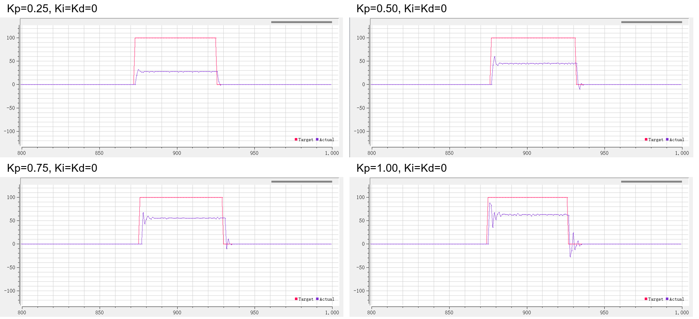
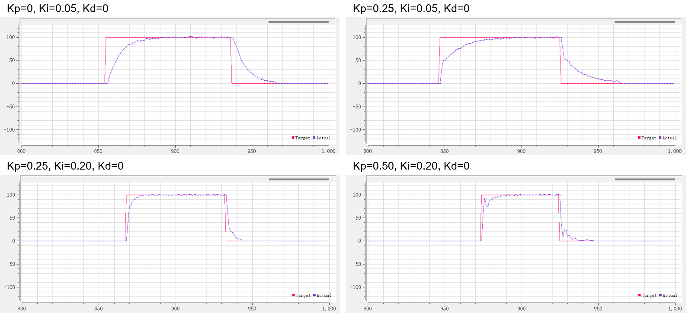

# 02 PID 基本原理

## 本章问题

目标、反馈和执行器组成闭环后，P、I、D 分别改变什么？调参时应该看哪些现象？

> 前置：先完成 [[00 从零复刻HAL工程]] 和 [[01 平台接线与HAL工程]]，确认 HAL 工程能编译、下载和观测传感器。

## 1. 闭环基本图


负反馈的符号必须先确认。电机正转后编码器反馈是正还是负，不能从变量名推断。

## 2. 三个作用

比例：

$$
u_P=K_Pe
$$

比例立即响应误差；`Kp` 增大通常响应更快，但更容易振荡。

积分：

$$
u_I(t)=K_I\int e(t)\,dt
$$

积分能减少持续偏差，但执行器饱和时会积累过多历史量。

微分：

$$
u_D(t)=K_D\frac{de(t)}{dt}
$$

微分提供阻尼，但会放大目标跳变和传感器噪声。

本课程代码使用的是离散系数形式：

$$
u_k=K_pe_k+K_iI_k+K_d(e_k-e_{k-1}),\qquad
I_k=I_{k-1}+e_k
$$

所以 `Ki`、`Kd` 是每个采样点的系数，不是可以脱离采样周期比较的连续参数。工程实现还会对 $I_k$ 做限幅（默认 ±500），见第 06 章。

## 3. 课程参考波形

下面的图是原课程演示，不是本工程 HAL 实测；横轴是样本序号，纵轴必须结合采样周期解释。





观察纯 P 时，固定机械和负载，只改变 `Kp`；观察 PI 时，固定 `Kp`，再改变 `Ki`。不要同时改电机电源、目标和采样周期。

## 4. 单位先于增益

本工程的典型单位：

| 量 | 单位 |
|---|---|
| 编码器速度 | count/40 ms，必须注明窗口 |
| 位置 | 编码器累计 count |
| 角度 | ADC 原始码 0～4095 |
| 输出 | 电机 PWM 百分点 -100～100 |

例如 `Kp=0.3` 的实际含义是"某个反馈单位对应多少 PWM 百分点"，脱离单位和周期没有可比性。40 ms 这个窗口来自控制节拍：TIM1 每 1 ms 计一次数，`app_config.h` 的 `APP_CONTROL_PERIOD_TICKS=40` 表示每 40 个节拍运行一次控制环。

## 与标准库教程的对应

标准库教程的"02 PID 基本原理"先讲 P、I、D，再进入定速实验。HAL 版把第一个闭环实验放在本章，但使用同一个 `User/Src/pid.c`，不重新生成 CubeMX 工程。

## 5. 可运行实验

### 实验 A：纯比例

**目标**：只观察比例项如何把误差变成电机输出，不引入积分和微分。

**只改这些位置**：

| 位置 | 改动 |
|---|---|
| `User/Inc/app_config.h` | `APP_SELECTED_DEMO` 改为 `APP_DEMO_SPEED` |
| `User/Src/app.c` 的 `init_controllers()` | `speed.kp = 0.20f`、`speed.ki = 0.0f`、`speed.kd = 0.0f`（工程当前默认是 `0.30/0.30/0`，对应 00 V1.1 综合程序的定速初值，实验 A 先清零 Ki/Kd） |
| `User/Inc/app_config.h` | 保持 `APP_SPEED_MIN_TARGET/MAX_TARGET` 的安全范围 |
| CubeMX | 不修改引脚、时钟和定时器 |

**接线与机械条件**：

- 使用转盘形态，拆下摆杆或断开摆杆负载；
- 电机回路先限流，底座夹紧；
- 先不接自动起摆状态机。

**逐步操作**：

1. 下载后让目标保持 0，按 K1 启动，再按 K1 停止一次，确认停止时 OLED 第 1 行显示 `STOP`、串口 `command` 为 0。
2. 用 RP1 缓慢给出一个小正目标，等 3 个 40 ms 控制窗口后再改成小负目标。
3. 依次只改 `Kp=0.10、0.20、0.30、0.40`，每次重新编译、下载、复位。
4. 每次记录目标、实际反馈、输出、是否饱和和机械是否继续转动。

**预期现象**：

- `Kp` 增大时，初始纠偏通常更快；
- 输出达到 ±100 后，继续增大 `Kp` 不能增加实际执行能力；
- 如果一加 `Kp` 就向错误方向运动，先停止，不要用负 `Kp` 掩盖反馈符号错误；
- P 只能消除正在变化的误差，摩擦或恒定负载下可能留下稳态残差。

**通过标准**：

- 正、负目标各完成一次；
- 四组 `Kp` 曲线有记录；
- 停止后输出为 0；
- 没有任何一次因方向错误而撞机或持续满输出。

### 实验 B：PI

在实验 A 的 P 参数已经能稳定响应后，只增加一个很小的 `Ki`，例如从 `0.01` 开始。保持 `Kp`、`Kd`、目标范围和机械条件不变。

重点观察：

- 持续摩擦下稳态残差是否减小；
- 目标切换时是否出现更大的超调；
- 输出饱和后积分是否继续积累，以及退出饱和时是否产生恢复迟缓。

如果残差没有改善，不要立即增大 `Ki`；先确认电机确实有静摩擦、目标单位正确、反馈没有丢失。积分策略的完整对照在 [[06 积分抗饱和]] 中进行。

### 统一记录表

每次实验至少填写一行：

| 模式 | 目标 | 实际 | 输出 | 采样窗口 | Kp/Ki/Kd | 是否饱和 | 现象 |
|---|---|---:|---:|---|---|---|---|
|  |  |  |  | 40 ms |  |  |  |

HAL 默认串口 CSV 为：

```text
demo,running,state,angle,target,actual,command,location
```

速度模式下 `actual` 是 PID 实际使用的上一个完整 40 ms 窗口计数值（不是正在累加的窗口）；位置模式是累计位置。CSV 没有自动输出 P/I/D 三项；需要观察它们时，在调试器中查看 `pid_result_t`，不要为了看曲线破坏控制周期。

### 回滚点

如果实验结果异常：

1. `Ki/Kd` 先恢复为 0；
2. `APP_SELECTED_DEMO` 恢复为 `APP_DEMO_OBSERVE`；
3. 复制本章开始前的工程快照；
4. 先重新确认编码器方向和单位，再恢复 P 实验。

## 新手操作卡

1. 完成第 00 章并保持 `APP_DEMO_OBSERVE` 可运行。
2. 复制当前工程为 `02_PID_Basic`，不要覆盖上一章。
3. 从配套工程补齐本章需要的文件：`User/Inc/control_types.h`、`pid.h`、`app_config.h` 和 `User/Src/pid.c`、`app.c`（速度环调度在这版 `app.c` 里，第 03 章逐行讲解），并在根 `CMakeLists.txt` 登记新增源文件。
4. 只修改 `User/Inc/app_config.h` 的模式为 `APP_DEMO_SPEED`，再修改 `User/Src/app.c` 中 `speed.kp/ki/kd`。
5. 先只改 `Kp`，每次重新编译、下载、复位、记录波形。
6. 本章不修改 CubeMX 引脚和时钟。

## 6. 验收

- [ ] 能解释负反馈方向；
- [ ] 能分别指出 P、I、D 对响应的影响；
- [ ] 能说明 `Ki/Kd` 的采样周期依赖；
- [ ] 不用"电机转/不转"代替波形验收；
- [ ] 记录了目标、反馈、输出和限幅。

## 排障

- 一加 `Kp` 就满输出：先查反馈方向和目标单位；
- P 能动但残差大：确认是否需要 I，以及执行器是否可达；
- 曲线抖动：先查编码器噪声、机械松动和采样周期；
- 目标跳变产生尖峰：进入 [[07 微分先行与滤波]]。

## 上一章 / 下一章

[[01 平台接线与HAL工程]] · [[03 离散PID与HAL调度]]
