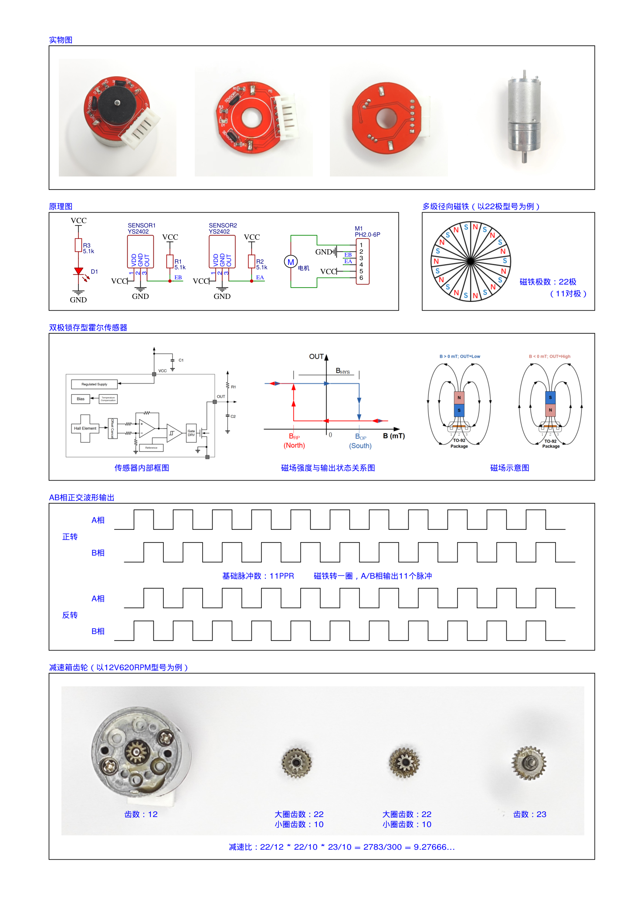

# 04 基础驱动与观测实验

## 本章问题

在不运行闭环时，如何确认每个 HAL 外设真的收到了正确信号？

> 前置：先完成 [[00 从零复刻HAL工程]]，保持 `APP_DEMO_OBSERVE`，电机电源先断开。
>
> 本章对应标准库教程的"01 基础驱动"实验；HAL 版把 OLED、按键、ADC、PWM、编码器和串口拆成 7 个独立验收项。

## 1. 实验原则

一次只打开一个现象：OLED、LED、按键、ADC、PWM、编码器、串口分别验收。电机实验先断开摆杆，底座夹紧。

## 2. GPIO、按键和 LED

`Core/Src/gpio.c` 初始化：

- PB12/PB13：电机方向，初始低；
- PB8/PB9：OLED 开漏并拉高；
- PB10/PB11/PA11/PA12：上拉输入；
- PC13：低电平点亮。

按键采用"每 20 ms 采样、松手产生事件"的非阻塞方式。不同按键的事件按位排队、互不覆盖；只有同一按键在两次采样之间完成"按下-松开"才会丢失事件，因此快速连按同一键时以松手时刻为准。

## 3. OLED

本工程沿用课程 OLED 软件 I²C 驱动，地址字节为 `0x78`（对应常见 7 位地址 `0x3C`）。驱动通过 `HAL_GPIO_WritePin()` 操作 PB8/PB9。

调用 `OLED_ShowString()`、`OLED_ShowSignedNum()` 后，驱动直接发送显示数据。

它没有独立的显存 `OLED_Update()` 步骤。

## 4. ADC

角度：

```text
PB0 → ADC1_IN8
ADC clock = PCLK2/6 = 12 MHz
12 bit right aligned
55.5 cycles
software trigger
```

旋钮：

```text
PA2/ADC2_IN2 → RP1
PA3/ADC2_IN3 → RP2
PA4/ADC2_IN4 → RP3
PA5/ADC2_IN5 → RP4
```

ADC2 采用逐通道单次转换。角度采集由 `BSP_StartAngleConversion()` 和 `BSP_ReadAngleIfReady()` 组成，避免在 TIM1 ISR 中阻塞。

旋钮 `BSP_ReadKnobs()` 在主循环使用有限超时。ADC 原始码不是角度；先记录端点、中心、盲区和顺逆时针方向。

## 5. PWM 和编码器

TIM2：

```text
PSC = 35, ARR = 99
f = 72 MHz / (36 × 100) = 20 kHz
```

TB6612 课程逻辑方向：

| 命令 | PB12/AIN1 | PB13/AIN2 |
|---|---|---|
| 正 | 低 | 高 |
| 负 | 高 | 低 |
| 滑行 | 低 | 低 |

TIM3 使用 TI12，CH1 Rising、CH2 Falling，输入滤波 15。`BSP_EncoderDelta()` 读取 16 位计数器，并用无符号差值转换为 `int16_t`。

这样可以避免"读后清零"的竞态；位置在应用层用 `int32_t` 累加。

课程资料给出输出轴约 408 count/圈，但本机必须手转一圈实测。



## 6. 串口观测

USART1 为 9600、8N1、无流控。先区分两个程序的实际协议：

- 00 V1.0/V1.1 综合测试程序的串口测试：K3 手动发送一个原始 `uint8_t`，OLED 的 `TxData:%02X` 只是显示，不是 ASCII CSV；
- 01～13 课程示例和配套 HAL 例程：主循环发送 ASCII/CSV 文本。

因此 00 串口工具应切换到 HEX 接收，HAL 串口工具使用 ASCII/CSV；不能把两种数据帧直接比较。

配套 HAL 例程每约 200 ms 发送：

```text
demo,running,state,angle,target,actual,command,location
```

发送在主循环，不能把 9600 波特率的阻塞发送放进 TIM1 控制中断。串口发送周期不等于控制周期。速度模式下 `actual` 是 PID 实际使用的上一个完整 40 ms 窗口值，不是实时累加值，详见第 05 章。

## 7. 分项实验

本章不修改 PID。一次只完成一项；每项通过后再打开下一项。默认保持 `APP_DEMO_OBSERVE`，摆杆拆下或电机电源断开。

### 7.1 OLED 和 LED

**操作**：下载后观察 OLED；用逻辑分析仪测 PB8/PB9。

**代码落点**：`User/Drivers/OLED/OLED.c` 的 `OLED_Init()`；`User/Src/app.c` 的 `draw_oled()`；`Core/Src/gpio.c` 的 PB8/PB9/PC13 初始化。

**预期现象**：

- OLED 第 1 行显示 `IP` 和 `STOP`，第 2 行模式与角度、第 3 行输出与目标、第 4 行位置 `L:`（驱动为 8x16 字体，只有 4 行 × 16 列）；
- PB8/PB9 出现软件 I²C 时序；
- PC13 初始为高，板载 LED 熄灭。

**通过标准**：屏幕稳定显示，重复复位后内容一致；没有明显花屏或 I²C 长时间拉低。

### 7.2 按键

**操作**：依次短按 K1、K2、K3、K4，每次只按一个键。

**代码落点**：`App_Tick1ms()` 的 `scan_keys()` 和 `handle_key_event()`。

**预期现象**：

- 按下时 GPIO 为低，松开恢复高；
- `APP_DEMO_OBSERVE` 下电机始终停止；
- K2/K3/K4 的现象与当前模式一致，不出现一次按键触发多个控制命令。

**通过标准**：每个按键动作可重复，松开后事件标志被清零。

### 7.3 四路旋钮 ADC

**操作**：保持电机停止，依次只旋转 RP1、RP2、RP3、RP4。

**代码落点**：`User/Src/bsp.c` 的 `BSP_ReadKnobs()`；`App_Process()` 每 20 ms 读取一次。

**预期现象**：OLED 和 CSV 都不直接显示旋钮原始值。把模式切到 `APP_DEMO_SPEED` 并按 K1 启动后，CSV 的 `target` 应随 RP1 变化（RP1 映射为目标）；其余三路旋钮要逐路观察时，把 `App_Process()` 里的 `knobs[4]` 改成 `static` 后在调试器中查看。四路范围均在 0～4095。

**失败现象**：四路同时变化或某一路永远不变时，先核对 PA2～PA5、ADC2 通道顺序和共地，不要先调 PID。

### 7.4 角度 ADC

**操作**：电机断开，双手缓慢改变 G1 角度；先在盲区外观察，再靠近盲区边缘。

**代码落点**：`BSP_StartAngleConversion()`、`BSP_ReadAngleIfReady()`；控制读取在 `App_Tick1ms()`。

**预期现象**：角度码随机械角度连续变化；进入盲区时可能跳到 0 或 4095，离开盲区后恢复。

**通过标准**：直立附近存在连续有效区间，并记录盲区两侧、中心码和顺逆方向。

### 7.5 开环 PWM 和电机方向

本例程没有单独的固定 PWM 模式。需要测试 `±10/±20` 时，在调试器中暂停 CPU（Halt）后调用 `BSP_MotorSet(10)`、`BSP_MotorSet(-10)`，观察后立即调用 `BSP_MotorStop()`。

不要从 TIM1 ISR 中调用函数；没有调试器时，先用小目标完成方向确认，再跳过本项。

**代码落点**：`BSP_MotorSet()`、`User/Drivers/TB6612/tb6612.c`；TIM2 参数由 CubeMX 生成。

**预期现象**：正 PWM 和负 PWM 对应相反机械方向；PWM=0 时方向脚进入滑行。

**通过标准**：方向、符号和机械安全均记录；不使用闭环，不在摆杆连接状态下测试。

### 7.6 编码器

**操作**：先记录静止时计数；手动向一个方向转一圈，再向相反方向转一圈。

**代码落点**：`BSP_EncoderDelta()` 和 `app_location`。

**预期现象**：两个方向产生相反的增量；位置连续累加，不因 16 位计数器回绕而跳变。

**通过标准**：本机每圈 count、正方向和采样窗口均已记录；课程 408 count/圈只能作为参考。

### 7.7 串口和时序

**操作**：打开 9600 8N1 串口工具；在调试器中观察 `app_ticks` 和各个分频点。逻辑分析仪只测 PA0 的 PWM。

**代码落点**：`App_Process()` 的 `send_serial()`；TIM1 中断链和 TIM2 PWM 由 CubeMX 生成。

**预期现象**：

- 每约 200 ms 收到一行 CSV；
- 字段顺序为 `demo,running,state,angle,target,actual,command,location`；
- TIM1 为 1 ms，PA0 PWM 约 20 kHz。

**通过标准**：串口没有乱码，控制 ISR 不被 OLED/串口发送拖延。

## 新手操作卡

1. 从第 00 章复制一个新工程，保持 `APP_DEMO_OBSERVE`。
2. 不修改 PID；按 OLED、LED、按键、ADC、PWM、编码器、串口的顺序逐项测试。
3. 每一项通过后再进入下一项，失败时只查当前外设。
4. 记录 PB8/PB9、PB12/PB13、PA0、PA6/PA7、PB0、PA2～PA5 的实际波形。
5. 基础观测全部通过后，复制工程进入第 05 章。

## 8. 验收

- [ ] 四路 ADC 范围合理；
- [ ] 正 PWM、编码器符号和电机机械方向已定义；
- [ ] 角度中心附近没有盲区跳变；
- [ ] PWM 频率约为 20 kHz；
- [ ] 串口 9600 8N1 帧完整；
- [ ] OLED 和串口更新不会阻塞控制中断。

## 排障

| 现象 | 优先检查 |
|---|---|
| PB8/PB9 无波形 | GPIO 是否开漏、外部上拉、OLED 供电 |
| PA0 无 PWM | `HAL_TIM_PWM_Start()` 是否调用 |
| 编码器反向 | CH2 Falling、EA/EB 相位、电机线序 |
| ADC 永远 0/4095 | 传感器盲区、引脚、ADC 校准和采样时间 |
| 串口乱码 | 波特率、TX/RX 交叉、共地和帧结束符 |

## 上一章 / 下一章

[[03 离散PID与HAL调度]] · [[05 四种单环控制实验]]
